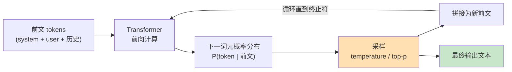
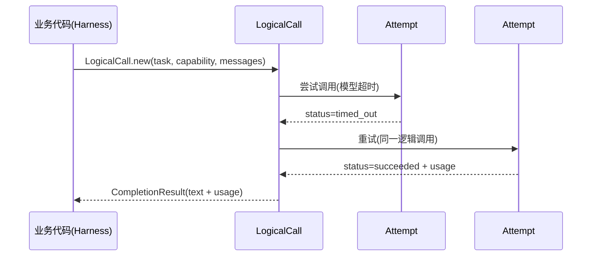

# 01 LLM 心智模型：从训推机理理解大模型

> **本课定位**：本课是全课程的第一块地基。要驾驭企业级 Agent，先要建立对 LLM 的**底层心智模型**——它不是数据库，不是搜索引擎，而是一个"基于上下文做下一词元概率分布"的自回归函数。这个心智模型决定了后面 41 讲的每一个工程决策：为什么必须契约化、为什么输出要校验、为什么记忆不能信、为什么评测必须离线可复现。学完本课，你能对任何一个"模型表现不符合预期"的问题，快速判断它是概率本性、上下文问题还是工程缺陷。
> **教学目标**：①能画出 LLM 自回归生成的心智模型图并说出三个工程推论；②能解释 LogicalCall 与 Attempt 的关系；③能用 FakeLlmClient 完成故障注入实验；④能说出"说做了≠做了"的三条工程对策。
> **前置**：无
> **产出**：可运行的模型调用心智实验 × 3（含故障注入）
> **对应代码**：`dataagent/src/dataagent/contracts/model.py`、`dataagent/src/dataagent/adapters/llm/fake_client.py`
> **对应测试**：`dataagent/tests/unit/test_contracts_domain.py`

---

## 0. 本课要用到的环境

| 组件 | 版本 / 取值 | 说明 |
|---|---|---|
| Python | ≥ 3.10 | 仓库内核兼容 3.10+ |
| 仓库位置 | `D:\projects\企业级Agent工程架构` | 下称"仓库根" |
| 运行方式 | 全程离线，`FakeLlmClient` 可编程假模型 | 无需任何 API Key |
| 验证命令 | `PYTHONPATH=src python -m pytest tests/unit/test_contracts_domain.py -v` | 在 `dataagent/` 目录执行 |

```bash
cd dataagent
# Windows PowerShell:
$env:PYTHONPATH="src"; python -m pytest tests/unit/test_contracts_domain.py -v
# Linux/macOS:
PYTHONPATH=src python -m pytest tests/unit/test_contracts_domain.py -v
```

---

## 1. 问题场景（为什么要建立心智模型）

某零售企业的数据团队给 Agent 提了一个需求："把华东区 GMV 下滑的原因查清楚"。

团队里出现了三种典型误解：

1. **把模型当数据库**："问它订单数，它应该去查表。"——错。模型默认只会生成**像答案的文本**，不会自己访问任何系统。
2. **把模型当确定性函数**："同样的输入为什么两次回答不一样？"——因为解码是**采样**自概率分布，温度 > 0 时同一输入可产生不同输出。
3. **把模型当员工**："它说了'已完成分析'，那就是分析完了。"——错。模型生成"已完成"三个字**不等于**系统里真的发生了任何事。**完成判据必须挂在可观测事实上**（这条原则会在第五篇的 Verifier、第九篇的 Code Grader 中反复出现）。

三种误解的共同根因：没有建立"概率生成器"的心智模型。工程上的对策不是"更好的提示词"，而是**用契约把概率生成关进确定性工程的笼子里**——这正是本课程 42 讲的主线。

---

## 2. 概念与机制

### 2.1 模型的本质：条件概率链

LLM 生成文本的本质是循环执行"给定前文，预测下一词元的概率分布，采样一个，拼回前文"：



三个直接的工程推论：

| 推论 | 为什么 | 对应工程手段 |
|---|---|---|
| 输出不可全信 | 概率采样可能生成"合理但不真实"的内容 | 结构化输出 + Schema 校验（第四篇） |
| 上下文决定一切 | 条件分布完全由前文决定 | Context Runtime 与预算分区（第六篇） |
| "说做了"≠"做了" | 文本只是采样结果 | 完成判据挂可观测事实（第五/九篇） |

### 2.2 契约层：把模型调用建模为稳定对象

本仓库把"一次模型调用"建模为两个数据对象（`contracts/model.py`）：

- `LogicalCall`：一次**逻辑调用**——稳定的执行对象，携带 task、messages、deadline、attempts；
- `Attempt`：一次**物理尝试**——LogicalCall 内部可重试多次，每次尝试记录状态/耗时/错误/用量。



"逻辑调用 ≠ 物理尝试"是第四篇可靠执行的种子：**一次成功 = 至少一个 Attempt 成功**，重试、回退、成本统计全部挂在 Attempt 粒度上。

### 2.3 假模型：离线可运行的关键

真实模型不可离线、不可复现、不可注入故障。本仓库的 `FakeLlmClient` 用**可编程假模型**解决：

```python
# dataagent/src/dataagent/adapters/llm/fake_client.py（节选）
class FakeLlmClient(LlmClient):
    def complete(self, capability, messages, *, temperature=0.0, max_tokens=None):
        self.call_count += 1
        if self.fail_times > 0:            # 故障注入：前 N 次必失败
            self.fail_times -= 1
            raise LlmError(self.fail_error, retryable=True)
        ...
```

关键设计：`FakeLlmClient` 与真实模型**实现同一个 `LlmClient` 协议**。上层业务（Harness、Workflow、Router）只依赖协议，不感知真假——这就是"接入真实模型只需换一个 Adapter"的结构保证。

---

## 3. 动手实验

### 实验 1：观察"逻辑调用 → 多次尝试"的生命周期

```bash
cd dataagent
$env:PYTHONPATH="src"
python -c "
from dataagent.contracts.model import LogicalCall, Message, ModelCapability, Role
cap = ModelCapability(model='demo')
call = LogicalCall.new(task='planning', capability=cap,
    messages=[Message(role=Role.USER, content='规划')])
print('call_id =', call.call_id)
print('初始状态 =', call.status.value)
print('deadline =', call.deadline > 0)
"
```

**预期输出**（call_id 随机）：

```text
call_id = call_a1b2c3d4e5f6
初始状态 = pending
deadline = True
```

**判定通过**：`LogicalCall.new()` 自动生成 call_id、初始 `pending`、默认 deadline 为 60 秒后。

### 实验 2：故障注入 —— 前两次失败后恢复

```bash
python -c "
from dataagent.adapters.llm.fake_client import FakeLlmClient
from dataagent.contracts.model import Message, ModelCapability, Role, Usage
from dataagent.infra.gateway.llm_runtime import LlmError

cap = ModelCapability(model='demo')
msgs = [Message(role=Role.USER, content='你好')]
c = FakeLlmClient(fail_times=2)
try:
    c.complete(cap, msgs)
except LlmError as e:
    print('第1次调用:', e)
try:
    c.complete(cap, msgs)
except LlmError as e:
    print('第2次调用:', e)
r = c.complete(cap, msgs)
print('第3次调用成功, text =', r.text[:20], '...')
print('call_count =', c.call_count)
"
```

**预期输出**：

```text
第1次调用: Simulated upstream failure
第2次调用: Simulated upstream failure
第3次调用成功, text = 基于查询结果，GMV 下滑主要来自华东区转化 ...
call_count = 3
```

**判定通过**：前两次抛 `LlmError`（retryable=True），第三次成功；`call_count=3` 说明每次物理调用都被计数。

### 实验 3：跑通契约层测试套件

```bash
python -m pytest tests/unit/test_contracts_domain.py -v
```

**预期输出**（节选）：

```text
tests/unit/test_contracts_domain.py::TestLogicalCall::test_new_sets_defaults PASSED
tests/unit/test_contracts_domain.py::TestLogicalCall::test_attempts_grow PASSED
tests/unit/test_contracts_domain.py::TestMetricAlias::test_alias_mapping PASSED
... 11 passed
```

---

## 4. 代码走读

### 4.1 `contracts/model.py` — Message 与 Role

```python
@dataclass(frozen=True)
class Message:
    role: Role
    content: str = ""
    name: Optional[str] = None
    tool_call_id: Optional[str] = None
    tool_calls: Optional[Sequence["ToolCall"]] = None
```

**设计意图**：`frozen=True` 让消息不可变——消息一旦进入上下文就不允许被半路篡改，这是第六篇"上下文可信"的第一道防线。

**反面写法**：如果 `Message` 可变，任何中间层都可能在传递途中"顺手"改写用户输入，等排查"模型为什么这么答"时，上下文早已失真且无据可查。

### 4.2 `contracts/model.py` — ModelCapability 能力契约

```python
@dataclass(frozen=True)
class ModelCapability:
    model: str
    supports_tool_calling: bool = True
    supports_structured_output: bool = True
    max_context_tokens: int = 128000
    cost_per_1k_input: float = 0.0
    latency_p50_ms: float = 0.0
    provider: str = "mock"
```

**设计意图**：能力契约把"模型能干什么、多贵、多快"从口口相传变成**可路由判定的数据**。第四篇的多模型路由（第 12 课）完全构建在这份契约之上。

### 4.3 `fake_client.py` — 为什么故障注入要放在 Adapter 层

```python
if self.fail_times > 0:
    self.fail_times -= 1
    raise LlmError(self.fail_error, retryable=True)
```

**设计意图**：故障注入点选在"最接近真实故障发生的位置"——网络/上游层面。这样重试逻辑（第四篇）、预算扣减、事件记录都会被真实触发，测试的保真度远高于"mock 掉整个 executor"。

**反面写法**：在 Harness 里 `if test_mode: skip_llm`。这种"测试专用分支"会永久污染业务代码，而且跳过了重试路径——恰恰是最需要测试的路径反而测不到。

---

## 5. 常见错误与 Badcase

| # | 错误现象 | 根因 | 正确做法 |
|---|---|---|---|
| 1 | 断言"模型返回了'已完成'，所以分析完成了" | 把文本采样当执行事实 | 用 `run.status == SUCCEEDED` + 事件流验证（见第 17 课） |
| 2 | 同一 Prompt 两次调用结果不同，怀疑"模型有 bug" | 采样随机性是设计行为 | 评测用确定性假模型（`FakeLlmClient` 无随机源）；真实模型设 temperature=0 也只降低不消除 |
| 3 | 直接 import OpenAI SDK 写在业务代码里 | 业务代码耦合具体 SDK | 业务只依赖 `LlmClient` 协议，SDK 藏在 Adapter（见 `adapters/llm/`） |
| 4 | 结构化输出直接 `json.loads` 后就往下传 | 未校验 Schema | `ReliableExecutor._validate_structured` 强制校验（第 13 课） |

---

## 6. 验收

```bash
cd dataagent
$env:PYTHONPATH="src"
# 1) 契约层测试 12 例全过
python -m pytest tests/unit/test_contracts_domain.py -q      # 期望: 12 passed
# 2) 故障注入实验输出与第 3 节一致（call_count=3）
# 3) 端到端演示可运行
python ../scripts/demo.py                                     # 期望: ✅ 全部演示离线运行成功
```

三条全部满足即通过本课。

---

## 7. 思辨与讨论

1. **"假模型测试算不算真测试？"** 我们的立场：算，而且是**高价值测试**。`FakeLlmClient` 测的是"系统如何响应模型的各类行为（成功/故障/结构化）"，这恰恰是与模型智能无关的**工程正确性**。真正的模型质量交给第九篇的 EvalOps 离线评测，而不是靠每次跑测试烧 token。
2. **"既然输出是概率的，企业级系统怎么可能确定？"** 确定性不是来自模型，而是来自**边界**：入口契约化（结构化输出+校验）、出口可观测（事件流+完成判据）、失败可恢复（重试+回退）。模型在笼子里可以自由发挥，笼子本身必须是确定性的。

---

## 8. 延伸与引用

- GB/T 8567-2006《计算机软件文档编制规范》——本文档系列的结构依据
- ISO/IEC/IEEE 42010:2011《系统和软件工程 — 架构描述》——逻辑/物理分层描述的国际依据
- 本仓库 `docs/00-TOGAF架构总览.md`——本课内容在 TOGAF 四阶段中的位置

---

## 9. 本课遗留问题

- `FakeLlmClient` 的默认文本（`_default_text`）只覆盖"规划/指标确认/通用结论"三类话术，课程演示够用，但不能模拟长尾的复杂模型行为（如拒答、多轮工具调用链）——登记为后续增强项，见第 20 课故障工程的扩展。
- `Usage.input_cost` 目前是 `prompt_tokens / 1000` 的占位口径（未乘单价），真实成本归集需接入 `ModelCapability.cost_per_1k_*`——已在第 14 课模型治理中登记。
