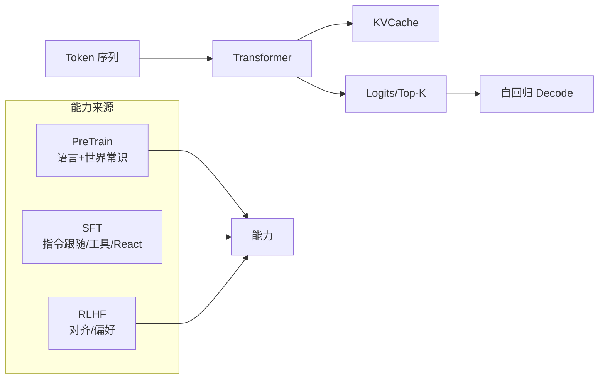

# 01 从训推机理理解 LLM：建立 AI Agent 开发的底层心智模型

> 所属篇：第一篇（AI 核心认知篇）｜ 对应代码：`dataagent/src/dataagent/contracts/model.py`

---

## 本章导语

工程师往往把 LLM 当"黑盒 API"调用。本章从**训练数据 Schema** 与**推理机制**两个视角，拆开黑盒，
建立三个能做架构判断的底层心智：模型的能力边界、行为偏好、以及"哪些靠模型、哪些必须靠 Contract/Tool/Workflow 补齐"。

## 教学目标

- 掌握 Token/Tokenizer/Prompt/Reasoning 等 Agent 设计师必须内化的基本元素。
- 从 PreTrain / SFT / RLHF 理解模型"会什么、偏好什么、代价多大"。
- 理解自回归生成：prefill、decode、kvcache 对推理效率与成本的影响。
- 建立"模型负责不确定性、系统负责确定性"的职责边界。

## 心智模型图



## 核心概念拆解

| 概念 | 是什么 | 对 Agent 工程的启示 |
|------|--------|--------------------|
| Token / Tokenizer | 文本被切成子词单元 | 计费与窗口都以 token 计，估算成本 |
| Prompt | 输入序列 | 决定模型看到的上下文，但不等于全部上下文工程 |
| Prefill | 一次性处理输入 | 首 token 延迟的主要成本 |
| Decode | 逐个生成 token | 输出越长越贵越慢 |
| KVCache | 缓存历史注意力键值 | 长对话内存/成本成关键 |
| Logits 采样 | Top-k/Top-p/Temperature | 控制随机性，评测需固定 seed |
| Reasoning | 思维/慢思考 | 可能与"确定性输出"冲突，需权衡 |

## 关键代码（可运行，指向 dataagent 模块）

`contracts/model.py` 的 `ModelCapability` 是把"模型能力认知"工程化的载体——先声明能力契约，路由才能做决策：

```python
from dataagent.contracts.model import ModelCapability
cap = ModelCapability(
    model="luna",
    supports_tool_calling=True, supports_structured_output=True,
    supports_reasoning=False,
    max_context_tokens=128000, cost_per_1k_input=0.3,
)
```

## 架构 / 时序 / 状态机图

一次完整推理的"生命周期"被建模为 `LogicalCall`（含多个 `Attempt`），这正是"把不稳定模型放大为稳定工程对象"：

```python
from dataagent.contracts.model import LogicalCall, Message, Role
call = LogicalCall.new("planning", cap, [Message(role=Role.USER, content="分析计划")])
# call.attempts 记录了每次外部请求；输出可校验、可追踪
```

## 候选方案 × 取舍矩阵

| 能力 | 交给模型 | 必须交给系统 | 依据 |
|------|---------|-------------|------|
| 语言/推理 | ✓ | | 常识库 |
| 精确指标计算 | | ✓ | 模型易算错 |
| 权限判定 | | ✓ | 模型不可信 |
| 工具参数 | 生成 | 校验 | 结构化输出+validate |
| 财务副作用 | | ✓(审批) | 风险 |

## 思考题与实战作业

1. 为什么"模型调用成功"不等于"任务成功"？试举一例。
2. 打开 `dataagent/tests/unit/test_llm_runtime.py`，跑通 `TestReliableExecution`。
3. 为一个真实模型（如 DeepSeek/OpenAI）填写一个 `ModelCapability`，说明其能力边界。