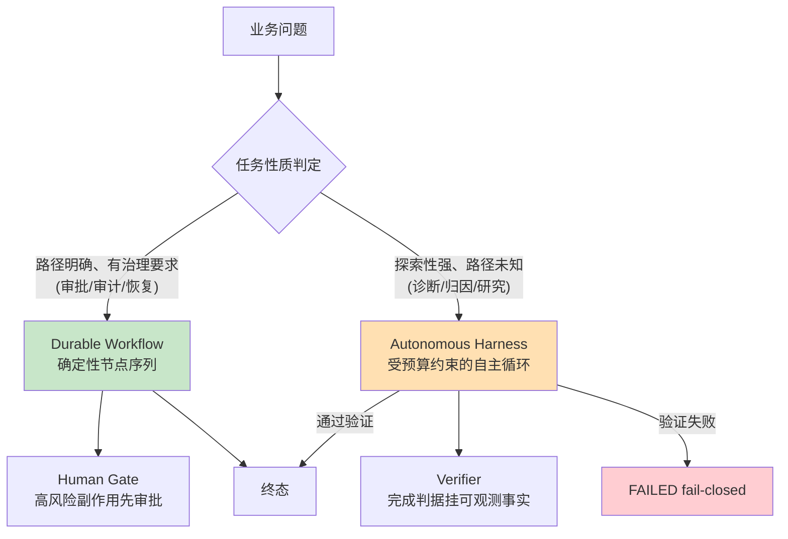
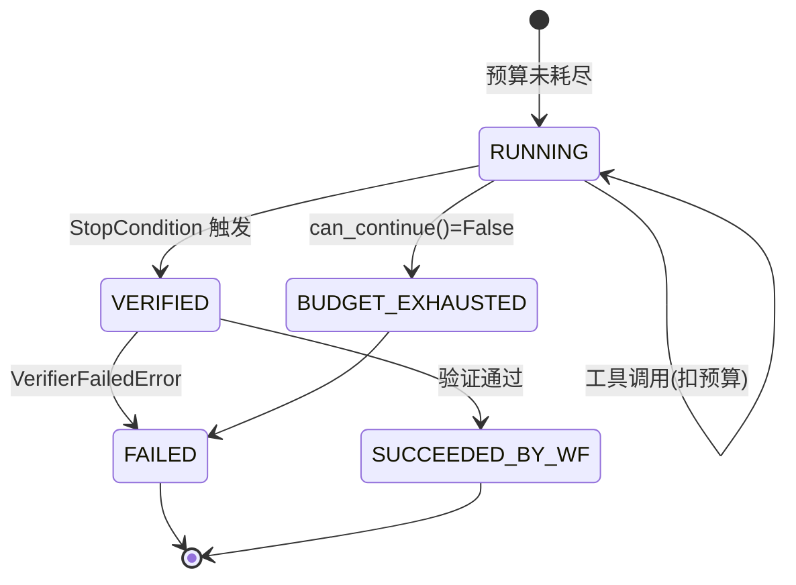

# 02 Agent 范式：从 Autonomous 到 Workflow 的混合架构

> **本课定位**：本课解决"Agent 系统该用什么执行范式"这个第一性问题。核心结论：**Autonomous 与 Workflow 不是二选一，而是分工**——开放性探索交给 Harness（自主循环），确定性治理交给 Workflow（可中断、可审批、可恢复）。学完本课，你能为一个业务任务正确选型执行范式，并理解本仓库 `Harness` 与 `DurableWorkflowExecutor` 的分工边界。
> **教学目标**：①能为一个业务任务做范式选型并给出理由；②能说出 Harness 三个治理件的作用；③能解释"终态归 Workflow 所有"的纪律及其 Badcase 来源；④能跑通混合范式的端到端轨迹。
> **前置**：第 01 课（LogicalCall/Attempt 心智模型）
> **产出**：两种范式的对照实验 × 2 + 范式选型矩阵
> **对应代码**：`dataagent/src/dataagent/infra/runtime/harness.py`、`dataagent/src/dataagent/infra/runtime/workflow.py`
> **对应测试**：`dataagent/tests/integration/test_integration.py`、`dataagent/tests/unit/test_state_machine.py`

---

## 0. 本课要用到的环境

| 组件 | 版本 / 取值 | 说明 |
|---|---|---|
| 仓库 | 本仓库根目录 | 全程离线 |
| 核心模块 | `dataagent/infra/runtime/harness.py`（自主范式） | AutonomyBudget/Verifier/StopCondition |
| 核心模块 | `dataagent/infra/runtime/workflow.py`（工作流范式） | 节点图 + 检查点 + 审批门 |
| 验证命令 | `python -m pytest tests/integration/test_integration.py -v` | 在 `dataagent/` 目录执行 |

---

## 1. 问题场景

同一个业务诉求——"诊断华东区 GMV 下滑并给出建议"——在两种极端实现下都会翻车：

**纯 Workflow 实现**（固定管道）：写死 `查询 → 聚合 → 输出` 三步。某天运营问"退款率异常也帮我看看"，发现管道里没有退款分支，改代码、发版、回归测试，一周后上线。业务问："为什么加个分析维度要一周？"

**纯 Autonomous 实现**（while 循环 + 工具）：把问题丢给模型，让它自己决定调什么工具、循环到"自认为完成"。结果：某次运行里模型把同一个指标查了 14 遍（没人拦），另一次运行它"宣布完成"但根本没查数据（没人验）。每跑一次都是开盲盒。

两种翻车的根因不同：前者把**开放性问题**塞进了**封闭结构**；后者把**治理要求**（预算、验证、审批）交给了**概率采样**。正确答案是把两者组合：



本仓库的 `DataAgentContainer.analyze()` 就是混合范式：**Durable Workflow 包裹 Autonomous Harness**——workflow 提供节点编排/检查点/审批门，其中 `autonomous_analysis` 节点内部由 Harness 自主探索。

---

## 2. 概念与机制

### 2.1 Autonomous Harness 的三个治理件

`harness.py` 的自主循环不是裸 while，而是由三个治理件包裹：

| 治理件 | 回答的问题 | 本仓库实现 |
|---|---|---|
| **AutonomyBudget** | "最多允许它跑多少？" | max_steps / max_tokens / max_tool_calls 三维硬上限 |
| **Verifier** | "结果可信吗？" | 可注入规则校验；失败抛 `VerifierFailedError` |
| **StopCondition** | "什么时候停？" | 结论步 + 验证通过才停 |



注意：本仓库重构后（第 17 课详述），**Harness 不写 Run 终态**——它只消费预算、写 Step/Event，终态归 Workflow 所有。这是"子流程不得与外层争夺终态"的纪律。

### 2.2 Workflow 的四类节点

`workflow.py` 的 `WorkflowNode.kind` 支持四种：

| kind | 语义 | 本仓库实例 |
|---|---|---|
| `task` | 确定性代码 | `verifier` 节点 |
| `verifier` | 独立验证 | 同上（fn 校验） |
| `human_gate` | 人工审批门 | `budget_adjust`（高风险副作用先审批） |
| `harness` | 自主子流程 | `autonomous_analysis` |

### 2.3 范式选型矩阵（本课核心产出）

| 判定维度 | 选 Workflow | 选 Harness | 选混合 |
|---|---|---|---|
| 路径是否可预先枚举 | 完全可枚举 | 完全不可 | 部分可 |
| 是否涉及副作用/审批 | 是 | 否 | 副作用部分是 |
| 失败后是否需要断点恢复 | 强需求 | 弱需求 | 强需求 |
| 步数是否可控 | 固定 | 不可控 | 外层固定内层有预算 |
| 可审计要求 | 每步审计 | 只审终态 | 全链路审计 |
| **DataAgent 的选择** | — | — | **✅ Workflow 包 Harness** |

---

## 3. 动手实验

### 实验 1：观察混合范式的完整执行轨迹

```bash
cd dataagent
$env:PYTHONPATH="src"
python ../scripts/demo.py
```

**预期输出**（节选，run_id 随机）：

```text
[1] 经营诊断链路
   Run=run_48b1d341ba  状态=succeeded
   - autonomous_analysis    [succeeded] {}          <- harness 节点(自主)
   - plan                   [succeeded] {'plan': '1. 确认指标口径...'}
   - query                  [succeeded] {}
   - analyze                [succeeded] {}
   - conclusion             [succeeded] {'conclusion': '基于查询结果...'}
   - verifier               [succeeded] {'verified': True}  <- task 节点
   - budget_adjust          [succeeded] {'approved': True, ...}  <- human_gate
   事件流长度=15  (可回放/可审计)
```

**判定通过**：能看到 harness 子流程（plan/query/analyze/conclusion 四步）+ verifier 任务节点 + budget_adjust 审批门依次执行，事件流 15 条。

### 实验 2：预算耗尽 = 硬性停止

```bash
python -c "
from dataagent.infra.runtime.harness import AutonomyBudget
b = AutonomyBudget(max_steps=2, max_tokens=20000, max_tool_calls=12)
b.spend_step(); b.spend_step()
print('steps=2, can_continue =', b.can_continue())   # False
b.tokens = 99999
b2 = AutonomyBudget()
b2.spend_tokens(20000)
print('tokens=20000, can_continue =', b2.can_continue())  # False
"
```

**预期输出**：

```text
steps=2, can_continue = False
tokens=20000, can_continue = False
```

**判定通过**：任一维度触顶即硬停，与模型"想不想继续"无关。

### 实验 3：审批门（human_gate）真实介入

```bash
python -m pytest tests/integration/test_integration.py::TestApprovalFlow::test_human_approval_gate_in_workflow -v
```

**预期输出**：

```text
tests/integration/test_integration.py::TestApprovalFlow::test_human_approval_gate_in_workflow PASSED
```

该测试将审批端口置为 `auto_approve=False`，验证 `approval_requested` 事件真实产生——即"高风险动作先请求授权"不是摆设。

---

## 4. 代码走读

### 4.1 `harness.py` — AutonomyBudget 的消费入口

```python
class AutonomyBudget:
    def can_continue(self) -> bool:
        return (self.steps < self.max_steps
                and self.tokens < self.max_tokens
                and self.tool_calls < self.max_tool_calls)

    def spend_step(self) -> None:
        """消费 1 步预算（唯一合法入口）。"""
        self.steps += 1
```

**设计意图**：注释里写明"唯一合法入口"——直接改 `budget.steps` 字段会绕过上限检查语义，Code Review 应拦截。这是"预算只能经方法消费"的纪律（本课重构时补的方法，替代原裸字段累加）。

### 4.2 `harness.py` — Verifier 失败的节点级语义

```python
if verifier_ok:
    run.add_event(EventType.EVAL, data={"verifier_ok": True})
else:
    s.status = StepStatus.FAILED
    s.error = f"verifier: {verr}"
    run.add_event(EventType.STEP_FAILED, step_id=s.step_id, data={"reason": verr})
    raise VerifierFailedError(verr)
```

**设计意图**：验证失败作为**节点级异常**抛出，由 Workflow 的统一异常路径把 Run 落 FAILED。"带病成功"在本仓库是结构性不可能——这正是第 01 课"完成判据挂可观测事实"的落地。

**反面写法**：verifier 失败仍设 `run.status = SUCCEEDED` 只在 metadata 里记 `verifier_ok=False`。这个标志位没人会读，等于没有。

### 4.3 `workflow.py` — harness 节点的调用方式

```python
if node.kind == "harness" and self.harness_runner is not None:
    run = self.harness_runner(run, {"node": node.name})
```

**设计意图**：Workflow 通过 `harness_runner` 回调持有 Harness，二者**依赖倒置**——workflow 不知道 harness 的内部步骤，harness 不知道自己在 workflow 里。容器装配（`container.py`）时才把它们接起来：

```python
self.workflow = DurableWorkflowExecutor(
    ...,
    harness_runner=lambda run, ctx: self.harness.run(run, "ten_a"),
)
```

---

## 5. 常见错误与 Badcase

| # | 错误现象 | 根因 | 正确做法 |
|---|---|---|---|
| 1 | Harness 跑完设 `run.status=SUCCEEDED`，后续审批门再改状态时抛 `InvalidStateTransition` | 子流程越权终结了 Run | 终态归 Workflow 所有，Harness 只写 Step/Event（本仓库已修复的真实缺陷） |
| 2 | 审批通过后从 `WAITING_APPROVAL` 直接跳 `SUCCEEDED` | 挂起态被当成通往终态的旁路 | 恢复必须显式回 `RUNNING`（本仓库已修复的真实缺陷，见 `test_state_machine.py::test_waiting_approval_resume_requires_running`） |
| 3 | Autonomous 循环不设预算，模型重复调工具几十次 | 裸 while 无上限 | `AutonomyBudget` 三维硬上限 |
| 4 | 给"查询类"只读步骤也加审批门 | 治理粒度错位 | 只对 `HIGH` 风险副作用设 human_gate，只读工具直接放行 |

---

## 6. 验收

```bash
cd dataagent
$env:PYTHONPATH="src"
python -m pytest tests/integration/test_integration.py -q        # 期望: 8 passed
python -m pytest tests/unit/test_state_machine.py -q             # 期望: 12 passed
python ../scripts/demo.py                                        # 期望: ✅ 全部演示离线运行成功
```

---

## 7. 思辨与讨论

1. **"Workflow 会不会让 Agent 变笨？"** 恰恰相反。本仓库的设计里，workflow 固定的是**治理框架**（哪些节点、何处审批、如何恢复），harness 在框架内保持**探索自由**。就像公司在财务流程上强管控，但不干涉分析师用什么方法做归因。
2. **"什么信号说明该从纯 Workflow 迁移到混合范式？"** 当你发现自己在 workflow 里为"步骤可能失败后换个方式重试"写第三个条件分支时，这一块逻辑就该下沉为 harness 子节点了——分支爆炸是范式错配的信号。

---

## 8. 延伸与引用

- ISO/IEC/IEEE 42010:2011 第 4.3 条——架构视图与关注点分离（范式选型属于架构视图）
- 本仓库 `docs/02-架构决策记录-ADR.md`——范式选型的决策记录
- 第 15 课《Runtime 架构选型》——本课结论在 Runtime 层的展开

---

## 9. 本课遗留问题

- `StopCondition` 当前只有 `conclusion` 计数一种停止语义，未接入"用户中断"信号——登记为第五篇第 19 课分布式 Runtime 的一部分。
- 范式选型矩阵尚未接入自动化判定（目前是人工对照）—— honest gap，作为第 10 课立项的 SDD 输入。
