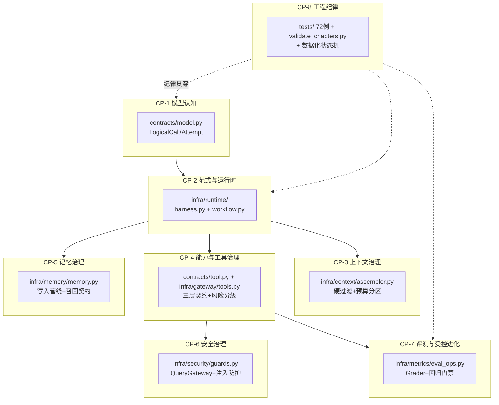
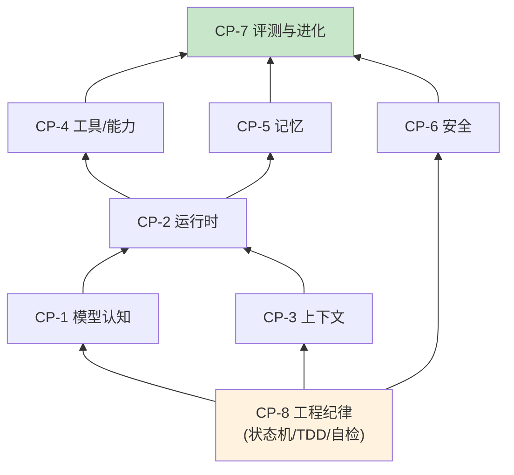

# 03 能力模型：拆解 AI Agent 工程师的核心能力

> **本课定位**：本课把"AI Agent 工程师"这个岗位拆解为可训练、可验收的能力模型。拆解的依据不是岗位 JD 的形容词，而是**本仓库代码的结构本身**——每一个核心模块对应一项能力，每一项能力对应一组可运行的测试。学完本课，你能给自己定位能力坐标，并知道每一项能力在本课程的哪几讲中训练。
> **教学目标**：①能说出八项能力与本仓库代码对象的映射；②能按"缺口读法"完成能力自评；③能用测试套件定位自己的能力缺口；④能解释 CP-8 为什么是地基。
> **前置**：第 01-02 课（心智模型与范式）
> **产出**：八项能力 × 代码对象 × 测试用例 的对照表 + 自评
> **对应代码**：全仓库（本课是导览课）
> **对应测试**：`dataagent/tests/` 全部 277 例

---

## 0. 本课要用到的环境

| 组件 | 取值 | 说明 |
|---|---|---|
| 仓库 | 本仓库根 | 全程离线 |
| 能力验收方式 | `PYTHONPATH=src python -m pytest -q` | 期望 244 passed + 5 skipped |
| 教学资料 | `chapters/` 42 讲 + `scripts/validate_chapters.py` 自检 | 资料本身也是能力训练场 |

---

## 1. 问题场景

"我们会用 LangChain 算会 Agent 吗？"——这个问题的错误在于把**工具熟练度**当成了**能力**。工具三个月换一茬（LangChain → LlamaIndex → AutoGen → …），而以下八项能力跨框架稳定存在。更关键的问题是：**能力如何验收？**"了解 RAG"无法验收，"`MemoryRecall.recall()` 必须按租户+权限+时效过滤后返回 (命中, 过滤原因) 二元组"可以验收。

本课的立场：**能力必须绑定到代码对象与测试用例**，否则就是简历词汇。

---

## 2. 概念与机制

### 2.1 八项能力 × 本仓库代码对照



| 能力 | 定义 | 代码对象 | 验收测试 | 训练讲次 |
|---|---|---|---|---|
| CP-1 模型认知 | 理解概率生成与调用生命周期 | `contracts/model.py` | `test_contracts_domain.py` 11 例 | 01 |
| CP-2 范式与运行时 | 范式选型 + 统一执行模型 | `harness.py`/`workflow.py`/`contracts/runtime.py` | `test_state_machine.py` 12 例 | 02, 15–20 |
| CP-3 上下文治理 | 最小充分、可信可控的上下文 | `assembler.py` | `test_context.py` 8 例 | 21–26 |
| CP-4 能力与工具治理 | 三层契约 + 风险分级 + 最小可见面 | `contracts/tool.py`、`gateway/tools.py` | `test_contracts_domain.py::TestTool*` | 27–31 |
| CP-5 记忆治理 | 可信写入 + 契约召回 | `memory.py` | `test_memory.py` 8 例 | 32–35 |
| CP-6 安全治理 | 只读网关 + 行列权限 + 防注入 | `guards.py` | `test_security.py` 7 例 | 26, 29 |
| CP-7 评测与受控进化 | 多维评分 + 回归门禁 + 灰度 | `eval_ops.py` | `test_integration.py::TestEval` | 36–40 |
| CP-8 工程纪律 | TDD/状态机/自检/诚实登记 | `tests/`、`scripts/validate_chapters.py` | 全部 277 例 + 自检脚本 | 全程 |

### 2.2 能力金字塔：CP-8 是地基



读法：**评测（CP-7）在顶端，因为它要给前面所有能力"打分"；而纪律（CP-8）在底端，因为没有它，上面七项的任何声称都不可验证**。这与参照工程"V5 评测线是三项能力的前置条件"的结论一致。

### 2.3 能力自评的"缺口读法"

能力自评表的读法是**数缺口，不是数能力**——八项全打勾的表信息量为零。请按下表格式自评（示例为诚实填法）：

| 能力 | 我能做到的 | 我的缺口 | 补齐讲次 |
|---|---|---|---|
| CP-3 | 能解释硬过滤优先于软排序 | 未独立实现过预算分区裁剪 | 23 |
| CP-7 | 能写 Code Grader | 未处理过"分数下降的根因证明" | 39 |

---

## 3. 动手实验

### 实验 1：用测试套件给自己做能力定位

```bash
cd dataagent
$env:PYTHONPATH="src"
python -m pytest -q
```

**预期输出**：

```text
ss.sss.................................................................. [100%]
```

66 通过 + 6 跳过（跳过为需真实 LLM 端点/CRDB 的 e2e，属诚实门控）。**判定通过**：全绿。若有失败，失败所在模块即你的第一个能力缺口。

### 实验 2：按模块跑分项测试

```bash
python -m pytest tests/unit/test_context.py -q        # CP-3 期望: 8 passed
python -m pytest tests/unit/test_memory.py -q         # CP-5 期望: 8 passed
python -m pytest tests/unit/test_security.py -q       # CP-6 期望: 7 passed
python -m pytest tests/unit/test_state_machine.py -q  # CP-8 期望: 12 passed
```

**判定通过**：四个模块全过。任何一个不过，对照 §2.1 表定位能力缺口。

### 实验 3：教学资料自检（CP-8 的活样本）

```bash
cd ..
python scripts/validate_chapters.py
```

**预期输出**（全 42 讲重写后）：

```text
chapters 自检：42 讲 · 索引 42 条 · 下限 120 行
全部通过 ✓（围栏 / 结构 / 体量 / 索引 / 反模板）
```

---

## 4. 代码走读

### 4.1 为什么用"测试即验收"而不是"作业即验收"

本仓库每个能力模块都有对应测试文件，且测试**先于或同步于**实现（TDD）。以状态机为例（`tests/unit/test_state_machine.py`）：

```python
def test_terminal_cannot_be_revived(self):
    r = Run(query="x")
    r.status = RunStatus.RUNNING
    r.status = RunStatus.SUCCEEDED
    with pytest.raises(InvalidStateTransition):
        r.status = RunStatus.RUNNING  # 终态复活 ✗
```

**设计意图**：能力验收标准 = "你能解释这个测试为什么这么写、破了哪个真实缺陷"。终态复活测试钉住的正是第 02 课 Badcase #1 的那处真实缺陷。

### 4.2 八项能力的依赖方向（代码证据）

`container.py`（组合根）的装配顺序就是能力依赖的活教材：

```python
# 1) LLM Runtime      <- CP-1
self.registry = ModelRegistry(); ...
self.executor = ReliableExecutor(...)
# 2) 工具/能力        <- CP-4
self.tools = build_dataagent_toolchain(self.lake)
# 3) 上下文           <- CP-3
self.ctx = ContextAssembler(token_budget=6000)
# 4) Memory           <- CP-5
self.mem_write = MemoryWritePipeline(self.mem_store, self.mem_policy)
# 5) Harness+Workflow <- CP-2 (依赖以上全部)
self.harness = Harness(self.executor, self.tools, ...)
self.workflow = DurableWorkflowExecutor(...)
# 6) 安全             <- CP-6
self.query_gateway = QueryGateway(self.sql_policy)
```

**设计意图**：装配顺序 = 依赖顺序。Harness 排在 executor/tools 之后，因为它依赖二者——**能力的训练顺序也应该如此**。

---

## 5. 常见错误与 Badcase

| # | 错误现象 | 根因 | 正确做法 |
|---|---|---|---|
| 1 | 自评表八项全勾、零缺口 | 把"听过"当"会了" | 按 §2.3 缺口读法逐项登记缺口与补齐路径 |
| 2 | 直接刷框架 API 文档学 Agent | 工具迭代快，能力不沉淀 | 按 §2.1 的代码对象逐模块精读 + 跑测试 |
| 3 | 跳过 CP-8 直接学 CP-2 运行时 | 纪律是地基，跳过则一切声称不可验证 | 先掌握 pytest/TDD/状态机，再进入运行时 |

---

## 6. 验收

```bash
cd dataagent
$env:PYTHONPATH="src"
python -m pytest -q                 # 期望: 248 passed, 5 skipped, 0 failed
cd ..
python scripts/validate_chapters.py # 期望: 全部通过 ✓
```

附加要求（人工）：对照 §2.1 表写出你自己的八项能力自评，**每项至少登记 1 个真实缺口**——全勾的表按不合格处理。

---

## 7. 思辨与讨论

1. **"能力绑定代码对象，会不会把工程师训练成'只会这个仓库'？"** 不会——绑定的是**设计模式**而非实现细节：状态机数据化、端口协议化、预算硬上限、契约三层，这些模式在任何框架里都存在。换框架时迁移的是模式，不是记忆。
2. **"八项能力需要全才会吗？"** 不需要，但 CP-8（纪律）与 CP-1（模型认知）是硬前置，缺了它们，其余六项的学习效率断崖式下降。

---

## 8. 延伸与引用

- GB/T 25000.10-2016《系统与软件质量模型》——能力验收的"可测试性"依据
- 本仓库 `chapters/README.md`——42 讲与本能力模型的映射索引
- 参照工程 `capability_self_assessment.md` 的"缺口读法"——本课 §2.3 的方法论来源

---

## 9. 本课遗留问题

- CP-8 的"教学资料自检"目前只覆盖结构/体量/一致性，尚未校验"代码片段可运行性"（抽查执行）——登记为后续增强，与第 09 课 Harness 的验收设计合并推进。
- 八项能力的进阶分级（如 CP-2 的"能解释/能实现/能重构"三级）未建模——属于课程运营层需求，如实登记不做。
