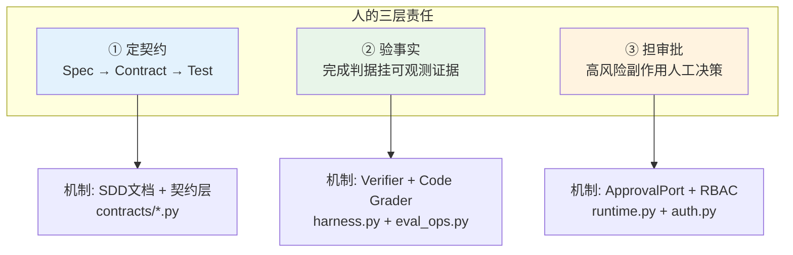

# 04 AI Native：团队与个人的知与行

> **本课定位**：本课从"人与组织"的视角回答：AI 时代工程师的角色如何变化、团队的协作契约如何重建。核心立场：**AI Native 不是"用 AI 写代码"，而是把 AI 纳入生产关系——人的责任从"写代码"上移到"定契约、验事实、担审批"**。本课的每个论点都落到本仓库的一个工程机制上，拒绝空谈。
> **教学目标**：①能说出人的三层责任及对应机制；②能把四种人机关系映射到本仓库代码与测试；③能演示"机提议、人拍板"链路与 RBAC 差异；④能解释"机制信任取代人格信任"的门禁栈。
> **前置**：第 03 课（能力模型）
> **产出**：角色-机制对照表 + 四种人机关系的本仓库落点
> **对应代码**：`services/src/services/api/auth.py`（RBAC）、`dataagent/contracts/runtime.py`（ApprovalPort）、`.github/workflows/ci.yml`（回归门禁）

---

## 0. 本课要用到的环境

| 组件 | 取值 | 说明 |
|---|---|---|
| 仓库 | 本仓库根 | 全程离线 |
| 观察对象 | 仓库的角色模型 / 审批机制 / CI 门禁 | 人机关系的物化证据 |
| 验证命令 | `python -m pytest tests/integration/test_integration.py -q` | 在 `dataagent/` 目录执行 |

---

## 1. 问题场景

某团队引入 AI Coding 后出现三种典型事故：

1. **责任悬空**：AI 生成的代码出了线上事故，复盘时工程师说"这是 AI 写的"。——责任无法外包给概率过程；**谁合入、谁负责**。
2. **审批自动化幻觉**：团队给"调整预算"的高风险动作配了自动通过（为了演示流畅），结果演示环境真的改了预算数据。——**高风险动作的审批权不可让渡给被治理对象本身**。
3. **验收口语化**：需求写着"体验要流畅"，AI 交付后无法判定过不过。——**验收标准必须可执行**（命令 + 期望输出）。

三个事故的共同解法是把"人的判断"结构化为**机制**：RBAC、审批门、可判定验收。这正是本仓库已经落地的三件事。

---

## 2. 概念与机制

### 2.1 人的责任上移：从写代码到三层治理



### 2.2 四种人机关系在本仓库的落点

| 关系 | 语义 | 本仓库落点 | 证据测试 |
|---|---|---|---|
| 人主导机 | 人定规则，机执行 | `SQLPolicy` 白名单、`SQLPolicy.banned_keywords` | `test_security.py::test_readonly_blocks_write` |
| 人监督机 | 机做、人验 | `Verifier`、`code_grader(verify=...)` | `test_integration.py::test_eval_scorecard_and_gate` |
| 人机协作 | 分工迭代 | harness 自主探索 + workflow 确定性收口 | `test_integration.py::test_full_analysis_pipeline` |
| 机为人候选 | 机提议、人拍板 | `human_gate` 节点 + `ApprovalPort` | `test_integration.py::test_human_approval_gate_in_workflow` |

关键设计：第四种关系里，**模型只能"提议"副作用动作**（`adjust_budget` 工具 `requires_approval=True`），执行必须经人。审批链路：`ApprovalRequest` → 审批人决议 → `pre_approved` 注入恢复。

### 2.3 团队契约：把"信任"换成"门禁"

AI Native 团队的信任模型：**不信任任何未经门禁的产出**（无论来自人还是 AI）。本仓库的门禁栈：

| 门禁 | 拦什么 | 位置 |
|---|---|---|
| 状态机校验 | 非法状态迁移（代码级缺陷） | `contracts/runtime.py` `__setattr__` |
| 测试套件 | 行为回归（72 例） | `dataagent/tests/` |
| CI 工作流 | 合入门禁 | `.github/workflows/ci.yml` |
| 回归门禁 | 评测分数退化 | `eval_ops.py::RegressionGate` |
| 资料自检 | 教学资料结构/一致性退化 | `scripts/validate_chapters.py` |

**设计意图**：门禁是**对事不对人**的——人类写的代码和 AI 写的代码过同一套门禁。这才是"AI Native 生产关系"的实质：信任从"人格信任"迁移到"机制信任"。

---

## 3. 动手实验

### 实验 1：观察"机提议、人拍板"的完整链路

```bash
cd dataagent
$env:PYTHONPATH="src"
python ../scripts/demo.py 2>&1 | Select-String "budget_adjust"
```

**预期输出**：

```text
   - budget_adjust          [succeeded] {'approved': True, 'request_id': 'apr_1793146285940', 'effect_key': 'adjust_budget:', 'idempotent_skip': False, 'receipt': {'action': 'side_effect_executed', 'params': {}}}
   事件流长度=16  (可回放/可审计)
```

**判定通过**：`adjust_budget`（HIGH 风险工具）的执行发生在审批门之后，`request_id` 证明审批请求真实创建。

### 实验 2：验证角色权限的差异（RBAC）

```bash
python -c "
from dataagent.domain.analytics import Tenant
analyst = Tenant(tenant_id='t1', roles={'analyst'})
approver = Tenant(tenant_id='t1', roles={'approver'})
admin = Tenant(tenant_id='t1', roles={'admin'})
print('analyst  可审批 =', analyst.can('approve'))
print('approver 可审批 =', approver.can('approve'))
print('admin    可审批 =', admin.can('approve'))
print('analyst  可查询 =', analyst.can('query'))
"
```

**预期输出**：

```text
analyst  可审批 = False
approver 可审批 = True
admin    可审批 = True
analyst  可查询 = True
```

**判定通过**：审批权只属于 approver/admin；查询对 analyst 开放——权限差异是数据驱动的（`domain/analytics.py::Tenant.can`），不靠人肉自觉。

### 实验 3：门禁的失效样例（教学性失败）

```bash
python -c "
from dataagent.contracts.runtime import Run, RunStatus
r = Run(query='x')
try:
    r.status = RunStatus.SUCCEEDED   # pending 直达终态
except Exception as e:
    print('门禁拦截:', type(e).__name__)
"
```

**预期输出**：

```text
门禁拦截: InvalidStateTransition
```

**判定通过**：即使"人"想绕过状态机，机制也会拒绝——门禁面前没有特权身份。

---

## 4. 代码走读

### 4.1 `ApprovalPort`：审批权的协议化

```python
class ApprovalPort(Protocol):
    """人工审批端口：高风险副作用在执行前必须经由本端口授权。"""
    def request(self, req: ApprovalRequest) -> str: ...
    def resolve(self, request_id: str, decision: ApprovalDecision, by: str) -> None: ...
    def get(self, request_id: str) -> ApprovalRequest: ...
```

**设计意图**：审批是**端口**不是实现——内存版（演示）、数据库版（生产：`services/api/auth.py` + CRDB `dataagent_approvals` 表）可替换，但"高风险动作必经审批"的协议不变。

**反面写法**：把审批逻辑写死在 workflow 节点里（`if risk == 'high': print('approved')`）。演示方便，但生产接入时要改核心代码——治理能力不可插拔。

### 4.2 CI 门禁：`.github/workflows/ci.yml` 的角色

CI 在 AI Native 团队里的角色变化：过去它守护"人写的代码"，现在它守护"**任何来源**的代码变更"。本仓库 CI 的验收标准：

```bash
cd dataagent && PYTHONPATH=src python -m pytest -q   # 72 例
python scripts/validate_chapters.py                   # 资料自检
```

**设计意图**：把"教学资料"也纳入 CI 门禁是本仓库的特色——资料退化（模板化、断链）和代码退化一样，都是交付物缺陷。

---

## 5. 常见错误与 Badcase

| # | 错误现象 | 根因 | 正确做法 |
|---|---|---|---|
| 1 | 演示环境审批自动通过，误开到生产 | 环境配置漂移 | `DATAAGENT_APPROVAL_MODE` 显式区分 auto/manual，默认 manual（见 `container.py`） |
| 2 | 验收标准写"界面友好、性能良好" | 不可判定的验收 = 没有验收 | 每条验收 = 命令 + 期望输出（本课 §3 全部如此） |
| 3 | AI 生成代码直接合入"看起来没问题" | 无门禁的人格信任 | 过同一套测试 + 状态机 + CI 门禁 |
| 4 | 给 analyst 角色开了 approve 权限"方便测试" | 权限为方便让渡 | 权限是契约不是配置项，测试用专用角色 |

---

## 6. 验收

```bash
cd dataagent
$env:PYTHONPATH="src"
python -m pytest tests/integration/test_integration.py -q     # 期望: 8 passed
python -m pytest tests/unit/test_state_machine.py -q          # 期望: 12 passed
# 实验 2/3 的输出与 §3 一致
```

---

## 7. 思辨与讨论

1. **"审批门会不会拖慢 Agent 的自动化价值？"** 本仓库的答案是**风险分级**：READONLY/LOW 工具全自动，HIGH 副作用才过门。审批的不是"Agent 活动"，是"不可逆副作用"。把审批门当减速带乱设，才是拖慢自动化价值的原因。
2. **"人越来越像'审批员'，是进步吗？"** 是——前提是审批面收敛。本仓库把审批面压到最小（只有资金类动作），而把验证面最大化（Verifier + Grader 全自动）。**人的判断花在刀刃上，机器的可判定全交给机器**，这才是好的分工。

---

## 8. 延伸与引用

- GB/T 22239-2019《网络安全等级保护基本要求》——权限最小化的国标依据
- 本仓库 `services/src/services/api/auth.py`——JWT + RBAC 的生产级实现
- 第 29 课《Action Runtime》——审批门在副作用执行闭环中的位置

---

## 9. 本课遗留问题

- 四种人机关系的"关系切换"（如人监督机 → 人主导机的降级路径）未建模——与第 42 课面向未来的讨论衔接。
- 审批的"委托链"（审批人休假时的代理审批）未实现——生产需求，如实登记。
