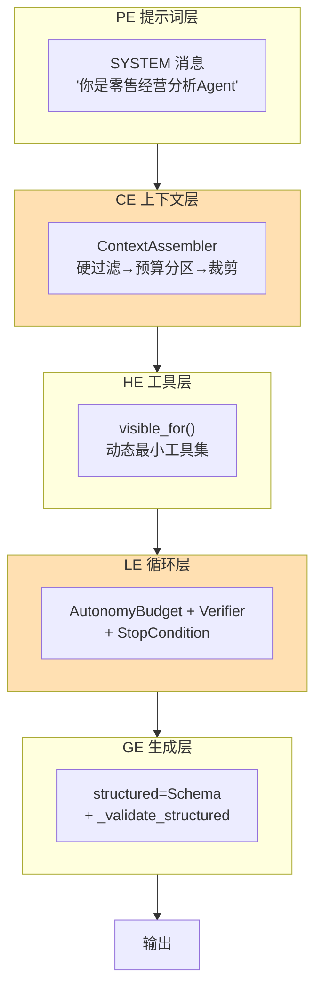

# 05 调优技术体系：从根本讲透 PE/CE/HE/LE/GE

> **本课定位**：调优不是"玄学提示词"，而是一个**分层体系**：Prompt/Context/Harness/Loop/Generation 五层（PE/CE/HE/LE/GE），每层有明确的干预对象、度量方式和失效模式。本课以本仓库代码为实验场，逐层验证"调优发生在哪一层、效果如何度量"。学完本课，你能把任何"模型表现不好"的问题定位到正确的层，而不是盲目改提示词。
> **教学目标**：①能把"模型表现不好"定位到 PE/CE/HE/LE/GE 五层之一；②能复述 CE 装配五步并演示硬过滤/预算分区/充分性门；③能解释为什么校验失败按 retryable 处理；④能识别五个典型调优 Badcase 的错误层。
> **前置**：第 01 课（心智模型）
> **产出**：五层调优的分层实验 × 5 + token 估算实验
> **对应代码**：`dataagent/src/dataagent/infra/context/assembler.py`、`harness.py`、`adapters/llm/fake_client.py`
> **对应测试**：`dataagent/tests/unit/test_context.py`

---

## 0. 本课要用到的环境

| 组件 | 取值 | 说明 |
|---|---|---|
| 仓库 | 本仓库根 | 全程离线 |
| 核心模块 | `infra/context/assembler.py` | CE/GE 层的主战场 |
| 核心模块 | `infra/runtime/harness.py` | HE/LE 层的主战场 |
| 验证命令 | `python -m pytest tests/unit/test_context.py -v` | 在 `dataagent/` 目录执行 |

---

## 1. 问题场景

同一个"GMV 诊断不准"的问题，在五层上的病因完全不同：

| 层 | 干预对象 | 典型病因 | 本仓库对照 |
|---|---|---|---|
| **PE** Prompt Engineering | 单次提示词文本 | 指令含糊、角色缺失 | `harness.py::_plan` 的 SYSTEM 消息 |
| **CE** Context Engineering | 进入窗口的信息集合 | 噪声挤占、关键信息缺失、超预算 | `assembler.py` 装配管线 |
| **HE** Harness Engineering | 工具与控制流 | 工具集过大、步骤失控 | `AutonomyBudget`、`CapabilityRegistry.visible_for` |
| **LE** Loop Engineering | 循环与停止语义 | 无限循环、过早停止 | `StopCondition`、`Verifier` |
| **GE** Generation Engineering | 解码与输出结构 | 结构漂移、格式错误 | `structured` 参数 + Schema 校验 |

**核心洞察**：症状都在"输出不好"，但**病因分布在不同层**。在错误的层调优 = 白费功夫。例：上下文超预算把"指标口径"挤出了窗口（CE 层病），你却在 PE 层加"请注意准确性"——无效。

---

## 2. 概念与机制

### 2.1 五层调优的干预位置图



### 2.2 CE 层：本仓库的上下文装配五步

`assembler.py::ContextAssembler.assemble` 的处理顺序就是 CE 调优的清单：

1. **收集**：遍历 `ContextProvider` 产出候选 `ContextItem`；
2. **硬过滤**：过期（TTL）→ 租户不匹配 → 角色不匹配 → 自定义 `hard_filter`——**权限先于相关性，任何软排序不可绕过**；
3. **预算分区**：按 provenance 分区（system_rule 600 / business_knowledge 2000 / tool_result 1500 / memory 700 …），单区超限即丢弃；
4. **总预算裁剪**：按优先级降序装填，总量超 6000 即弃；
5. **充分性检查**：`ContextContract.required` 缺失则标记 `__missing_required__`——**关键上下文缺失时停止执行而非带病运行**。

### 2.3 GE 层：结构化输出的强校验

```python
# llm_runtime.py（节选）
def _validate_structured(self, data, model_type, model):
    if hasattr(model_type, "model_validate"):       # pydantic v2
        model_type.model_validate(data)
    else:                                            # dataclass
        inspect.signature(model_type).bind(**data)
```

**设计意图**：GE 调优的终点不是"提示词求模型输出 JSON"，而是**校验失败就当作调用失败**（retryable）——把格式正确性从"希望"变成"门禁"。

---

## 3. 动手实验

### 实验 1：观察硬过滤（CE 层）—— 租户隔离优先

```bash
cd dataagent
$env:PYTHONPATH="src"
python -c "
from dataagent.infra.context.assembler import ContextAssembler, ContextProvider, ContextItem, Provenance
a = ContextAssembler(token_budget=6000)
a.register(ContextProvider('foreign', lambda: ContextItem(
    key='foreign_data', content='其他租户数据: GMV=999', provenance=Provenance.TENANT_ATTR),
    priority=100))  # 相关性拉满也绕不过租户过滤
s = a.assemble(tenant_id='ten_a', roles={'analyst'})
print('包含项 =', [i.key for i in s.items])
print('过滤原因 =', s.filtered)
"
```

**预期输出**：

```text
包含项 = []
过滤原因 = [('foreign_data', 'tenant_mismatch:default')]
```

**判定通过**：优先级 100 的"高相关"内容被租户硬过滤拒绝——CE 层的第一铁律。

### 实验 2：预算分区（CE 层）—— 单区超限即裁剪

```bash
python -c "
from dataagent.infra.context.assembler import ContextAssembler, ContextProvider, ContextItem, Provenance
a = ContextAssembler(token_budget=6000)  # business_knowledge 分区默认 2000
for n in range(6):
    a.register(ContextProvider(f'bk{n}', lambda n=n: ContextItem(
        key=f'bk{n}', content='x'*1500, provenance=Provenance.BUSINESS_KNOWLEDGE),
        priority=50))
s = a.assemble()
print('包含 =', len(s.items), '条, tokens =', s.tokens_used)
print('被裁 =', [k for k, r in s.filtered if r == 'budget_partition_exceeded'])
"
```

**预期输出**（真实运行：1500 字符 ≈ 375 token，5 条 1875 未触顶，第 6 条超限）：

```text
包含 = 5 条, tokens = 1880
被裁 = ['bk5']
```

**判定通过**：同区内容达到分区上限后，后续同区条目被裁——预算是硬的。

### 实验 3：充分性门（CE 层）—— 缺关键上下文即停

```bash
python -c "
from dataagent.infra.context.assembler import ContextAssembler, ContextContract
a = ContextAssembler(token_budget=6000)  # 不注册 metric_registry
s = a.assemble(step_contract=ContextContract('planning', required=('metric_registry',)))
missing = [k for k, r in s.filtered if k == '__missing_required__']
print('充分性检查:', '不满足 → 停止执行' if missing else '满足')
"
```

**预期输出**：

```text
充分性检查: 不满足 → 停止执行
```

**判定通过**：required 上下文缺失被显式暴露，而不是生成一个注定失败的调用。

### 实验 4：GE 层 —— 结构化校验失败即重试

```bash
python -m pytest tests/unit/test_llm_runtime.py::TestReliableExecution::test_structured_output_validation -v
```

**预期输出**：

```text
tests/unit/test_llm_runtime.py::TestReliableExecution::test_structured_output_validation PASSED
```

---

## 4. 代码走读

### 4.1 token 估算：`assembler.py` 的中文感知估算器（GAP-13）

```python
def default_token_estimator(text: str) -> int:
    cjk = sum(1 for ch in text if "\u4e00" <= ch <= "\u9fff")
    other = len(text) - cjk
    return max(1, cjk + (other + 3) // 4)
```

**设计意图**：CJK 字符按 1 token 计、其余按 4 字符 1 token——对英文与旧口径（`len//4`）一致，对中文从"低估 2-4 倍"修正到接近真实 tokenizer。**估算仍偏保守是正确方向**（宁可早裁不可溢出）；`ContextAssembler(token_estimator=...)` 可插拔，生产注入真实 tokenizer。预算检查必须在**装配时**执行，而不是调用后统计。

### 4.2 PE 层的落点：`harness.py::_plan`

```python
call = LogicalCall.new(
    task="planning",
    capability=self.executor.registry.resolve(self.model),
    messages=[
        Message(role=Role.SYSTEM, content="你是零售经营分析 Agent。请输出分析计划。"),
        Message(role=Role.USER, content=f"租户={tenant_id} 任务={run.query} 请规划：..."),
    ],
)
```

**设计意图**：SYSTEM 与 USER 分离，任务画像（task="planning"）驱动路由——PE 优化后的提示词应该**进契约**（成为代码的一部分），而不是散落在配置文件里等人粘贴。

### 4.3 LE 层：预算三维度对齐生成行为

```python
def spend_tokens(self, n: int) -> None:
    self.tokens += n
# _plan 中：self.budget.spend_tokens(usage.total_tokens)
```

**设计意图**：LE 层的 token 预算使用**真实 usage 回填**（Attempt 返回的 Usage），不是"猜的"——生成层每花一个 token，循环层都知道。

---

## 5. 常见错误与 Badcase

| # | 错误现象 | 根因 | 正确做法 |
|---|---|---|---|
| 1 | 高相关性的外部内容进入上下文，泄漏他租户信息 | 只做相关性排序，无硬过滤 | 硬过滤（租户/角色/TTL）先于排序，任何排序不可绕过 |
| 2 | 上下文经常莫名截断，关键信息丢失 | 总预算充足但单分区超限 | 分区预算 + 优先级装填；业务知识区可扩但需显式改配置 |
| 3 | 提示词调优后本地有效、线上失效 | PE 改动未版本化、未回归 | 提示词进契约 + 纳入 RegressionGate（第 40 课） |
| 4 | 结构化输出偶尔格式崩坏导致下游崩溃 | GE 层无校验 | `structured` + Schema 校验，失败按 retryable 处理 |
| 5 | 模型重复调用同一工具十几次 | LE 层无预算/停止条件 | AutonomyBudget 三维上限 + StopCondition |

---

## 6. 验收

```bash
cd dataagent
$env:PYTHONPATH="src"
python -m pytest tests/unit/test_context.py -q        # 期望: 8 passed
python -m pytest tests/unit/test_llm_runtime.py -q    # 期望: 8 passed
# 实验 1-3 的输出与 §3 一致（硬过滤/分区裁剪/充分性门）
```

---

## 7. 思辨与讨论

1. **"PE 已死，CE 万岁？"** 本仓库的立场：PE 没死，但**PE 的杠杆率最低**（影响单次调用），CE/LE 杠杆率高（影响整个会话与系统行为）。分层调优的意义就是先问"病在哪层"，再决定花力气。
2. **"预算估算不准怎么办？"** 本仓库用 `len//4` 保守估算，是**演示级**方案。生产应接真实 tokenizer；但注意即使估算精度提升，"预算硬上限 + 分区"的机制不变——调优改变参数，不改变机制。

---

## 8. 延伸与引用

- 本仓库 `docs/03-架构图集.md`——上下文装配管线图
- 第 21–26 课（上下文治理篇）——CE 层的全面展开
- 第 16 课（Autonomous Harness）——HE/LE 层的展开

---

## 9. 本课遗留问题

- ~~`_estimate` 的中文 token 估算偏差较大（可能低估 2-4 倍）~~ → **已修复（GAP-13）**：默认估算器 CJK 按 1 token 计，`token_estimator` 参数可插拔真实 tokenizer。
- `render_prompt_template` 的分区标题是写死的两段式，未支持自定义渲染模板——登记为 CE 层增强项。
