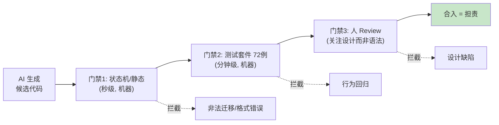

# 06 AI Coding 之道：生产观 / 角色观 / 责任观

> **本课定位**：本课是"道"层——在进入任何具体技法之前，先立三条观：**生产观**（AI 产出的是"候选"不是"成品"）、**角色观**（AI 是快而不稳的初级队友）、**责任观**（合入即担责，责任不可让渡给概率过程）。每一条观都对应本仓库的一个工程机制，做到"道不空谈"。
> **教学目标**：①能复述生产观/角色观/责任观及其机制落点；②能演示门禁拦截非法状态赋值；③能解释审批链路中 by 参数的责任语义；④能识别 4 个典型 AI Coding 事故的观层根因。
> **前置**：第 04 课（AI Native 人机关系）
> **产出**：三观 × 机制对照表 + 门禁失效实验
> **对应代码**：`.github/workflows/ci.yml`、`contracts/runtime.py`（状态机）、`tests/`
> **对应测试**：全量 72 例

---

## 0. 本课要用到的环境

| 组件 | 取值 | 说明 |
|---|---|---|
| 仓库 | 本仓库根 | 全程离线 |
| 观察对象 | CI 工作流 / 状态机 / 测试套件 | 三观的物化证据 |
| 验证命令 | `PYTHONPATH=src python -m pytest -q` | 在 `dataagent/` 目录执行 |

---

## 1. 问题场景

同一家团队在引入 AI Coding 前后的两种状态：

**引入前**：工程师 A 写代码 → 自测 → 提 PR → 人肉 Review → 合入。质量依赖 A 的水平与责任心，瓶颈在 A 的速度。

**引入后（错误姿势）**：AI 生成 500 行 → 看起来能跑 → 直接合入。一周后三个隐患爆发：一个空指针、一个越权查询、一个"demo 里能过但生产必挂"的分支。复盘时发现 Review 环节整个消失了——**AI 的加入让人误以为"可以少做"，实际上是"要做的事变了"**。

三观就是把"要做的事"重新定义清楚。

---

## 2. 概念与机制

### 2.1 生产观：AI 产出的是候选，不是成品



本仓库的活证据：本轮重构把 `run.status = X` 的直接赋值改为状态机校验（`contracts/runtime.py::__setattr__`），**人写的改动同样先过 72 例测试才合入**——生产观面前没有特殊来源。

### 2.2 角色观：AI 是"快而不稳"的初级队友

| 队友特征 | AI 的表现 | 管理手段 |
|---|---|---|
| 速度极快 | 秒出千行 | 让它做量大的候选生产 |
| 稳定性差 | 幻觉 API、忽略边界 | 测试套件 + 状态机门禁 |
| 不懂上下文 | 不知道仓库纪律 | 规约文档 + 示例代码（本 chapters 即范例语料） |
| 不担责任 | 无法问责 | 合入者担责（责任观） |

把 AI 当初级队友，管理动作就清晰了：**给它的任务要小而明确，验收要可判定，产出要过门禁**。

### 2.3 责任观：合入即担责

本仓库把责任链写进机制而非口号：

- 代码谁合入谁担责——CI 记录 + PR 制度；
- 副作用谁审批谁担责——`ApprovalPort.resolve(request_id, decision, by)` 的 `by` 参数就是责任人签名；
- 资料谁发布谁担责——`validate_chapters.py` 不通过不得发布。

---

## 3. 动手实验

### 实验 1：体验"候选被门禁拦截"

```bash
cd dataagent
$env:PYTHONPATH="src"
python -c "
from dataagent.contracts.runtime import Run, RunStatus
# 模拟一段'AI 候选代码'的错误写法：跳过运行期直达终态
r = Run(query='x')
try:
    r.status = RunStatus.SUCCEEDED
except Exception as e:
    print('生产观落地 —— 门禁拦截:', type(e).__name__)
    print('原因:', e)
"
```

**预期输出**：

```text
生产观落地 —— 门禁拦截: InvalidStateTransition
原因: [Run] 非法状态迁移: pending -> succeeded。合法迁移见 Run_STATE_MACHINE.to_table()
```

### 实验 2：验证责任签名（审批链路）

```bash
python -c "
from dataagent.contracts.runtime import ApprovalRequest, ApprovalDecision
from dataagent.infra.runtime.workflow import InMemoryApprovalPort
port = InMemoryApprovalPort(auto_approve=False)
req = ApprovalRequest(request_id='apr_demo', run_id='run_demo', action='adjust_budget', params={'region':'华东','amount':5000})
rid = port.request(req)
port.resolve(rid, ApprovalDecision.APPROVED, by='张工(数据平台负责人)')
print('审批单状态 =', port.get(rid).status)
print('决议人 =', '张工(数据平台负责人)')
"
```

**预期输出**：

```text
审批单状态 = approved
决议人 = 张工(数据平台负责人)
```

**判定通过**：决议带 `by` 签名——责任落在数据结构里，不落在群里的一句话里。

### 实验 3：全量门禁通过

```bash
python -m pytest -q
# 期望: 248 passed, 5 skipped, 0 failed
```

---

## 4. 代码走读

### 4.1 门禁为什么选在"赋值点"而不是"调用点"

```python
def __setattr__(self, name, value):
    if name == "status":
        old = self.__dict__.get("status")
        if old is not None:
            RUN_STATE_MACHINE.assert_transition(old.value, value.value)  # 节选
    object.__setattr__(self, name, value)
```

**设计意图**：在 `__setattr__` 拦截意味着**任何代码路径**（业务、测试、demo、未来 AI 生成的代码）想改状态都必须过状态机。门禁放在"唯一的必经之路"上，而不是每个调用点自己记得检查。

### 4.2 `by` 参数：责任的最小数据结构

```python
def resolve(self, request_id: str, decision: ApprovalDecision, by: str) -> None: ...
```

**设计意图**：审批协议强制要求 `by`——想实现一个不带责任人的审批？协议签名就不允许。**用类型系统表达治理要求**，比文档口号有效得多。

---

## 5. 常见错误与 Badcase

| # | 错误现象 | 根因 | 正确做法 |
|---|---|---|---|
| 1 | "AI 写的，我不熟，出事不算我的" | 责任让渡幻觉 | 合入即担责——不熟的代码更应该 review 后合入 |
| 2 | AI 候选代码只跑 demo 不跑测试 | 把"看起来能跑"当验收 | 全量测试门禁 + 失败样例实验（本课 §3.1） |
| 3 | 团队为赶工临时关掉 CI | 门禁被当成官僚流程 | 门禁坏了修门禁，不能绕门禁；绕过记录为事故 |
| 4 | 把规约写在 wiki 里但 AI 从不读 | 规约与语料脱节 | 规约进仓库（如本 chapters 结构），示例即语料 |

---

## 6. 验收

```bash
cd dataagent
$env:PYTHONPATH="src"
python -m pytest -q                                  # 期望: 248 passed, 5 skipped
# 实验1 拦截输出与 §3.1 一致；实验2 责任签名输出与 §3.2 一致
```

---

## 7. 思辨与讨论

1. **"门禁这么多，会不会扼杀 AI 的效率优势？"** 本仓库的实测答案：门禁拦截的是**分钟级**的机器检查与**必要的人审**，换来的是"合入的东西基本可信"。绕过门禁的返工成本（线上事故 + 排查）远高于门禁成本。效率之争要算总账。
2. **"初级队友 metaphor 会不会低估模型？"** 模型能力会涨，但**稳定性与责任主体的缺位**是结构性的：概率过程的输出永远需要外部验收，责任永远在人。角色观的"不稳"与"不担责"两栏，十年内大概率仍然成立。

---

## 8. 延伸与引用

- GB/T 8566-2007《软件生存周期过程》——过程与责任划分的国标依据
- 本仓库 `.github/workflows/ci.yml`——CI 门禁的实现
- 第 07 课（法-SDD）——把本课的"契约"具体化为规格驱动开发

---

## 9. 本课遗留问题

- "合入即担责"目前依赖 Git 记录，未与审批系统打通形成统一责任台账——生产需求，如实登记。
- AI 候选代码的自动预审（静态检查 + 测试子集预跑）未实现——属于 CI 增强，登记后续。
