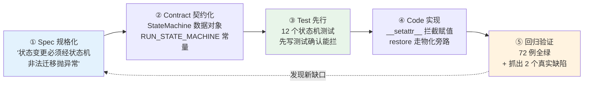

# 07 AI Coding 之法：SDD 把概率生成转化为确定性交付

> **本课定位**：本课讲"法"——规格驱动开发（SDD, Specification-Driven Development）的完整循环：**Spec → Contract → Test → Code**。核心洞察：AI 时代交付质量的决定因素从"编码能力"前移到"规格能力"——规格写得越可判定，AI 候选的验收越机械。本课用本仓库**真实发生的一次重构**（状态机严格化）做全程示范。
> **教学目标**：①能复述 SDD 四步循环与可执行规格三要件；②能用本仓库状态机规格做判据/反例/例外三段验证；③能解释"规格严格化必须预期翻旧账"的实录依据；④能为一个新行为写出可执行规格。
> **前置**：第 06 课（三观）
> **产出**：一次完整 SDD 循环的实录 + 可执行规格模板
> **对应代码**：`contracts/runtime.py`、`tests/unit/test_state_machine.py`、`docs/01-SDD规格说明书.md`
> **对应测试**：`test_state_machine.py` 12 例（本轮重构新增）

---

## 0. 本课要用到的环境

| 组件 | 取值 | 说明 |
|---|---|---|
| 仓库 | 本仓库根 | 含本轮状态机重构的完整记录 |
| 案例 | Run/Step 状态机严格化 | Spec→Test→Code→回归全链路 |
| 验证命令 | `python -m pytest tests/unit/test_state_machine.py -v` | 在 `dataagent/` 目录执行 |

---

## 1. 问题场景

旧版代码（重构前）允许任意赋值状态：

```python
# 旧代码：任何人任何地方都可以这么写，毫无抵抗
run.status = RunStatus.SUCCEEDED   # 从 pending 直接跳终态？没人管
```

三个真实后果：
1. `harness.py` 里 `run.status = RunStatus.SUCCEEDED` 与后续审批门的状态变更**互相打架**，缺陷以"偶发 500"的形态潜伏；
2. `workflow.py` 的异常兜底把状态机违规**吞成业务失败**，排障方向被误导；
3. 代码评审时"状态可以怎么改"要靠**读遍全仓库**才能回答——规格没有承载体。

这就是"法"要解决的问题：**用 SDD 让状态规则成为可执行、可评审、可回归的规格**。

---

## 2. 概念与机制

### 2.1 SDD 四步循环



### 2.2 可执行规格的三要件

一条规格要可执行，必须有三要件（缺一即退化为口号）：

| 要件 | 问题 | 状态机规格的满足方式 |
|---|---|---|
| **判据** | "怎么算违规？" | `StateMachine.can_transition(src, dst) == False` |
| **动作** | "违规了怎么办？" | 抛 `InvalidStateTransition`（fail-fast，不静默纠正） |
| **反例** | "哪些写法会被拦？" | `pending→succeeded`、`succeeded→running`（终态复活）等测试 |

### 2.3 实录：这次重构的 Spec 原文

> **规格 R-001（Run/Step 状态机严格化）**
> - **R-001.1 判据**：Run 与 Step 的 `status` 字段每次赋值必须经模块级状态机常量校验；同值赋值视为幂等 no-op 放行。
> - **R-001.2 迁移表**：Run 合法迁移 `pending→{running,canceled}`、`running→{paused,waiting_approval,succeeded,failed,canceled}`、`paused→{running,failed,canceled}`、`waiting_approval→{running,failed,canceled}`；终态无出边。Step 类似（含 `skipped`）。
> - **R-001.3 例外**：`restore()` 从 Checkpoint 重建属于**物化**而非迁移，允许落到任意已持久化状态。
> - **R-001.4 验收**：`pytest tests/unit/test_state_machine.py` 12 例全过；全量套件无回归；重构过程中暴露的历史缺陷必须修复并记录。

注意"R-001.4 验收"里包含"**必须修复暴露的历史缺陷**"——规格要预料到严格化会翻出旧账，并把"翻旧账"定义为验收的一部分而不是意外。

---

## 3. 动手实验

### 实验 1：验证规格 R-001 的判据（终态复活被拦）

```bash
cd dataagent
$env:PYTHONPATH="src"
python -m pytest tests/unit/test_state_machine.py::TestRunStateMachine::test_terminal_cannot_be_revived -v
```

**预期输出**：

```text
tests/unit/test_state_machine.py::TestRunStateMachine::test_terminal_cannot_be_revived PASSED
```

### 实验 2：验证规格 R-001.3 的物化例外

```bash
python -c "
from dataagent.contracts.runtime import Run, RunStatus
r = Run(query='x'); r.status = RunStatus.RUNNING
cp = r.to_checkpoint()
r2 = Run(); r2.restore(cp)
print('restore 物化后状态 =', r2.status.value, '（绕过迁移校验，合法）')
"
```

**预期输出**：

```text
restore 物化后状态 = running （绕过迁移校验，合法）
```

### 实验 3：状态机是数据 —— 打印迁移表（规格可评审）

```bash
python -c "
from dataagent.contracts.runtime import RUN_STATE_MACHINE
print(RUN_STATE_MACHINE.to_table())
"
```

**预期输出**：

```text
StateMachine<Run> terminal=['canceled', 'failed', 'succeeded']
  canceled 不在迁移表(终态)
  paused -> ['canceled', 'failed', 'running']
  pending -> ['canceled', 'running']
  running -> ['canceled', 'failed', 'paused', 'succeeded', 'waiting_approval']
  waiting_approval -> ['canceled', 'failed', 'running']
```

**判定通过**：迁移表本身可打印、可评审——规格从"口口相传"变成"数据对象"。

### 实验 4：全量回归（SDD 的安全网）

```bash
python -m pytest -q   # 期望: 248 passed, 5 skipped, 0 failed
```

---

## 4. 代码走读

### 4.1 Spec → Contract 的映射

规格 R-001.2 的迁移表落成代码（`contracts/runtime.py`）：

```python
RUN_STATE_MACHINE = StateMachine(
    name="Run",
    transitions={
        "pending": {"running", "canceled"},
        "running": {"paused", "waiting_approval", "succeeded", "failed", "canceled"},
        "paused": {"running", "failed", "canceled"},
        "waiting_approval": {"running", "failed", "canceled"},
    },
    terminal={"succeeded", "failed", "canceled"},
)
```

**设计意图**：状态机是**数据**不是 if/else——迁移表可打印（实验 3）、可在构造期自检（终态不得作为起点，否则 ValueError）。

### 4.2 Spec → Code 的映射：拦截点选择

```python
def __setattr__(self, name, value):
    if name == "status":
        old = self.__dict__.get("status")
        if old is not None:   # None = dataclass 初始赋值，放行
            RUN_STATE_MACHINE.assert_transition(...)
    object.__setattr__(self, name, value)
```

**设计意图**：在 `__setattr__` 拦截而非提供 `transition()` 方法并改造所有调用点——前者让规格对**所有现存与未来代码**自动生效，后者会遗漏任何一处新写法。

**反面写法**：提供 `safe_set_status()` 方法但保留字段可写——"建议走门禁"的门禁不是门禁。

### 4.3 SDD 循环的"翻旧账"实录

这次重构暴露并修复的两个真实缺陷（规格 R-001.4 的兑现）：

| # | 缺陷 | 表现 | 修复 |
|---|---|---|---|
| 1 | Harness 作为 workflow 子节点越权终结 Run（设 SUCCEEDED） | 后续审批门撞终态保护，异常被兜底 except 吞成业务失败 | Harness 不写 Run 终态，只写 Step/Event；验证失败抛 `VerifierFailedError` 走节点失败路径 |
| 2 | auto 审批通过后从 `WAITING_APPROVAL` 直奔 `SUCCEEDED` | 挂起态被当作通往终态的旁路 | 审批决即恢复 `RUNNING`，恢复语义显式化 |

两个缺陷在旧代码里**全部测试通过**——没有状态机规格，它们会一直潜伏。

---

## 5. 常见错误与 Badcase

| # | 错误现象 | 根因 | 正确做法 |
|---|---|---|---|
| 1 | 规格写"状态要规范管理" | 不可判定的规格 = 没有规格 | 三要件：判据 + 动作 + 反例（本课 §2.2） |
| 2 | 先写代码后补测试，测试照着实现抄 | 测试失去证伪能力 | Test 先行：先写会失败的测试（本课 `test_terminal_cannot_be_revived` 在旧代码上必失败） |
| 3 | 规格严格化后，旧缺陷修复被当作"意外改动" | 规格没预料翻旧账 | 验收条款显式包含"暴露的历史缺陷必须修复并记录" |
| 4 | 物化（restore）也被迁移校验拦住 | 例外场景未规格化 | R-001.3 显式定义例外与依据 |

---

## 6. 验收

```bash
cd dataagent
$env:PYTHONPATH="src"
python -m pytest tests/unit/test_state_machine.py -q   # 期望: 12 passed
python -m pytest -q                                     # 期望: 248 passed, 5 skipped
# 实验2/3 的输出与 §3 一致
```

---

## 7. 思辨与讨论

1. **"规格先行会不会拖慢迭代？"** 本课实录给出反例：状态机重构从规格到全绿一次完成，且顺手抓出两个潜伏缺陷。规格慢的是"写的那半小时"，省的是"以后每次改状态相关代码的排查"。
2. **"AI 能写规格吗？"** AI 能写**候选规格**（像候选代码一样），但规格的"判据是否完备、反例是否真实"必须人来判定——这把第 06 课的责任观又收紧了一圈：**人负责规格的正确性，机器负责规格的实现**。

---

## 8. 延伸与引用

- ISO/IEC/IEEE 29148:2018《需求工程》——规格质量特性的国际依据
- GB/T 9385-2008《软件需求规格说明规范》——SRS 结构的国标依据
- 本仓库 `docs/01-SDD规格说明书.md`——全课程规格的承载文档
- 参照工程 `docs/01-课程规格说明书-SRS.md`（FR/NFR 编号体系）——可追溯规格的成熟范例

---

## 9. 本课遗留问题

- 规格编号体系（本课 R-001）尚未与 `docs/01-SDD规格说明书.md` 的既有编号打通——文档治理项，登记待办。
- "物化例外"（restore 绕过校验）目前靠约定 + 注释，缺一条"restore 后状态必须在合法集合内"的附加断言——登记为小增强。
