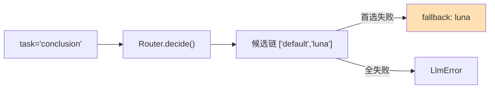

# 08 AI Coding 之术：Agent 驾驭与高成功率的编排技巧

> **本课定位**：本课讲"术"——在道与法之上，具体到"如何让 Agent 一次跑成"的操作技法：任务画像路由、故障注入预演、预算调参、证据绑定。每个技巧都配本仓库的可运行实验与真实输出。学完本课，你能诊断"Agent 任务失败"的常见原因并按术施治。
> **教学目标**：①能配置候选链与退避重试并解释封顶意义；②能用故障注入预演回答三问（恢复/记录/幂等）；③能区分可重试与不可重试故障的代码语义；④能诊断 5 类成功率低的病根并施治。
> **前置**：第 07 课（SDD）
> **产出**：五个技法实验 + 故障注入诊断手册
> **对应代码**：`infra/gateway/llm_runtime.py`、`adapters/llm/fake_client.py`、`tests/fault/test_fault_injection.py`
> **对应测试**：`test_fault_injection.py` 4 例、`test_llm_runtime.py` 8 例

---

## 0. 本课要用到的环境

| 组件 | 取值 | 说明 |
|---|---|---|
| 仓库 | 本仓库根 | 全程离线 |
| 核心模块 | `llm_runtime.py` / `fake_client.py` | 路由与故障注入 |
| 验证命令 | `python -m pytest tests/fault/ tests/unit/test_llm_runtime.py -v` | 在 `dataagent/` 目录执行 |

---

## 1. 问题场景

"Agent 任务成功率低"的现场通常长这样：

- 上游模型抖动一次，整个分析就失败——**没有重试**；
- 重试了，但每次都打同一个挂掉的模型——**没有 fallback 链**；
- 重试 + fallback 都配了，但重试风暴把配额烧光——**没有退避与上限**；
- 全配好了，测试环境全绿上线后还是挂——**没有预演故障**。

四种病、四副药，全是"术"层的内容。

---

## 2. 概念与机制

### 2.1 术一：任务画像路由（task → 候选链）



```python
# container.py（装配示例）
self.router.add_route("conclusion", ["default", "luna"])
```

**要诀**：候选链 = 首选 + 至少一个降级；链上每个模型都必须在 Registry 注册（`Router.decide` 会过滤未注册模型，全空则抛 `LlmError(retryable=False)`）。

### 2.2 术二：退避重试（指数退避封顶）

```python
# llm_runtime.py
self._sleep(min(self.base_backoff_s * (2 ** attempt_idx), 1.0))
```

**要诀**：`base * 2^n` 且**封顶 1 秒**——退避不封顶会在长任务里睡到天荒地老；base=0.2s 保证测试快。

### 2.3 术三：故障注入预演（先看它怎么死，再让它活）

`FakeLlmClient(fail_times=N)` 模拟"前 N 次必失败"。预演要回答三个问题：重试几次后恢复？Attempt 记录完整吗？副作用有没有重复执行？——`tests/fault/test_fault_injection.py` 的 4 个测试就是这三问的答案。

### 2.4 术四：预算与验证联动（成功率 ≠ 完成率）

成功率高不等于任务完成——Verifier 失败同样落 FAILED（第 02 课）。**术的最后一层：让"完成"的定义正确**。

---

## 3. 动手实验

### 实验 1：故障注入下整链恢复

```bash
cd dataagent
$env:PYTHONPATH="src"
python ../scripts/demo.py 2>&1 | Select-String "故障注入"
```

**预期输出**：

```text
[3] 故障注入与只读 SQL 网关
   注入 2 次模型故障后仍成功: 状态=succeeded, 调用次数=6
```

**判定通过**：注入 2 次故障，重试机制消耗后（调用 6 次 = 多个 LogicalCall × 重试），任务仍 succeeded。

### 实验 2：Attempt 生命周期完整记录

```bash
python -m pytest tests/fault/test_fault_injection.py -v
```

**预期输出**：

```text
tests/fault/test_fault_injection.py::TestFaultInjection::test_recovers_after_failures PASSED
tests/fault/test_fault_injection.py::TestFaultInjection::test_attempt_lifecycle_recorded PASSED
tests/fault/test_fault_injection.py::TestFaultInjection::test_unrecoverable_raises PASSED
tests/fault/test_fault_injection.py::TestFaultInjection::test_side_effect_not_repeated PASSED
4 passed
```

### 实验 3：不可恢复故障正确抛出（retryable=False 不重试）

```bash
python -c "
from dataagent.adapters.llm.fake_client import FakeLlmClient
from dataagent.contracts.model import Message, ModelCapability, Role
from dataagent.infra.gateway.llm_runtime import LlmError, ModelRegistry, ReliableExecutor, Router

reg = ModelRegistry(); reg.register(ModelCapability(model='demo'))
rt = Router(reg); rt.add_route('t', ['demo'])
client = FakeLlmClient(fail_times=5)
ex = ReliableExecutor(client, rt, reg, max_attempts=2, sleep=lambda s: None)  # 退避置零加速
call = LogicalCall = None
from dataagent.contracts.model import LogicalCall
call = LogicalCall.new(task='t', capability=reg.resolve('demo'), messages=[Message(role=Role.USER, content='x')])
try:
    ex.complete(call)
except LlmError as e:
    print('耗尽后抛错:', e)
    print('尝试记录数 =', len(call.attempts))
"
```

**预期输出**：

```text
耗尽后抛错: Simulated upstream failure
尝试记录数 = 2
```

**判定通过**：max_attempts=2 意味着尝试记录 2 条、然后抛错——重试有上限，不会烧穿配额。

### 实验 4：副作用幂等（故障重试不重复执行副作用）

`test_fault_injection.py::test_side_effect_not_repeated` 已覆盖：副作用执行前先落幂等键，重试命中幂等键直接返回已执行结果。

---

## 4. 代码走读

### 4.1 ReliableExecutor 的双循环结构

```python
for attempt_idx in range(self.max_attempts):     # 外层: 逻辑尝试
    for model in attempt_models:                  # 内层: 候选链
        try:
            result = self._client.complete(...)
            ...
            return result
        except LlmError as e:
            if not e.retryable:
                break                             # 不可重试 → 直接换下一个逻辑尝试
            self._sleep(min(self.base_backoff_s * (2 ** attempt_idx), 1.0))
```

**设计意图**：外层 attempt × 内层候选链的双循环把"重试"与"回退"解耦：`retryable=False` 的故障（如参数非法）连重试都不配，直接进入下一候选。

### 4.2 `fake_client.py` 的故障注入为何模拟 LlmError

```python
if self.fail_times > 0:
    self.fail_times -= 1
    raise LlmError(self.fail_error, retryable=True)
```

**设计意图**：注入的异常类型与真实故障同型（LlmError + retryable 标志），重试逻辑无法区分真假——预演保真。

---

## 5. 常见错误与 Badcase

| # | 错误现象 | 根因 | 正确做法 |
|---|---|---|---|
| 1 | 重试风暴：1 次故障放大为 20 次调用 | max_attempts 过大 + 无退避封顶 | max_attempts=2~3 + `min(base*2^n, cap)` |
| 2 | fallback 链上挂了未注册模型，静默少一档 | 未校验候选 | `Router.decide` 过滤未注册模型；装配时断言候选非空 |
| 3 | 不可重试错误（参数非法）被反复重试 | 未区分 retryable | 异常携带 retryable 标志，False 直接 break |
| 4 | 重试成功但下游副作用执行了两次 | 副作用无幂等键 | 幂等键先行（test_side_effect_not_repeated 的语义） |
| 5 | 测试里依赖真实退避时间导致 flaky | sleep 不可注入 | `ReliableExecutor(sleep=...)` 注入空实现（本轮重构已加） |

---

## 6. 验收

```bash
cd dataagent
$env:PYTHONPATH="src"
python -m pytest tests/fault/ -q                    # 期望: 4 passed
python -m pytest tests/unit/test_llm_runtime.py -q  # 期望: 8 passed
python ../scripts/demo.py                            # 期望: 注入 2 次故障后仍成功
```

---

## 7. 思辨与讨论

1. **"重试是万能药吗？"** 不是。重试只对**瞬时故障**（网络抖动、限流）有效，对**永久故障**（参数非法、权限不足）是浪费甚至放大。术的第一课是分清故障类型——`retryable` 标志就是这道分水岭的数据化。
2. **"预演故障要覆盖多少种？"** 按"可重试/不可重试 × 瞬时/持续"四象限至少各一种。本仓库覆盖：瞬时可重试（fail_times）、持续（fail_times 极大触发耗尽）、不可重试（retryable=False）——四象限里"持续不可重试"与"瞬时可重试"行为等价，故三种足矣。

---

## 8. 延伸与引用

- 第 13 课《可靠执行》——本课术三的全面展开（deadline/schema 拦截）
- 第 20 课《故障工程》——以故障为教材的系统化方法
- 本仓库 `tests/fault/test_fault_injection.py`——四象限故障的测试化表达

---

## 9. 本课遗留问题

- `FakeLlmClient` 不模拟**限流型故障**（429 + Retry-After 语义），重试间隔无法按服务端指示调整——登记为 Adapter 增强。
- Router 候选链尚无"按成本/时延自动排序"——课程版固定链即可，生产建议接入第四篇治理体系。
