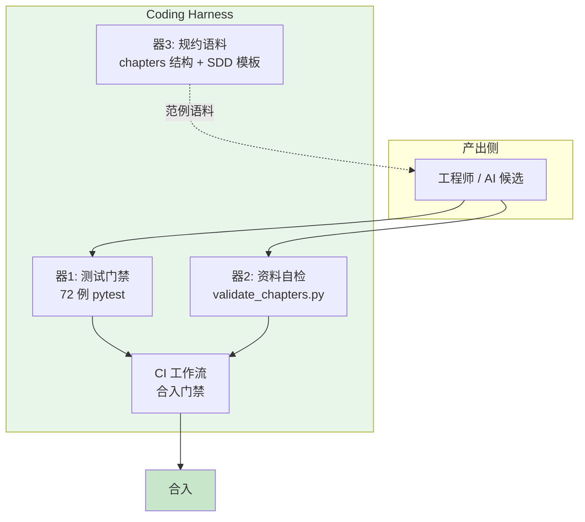

# 09 AI Coding 之器：可治理可验证的 AI Coding Harness

> **本课定位**：本课讲"器"——把前四课的道法术固化成**随取随用的工具集**（Harness）。一个合格的 Coding Harness 要回答三个问题：产出怎么验（验收自动化）、纪律怎么守（门禁自动化）、语料怎么养（示例即语料）。本课以本仓库自建的三个"器"为活教材：全量测试门禁、`validate_chapters.py` 资料自检、SDD 规约文档。
> **教学目标**：①能说出 Coding Harness 的器 1-4 及其对应事故；②能跑通两条验收命令并演示门禁拦截；③能解释围栏检查为何不用数奇偶；④能按"事故驱动"标准为自己的仓库设计器。
> **前置**：第 08 课（术）
> **产出**：Harness 组件清单 + 三个"器"的使用实验
> **对应代码**：`scripts/validate_chapters.py`、`conftest.py`、`.github/workflows/ci.yml`、`chapters/`（规约即语料）
> **对应测试**：全量 72 例 + 自检脚本

---

## 0. 本课要用到的环境

| 组件 | 取值 | 说明 |
|---|---|---|
| 仓库 | 本仓库根 | 三个"器"均已内置 |
| 器 1 | `dataagent/tests/`（72 例） | 代码验收器 |
| 器 2 | `scripts/validate_chapters.py` | 资料验收器（5 类检查） |
| 器 3 | `chapters/README-规约` 与本讲 §4 | 规约语料 |

---

## 1. 问题场景

没有 Harness 的 AI Coding 日常：

- 每次验收都手工跑几个命令，漏跑是常态；
- 资料和代码各改各的，链接断了几个月没人发现（本仓库旧版 42 讲的索引 40/42 失效就是真实案例）；
- 每新人都重新口述一遍"我们的代码纪律"。

有了 Harness：验收 = 一条命令；纪律 = 脚本 + CI；语料 = 仓库本身就是范例。

---

## 2. 概念与机制

### 2.1 Coding Harness 的组件图



### 2.2 器 2 的五类检查（资料门禁设计）

`scripts/validate_chapters.py` 的检查矩阵——每一类都对应旧资料真实发生过的缺陷：

| 检查 | 缺陷根源 | 判定方式 |
|---|---|---|
| C1 围栏平衡 | 模板生成的 ``` 错位（渲染串块） | 逐行状态机模拟，非数奇偶 |
| C2 索引一致 | README 与文件名漂移（40/42 失效） | 双向核对：索引→文件、文件→索引 |
| C3 结构完整 | 缺实验/缺验收/缺 Badcase | 10 字段正则（标题或引用块两种形态） |
| C4 反模板 | 同一占位图复用 81 处 | mermaid 块跨文件去重计数 |
| C5 体量下限 | 退化回 50 行提纲 | 非空行 ≥ 120 |

**设计要诀**：**每一类检查都来自一次真实事故**。凭空设计的检查是过度工程，事故驱动的检查才是精准防御。

### 2.3 器 3：规约即语料

AI Coding 的隐藏常识：**模型模仿语料胜过服从指令**。本仓库把 42 讲按统一 10 字段结构书写——这套结构本身就是给 AI 的最佳语料："以后让 AI 补写第 43 讲，它会自动模仿周围文件的形态"。

---

## 3. 动手实验

### 实验 1：器 1 —— 全量代码门禁

```bash
cd dataagent
$env:PYTHONPATH="src"
python -m pytest -q
```

**预期输出**：

```text
ss.sss.................................................................. [100%]
```

### 实验 2：器 2 —— 资料门禁的拦截演示

```bash
cd ..
python scripts/validate_chapters.py
```

**预期输出**（42 讲全部重写完成后）：

```text
chapters 自检：42 讲 · 索引 42 条 · 下限 120 行
全部通过 ✓（围栏 / 结构 / 体量 / 索引 / 反模板）
```

**演示拦截**：临时把某讲的一个 ``` 删掉再跑，应看到 `[C1 围栏]` 报错——验证门禁真的能拦（验完恢复）。

### 实验 3：器 2 的参数化（分阶段验收）

```bash
python scripts/validate_chapters.py --min-lines 200
```

**预期输出**：以更严的体量标准复检（用于冲刺阶段的收紧验收）。

### 实验 4：器 4 —— CI 等效命令（本地模拟）

```bash
cd dataagent
$env:PYTHONPATH="src"
python -m pytest -q
cd ..
python scripts/validate_chapters.py
echo "CI 等效通过: $?"
```

**判定通过**：两条命令即 CI 的全部内容——本地能跑，CI 才不是黑盒。

---

## 4. 代码走读

### 4.1 `validate_chapters.py` 的围栏检查为什么不用数奇偶

```python
def check_fences(text: str) -> list[str]:
    in_fence = False
    for i, line in enumerate(text.splitlines(), 1):
        if line.strip().startswith("```"):
            in_fence = not in_fence
    if in_fence:
        errors.append(f"围栏未闭合：第 {fence_opens[-1]} 行开启后直到文件结束未关闭")
```

**设计意图**：旧资料的真实缺陷是"数量守恒但开闭错位"（part04/12 两个图实际错位但 ``` 数为偶数）——数奇偶抓不住，必须逐行模拟开闭状态。

### 4.2 `conftest.py`：最小可行 import 器

```python
ROOT = os.path.dirname(os.path.abspath(__file__))
for p in ("services/src", "dataagent/src"):
    sys.path.insert(0, os.path.join(ROOT, p))
```

**设计意图**：测试包根 conftest 保证"从仓库根跑 pytest"可收集——器要**零配置可用**，配置成本每高一分，使用率就跌一半。（对比 `services/api/asgi.py` 中的 sys.path hack 已被移除：**测试期注入路径可以，运行时注入路径不行**——后者掩盖部署缺陷。）

### 4.3 C2 双向核对的设计

```python
for lesson_no, rel in index:
    target = CHAPTERS / rel
    if not target.exists():
        errors.append(f"索引第 {lesson_no} 讲指向不存在的文件: {rel}")
for f in sorted(actual - indexed):
    errors.append(f"文件未被索引收录: {f.relative_to(CHAPTERS)}")
```

**设计意图**：只查"索引→文件"会漏"野文件"（写了没收录），只查"文件→索引"会漏"死链"。双向核对才完整。

---

## 5. 常见错误与 Badcase

| # | 错误现象 | 根因 | 正确做法 |
|---|---|---|---|
| 1 | 自检脚本长期"全绿"但资料仍有问题 | 检查项凭空设计，未对准真实缺陷 | 事故驱动的检查矩阵（本课 §2.2） |
| 2 | 门禁只在 CI 跑，本地从来不跑 | 本地与 CI 环境割裂 | CI 就是本地命令的集合（实验 4） |
| 3 | 规约写 100 条没人遵守 | 规约无执行机制 | 规约 → 检查项 → CI，三层闭环 |
| 4 | 器检查太严导致大量误报，团队加 ignore | 阈值未分阶段 | `--min-lines` 参数化，分阶段收紧 |

---

## 6. 验收

```bash
cd dataagent && $env:PYTHONPATH="src"; python -m pytest -q     # 期望: 248 passed, 5 skipped
cd .. && python scripts/validate_chapters.py                    # 期望: 全部通过 ✓
# 实验2 的临时破坏→拦截→恢复演示完成
```

---

## 7. 思辨与讨论

1. **"器会不会越建越多，最后没人维护？"** 会——所以器的准入标准是"对应一次真实事故 + 一条命令能跑"。本仓库现在只有两个器（测试 + 资料自检），够用且都有明确的事故出处。**器不在多，在每台都有案子**。
2. **"资料也要门禁，是不是过度工程？"** 本仓库的旧版 42 讲就是反例教材：索引失效 40/42、模板图复用 81 处、42 讲全部低于手册体量——**没有门禁时，这些缺陷与代码缺陷共存了很久**。资料的读者（人与 AI）同样值得被质量保护。

---

## 8. 延伸与引用

- 本仓库 `scripts/validate_chapters.py` 源码——本课 §4 的三个设计要诀均在其中
- 参照工程 `lessons/README-编写规约.md`——"规约即语料"的成熟范例
- 第 03 课（能力模型）——器 1/器 2 在 CP-8 中的位置

---

## 9. 本课遗留问题

- 器 2 的 C5 体量阈值（120 行）为经验值，未按篇差异化（认知篇天然比底座篇短）——登记为调参项。
- 代码片段可运行性抽查（从 md 里提取 python 块试跑）未实现——需要更强的隔离沙箱，登记为器 2 的下一代增强。
