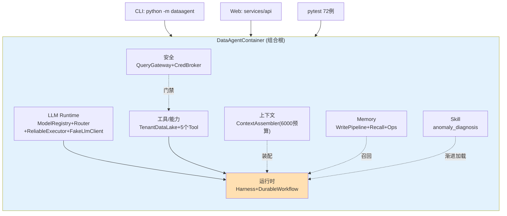

# 10 实战项目立项：多租户零售 DataAgent

> **本课定位**：本课是贯穿实战的起点——给 DataAgent 立项。立项要交付四件事：一句话定位、M0 基线定义、架构选型、可运行验证。本仓库的 `DataAgentContainer` + `default_seed()` + `scripts/demo.py` 就是立项交付物的实物形态。学完本课，你能用同样的四件套给任何 Agent 项目立项。
> **教学目标**：①能用四件套（定位/基线/选型/验证）完成立项；②能读懂组合根装配顺序与依赖关系；③能验证多租户隔离与 CLI/演示双形态；④能识别立项阶段 4 个典型 Badcase。
> **前置**：第 02 课（范式）、第 09 课（器）
> **产出**：DataAgent 立项四件套 + M0 基线验证
> **对应代码**：`dataagent/app/container.py`（组合根）、`scripts/demo.py`（演示）
> **对应测试**：`tests/integration/test_integration.py`

---

## 0. 本课要用到的环境

| 组件 | 取值 | 说明 |
|---|---|---|
| 项目名 | DataAgent —— 多租户零售经营分析与决策 Agent | 全课程贯穿项目 |
| 组合根 | `dataagent/app/container.py` | 依赖注入根，三端（CLI/Web/测试）复用 |
| 演示数据 | `default_seed()`：ten_a 12 单 / ten_b 6 单 | 离线内存数据湖 |
| 验证命令 | `python ../scripts/demo.py` | 在 `dataagent/` 目录执行 |

---

## 1. 问题场景（立项背景）

零售企业的运营团队每天面对三类问题：
1. "华东区 GMV 为什么下滑？"——**诊断类**，需要查数+归因；
2. "这个月预算要不要调？"——**决策类**，需要分析+审批；
3. "把刚才的分析固化成周报能力"——**沉淀类**，需要 Skill 化。

朴素方案（每个问题写一个脚本）会在三个月后变成"脚本地狱"：口径不一致、权限没人管、没有审计。立项就是把这三个问题统一为一个**受治理的 Agent 系统**。

### 立项四件套

| 件 | 内容 | DataAgent 的答案 |
|---|---|---|
| ① 一句话定位 | 给谁、解决什么、边界在哪 | 多租户零售经营分析；做诊断与受控决策建议；不做自动资金操作（必须人审批） |
| ② M0 基线 | 第一版最小可运行形态 | 容器装配 + 内核全离线 + demo 全链路（本课验证） |
| ③ 架构选型 | 范式 / 分层 / 多租户 | Workflow 包 Harness；contracts/domain/infra/adapters/app 五层；租户隔离贯穿数据湖/工具/记忆 |
| ④ 可运行验证 | 立项即有活物 | `demo.py` 端到端 5 段演示全绿 |

---

## 2. 概念与机制

### 2.1 M0 基线：组合根装配图



**设计意图**：组合根是**唯一**知道全部依赖的地方——CLI/Web/测试三端都拿同一个容器，行为完全一致（这就是"离线可运行、可测试、可部署"的结构保证）。

### 2.2 多租户从第一行代码就存在

`default_seed()` 的数据形态：

```python
{
    "ten_a": [  # 12 行：华东 8 行(amount=300) + 华南 4 行(amount=120)，预埋归因维度
        {"order_id": "a0", "region": "华东", "amount": 300, "conversion_rate": 0.5},
        # ...(其余 11 行同构，完整定义见 container.default_seed())
    ],
    "ten_b": [  # 6 行：华北 amount=260
        {"order_id": "b0", "region": "华北", "amount": 260, "conversion_rate": 0.6},
        # ...(其余 5 行同构)
    ],
}
```

数据湖按租户分桶（`TenantDataLake._tables[tenant]`），指标计算按租户独立（`compute_metrics(tenant)`），工具调用带租户上下文（`invoke(params, tenant_id=...)`）——**多租户不是功能，是数据的组织方式**。

### 2.3 演进路线预告（M0 → M4）

| 里程碑 | 内容 | 本仓库落点 |
|---|---|---|
| M0 | 模块化单体 + 离线内核 | `container.py`（本课） |
| M1 | 服务层拆分（API/Worker/队列） | `services/`（Litestar+Granian+Pulsar/Redis） |
| M2 | 真实中间件落库 | `infra/persistence/cockroach.py` |
| M3 | B 端控制台 | `services/api/console_spa.py`（10 页 SPA） |
| M4 | K8s 生产部署 | `deploy/`（Docker/Helm/K8s） |

---

## 3. 动手实验

### 实验 1：立项验证 —— 端到端演示

```bash
cd dataagent
$env:PYTHONPATH="src"
python ../scripts/demo.py
```

**预期输出**（节选）：

```text
[1] 经营诊断链路
   Run=run_48b1d341ba  状态=succeeded
   - autonomous_analysis    [succeeded] {}
   - plan / query / analyze / conclusion / verifier / budget_adjust ...
   事件流长度=15  (可回放/可审计)

[2] 多租户隔离
   ten_a: GMV=2880.0  单量=12.0
   ten_b: GMV=1560.0  单量=6.0

[5] 上下文/Memory/工具/安全 机制自检
✅ 全部演示离线运行成功 —— 完整、可测试、可部署。
```

**判定通过**：5 段演示全绿 = M0 基线成立。

### 实验 2：CLI 形态验证

```bash
python -m dataagent "华南区订单量分析"
```

**预期输出**（节选）：

```text
=== DataAgent 经营诊断 Run: run_xxxxxxxxxx 状态=succeeded ===
查询: 华南区订单量分析

[stp_0001] plan  (succeeded)
[stp_0002] query  (succeeded)
...
=== Run Timeline (事件流) ===
诊断完成 ✅  全部离线运行，无需任何外部 API。
```

### 实验 3：多租户隔离直接验证

```bash
python -m pytest tests/integration/test_integration.py::TestMultiTenant::test_tenant_isolation_in_lake -v
```

**预期输出**：

```text
tests/integration/test_integration.py::TestMultiTenant::test_tenant_isolation_in_lake PASSED
```

该测试断言 ten_a 与 ten_b 相同单量下 GMV 不同（隔离计算）——租户隔离可被测试证明，不是口头承诺。

---

## 4. 代码走读

### 4.1 组合根的装配顺序 = 依赖顺序

```python
# container.py（节选）
self.executor = ReliableExecutor(self.client, self.router, self.registry, max_attempts=2)
self.tools = build_dataagent_toolchain(self.lake)
self.ctx = ContextAssembler(token_budget=6000)
self.harness = Harness(self.executor, self.tools, model="luna",
                       budget=AutonomyBudget(max_steps=6),
                       verifier=Verifier(), stop=StopCondition())
self.workflow = DurableWorkflowExecutor(
    store=self.run_store, approval=self.approval, idem=self.idem,
    harness_runner=lambda run, ctx: self.harness.run(run, "ten_a"))
```

**设计意图**：executor → tools → ctx → harness → workflow，被依赖者先装配。读组合根 = 读架构图。

### 4.2 演示数据为什么要带 conversion_rate 字段

```python
{"order_id": "a0", "region": "华东", "amount": 300, "conversion_rate": 0.5}
```

**设计意图**：领域诊断服务（`domain/analytics.py::RetailDiagnosisService`）按转化率/客单价做归因——立项时的演示数据就要**预埋归因维度**，否则第一版 demo 只能说"GMV 是 X"，说不出"为什么"。

**反面写法**：演示数据只有 amount 一列，归因服务永远输出"流量下降"兜底分支——demo 能跑但毫无说服力。

### 4.3 approval_mode 的环境化

```python
approval_mode=os.getenv("DATAAGENT_APPROVAL_MODE", "auto"),
```

**设计意图**：M0 演示用 auto（审批自动通过，保持演示流畅），生产环境设 manual 走真实 HITL（第 04 课 Badcase #1 的教训：auto 配置误入生产 = 事故）。环境变量显式化让这个风险可审计。

---

## 5. 常见错误与 Badcase

| # | 错误现象 | 根因 | 正确做法 |
|---|---|---|---|
| 1 | 立项 PPT 写了 20 页，第一行可运行代码三周后才出现 | 基线定义缺失 | 立项四件套第②④件：M0 即活物 |
| 2 | 演示环境和生产环境行为不一致 | approval_mode 等配置未环境化 | 环境变量显式 + 默认值安全（manual 优先） |
| 3 | 多租户"以后再加"，首版单租户写死 | 数据模型没预留租户维度 | 数据按租户分桶从第一行开始（default_seed 即如此） |
| 4 | demo 数据随机生成，归因结论每次不同 | 演示数据无预埋语义 | 种子数据带归因维度（conversion_rate/aov） |

---

## 6. 验收

```bash
cd dataagent
$env:PYTHONPATH="src"
python ../scripts/demo.py                                        # 期望: 5 段全绿 ✅
python -m dataagent "华东区本月 GMV 下滑原因诊断"                  # 期望: 状态=succeeded
python -m pytest -q                                              # 期望: 248 passed, 5 skipped
```

---

## 7. 思辨与讨论

1. **"立项要不要先做技术选型（框架/模型）？"** 本仓库的答案是**后置**：M0 用契约 + 假模型把业务闭环跑通，选型推迟到有真实负载画像时（第四篇）。选型早于基线的最大风险是"为了框架削足适履"。
2. **"贯穿项目为什么选'多租户零售分析'？"** 因为它天然覆盖全课程要素：多租户（治理）、诊断（自主性）、预算调整（高风险副作用/审批）、周报偏好（记忆）、口径争议（指标注册）。**选题即教学设计**。

---

## 8. 延伸与引用

- GB/T 9385-2008《软件需求规格说明规范》——立项规格的国标依据
- 本仓库 `docs/00-TOGAF架构总览.md` §架构愿景——立项四件套与 TOGAF A 阶段的映射
- 第 11 课起（LLM 执行底座篇）——M0 之上的第一个演进专题

---

## 9. 本课遗留问题

- `default_seed` 的 ten_a 数据里 order_id 有重复（a0-a7 与 a8-a11 之外复用 a{i} 前缀），演示无碍但做主键实验时要注意——如实登记。
- 立项四件套尚无"项目健康度仪表"（测试数/覆盖率/资料自检的聚合视图）——与 docs/06 审计更新合并推进。
