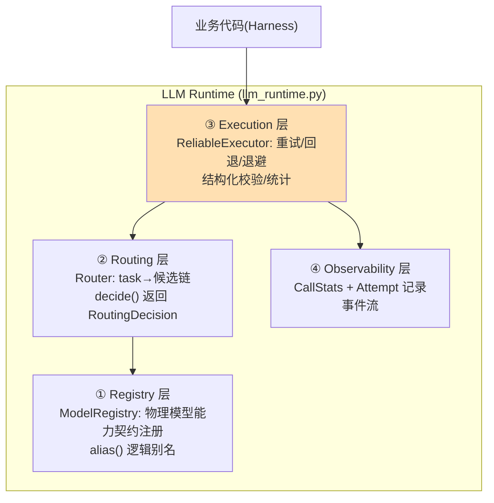

# 11 从散落调用到 LLM Runtime：建立稳定执行入口

> **本课定位**：本课讲第四篇的开篇命题：为什么模型调用必须收口到 Runtime？核心论证：散落调用 = 路由/重试/成本/审计四处失控；Runtime = **一个入口 + 四个分层**（Registry 路由执行观测）。学完本课，你能识别散落调用的六种症状，并理解本仓库 `llm_runtime.py` 的分层设计。
> **教学目标**：①能说出散落调用的六种症状与 Runtime 四层结构；②能演示注册/别名/路由决策；③能解释"换模型 diff=0"的验收判据；④能识别封装缺失的真实缺陷案例。
> **前置**：第 01 课（LogicalCall/Attempt）
> **产出**：Runtime 分层走读 + 散落调用症状对照实验
> **对应代码**：`dataagent/src/dataagent/infra/gateway/llm_runtime.py`
> **对应测试**：`tests/unit/test_llm_runtime.py` 8 例

---

## 0. 本课要用到的环境

| 组件 | 取值 | 说明 |
|---|---|---|
| 核心模块 | `infra/gateway/llm_runtime.py` | LlmError/CallStats/ModelRegistry/Router/ReliableExecutor |
| 对照反例 | 业务代码直接 `openai.chat(...)` | 散落调用 |
| 验证命令 | `python -m pytest tests/unit/test_llm_runtime.py -v` | 在 `dataagent/` 目录执行 |

---

## 1. 问题场景（散落调用的六种症状）

在 Runtime 出现之前，一个典型仓库的模型调用长这样：

```python
# 散落在 17 个文件里的调用（反面教材）
r1 = openai.chat(model="gpt-4", messages=msgs)          # 文件A: 无重试
r2 = openai.chat(model="gpt-4o", messages=msgs)          # 文件B: 换了模型没人知道
r3 = some_sdk.complete(model, msgs, temperature=0.7)     # 文件C: 温度不一致
r4 = openai.chat(model="gpt-4", messages=msgs)           # 文件D: 第4次重复实现重试
```

六种症状：**模型名写死**（换模型=全局搜索替换）、**重试各写各的**（质量参差）、**成本无人统计**、**故障无处注入**、**权限不分租户**、**审计靠日志考古**。Runtime 的本质：把这六件事从"每处自选"收编为"一处强制"。

---

## 2. 概念与机制

### 2.1 Runtime 四层结构



### 2.2 Registry：能力契约是路由的燃料

```python
@dataclass(frozen=True)
class ModelCapability:
    model: str
    supports_tool_calling: bool = True
    max_context_tokens: int = 128000
    cost_per_1k_input: float = 0.0
    latency_p50_ms: float = 0.0
    provider: str = "mock"
```

注册即提供"这个模型能干什么/多贵/多快"的事实——第 12 课路由的全部判定依据都来自这里。

### 2.3 Router：候选链决策

```python
@dataclass
class RoutingDecision:
    chosen: str
    fallbacks: list[str]
    reason: str
```

`Router.decide(task)` 按 task 查候选链、过滤未注册模型、返回首选+降级+理由——**决策是数据对象**，可以进审计。

---

## 3. 动手实验

### 实验 1：注册与别名

```bash
cd dataagent
$env:PYTHONPATH="src"
python -c "
from dataagent.infra.gateway.llm_runtime import ModelRegistry
from dataagent.contracts.model import ModelCapability
reg = ModelRegistry()
reg.register(ModelCapability(model='gpt-real'))
reg.alias('analysis-main', 'gpt-real')     # 逻辑别名
print('直查 =', reg.resolve('gpt-real').model)
print('别名 =', reg.resolve('analysis-main').model)
try:
    reg.resolve('ghost')
except KeyError as e:
    print('未注册拦截:', e)
"
```

**预期输出**：

```text
直查 = gpt-real
别名 = gpt-real
未注册拦截: '未注册的模型: ghost'
```

### 实验 2：路由决策与 fallback 链

```bash
python -c "
from dataagent.infra.gateway.llm_runtime import ModelRegistry, Router
from dataagent.contracts.model import ModelCapability
reg = ModelRegistry()
for m in ('premium', 'standard'): reg.register(ModelCapability(model=m))
rt = Router(reg)
rt.add_route('analysis', ['premium', 'standard'])
d = rt.decide('analysis')
print('chosen =', d.chosen, '| fallbacks =', d.fallbacks, '| reason =', d.reason)
"
```

**预期输出**：

```text
chosen = premium | fallbacks = ['standard'] | reason = task=analysis
```

### 实验 3：验证测试套件

```bash
python -m pytest tests/unit/test_llm_runtime.py -q    # 期望: 8 passed
```

---

## 4. 代码走读

### 4.1 `Router.decide` 的防御式过滤

```python
def decide(self, task: str) -> RoutingDecision:
    candidates = self._routes.get(task) or ["default"]
    available = [c for c in candidates if self._registry.has(c)]
    if not available:
        raise LlmError(f"任务 {task} 无可用模型", retryable=False)
    return RoutingDecision(chosen=available[0], fallbacks=available[1:], reason=f"task={task}")
```

**设计意图**：未注册的候选被**过滤**而非报错（容忍部分故障），全空则抛 `retryable=False`（重试无意义）——两层语义一次讲清。

**反面写法**：`return self._routes[task][0]`——候选里有一个没注册就在运行时 KeyError，且不区分可否重试。

### 4.2 别名机制与"换模型 diff=0"

```python
def alias(self, alias: str, model: str) -> None:
    self._capabilities[alias] = self._capabilities[model]
```

**设计意图**：业务代码只写 `resolve('analysis-main')`；换物理模型只改一行 alias——**切换物理模型时业务代码 diff 为 0**，这是逻辑/物理分层的验收判据。

### 4.3 `ReliableExecutor.registry` 公开访问器

```python
@property
def registry(self) -> ModelRegistry:
    """公开只读访问器 —— 上游（Harness 等）不应触碰私有字段 ``_registry``。"""
    return self._registry
```

**设计意图**：本轮重构前 harness 里写的是 `self.executor._registry`（越权访问私有字段）。公开只读 property 让访问合法且语义清晰——**封装不是洁癖，是让依赖方向可审查**。

---

## 5. 常见错误与 Badcase

| # | 错误现象 | 根因 | 正确做法 |
|---|---|---|---|
| 1 | 换模型全局替换字符串，漏改一处线上炸 | 模型名散落 | alias + Registry，diff=0 换模型 |
| 2 | 某个脚本绕过 Runtime 直调 SDK | 入口不唯一 | Code Review 红线：`import openai` 只允许出现在 adapters/ |
| 3 | 未注册候选静默跳过，fallback 链悄悄变短 | 无装配校验 | 装配后断言每个 task 的 available 候选数 |
| 4 | Router 返回裸字符串模型名 | 决策不可审计 | 返回 RoutingDecision 数据对象（含 reason） |

---

## 6. 验收

```bash
cd dataagent
$env:PYTHONPATH="src"
python -m pytest tests/unit/test_llm_runtime.py -q    # 期望: 8 passed
# 实验1/2 输出与 §3 一致
```

---

## 7. 思辨与讨论

1. **"Runtime 会不会成为单点瓶颈？"** 本仓库的 Runtime 是**进程内库**不是网络网关——没有额外的网络跳数。真正的网关化（虚拟 key/租户配额）是 M1+ 的事（`services/shared` 层），两者不冲突。
2. **"为什么 Router 返回 reason 这么简单（task=xxx）？"** 演示版够用；参照工程把 reason 做成了"候选+排除原因+权重明细"的一等输出。 lesson：**可解释性的成本要趁早付**——等排障时补，就得翻全部调用点。

---

## 8. 延伸与引用

- 第 12 课（多模型路由）——Router 的能力契约细节
- 第 13 课（可靠执行）——Execution 层全面展开
- 本仓库 `docs/03-架构图集.md`——Runtime 在七层架构中的位置

---

## 9. 本课遗留问题

- `RoutingDecision.reason` 目前只含 task 标识，未含"为什么排除其他候选"——与参照工程的差距，如实登记（第 12 课遗留项同源）。
- `CallStats.estimated_cost` 是 `tokens/1000*0.2` 的近似口径，未按模型单价计算——第 14 课治理体系修复。
