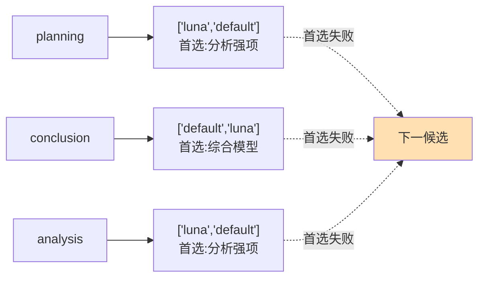

# 12 多模型路由：能力契约与策略路由

> **本课定位**：本课深入 Routing 层：逻辑/物理分层的真正含义（**换物理模型 diff=0**）、候选链设计、多租户模型策略。核心原则：**路由是治理行为不是打分函数**——谁允许用贵模型、谁被降级到便宜模型，是权限与预算问题。学完本课，你能为 DataAgent 的四类任务（分析/SQL/证据/报告）设计路由策略。
> **教学目标**：①能区分别名与逻辑模型并说出 diff=0 判据；②能设计四类任务的候选链并解释"顺序即策略"；③能演示运行时降级与全空 fail-fast；④能复述"能力先于成本"的路由宪法。
> **前置**：第 11 课（Runtime 四层）
> **产出**：四类任务的路由策略 + 策略生效实验
> **对应代码**：`llm_runtime.py::Router`、`container.py`（路由装配）
> **对应测试**：`test_llm_runtime.py::TestRouting` 3 例

---

## 0. 本课要用到的环境

| 组件 | 取值 | 说明 |
|---|---|---|
| 核心模块 | `llm_runtime.py::Router/ModelRegistry` | 路由决策 |
| 装配现场 | `container.py` 的 add_route 三条 | analysis/planning/conclusion |
| 验证命令 | `python -m pytest tests/unit/test_llm_runtime.py -v` | 在 `dataagent/` 目录执行 |

---

## 1. 问题场景（四个真实事故）

DataAgent 接入多模型后（假想 + 参照工程实录）：

1. **SQL 生成被路由到不支持工具调用的便宜模型**——工具调用静默失效，模型退化成自由文本生成 SQL，`SqlGuard` 拦下一堆语法错误，排查两周，根因是路由没看能力契约。
2. **报告生成路由到便宜模型**——成本降 87%，但结论质量崩了，业务投诉"报告变水"，且系统**没有降级事件记录**。
3. **租户白名单未生效**——B 租户用上了 A 租户才配的贵模型（参照工程真实 Badcase：路由只看效果与成本）。
4. **路由不可解释**——运维问"为什么这次用了便宜模型"，回答不上来。

四事故共同根因：**路由是一个函数，不是决策过程**。

---

## 2. 概念与机制

### 2.1 逻辑模型 ≠ 别名

| | 别名（静态映射） | 逻辑模型（能力要求） |
|---|---|---|
| 形态 | `analyst → mock-analyst` 查表 | "analysis 任务需要全能力+高质量" 的画像 |
| 切换物理模型 | 改表 | 改画像/改注册表，**业务 diff=0** |
| 排除低配 | 做不到 | 能力硬过滤：不支持 tool_calling 的不得进入 SQL 生成 |

本仓库的 `ModelCapability`（能力契约）+ `Router.add_route`（候选链）+ `alias` 组合已能实现"diff=0"；画像级硬过滤（按 `supports_tool_calling` 排除）是本课的演进方向（见遗留问题）。

### 2.2 候选链的设计原则



三条原则：
1. **链上必须有降级**——单候选链等于没有容错；
2. **顺序即策略**——首选用贵模型还是稳模型，是业务决策不是技术默认；
3. **候选必须注册**——`decide()` 自动过滤未注册项，装配后应断言链长。

### 2.3 多租户策略（治理视角）

路由的三个治理维度：**谁**（租户权限）能用**什么档**（模型分级）花**多少**（预算）。本仓库 M0 版以 `permission` 字段承载第一维（`Tool.permission`），完整版见参照工程的 `TenantModelPolicy`（白名单/区域/单价上限/日预算/版本号，未配置 fail-closed）。

---

## 3. 动手实验

### 实验 1：DataAgent 的三条路由策略

```bash
cd dataagent
$env:PYTHONPATH="src"
python -c "
from dataagent.app.container import DataAgentContainer
c = DataAgentContainer()
for task in ('analysis', 'planning', 'conclusion'):
    d = c.router.decide(task)
    print(f'{task:12s} chosen={d.chosen:8s} fallbacks={d.fallbacks}')
"
```

**预期输出**：

```text
analysis     chosen=luna     fallbacks=['default']
planning     chosen=luna     fallbacks=['default']
conclusion   chosen=default  fallbacks=['luna']
```

**判定通过**：analysis/planning 首选分析强项 luna，conclusion 首选综合模型 default——**顺序即策略**，与装配代码逐条对应。

### 实验 2：首选"故障"时降级生效

```bash
python -c "
from dataagent.app.container import DataAgentContainer
c = DataAgentContainer()
c.registry._capabilities.pop('luna')   # 模拟 luna 下线
d = c.router.decide('analysis')
print('luna 下线后 chosen =', d.chosen, '| fallbacks =', d.fallbacks)
"
```

**预期输出**：

```text
luna 下线后 chosen = default | fallbacks = []
```

**判定通过**：未注册候选被过滤，链自动收缩到 default——运行时降级不靠重启。

### 实验 3：全空候选链显式报错（retryable=False）

```bash
python -c "
from dataagent.infra.gateway.llm_runtime import ModelRegistry, Router, LlmError
rt = Router(ModelRegistry())
rt.add_route('x', ['ghost1', 'ghost2'])
try:
    rt.decide('x')
except LlmError as e:
    print('拦截:', e, '| retryable =', e.retryable)
"
```

**预期输出**：

```text
拦截: 任务 x 无可用模型 retryable = False
```

---

## 4. 代码走读

### 4.1 `decide` 的过滤语义

```python
available = [c for c in candidates if self._registry.has(c)]
if not available:
    raise LlmError(f"任务 {task} 无可用模型", retryable=False)
return RoutingDecision(chosen=available[0], fallbacks=available[1:], reason=f"task={task}")
```

**设计意图**：部分失败容忍（过滤）、全部失败 fail-fast（不重试）——对照参照工程的"六个硬过滤原因码全部可枚举可断言"，本仓库的简化版保留了核心语义。

### 4.2 装配处：策略集中一处

```python
# container.py
self.router.add_route("analyze", ["luna", "default"])
self.router.add_route("planning", ["luna", "default"])
self.router.add_route("conclusion", ["default", "luna"])
```

**设计意图**：全部路由策略在组合根一屏可见——策略散落是"不可解释"事故的温床。

**反面写法**：在业务代码里 `if task == 'analysis': model = 'luna'`——策略碎片化 + 无法降级 + 无法审计。

---

## 5. 常见错误与 Badcase

| # | 错误现象 | 根因 | 正确做法 |
|---|---|---|---|
| 1 | SQL 生成用了无工具调用能力的模型 | 路由未做能力硬过滤 | 能力契约判定：`supports_tool_calling=False` 不得进入工具链任务（演进项，见遗留） |
| 2 | 贵模型被所有租户随意使用 | 无租户模型策略 | 白名单 + 单价上限 + 日预算（参照工程 TenantModelPolicy 形态） |
| 3 | 降级发生但无人知晓 | 无降级事件 | `RoutingDecision`/Attempt 记录降级事实，进审计流 |
| 4 | 换模型全局替换漏改 | 模型名散落业务代码 | alias + 组合根集中装配 |

---

## 6. 验收

```bash
cd dataagent
$env:PYTHONPATH="src"
python -m pytest tests/unit/test_llm_runtime.py -q    # 期望: 8 passed
# 实验1 三条策略输出与 §3.1 一致；实验2 降级输出与 §3.2 一致
```

---

## 7. 思辨与讨论

1. **"路由该自动打分还是显式配置？"** 本仓库立场：**M0 显式配置**（策略可见可审计），自动化打分要等有真实成本/质量数据后再上（否则是"看起来智能的拍脑袋"）。参照工程的三维权重（质量/成本/时延）是 M1+ 演进方向。
2. **"能力硬过滤为什么必须先于成本优化？"** 第 1 课事故：能力不匹配的模型进任务 = 静默失败，排查成本远超省下的模型费。**权限先于相关性，能力先于成本**——两句话是路由层的宪法。

---

## 8. 延伸与引用

- 参照工程 `lessons/第4篇/L4-2-多模型路由.md`——六个硬过滤原因码与 TaskProfile 的完整实现
- 第 14 课（模型治理）——成本归集与策略版本化
- 本仓库 `container.py`——路由装配现场

---

## 9. 本课遗留问题（如实登记）

- ~~本仓库 Router 尚未实现"按 `supports_tool_calling` 硬过滤"~~ → **已实现（GAP-06）**：`Router.add_route(require_capabilities=...)` 装配期声明 + `decide` 排除并记录原因；测试见 `test_routing_and_deadline.py::TestCapabilityHardFilter`。
- ~~`RoutingDecision.reason` 未含排除原因明细~~ → **已实现**：`excluded: list[(model, reason)]` 成为一等输出，reason 携带排除明细（含 `model_not_registered`）。
- 租户级模型策略（白名单/预算）未落地——生产演进项，形态参照 `TenantModelPolicy`。
