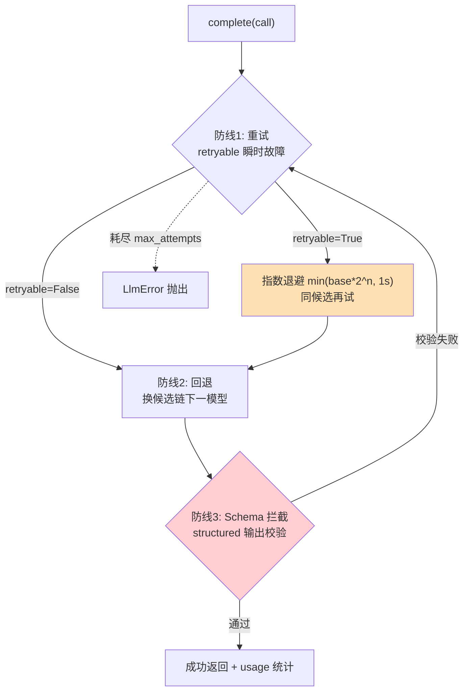

# 13 高并发下可靠的模型执行：重试、回退与结构化校验

> **本课定位**：本课深入 Execution 层——`ReliableExecutor` 的完整语义："模型调用成功 ≠ 任务成功"。核心内容：Attempt 生命周期、指数退避与封顶、可重试/不可重试的语义分界、结构化输出校验（schema 拦截）。学完本课，你能为本仓库的执行器做确定性测试（可注入时钟/退避），并理解每条防线拦的是什么。
> **教学目标**：①能画出执行器三道防线图；②能用注入 sleep 技法做确定性测试；③能区分三类故障的 retryable 语义；④能解释校验失败归一为 LlmError 的设计。
> **前置**：第 12 课（候选链）
> **产出**：执行器三防线实验 + 确定性测试技法
> **对应代码**：`llm_runtime.py::ReliableExecutor`
> **对应测试**：`test_llm_runtime.py` 8 例、`tests/fault/` 4 例

---

## 0. 本课要用到的环境

| 组件 | 取值 | 说明 |
|---|---|---|
| 核心模块 | `ReliableExecutor(client, router, registry, max_attempts, base_backoff_s, sleep)` | 本轮重构后支持注入 sleep |
| 验证命令 | `python -m pytest tests/unit/test_llm_runtime.py tests/fault/ -v` | 在 `dataagent/` 目录执行 |

---

## 1. 问题场景

高并发下模型调用的三层崩法：

1. **瞬时故障**（网络抖动/限流）：一次失败就放弃 → 成功率暴跌；
2. **重试风暴**：无上限无退避地重试 → 配额烧光、故障放大；
3. **格式漂移**：模型偶发输出非法 JSON → 下游解析崩溃，且**重试也没有用**（除非校验后触发重试）。

`ReliableExecutor` 的设计就是给这三层崩法各配一道防线。

---

## 2. 概念与机制

### 2.1 三道防线



### 2.2 Attempt：每一次物理尝试的档案

```python
@dataclass
class Attempt:
    attempt_index: int
    status: CallStatus          # succeeded / failed / timed_out
    started_at: float
    finished_at: Optional[float] = None
    error: Optional[str] = None
    usage: Optional[Usage] = None
```

失败的可观测性全部挂在 Attempt 上：几次尝试、每次多久、错在哪、花了多少 token——排障不再靠猜。

### 2.3 retryable 的语义分界

| 故障类型 | 例子 | retryable | 执行器行为 |
|---|---|---|---|
| 瞬时 | 超时、限流、5xx | `True` | 退避重试 |
| 永久 | 参数非法、无可用模型 | `False` | 直接进入下一候选/抛出 |
| 格式 | 结构化校验失败 | `True`（包装为 LlmError） | 重试（可能模型这次就对了） |

---

## 3. 动手实验

### 实验 1：重试后恢复 + 统计完整

```bash
cd dataagent
$env:PYTHONPATH="src"
python -m pytest tests/unit/test_llm_runtime.py::TestReliableExecution::test_retries_then_recovers -v
```

**预期输出**：

```text
tests/unit/test_llm_runtime.py::TestReliableExecution::test_retries_then_recovers PASSED
```

### 实验 2：确定性测试 —— 注入 sleep 消除等待

```bash
python -c "
from dataagent.infra.gateway.llm_runtime import ModelRegistry, ReliableExecutor, Router
from dataagent.contracts.model import LogicalCall, Message, ModelCapability, Role
from dataagent.adapters.llm.fake_client import FakeLlmClient
from dataagent.infra.gateway.llm_runtime import LlmError

reg = ModelRegistry(); reg.register(ModelCapability(model='demo'))
rt = Router(reg); rt.add_route('t', ['demo'])
client = FakeLlmClient(fail_times=3)
slept = []
ex = ReliableExecutor(client, rt, reg, max_attempts=4, sleep=slept.append, base_backoff_s=0.1)
call = LogicalCall.new(task='t', capability=reg.resolve('demo'),
                       messages=[Message(role=Role.USER, content='x')])
r = ex.complete(call)
print('成功; 退避序列 =', [round(x,2) for x in slept])
print('stats.attempts =', ex.stats.attempts, '| retries =', ex.stats.retries)
"
```

**预期输出**：

```text
成功; 退避序列 = [0.1, 0.2, 0.4]
stats.attempts = 1 | retries = 3
```

**判定通过**：`sleep=slept.append` 把退避变成**可断言的数据**——测试不真睡，但退避序列被完整记录。这就是"注入退避实现"的确定性测试法（本轮重构新增的能力）。

### 实验 3：schema 校验失败触发重试

```bash
python -m pytest tests/unit/test_llm_runtime.py::TestReliableExecution::test_structured_output_validation -v
# PASSED —— 校验失败包装为 retryable LlmError，进入重试
```

### 实验 4：耗尽后抛出 + Attempt 档案完整

```bash
python -m pytest tests/fault/test_fault_injection.py::TestFaultInjection::test_attempt_lifecycle_recorded -v
# PASSED —— 失败尝试的 status/error/timestamps 全部入档
```

---

### 进阶实验（第四/五轮新特性）：deadline 与限流型退避

```bash
python -m pytest tests/unit/test_routing_and_deadline.py tests/unit/test_gap_round5.py::TestFaultQuadrantComplete -v
```

**预期输出**（节选）：

```text
tests/unit/test_routing_and_deadline.py::TestDeadlineInterception::test_deadline_already_past_means_zero_attempts PASSED
tests/unit/test_routing_and_deadline.py::TestDeadlineInterception::test_deadline_stops_retrying_midway PASSED
tests/unit/test_gap_round5.py::TestFaultQuadrantComplete::test_rate_limit_uses_server_directed_backoff PASSED
tests/unit/test_gap_round5.py::TestFaultQuadrantComplete::test_timeout_fault_uses_exponential_backoff PASSED
```

限流型退避的确定性对照（服务端指示 vs 本地指数）：

```bash
python -c "
from dataagent.adapters.llm.fake_client import FakeLlmClient
from dataagent.contracts.model import LogicalCall, Message, ModelCapability, Role
from dataagent.infra.gateway.llm_runtime import ModelRegistry, ReliableExecutor, Router
reg = ModelRegistry(); reg.register(ModelCapability(model='demo'))
rt = Router(reg); rt.add_route('t', ['demo'])
client = FakeLlmClient(fail_times=2, fail_mode='rate_limit', retry_after_s=0.5)
slept = []
ex = ReliableExecutor(client, rt, reg, max_attempts=3, sleep=slept.append, base_backoff_s=0.2)
call = LogicalCall.new(task='t', capability=reg.resolve('demo'), messages=[Message(role=Role.USER, content='x')])
ex.complete(call)
print('退避序列 =', slept)
print('本地指数退避会是 =', [0.2, 0.4])
"
```

**预期输出**（真实运行）：

```text
退避序列 = [0.5, 0.5]
本地指数退避会是 = [0.2, 0.4]
```

**读法**：429 的 `Retry-After` 是上游的容量事实，执行器**听上游的**（0.5+0.5）而不是猜（0.2+0.4）——省配额也少等待。

## 4. 代码走读

### 4.1 双循环与两类异常处理

```python
for attempt_idx in range(self.max_attempts):
    for model in attempt_models:
        try:
            result = self._client.complete(...)
            if structured is not None and result.structured is not None:
                self._validate_structured(result.structured, structured, model)
            ...
            return result
        except LlmError as e:
            if not e.retryable:
                break                      # 永久故障：放弃本候选
            self._sleep(min(self.base_backoff_s * (2 ** attempt_idx), 1.0))
        except Exception as e:
            last_error = LlmError(str(e), retryable=True)   # 未知异常按瞬时处理
```

**设计意图**：`except LlmError` 与 `except Exception` 分开——已知故障按其 retryable 语义走，未知故障保守按可重试处理（宁可多试不可误弃）。

**反面写法**：一个 `except Exception` 全兜住——retryable 语义失效，永久故障也白白重试。

### 4.2 校验失败 = 调用失败

```python
def _validate_structured(self, data, model_type, model):
    try:
        if hasattr(model_type, "model_validate"):
            model_type.model_validate(data)
        else:
            inspect.signature(model_type).bind(**data)
    except Exception as e:
        raise LlmError(f"结构化输出校验失败 [{model}]: {e}", retryable=True) from e
```

**设计意图**：把 schema 违规**统一进 LlmError 体系**（retryable=True）——下游永远看不到非法结构，格式正确性从"希望"变"门禁"（第 05 课 GE 层的执行层保障）。

### 4.3 统计与延迟度量

```python
start = time.time()
result = self._client.complete(...)
self.stats.total_latency_ms += (time.time() - start) * 1000
```

**设计意图**：耗时统计挂 Attempt 粒度——注意 wall-clock 度量受机器负载影响，**不能用于截止时间判定**（参照工程为此把 monotonic 时钟做成可注入；本仓库 M0 版以统计用途为主，截止时间语义见遗留）。

---

## 5. 常见错误与 Badcase

| # | 错误现象 | 根因 | 正确做法 |
|---|---|---|---|
| 1 | 重试测试偶发失败（CI 上 flaky） | 依赖真实 sleep 时长 | 注入 sleep（实验 2 的 `sleep=slept.append` 技法） |
| 2 | 结构化输出偶发崩溃下游 | 校验在下游做、且失败不重试 | 执行器内校验 + 失败转 retryable |
| 3 | 重试把限流打成封禁 | 无退避/无封顶 | `min(base*2^n, cap)` 指数退避封顶 |
| 4 | 永久故障重试 N 次浪费时间 | 异常不带 retryable | 异常类型携带语义，执行器分派 |
| 5 | 耗尽后抛的异常丢了上下文 | 只抛最后一个 message | `last_error` 汇聚 + Attempt 档案可查 |

---

## 6. 验收

```bash
cd dataagent
$env:PYTHONPATH="src"
python -m pytest tests/unit/test_llm_runtime.py tests/fault/ -q    # 期望: 12 passed
# 实验2 退避序列输出与 §3.2 一致
```

---

## 7. 思辨与讨论

1. **"为什么退避要封顶 1 秒？"** 指数退避不封顶：第 10 次重试睡 0.2×2⁹≈102 秒——长任务里一次抖动就变成"假死"。封顶让"重试 budget"可控，配合 max_attempts 才是完整的失败预算。
2. **"校验失败算不算'模型失败'？"** 本仓库回答：算——统一进 LlmError 后，重试/统计/审计全部复用，下游无需知道"这次失败是网络还是格式"。**故障归一化是执行层的核心抽象**。

---

## 8. 延伸与引用

- 参照工程 `services/llm/executor.py`——deadline/monotonic 可注入的完整实现（本课遗留的演进方向）
- 第 20 课（故障工程）——故障分类学的系统化
- 本仓库 `tests/unit/test_llm_runtime.py`——8 例的语义覆盖清单

---

## 9. 本课遗留问题（如实登记）

- ~~`LogicalCall.deadline` 字段已存在但执行器未实现"deadline 拦截重试"~~ → **已实现（GAP-01）**：`complete(call, deadline=<monotonic 瞬时值>)` 每次尝试前拦截，已过期即 retryable=False 终止并计 `stats.timeouts`；monotonic 可注入，"截止时间已过 → 零次尝试"可确定性断言（`test_routing_and_deadline.py::TestDeadlineInterception`）。
- **硬超时强杀仍未实现**：同步客户端无法终止挂起中的调用，deadline 拦的是"重试终止"语义；强杀需线程池/异步化——如实登记为下一阶段。
- `CallStats.estimated_cost` 未按 `ModelCapability.cost_per_1k_*` 计算——第 14 课修复。
