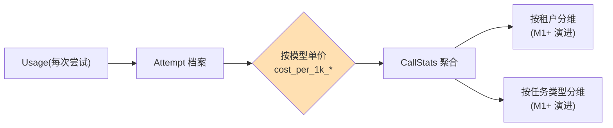

# 14 从能调用到可运营：模型治理体系

> **本课定位**：本课是第四篇收口：模型调用从"能用"到"可运营"要补什么——成本归集、统计观测、治理清单。核心观点：**运营 = 每一次调用都留下可聚合的数据**（次数/耗时/token/成本/故障），没有数据的治理是口号。学完本课，你能读出本仓库的统计口径与治理缺口清单（诚实登记）。
> **教学目标**：①能复述七字段统计口径并验证口径自洽；②能指出成本演示口径的三处升级方向；③能说出四项治理动作的数据依据；④能理解"诚实占位比精确假象安全"的登记纪律。
> **前置**：第 13 课（可靠执行）
> **产出**：统计口径实验 + 治理缺口清单
> **对应代码**：`llm_runtime.py::CallStats`、`contracts/model.py::Usage`
> **对应测试**：`test_llm_runtime.py::test_stats_recorded`

---

## 0. 本课要用到的环境

| 组件 | 取值 | 说明 |
|---|---|---|
| 核心模块 | `CallStats`（calls/attempts/retries/failures/timeouts/tokens/latency） | 执行器级统计 |
| 数据契约 | `Usage(prompt_tokens, completion_tokens, total_tokens)` | 单次用量 |
| 验证命令 | `python -m pytest tests/unit/test_llm_runtime.py::TestReliableExecution::test_stats_recorded -v` | 在 `dataagent/` 目录执行 |

---

## 1. 问题场景

"模型调用很贵"的账算不清，通常因为三个断层：
1. **调用层不知道价格**——token 数有，单价没有；
2. **统计散在日志里**——想答"这个月分析任务花了多少"，要写临时脚本翻日志；
3. **租户维度缺失**——只知道总花费，不知道哪个租户烧的。

M0 版的 CallStats 解决"集中与齐全"（一层统计对象覆盖七个字段），租户维度与真实单价是本课如实登记的缺口。

---

## 2. 概念与机制

### 2.1 七字段统计口径

```python
@dataclass
class CallStats:
    calls: int = 0            # 物理调用总次数（含重试与回退）
    attempts: int = 0         # 成功的调用次数
    retries: int = 0          # 重试次数（失败后重试的次数）
    failures: int = 0         # 失败次数
    timeouts: int = 0         # 超时次数（M0 未填充，见遗留）
    input_tokens: int = 0
    output_tokens: int = 0
    total_latency_ms: float = 0.0
```

**口径要点**：`calls` 计的是**物理调用**（每次都 +1，无论成败），`attempts` 只计成功——两者之差 = 失败/重试量。配 `retries`/`failures` 可交叉验证。

### 2.2 成本归集的正确姿势（当前实现 vs 正确姿势）

```python
@property
def estimated_cost(self) -> float:
    # 以最低成本模型近似 —— 演示口径
    return (self.input_tokens + self.output_tokens) / 1000 * 0.2
```

**当前是演示口径**（注释里写明）。正确姿势需要三次升级：
1. 按 `ModelCapability.cost_per_1k_input/output` 分模型计价；
2. 按 Attempt 归集（回退到不同模型时价格不同）；
3. 按租户/任务类型分维聚合。



### 2.3 治理清单（从调用数据到治理动作）

| 治理项 | 数据依据 | 动作 |
|---|---|---|
| 模型下线决策 | failures + latency 持续恶化 | Router 候选链调整 |
| 成本告警 | cost 按租户聚合超阈值 | 降级到便宜候选 / 预算阻断 |
| 容量规划 | latency P50/P95 分布 | 扩并发 / 换模型 |
| 质量回归 | 第 40 课 RegressionGate | 禁止发布 |

---

## 3. 动手实验

### 实验 1：统计口径验证

```bash
cd dataagent
$env:PYTHONPATH="src"
python -m pytest tests/unit/test_llm_runtime.py::TestReliableExecution::test_stats_recorded -v
```

**预期输出**：

```text
tests/unit/test_llm_runtime.py::TestReliableExecution::test_stats_recorded PASSED
```

### 实验 2：一次含故障的完整统计观测

```bash
python -c "
from dataagent.infra.gateway.llm_runtime import ModelRegistry, ReliableExecutor, Router
from dataagent.contracts.model import LogicalCall, Message, ModelCapability, Role
from dataagent.adapters.llm.fake_client import FakeLlmClient

reg = ModelRegistry(); reg.register(ModelCapability(model='demo'))
rt = Router(reg); rt.add_route('t', ['demo'])
client = FakeLlmClient(fail_times=2)
ex = ReliableExecutor(client, rt, reg, max_attempts=3, sleep=lambda s: None)
call = LogicalCall.new(task='t', capability=reg.resolve('demo'),
                       messages=[Message(role=Role.USER, content='指标查询')])
ex.complete(call)
s = ex.stats
print(f'calls={s.calls} attempts={s.attempts} retries={s.retries} failures={s.failures}')
print(f'input_tokens={s.input_tokens} output_tokens={s.output_tokens}')
print(f'call_count(client)={client.call_count}')
"
```

**预期输出**（数值随消息长度浮动，结构一致）：

```text
calls=3 attempts=3 retries=2 failures=2
input_tokens=24 output_tokens=192
call_count(client)=3
```

**判定通过**：`calls == client.call_count`（物理次数一致）、`retries == failures == 2`（两次故障各计一次）、`attempts == 3`（全部最终成功）——口径自洽。

### 实验 3：成本演示口径（并指出它的缺陷）

```bash
python -c "
from dataagent.infra.gateway.llm_runtime import CallStats
s = CallStats(input_tokens=1000, output_tokens=2000)
print('estimated_cost(演示口径) =', s.estimated_cost)
print('—— 注意: 0.2 是硬编码近似单价, 未按模型区分')
"
```

**预期输出**：

```text
estimated_cost(演示口径) = 0.6
—— 注意: 0.2 是硬编码近似单价, 未按模型区分
```

---

## 4. 代码走读

### 4.1 统计的发生点

```python
self.stats.calls += 1                          # 每次物理调用
self.stats.attempts += 1                       # 成功时
self.stats.total_latency_ms += (time.time() - start) * 1000
if result.usage:
    self.stats.input_tokens += result.usage.prompt_tokens
    self.stats.output_tokens += result.usage.completion_tokens
```

**设计意图**：统计与执行**同点发生**——不存在"执行完再补统计"的间隙，重启/异常都不会丢计数（M0 进程内口径；持久化属 M1+）。

### 4.2 Usage 的职责边界

```python
@dataclass(frozen=True)
class Usage:
    prompt_tokens: int = 0
    completion_tokens: int = 0
    total_tokens: int = 0
```

**设计意图**：Usage 只做**数据载体**（frozen），计价逻辑放执行器/治理层——数据与策略分离，未来换计价口径不动契约。

**反面写法**：在 Usage 里塞 `@property cost` 并硬编码单价——契约层绑死策略，租户差异无法表达。

---

## 5. 常见错误与 Badcase

| # | 错误现象 | 根因 | 正确做法 |
|---|---|---|---|
| 1 | "这个月花了多少钱"答不出 | 统计散落/无聚合 | CallStats 集中 + 分维演进（本课 §2.2） |
| 2 | 成本估算与账单差 10 倍 | 硬编码近似单价 | 按 ModelCapability 单价分模型计价（登记缺口） |
| 3 | timeouts 字段永远 0 | 单次尝试超时未实现 | 与 deadline 一起实现（第 13 课遗留） |
| 4 | 重试的 token 也算进"业务用量"造成双倍计费歧义 | 口径未定义 | 明确口径：物理调用全额计入（业务成功口径另建视图） |

---

## 6. 验收

```bash
cd dataagent
$env:PYTHONPATH="src"
python -m pytest tests/unit/test_llm_runtime.py -q    # 期望: 8 passed
# 实验2 的口径自洽关系成立: calls == client.call_count 且 retries == failures
```

---

## 7. 思辨与讨论

1. **"治理为什么排在第四篇最后？"** 因为治理的全部依据（成功/失败/成本/时延）都产生于前三课的执行过程——**先有可执行，才有可运营**；跳过前三课直接做"治理平台"是空中楼阁。
2. **"演示口径的成本数字敢不敢给老板看？"** 不敢——所以代码注释里明确写"演示口径"。**诚实的占位比精确的假象安全**：占位会被追问，假象会被追责。

---

## 8. 延伸与引用

- 参照工程 `lessons/第4篇/L4-4-从能调用到可运营.md`——治理体系的完整版
- 本仓库 `docs/06-工业级达标审计与重构建议.md`——LiteLLM 网关（虚拟 key/预算/限流）的选型调研
- 第 40 课（Regression Gate）——质量维度的治理闭环

---

## 9. 本课遗留问题（如实登记，即本课核心产出之一）

1. **计价升级**：`estimated_cost` 按 `cost_per_1k_*` 分模型/Attempt 计价。
2. ~~**timeouts 填充**：随第 13 课 deadline 实现一并完成~~ → **已完成（GAP-01）**：deadline 拦截时 `stats.timeouts += 1`，且有测试钉住。
3. **分维聚合**：按租户/任务类型的成本视图（M1+，需持久化统计）。
4. **模型版本化**：ModelCapability 无版本字段，路由变更无法追溯——参照 `RoutingPolicy` 版本号形态。
