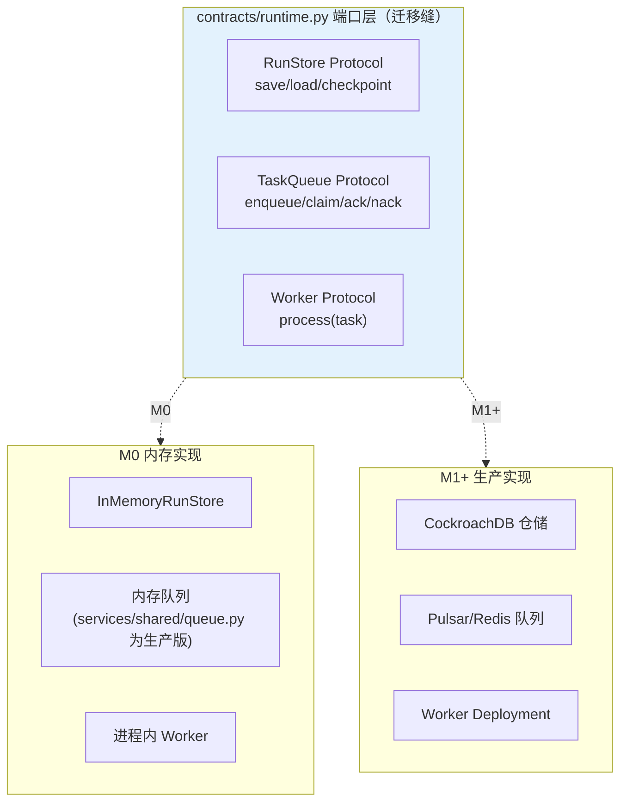

# 15 Agent Runtime 混合架构选型

> **本课定位**：第五篇开篇。本课回答：Runtime 层有哪些候选架构（进程内编排 / Workflow 引擎 / 分布式编排器），DataAgent 为什么选"进程内 Durable Workflow 包 Harness"作为 M0，何时迁移到分布式。学完本课，你能用"选型判定表"为自己的项目做 Runtime 选型并说明理由。
> **教学目标**：①能用三问判定表完成 Runtime 选型；②能解释"迁移缝"的设计与实证；③能换自定义 RunStore 验证端口可替换性；④能识别四种选型错误姿势。
> **前置**：第 02 课（范式）、第 10 课（立项）
> **产出**：选型判定表 + 本仓库选型的验证实验
> **对应代码**：`infra/runtime/workflow.py`（M0 选型落点）、`contracts/runtime.py::TaskQueue/Worker`（分布式预留端口）
> **对应测试**：`tests/integration/test_integration.py`

---

## 0. 本课要用到的环境

| 组件 | 取值 | 说明 |
|---|---|---|
| 候选 A | 进程内函数调用（裸编排） | 反面基线 |
| 候选 B | 进程内 Durable Workflow（本仓库 M0） | 检查点+审批+幂等 |
| 候选 C | 分布式编排（Temporal/Celery 形态） | 端口已预留（`TaskQueue`/`Worker` 协议） |
| 验证命令 | `python -m pytest tests/integration/test_integration.py -q` | 在 `dataagent/` 目录执行 |

---

## 1. 问题场景

选型的三个常见错误姿势：
1. **一步到位**：M0 就上 Temporal + K8s，结果业务闭环没跑通，先花两周搭集群；
2. **永不迁移**：所有逻辑写死在进程内，等到要恢复/扩容时发现检查点/队列概念根本不存在；
3. **为迁移而抽象**：全部依赖都套一层接口，M0 就背上了 M3 的复杂度。

正确姿势：**基线选简单的，但把"迁移缝"预留在正确的位置**——本仓库的做法是 `TaskQueue`/`Worker`/`RunStore` 以 Protocol 端口形式存在，M0 用内存实现，生产换分布式实现。

---

## 2. 概念与机制

### 2.1 三个候选的对比矩阵

| 判定维度 | A 进程内裸编排 | B Durable Workflow（M0 选择） | C 分布式编排（M1+） |
|---|---|---|---|
| 中断恢复 | 无（进程死=全丢） | Checkpoint 恢复 | 跨进程租约+持久化 |
| 人工审批 | 阻塞进程 | WAITING_APPROVAL + 恢复 | 审批服务独立 |
| 副作用幂等 | 自求多福 | IdempotencyStore | 分布式幂等键 |
| 扩展并发 | 单进程 | 单进程 | Worker 池水平扩展 |
| 运维成本 | 零 | 低（无外部依赖） | 高（集群） |
| 适用阶段 | 原型 | **M0-M1 闭环** | 生产规模化 |

### 2.2 本仓库选型的"迁移缝"预留



### 2.3 选型判据：三个问题的答案

1. **任务会中断吗？**（长任务/审批等待）→ 会：需要 Checkpoint（B 起步）；
2. **副作用可重复吗？**→ 不可：需要幂等（B 起步）；
3. **并发量需要多进程吗？**→ M0 否 / 生产是：端口预留（B→C 缝）。

三个答案指向 B：**Durable Workflow 是"够用的确定性"与"预留的扩展性"之间的最优点**。

---

## 3. 动手实验

### 实验 1：验证 M0 选型的三大能力（检查点/审批/幂等）共存

```bash
cd dataagent
$env:PYTHONPATH="src"
python -m pytest tests/integration/test_integration.py -q
```

**预期输出**：8 passed（覆盖 full_pipeline / approval_gate / checkpoint 回放 / 故障恢复）。

### 实验 2：检查点恢复演示

```bash
python -m pytest tests/integration/test_integration.py::TestReplay::test_report_replayable_via_checkpoint -v
# PASSED —— to_checkpoint() 与事件流等长, 可重建
```

### 实验 3：端口层的可替换性（换一个 RunStore 实现零改动业务）

```bash
python -c "
from dataagent.contracts.runtime import Run, RunStore, Checkpoint
from typing import Optional
class MyStore(RunStore):   # 自定义实现 —— 端口契约不变
    def __init__(self): self.d = {}
    def save(self, run): self.d[run.run_id] = run
    def load(self, run_id): return self.d[run_id]
    def save_checkpoint(self, cp): pass
    def load_checkpoint(self, run_id): return None
from dataagent.infra.runtime.workflow import DurableWorkflowExecutor, HumanApprovalGate, IdempotencyStore, InMemoryApprovalPort, WorkflowDefinition, WorkflowNode
ex = DurableWorkflowExecutor(store=MyStore(), approval=HumanApprovalGate(InMemoryApprovalPort(auto_approve=True)), idem=IdempotencyStore(), harness_runner=lambda run, ctx: run)
run = ex.execute(WorkflowDefinition('x', nodes=[WorkflowNode('t', 'task', fn=lambda r, i: {'ok': 1})]), Run(query='x'))
print('自定义 Store 下状态 =', run.status.value)
"
```

**预期输出**：

```text
自定义 Store 下状态 = succeeded
```

**判定通过**：换 RunStore 实现，业务与执行器零改动——这就是"迁移缝"的实证。

---

## 4. 代码走读

### 4.1 端口定义：`contracts/runtime.py`

```python
class RunStore(Protocol):
    def save(self, run: Run) -> None: ...
    def load(self, run_id: str) -> Run: ...
    def save_checkpoint(self, cp: Checkpoint) -> None: ...
    def load_checkpoint(self, run_id: str) -> Optional[Checkpoint]: ...

class TaskQueue(Protocol):
    def enqueue(self, run_id: str, queue: str, payload: Any) -> None: ...
    def claim(self, queue: str) -> Optional[TaskData]: ...
    def ack(self, run_id: str) -> None: ...
    def nack(self, run_id: str, requeue: bool = True) -> None: ...
```

**设计意图**：`TaskQueue` 的 `nack(requeue)` 直接对应 Pulsar/NACK 语义——端口形状按**目标底座**设计，迁移时无需改形状。

### 4.2 生产队列的现成实现（`services/shared/queue.py`）

服务层已实现"Pulsar 优先 / Redis 兜底"的队列（NACK 重试 + 超限落 DLQ）——内核的 Protocol 与服务层的实现是同一套语义，这是 M1 迁移已经完成一半的证据。

---

## 5. 常见错误与 Badcase

| # | 错误现象 | 根因 | 正确做法 |
|---|---|---|---|
| 1 | M0 直接上分布式编排，两周没跑通业务 | 选型超前 | 判定表三问 → M0 选 B |
| 2 | 想上 K8s 时发现队列/检查点概念不存在 | 未预留迁移缝 | Protocol 端口（本课 §2.2） |
| 3 | 所有依赖套接口，M0 复杂度爆炸 | 为迁移而抽象 | 只给**真的会换**的依赖留端口（存储/队列/Worker） |
| 4 | 内存版 RunStore 被误用到多进程生产 | 内存实现无跨进程语义 | 文档显式声明"单进程限定"（参照工程 §8 的教训） |

---

## 6. 验收

```bash
cd dataagent
$env:PYTHONPATH="src"
python -m pytest tests/integration/test_integration.py -q    # 期望: 8 passed
# 实验3 自定义 Store 输出与 §3.3 一致
```

---

## 7. 思辨与讨论

1. **"Protocol 端口 vs 依赖注入框架？"** 本仓库用 `typing.Protocol`（结构化鸭子类型）：实现方**不需要** import 基类，天然低耦合。DI 框架解决的是"装配"问题，端口解决的是"契约"问题——本仓库组合根手写装配已够，无需框架。
2. **"什么时候必须迁 C（分布式）？"** 三个硬信号：①检查点需要跨进程恢复；②单进程内存装不下 Run 历史；③审批/Worker 需要独立伸缩。信号没出现就迁，是为迁移而迁移。

---

## 8. 延伸与引用

- 第 19 课（分布式 Runtime）——端口的生产化实现
- 参照工程 `docs/adr/0001-unified-execution-model.md`——统一执行模型的 ADR 范例
- 本仓库 `deploy/k8s/`——C 候选的部署形态

---

## 9. 本课遗留问题

- `RunStore.load` 对不存在 run 的语义（KeyError）未在 Protocol 文档中规定——契约细节，登记。
- 分布式租约（多 Worker 抢占同一 Run）未建模——第 19 课主题，端口已预留。
