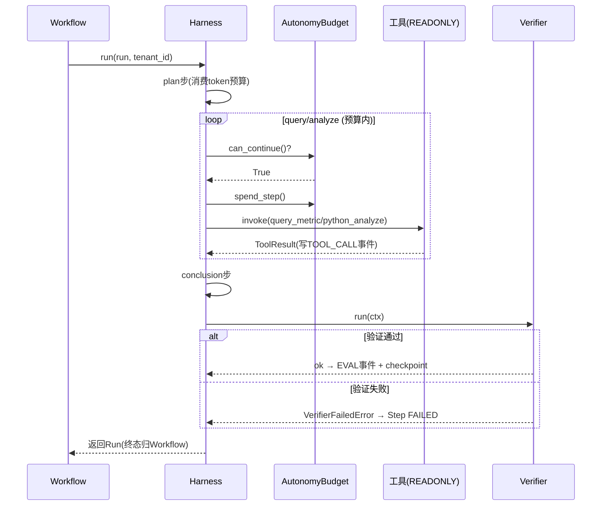

# 16 从 while 循环到 Autonomous Harness

> **本课定位**：本课把第五篇第 2 课讲透：裸 while 循环的四种死法，以及 `Harness` 的四件套（预算/验证器/停止条件/事件流）如何逐一救活。学完本课，你能为一个自主任务配置合理的预算参数，并用 Verifier 规则把"完成"钉在可观测事实上。
> **教学目标**：①能说出裸 while 四种死法与四件套的对应；②能配置预算三参数并解释依据；③能演示验证失败 fail-closed 全链路；④能使用注入时钟做确定性耗时断言。
> **前置**：第 02 课（范式分工）
> **产出**：四件套配置实验 + 裸循环死法对照
> **对应代码**：`infra/runtime/harness.py`
> **对应测试**：`test_state_machine.py::TestVerifierSemantics`、`test_integration.py::test_autonomy_budget_bounds`

---

## 0. 本课要用到的环境

| 组件 | 取值 | 说明 |
|---|---|---|
| 核心模块 | `harness.py`：AutonomyBudget / Verifier / StopCondition / Harness | 四件套 |
| 本轮重构点 | 时钟可注入（`clock` 参数） / 预算消费方法化 / 验证失败抛 `VerifierFailedError` | 与旧版对照 |
| 验证命令 | `python -m pytest tests/unit/test_state_machine.py tests/integration/test_integration.py -v` | 在 `dataagent/` 目录执行 |

---

## 1. 问题场景（裸 while 的四种死法）

```python
# 反面教材：裸自主循环
while not done:
    result = llm(messages)
    if "完成" in result:        # 死法1: 模型说完成就完成 —— 文本≠事实
        done = True
    tools = llm_choose_tools()   # 死法2: 工具随便调 —— 没有预算
    run_tool(tools)
# 死法3: 异常直接崩 —— 没有失败语义
# 死法4: 跑了什么没有记录 —— 无法审计
```

| 死法 | 症状 | 救活机制 |
|---|---|---|
| 1 文本当事实 | "完成"字样=真完成 | **Verifier**：规则校验 |
| 2 无预算 | 重复调用几十次 | **AutonomyBudget**：三维硬上限 |
| 3 无失败语义 | 崩溃/带病成功 | **VerifierFailedError** → 节点失败 → Run FAILED |
| 4 无轨迹 | 排障靠回忆 | **事件流**：Run/Step/Event 全记录 |

---

## 2. 概念与机制

### 2.1 Harness 执行轨迹



### 2.2 预算参数怎么配

| 参数 | 含义 | DataAgent M0 值 | 配置依据 |
|---|---|---|---|
| `max_steps` | 最大分析步数 | 6（容器默认） | plan+query+analyze+conclusion+2 次重试余量 |
| `max_tokens` | token 总预算 | 20000 | 演示规模；生产按任务画像 × 单价定 |
| `max_tool_calls` | 工具调用上限 | 12 | 只读工具为主，审批类不计 |

**配置原则**：预算是**业务护栏**不是性能参数——按"正常任务的 1.5~2 倍"配，超了说明任务本身要拆。

### 2.3 Verifier 规则设计

`Verifier(checks=[...])` 接受规则列表，每条规则返回失败原因（空串=通过）。DataAgent M0 用默认空规则（演示），真实规则示例：

```python
def conclusion_has_evidence(ctx: dict) -> str:
    if "依据" not in ctx.get("conclusion", ""):
        return "结论未引用证据"
    return ""
```

**规则设计要诀**：只写**可机器判定**的规则；"结论要专业"这种不可判定的，交给第九篇的 LLM Grader。

---

## 3. 动手实验

### 实验 1：预算硬上限验证

```bash
cd dataagent
$env:PYTHONPATH="src"
python -m pytest tests/integration/test_integration.py::TestEndToEnd::test_autonomy_budget_bounds -v
```

**预期输出**：

```text
tests/integration/test_integration.py::TestEndToEnd::test_autonomy_budget_bounds PASSED
```

### 实验 2：预算消费入口（方法化后不可绕过语义）

```bash
python -c "
from dataagent.infra.runtime.harness import AutonomyBudget
b = AutonomyBudget(max_steps=1)
print('初始 can_continue =', b.can_continue())
b.spend_step()
print('消费1步后 can_continue =', b.can_continue())
# 对比: 直接改字段 b.steps = -5 可以'作弊', 但 Code Review 会拦 —— 注释已声明唯一合法入口
"
```

**预期输出**：

```text
初始 can_continue = True
消费1步后 can_continue = False
```

### 实验 3：验证失败 → Run FAILED（fail-closed 全链路）

```bash
python -m pytest tests/unit/test_state_machine.py::TestVerifierSemantics::test_verifier_failure_fails_run_via_workflow -v
```

**预期输出**：

```text
tests/unit/test_state_machine.py::TestVerifierSemantics::test_verifier_failure_fails_run_via_workflow PASSED
```

该测试用最小替身注入 `VerifierFailedError`，断言最终 `run.status == FAILED` 且 STEP_FAILED 事件带 verifier 原因——**"带病成功"被结构性禁止**。

### 实验 4：注入时钟的确定性耗时断言

```bash
python -c "
import time
from dataagent.infra.runtime.harness import Harness
t0 = time.time()
fake_clock = lambda: t0 + 42.0     # 受控时钟
h = Harness.__new__(Harness)
h._clock = fake_clock
print('注入时钟读数 =', h._clock() - t0)   # 42.0 —— 测试可断言耗时语义
"
```

**预期输出**：

```text
注入时钟读数 = 42.0
```

---

## 4. 代码走读

### 4.1 时钟注入：`harness.py` 的重构对照

```python
# 旧代码（异味）：运行中内联 import，且不可测试
s.started_at = __import__("time").time()

# 新代码：构造期注入，测试用受控时钟
self._clock: Clock = clock or time.time()
s.started_at = self._clock()
```

**设计意图**：时间只从 `clock` 一个口子流入——耗时刻画、超时判定都可以被确定性验证，不靠真实等待。

### 4.2 私有字段的正确访问

```python
# 旧代码：越权触碰执行器私有字段
cap = self.executor._registry.resolve(self.model)

# 新代码：公开只读访问器
cap = self.executor.registry.resolve(self.model)
```

**设计意图**：`_registry` → `registry` property——封装的意义是让依赖方向**可审查**，而不是保密。

### 4.3 只读工具过滤

```python
for tool_schema in self.registry.visible_for(tenant_id=tenant_id, roles={"analyst"}):
    tool = self.registry.get(tool_schema["function"]["name"])
    if tool.risk_level.name != "READONLY":
        continue
```

**设计意图**：自主循环里只放行 READONLY 工具——HIGH 风险动作（adjust_budget）**在结构上进不了自主循环**，只能走 human_gate。治理不靠提示词，靠结构。

---

## 5. 常见错误与 Badcase

| # | 错误现象 | 根因 | 正确做法 |
|---|---|---|---|
| 1 | Harness 设了 run 终态，与 Workflow 打架 | 终态所有权混乱 | Harness 不写 Run 终态（第 07 课缺陷实录 #1） |
| 2 | 预算还没耗尽就停 / 耗尽了还在跑 | can_continue 与消费不一致 | 消费只经 spend_* 方法，判定只看 can_continue |
| 3 | Verifier 规则写"结论要专业" | 不可机器判定 | 规则只写可判定的；开放质量交 LLM Grader |
| 4 | 自主循环里调到了 HIGH 工具 | 未按风险过滤 | `risk_level != READONLY → continue`（§4.3） |
| 5 | 耗时断言用真实 sleep，CI 偶发超时 | 时钟不可控 | 注入 clock（实验 4） |

---

## 6. 验收

```bash
cd dataagent
$env:PYTHONPATH="src"
python -m pytest tests/unit/test_state_machine.py -q    # 期望: 12 passed
python -m pytest tests/integration/test_integration.py -q  # 期望: 8 passed
```

---

## 7. 思辨与讨论

1. **"预算配多大合适？"** 先跑 20 次正常任务记录分布，取 P95 × 1.5。没有数据的预算配置都是拍脑袋——这也是为什么统计（第 14 课）要先行。
2. **"Verifier 失败该重试吗？"** 分情况：格式类失败（缺字段）可重试；语义类失败（证据不足）重试大概率浪费预算。M0 简化为直接失败，重试策略交给上层（workflow 的节点级重试扩展点 `WorkflowNode.retries` 已预留）。

---

## 8. 延伸与引用

- 第 17 课（统一执行模型）——Run/Step/Event 的完整语义
- 参照工程 `lessons/第5篇/L5-2*`——AutonomyBudget 六维版（本仓库为三维）
- 本仓库 `docs/03-架构图集.md`——Harness 时序图

---

## 9. 本课遗留问题

- `StopCondition` 仅支持 conclusion 计数语义，用户中断未接入——第 19 课。
- Verifier 的重试策略未实现（`WorkflowNode.retries` 预留未消费）——登记。
- 预算只统计 executor 上报的 token，工具执行的 token（若有）未计入——口径缺口，如实登记。
