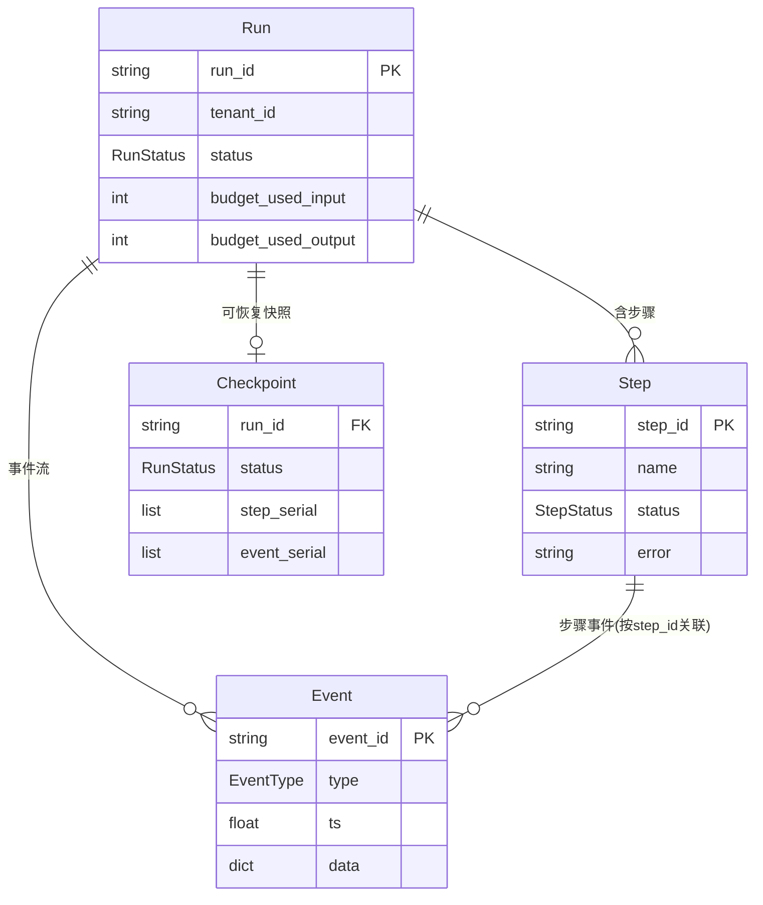
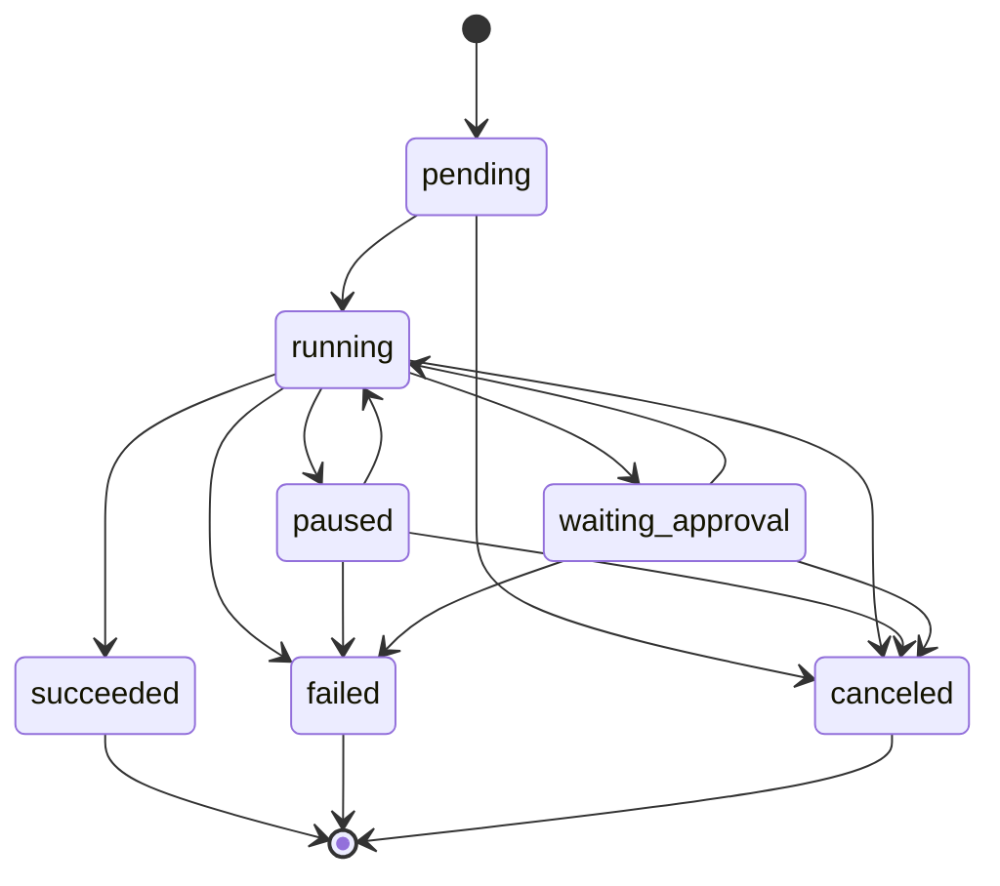

# 17 从聊天历史到统一执行模型

> **本课定位**：本课讲第五篇最核心的抽象：**统一执行模型**（Run → Step → Event → Checkpoint）。它是全部治理能力的承重墙：审批、恢复、回放、评测、审计都长在这套模型上。本课重点讲本轮重构完成的**数据化状态机**——状态是数据、迁移有校验、恢复是物化。学完本课，你能画出执行模型的实体关系并解释每条状态机纪律。
> **教学目标**：①能画出 Run/Step/Event/Checkpoint 实体关系；②能复述状态机三纪律并演示合法/非法迁移；③能解释终态不可复活与挂起不走旁路；④能识别事件载荷扁平化修复的接口陷阱。
> **前置**：第 16 课（Harness 四件套）
> **产出**：执行模型 ER 图 + 状态机纪律实验 × 4
> **对应代码**：`dataagent/src/dataagent/contracts/runtime.py`
> **对应测试**：`tests/unit/test_state_machine.py` 12 例

---

## 0. 本课要用到的环境

| 组件 | 取值 | 说明 |
|---|---|---|
| 核心模块 | `contracts/runtime.py` | RunStatus/StepStatus/StateMachine/Run/Step/Event/Checkpoint |
| 重构实录 | 数据化状态机 + `__setattr__` 校验 + restore 物化 | 本轮 SDD 重构（第 07 课实录） |
| 验证命令 | `python -m pytest tests/unit/test_state_machine.py -v` | 在 `dataagent/` 目录执行 |

---

## 1. 问题场景（聊天历史的三个致命伤）

用"聊天历史"做 Agent 的执行记录（很多项目的起点）会撞上：
1. **没有结构**——"第 3 轮用户说了什么"有，"query 步成功没有"没有；
2. **没有状态语义**——一个长任务"进行到哪/能不能取消/等谁审批"无法回答；
3. **无法恢复**——进程重启后对话可以续，但"任务执行到第几步、预算用了多少"全丢。

统一执行模型用四个实体替换聊天历史：



---

## 2. 概念与机制

### 2.1 状态机是数据：三条纪律

| 纪律 | 内容 | 代码落点 |
|---|---|---|
| ① 数据化 | 迁移表是模块级常量，可打印可评审 | `RUN_STATE_MACHINE.to_table()` |
| ② 强校验 | `status` 赋值经 `__setattr__` 拦截，非法迁移抛 `InvalidStateTransition` | `Run.__setattr__` / `Step.__setattr__` |
| ③ 恢复即物化 | `restore()` 从 Checkpoint 重建，绕过迁移校验（`object.__setattr__`） | `Run.restore()` |

**为什么同值赋值放行**：`running → running` 是幂等重入（workflow 重入 harness 子流程的正常路径），拦它只会制造麻烦。

### 2.2 Run 状态机全图



**读图要点**：终态（succeeded/failed/canceled）无出边——**终态不可复活**；`waiting_approval → succeeded` 不存在——**挂起不是通往终态的旁路**（第 02 课 Badcase #2 的来源）。

### 2.3 事件：append-only 的审计事实

`Run.add_event(type_, step_id="", data={...})` 追加不可变 Event（frozen dataclass）。本轮修正了它的载荷语义：`data={...}` 与零散 kwargs 都直接作为**扁平载荷**——旧实现会把整个 dict 套进 `{"data": {...}}`，让所有消费方写 `e.data["data"]["x"]`（接口陷阱，已修复并留档）。

---

## 3. 动手实验

### 实验 1：合法/非法迁移对照

```bash
cd dataagent
$env:PYTHONPATH="src"
python -c "
from dataagent.contracts.runtime import Run, RunStatus, InvalidStateTransition
r = Run(query='x')
r.status = RunStatus.RUNNING      # pending→running ✓
print('pending→running OK')
try:
    r.status = RunStatus.SUCCEEDED.__class__('succeeded') if False else r.status
    # 直接演示非法迁移:
    r2 = Run(query='y')
    r2.status = RunStatus.SUCCEEDED   # pending→succeeded ✗
except InvalidStateTransition as e:
    print('pending→succeeded 拦截:', e)
try:
    r.status = RunStatus.RUNNING      # running→running 幂等重入 ✓
    r.status = RunStatus.SUCCEEDED    # running→succeeded ✓
    r.status = RunStatus.FAILED       # 终态复活 ✗
except InvalidStateTransition as e:
    print('终态复活拦截:', e)
"
```

**预期输出**：

```text
pending→running OK
pending→succeeded 拦截: [Run] 非法状态迁移: pending -> succeeded。合法迁移见 Run_STATE_MACHINE.to_table()
终态复活拦截: [Run] 非法状态迁移: succeeded -> failed。合法迁移见 Run_STATE_MACHINE.to_table()
```

### 实验 2：迁移表可打印（规格可评审）

```bash
python -c "
from dataagent.contracts.runtime import RUN_STATE_MACHINE
print(RUN_STATE_MACHINE.to_table())
"
```

**预期输出**：

```text
StateMachine<Run> terminal=['canceled', 'failed', 'succeeded']
  paused -> ['canceled', 'failed', 'running']
  pending -> ['canceled', 'running']
  running -> ['canceled', 'failed', 'paused', 'succeeded', 'waiting_approval']
  waiting_approval -> ['canceled', 'failed', 'running']
```

### 实验 3：Checkpoint 往返 + 事件流等长

```bash
python -m pytest tests/unit/test_contracts_domain.py::TestRun::test_checkpoint_roundtrip -v
# PASSED —— restore 后 status/events 与快照一致
```

### 实验 4：事件载荷扁平化（修复后语义）

```bash
python -c "
from dataagent.contracts.runtime import Run, EventType
r = Run(query='x')
e = r.add_event(EventType.TOOL_CALL, step_id='stp_0001', data={'tool': 'query_metric'})
print('载荷 =', e.data)      # {'tool': 'query_metric'} —— 扁平, 不再套 data.data
print('关联步骤 =', e.step_id)
"
```

**预期输出**：

```text
载荷 = {'tool': 'query_metric'}
关联步骤 = stp_0001
```

---

### 进阶实验（第四/六轮新特性）：事件流与检查点的 JSONL 持久化

```bash
cd dataagent
$env:PYTHONPATH="src"
python -c "
import tempfile, json, pathlib
from dataagent.infra.observability import JsonlRecorder
from dataagent.app.container import DataAgentContainer, default_seed
d = tempfile.mkdtemp()
c = DataAgentContainer(seed_orders=default_seed())
c.workflow.recorder = JsonlRecorder(d)   # GAP-18 接线（生产用 env DATAAGENT_OBSERV_DIR）
run = c.analyze('华东区 GMV 下滑')
snap = json.load(open(pathlib.Path(d, run.run_id + '.checkpoint.json'), encoding='utf-8'))
print('事件落盘 =', len(c.workflow.recorder.load_events(run.run_id)),
      '| 检查点步骤 =', [s[1] for s in snap['steps']])
"
```

**预期输出**（真实运行）：

```text
事件落盘 = 16 | 检查点步骤 = ['succeeded', 'succeeded', 'succeeded', 'succeeded', 'succeeded', 'succeeded', 'succeeded']
```

**读法**：事件流（append-only）与检查点快照（last-wins）双流落盘，进程重启后仍可重放/审计——"聊天历史"做执行记录的最后一块短板补齐。落盘故障不阻断主链路（fail-safe，`stats.write_errors` 计数可见）。

## 4. 代码走读

### 4.1 `__setattr__` 拦截的完整逻辑

```python
def __setattr__(self, name, value):
    if name == "status":
        old = self.__dict__.get("status")
        if old is not None:   # None = dataclass __init__ 的初始赋值, 放行
            RUN_STATE_MACHINE.assert_transition(
                old.value, value.value if isinstance(value, RunStatus) else str(value)
            )
    object.__setattr__(self, name, value)
```

**设计意图**：拦截点选在**赋值的必经之路**——任何代码路径（业务/测试/未来 AI 生成）都自动受约束。`old is None` 判定让构造期赋值天然放行，无需额外标志位。

### 4.2 restore 的物化实现

```python
def restore(self, cp: "Checkpoint") -> None:
    """从 Checkpoint 物化恢复 —— 属于重建而非状态迁移，绕过迁移校验。"""
    object.__setattr__(self, "status", cp.status)
```

**设计意图**：`object.__setattr__` 显式绕过校验——**例外的存在必须是显式的**，未来读代码的人一眼知道这里为什么不过状态机。

### 4.3 终态自检的构造期防线

```python
for t in self.terminal:
    if t in self._transitions:
        raise ValueError(f"[{name}] 终态 {t} 不应出现在迁移表中作为起点")
```

**设计意图**：状态机在**构造时**自检——把"终态配了出边"这类规格错误拦在启动期，而不是运行期的某次迁移。

---

## 5. 常见错误与 Badcase

| # | 错误现象 | 根因 | 正确做法 |
|---|---|---|---|
| 1 | 子流程设终态后被审批门撞车 | 终态所有权不清 | Harness 不写终态（第 16 课） |
| 2 | 审批通过后 waiting_approval→succeeded 崩溃 | 挂起态走旁路 | 恢复显式回 running |
| 3 | restore 被迁移校验拦截 | 物化与迁移混淆 | restore 用 object.__setattr__ 显式旁路 |
| 4 | 事件载荷层层嵌套 `data["data"]` | add_event 的 kwargs 陷阱 | 载荷扁平化（本轮已修复） |
| 5 | 状态机非法迁移被 except 吞成业务失败 | 兜底 except 捕获一切 | workflow 兜底处加终态保护 + re-raise |

---

## 6. 验收

```bash
cd dataagent
$env:PYTHONPATH="src"
python -m pytest tests/unit/test_state_machine.py -q     # 期望: 12 passed
python -m pytest tests/unit/test_contracts_domain.py -q  # 期望: 12 passed
# 实验1/2/4 输出与 §3 一致
```

---

## 7. 思辨与讨论

1. **"为什么不用 enum 自带的约束（如 Python 3.11 StrEnum + setter 库）？"** 自造 60 行 StateMachine 换来三样东西：迁移表可打印（评审）、构造期自检（防配置错误）、异常带完整上下文（排障）——库给不了评审形态。**执行模型是系统的宪法，值得手写**。
2. **"Event 为什么 frozen？"** 事件是**已发生的事实**，事实不可篡改——要更正就追加新事件（append-only 审计语义），这与"修改历史"有本质区别。

---

## 8. 延伸与引用

- 参照工程 `platform/domain/runtime/entities.py`——五个状态机 + 迁移即事件（D-07 修复）的完整版
- 第 07 课（SDD）——本课状态机的规格化实录
- 第 18 课（Durable Workflow）——执行模型之上的恢复/审批语义

---

## 9. 本课遗留问题

- `Event.ts` 使用 wall-clock（`time.time`），回放排序在时钟回拨场景不稳—— monotonic/逻辑时钟演进项。
- Attempt 实体（contracts/model.py）与 Step 状态机各自独立，未统一进同一状态机体系——口径统一登记。
- Checkpoint 未含 steps 的完整快照（只有 step_serial 状态对），步骤输出恢复依赖上层——如实登记。
