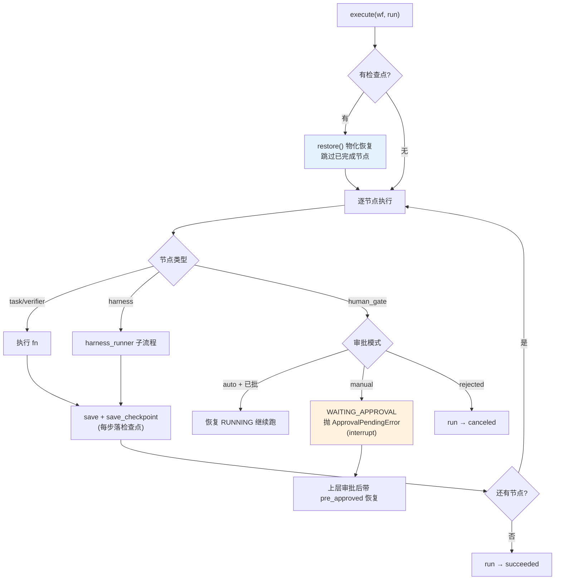

# 18 用 Durable Workflow 收口自主分析：检查点、审批与幂等

> **本课定位**：本课讲 `DurableWorkflowExecutor` 的三大支柱：**检查点恢复**（断点续跑）、**人工审批**（HITL interrupt/resume）、**副作用幂等**（重试不重复）。学完本课，你能手工完成一次"审批中断 → 决议 → 恢复"的完整演练，并解释每个支柱拦住的现实事故。
> **教学目标**：①能手工完成 interrupt→决议→resume 全流程；②能解释幂等 try_mark 的原子性；③能区分审批中断与故障的异常分流；④能说明拒绝路径的双层语义（step 成功/run 取消）。
> **前置**：第 17 课（执行模型）
> **产出**：三支柱实验 × 4
> **对应代码**：`infra/runtime/workflow.py`
> **对应测试**：`test_integration.py::TestApprovalFlow`、`tests/fault/test_fault_injection.py::test_side_effect_not_repeated`

---

## 0. 本课要用到的环境

| 组件 | 取值 | 说明 |
|---|---|---|
| 核心模块 | `workflow.py`：DurableWorkflowExecutor / InMemoryRunStore / IdempotencyStore / HumanApprovalGate | 三支柱 |
| 审批模式 | `approval_mode='manual'`（真实 HITL）/ `'auto'`（演示） | `DATAAGENT_APPROVAL_MODE` 环境变量 |
| 验证命令 | `python -m pytest tests/integration/test_integration.py -v` | 在 `dataagent/` 目录执行 |

---

## 1. 问题场景

三个现实事故，对应三根支柱：

1. **跑了 40 分钟的分析，进程重启全没了**——没有检查点。M0 的内存检查点救的是"单进程内中断恢复"；跨进程持久化在 M1（CockroachDB RunStore 已在 `infra/persistence/cockroach.py` 备好）。
2. **Agent 自己把钱扣了**——高风险副作用没有审批门。`human_gate` 节点 + `ApprovalPort` 让"执行前必须有人拍板"成为结构。
3. **重试把同一笔预算调了两次**——副作用不幂等。`IdempotencyStore` 以幂等键记录已执行动作，重试命中即返回。

---

## 2. 概念与机制

### 2.1 三支柱在执行循环中的位置



### 2.2 幂等键的生命周期

```python
class IdempotencyStore:
    def try_mark(self, key: str) -> bool:
        """若 key 已执行返回 False，否则标记并返回 True（只有第一次能执行）。"""
```

**设计要诀**：`try_mark` 是**原子的先占**（不是"查一下再标记"两步——两步在并发下有竞态，参照工程 AR-014 的教训：幂等键挂唯一约束才是并发下正确的解）。

### 2.3 HITL 的 interrupt/resume 协议

| 阶段 | 动作 | 数据痕迹 |
|---|---|---|
| interrupt | human_gate 节点抛 `ApprovalPendingError(action, params)` | Run 存为 WAITING_APPROVAL + 检查点 |
| 审批 | 上层（API/Worker）创建审批单，人决议 | ApprovalRequest.status → approved/rejected |
| resume | 带 `pre_approved={"action": {"decision": "approved", "by": ...}}` 再次 execute | APPROVAL_RESOLVED 事件 + 恢复 RUNNING |

**协议要点**：恢复时注入的决议带 `by`（责任人）——第 06 课责任观的数据落地。

---

## 3. 动手实验

### 实验 1：审批门真实介入（auto=False）

```bash
cd dataagent
$env:PYTHONPATH="src"
python -m pytest tests/integration/test_integration.py::TestApprovalFlow::test_human_approval_gate_in_workflow -v
```

**预期输出**：

```text
tests/integration/test_integration.py::TestApprovalFlow::test_human_approval_gate_in_workflow PASSED
```

### 实验 2：手工完成 interrupt → resume 全流程

```bash
python -c "
from dataagent.contracts.runtime import Run, RunStatus
from dataagent.infra.runtime.workflow import (DurableWorkflowExecutor, HumanApprovalGate,
    IdempotencyStore, InMemoryApprovalPort, InMemoryRunStore, WorkflowDefinition, WorkflowNode,
    ApprovalPendingError)
from dataagent.contracts.runtime import ApprovalDecision, ApprovalRequest

port = InMemoryApprovalPort(auto_approve=False)
ex = DurableWorkflowExecutor(store=InMemoryRunStore(),
    approval=HumanApprovalGate(port), idem=IdempotencyStore(), approval_mode='manual',
    harness_runner=None)
wf = WorkflowDefinition('x', nodes=[WorkflowNode('budget', 'human_gate', approval_action='adjust_budget')])
run = Run(query='调预算')
try:
    ex.execute(wf, run)
except ApprovalPendingError as e:
    print('中断于动作 =', e.action)
    print('Run 状态 =', run.status.value)          # waiting_approval
# 人来决议
req = ApprovalRequest(request_id='apr_manual', run_id=run.run_id, action='adjust_budget', params={})
port.request(req); port.resolve('apr_manual', ApprovalDecision.APPROVED, by='审批人老王')
run2 = ex.execute(wf, run, pre_approved={'adjust_budget': {'decision': 'approved', 'by': '审批人老王'}})
print('恢复后状态 =', run2.status.value)          # succeeded
print('恢复事件 =', [e.type.value for e in run2.events if 'APPROVAL' in e.type.name])
"
```

**预期输出**：

```text
中断于动作 = adjust_budget
Run 状态 = waiting_approval
恢复后状态 = succeeded
恢复事件 = ['approval_requested', 'approval_resolved']
```

**判定通过**：interrupt 抛出、状态挂起、决议注入恢复、审计事件齐全——HITL 协议完整可演练。

### 实验 3：副作用幂等（重试不重复执行）

```bash
python -m pytest tests/fault/test_fault_injection.py::TestFaultInjection::test_side_effect_not_repeated -v
```

**预期输出**：

```text
tests/fault/test_fault_injection.py::TestFaultInjection::test_side_effect_not_repeated PASSED
```

### 实验 4：拒绝 → canceled（拒绝也是终态迁移）

```bash
python -c "
from dataagent.contracts.runtime import Run, RunStatus
from dataagent.infra.runtime.workflow import (DurableWorkflowExecutor, HumanApprovalGate,
    IdempotencyStore, InMemoryApprovalPort, InMemoryRunStore, WorkflowDefinition, WorkflowNode)
ex = DurableWorkflowExecutor(store=InMemoryRunStore(),
    approval=HumanApprovalGate(InMemoryApprovalPort(auto_approve=True)),
    idem=IdempotencyStore(), harness_runner=None)
wf = WorkflowDefinition('x', nodes=[WorkflowNode('g', 'human_gate', approval_action='a')])
run = Run(query='x')
r = ex.execute(wf, run, pre_approved={'a': {'decision': 'rejected', 'by': '审批人'}})
print('拒绝后状态 =', r.status.value)
"
```

**预期输出**：

```text
拒绝后状态 = canceled
```

---

### 进阶实验（第四轮新特性）：审批超时 → 升级 → 过期 → 补批准被拒

```bash
cd dataagent
$env:PYTHONPATH="src"
python -c "
from dataagent.contracts.runtime import ApprovalDecision, ApprovalRequest, ApprovalStatus, ApprovalTimeoutPolicy
from dataagent.infra.runtime.workflow import InMemoryApprovalPort, ApprovalExpiredError
t = {'now': 1000.0}
port = InMemoryApprovalPort(auto_approve=False, timeout_policy=ApprovalTimeoutPolicy(
    pending_ttl_s=100, escalate_after_s=30, escalation_chain=('approver', 'sec_admin')),
    clock=lambda: t['now'])
rid = port.request(ApprovalRequest(request_id='apr1', run_id='run1', action='adjust_budget', params={}, created_at=990.0))
t['now'] = 1040.0
acts = port.sweep_timeouts(run_id='run1')
print('到点升级 =', acts[0][1], '| escalation_history =', acts[0][0].escalation_history)
t['now'] = 1105.0
acts = port.sweep_timeouts(run_id='run1')
print('超时处置 =', acts[0][1], '| status =', port.get(rid).status)
try:
    port.resolve(rid, ApprovalDecision.APPROVED, by='事后反悔')
except ApprovalExpiredError as e:
    print('过期后补批准 →', type(e).__name__)
"
```

**预期输出**（真实运行）：

```text
到点升级 = escalate:approver | escalation_history = ['approver']
超时处置 = expired | status = expired
过期后补批准 → ApprovalExpiredError
```

**读法**：到点升级（`escalation_history` 留痕）→ 超时 EXPIRED → **过期后不得补批准**。三个语义合成一句话：审批门没有超时 = 隐性 DoS；超时若当放行 = 审批可被拖延绕过——两个坑一次填平。

## 4. 代码走读

### 4.1 每步落检查点

```python
# 每步结束保存一次 Checkpoint → 支持中断恢复
self.store.save(run)
self.store.save_checkpoint(run.to_checkpoint())
```

**设计意图**：检查点粒度 = 节点——太粗（整个 workflow 一次）恢复损失大，太细（每行代码）开销大。节点是"语义完整的恢复单元"。

### 4.2 ApprovalPendingError 的特殊地位

```python
try:
    ...  # 节选：前略各分支
except ApprovalPendingError:
    # 审批中断不是故障：向上传播以创建审批单（HITL interrupt）
    step.status = StepStatus.WAITING_APPROVAL
    self.store.save(run); self.store.save_checkpoint(run.to_checkpoint())
    raise
except Exception as e:  # noqa: BLE001
    ...
```

**设计意图**：`ApprovalPendingError` 在异常处理链中被**显式分流**——它不是故障（不发 STEP_FAILED、不落 FAILED），是控制流信号。把控制流信号混进故障处理是 HITL 实现最常见的坑。

### 4.3 拒绝路径的状态语义

```python
# 节选：human_gate 的拒绝分支（工作流方法内，故此处以 if 展示）
if decision and decision.get("decision") == "rejected":
    run.add_event(EventType.APPROVAL_RESOLVED, step_id=step.step_id,
                  data={"approved": False, "by": decision.get("by", "")})
    run.status = RunStatus.CANCELED
    step.status = StepStatus.SUCCEEDED
    step.output = {"approved": False, "canceled": True}
```

**设计意图**：run 落 CANCELED 但 step 落 SUCCEEDED——步骤（"执行了拒绝处理"）成功了，运行（"这次分析被否了"）取消。**两个层的语义分离**，混为一谈会导致审计读不懂。

---

## 5. 常见错误与 Badcase

| # | 错误现象 | 根因 | 正确做法 |
|---|---|---|---|
| 1 | auto 审批后 waiting_approval→succeeded 崩 | 恢复未显式回 RUNNING | 审批决即 `run.status = RUNNING`（第 07 课缺陷实录 #2） |
| 2 | 幂等"先查后写"并发下双执行 | 两步非原子 | `try_mark` 原子先占（生产加唯一约束） |
| 3 | ApprovalPendingError 被 except Exception 吞掉 | 控制流信号混入故障 | 异常处理链显式分流（§4.2） |
| 4 | 拒绝后 step 标 FAILED，审计误读为"系统故障" | 层级语义混淆 | 拒绝 = step SUCCEEDED + run CANCELED |
| 5 | 恢复执行跳过了已完成节点，却重跑失败节点的前一个 | 恢复索引逻辑错 | 按 `step_serial` 逐个核对 SUCCEEDED 再跳 |

---

## 6. 验收

```bash
cd dataagent
$env:PYTHONPATH="src"
python -m pytest tests/integration/test_integration.py tests/fault/ -q    # 期望: 12 passed
# 实验2 的 interrupt/resume 输出与 §3.2 一致
```

---

## 7. 思辨与讨论

1. **"审批中断会不会把 Run '卡死'？"** 会——这正是设计意图的一部分：没有决议就没有终点。但工程上要配"审批超时"（超时自动拒绝/升级），M0 未实现，登记为遗留。**审批门没有超时 = 隐性 DoS**。
2. **"幂等键应该由谁生成？"** 调用方（知道业务唯一性语义）。本仓库 M0 用 action 名+参数演示；参照工程升级为"契约声明制"（幂等键只取治理契约声明的副作用参数）——**描述性参数混进幂等键**会让"结论换个措辞"就重复执行（参照工程真实缺陷 #4）。

---

## 8. 延伸与引用

- 第 29 课（Action Runtime）——副作用执行六阶段的完整闭环
- 参照工程 `platform/services/capability/action_runtime.py`——六阶段 + 契约声明幂等的实现
- 本仓库 `services/api/admin.py`——生产版审批单落库（dataagent_approvals 表）

---

## 9. 本课遗留问题

- ~~审批超时/升级机制未实现~~ → **已实现（GAP-19a，第四轮）**：`ApprovalTimeoutPolicy`（到点升级/超时 EXPIRED）+ 端口 `sweep_timeouts` + 工作流 APPROVAL_ESCALATED/EXPIRED 事件接线；**过期后补批准被显式拒绝**（fail-closed）。生产 sweep 定时任务接线登记。
- `pre_approved` 注入路径未做决议人权限校验（谁有权 approve 这个 action）——依赖上层 API 的 RBAC（`services/api/auth.py` 已有），内核层未重复校验，如实登记。
- InMemoryApprovalPort.resolve 的 rejected 分支为空实现（状态已置）——行为正确但无附加动作，注释已说明。
