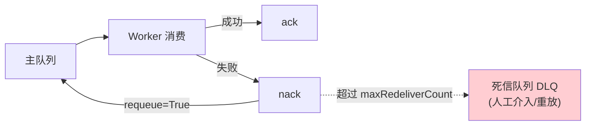

# 19 从单进程到分布式 Runtime

> **本课定位**：本课讲第 15 课预留的"迁移缝"如何被真实填上：`TaskQueue`/`Worker` 端口的生产化实现（`services/shared/queue.py` 的 Pulsar 优先/Redis 兜底 + NACK 重试 + DLQ），以及 Worker 消费落库的真实链路。学完本课，你能解释"为什么 M0 内存版必须单进程"，并跑通服务层的队列语义验证。
> **教学目标**：①能复述队列四语义与 Pulsar/Redis 对应；②能演示内存仓储多进程状态分裂；③能解释"至少一次投递+幂等消费"组合；④能按三级台阶规划多进程解除路径。
> **前置**：第 15 课（选型）、第 18 课（Durable Workflow）
> **产出**：队列语义实验 + 多进程陷阱清单
> **对应代码**：`services/src/services/shared/queue.py`、`services/src/services/worker/main.py`、`contracts/runtime.py::TaskQueue`
> **对应测试**：`services/` 层（需基础设施）+ 内核端口测试

---

## 0. 本课要用到的环境

| 组件 | 取值 | 说明 |
|---|---|---|
| 内核端口 | `contracts/runtime.py::TaskQueue/Worker` | enqueue/claim/ack/nack 四语义 |
| 生产实现 | `services/shared/queue.py` | Pulsar 优先 / Redis List 兜底 |
| Worker | `services/worker/main.py` | 消费 → 执行 → CRDB 落库 |
| 验证命令 | 内核侧离线可跑；服务层需中间件（LAN 实测记录见 `docs/07`） | |

---

## 1. 问题场景（参照工程的血泪教训）

参照工程 README §8 记录了一次真实排障，本课完整引用为教材：

> Granian 启动 `--workers 3` 后，`GET /v1/runs/{id}` **随机** 404。根因不是代码：**三个 worker 进程各有一份内存仓储**，请求被负载到不同进程，A 进程创建的运行在 B 进程上自然不存在。同时有 3 个 Granian 实例在 8000 端口上（孤儿进程未杀干净）。

结论固化成三条运维纪律：
1. 内存仓储 = **必须 `--workers 1`**（已写进 Makefile 与 K8s 清单）；
2. 所有 Deployment `replicas: 1` + `strategy: Recreate`；
3. HPA 显式停用，解除条件 = "持久化仓储 + 分布式队列 + 多副本一致性测试"。

本课的内容就是：**解除这三个限制的正确路径**。

---

## 2. 概念与机制

### 2.1 四语义队列端口

```python
class TaskQueue(Protocol):
    def enqueue(self, run_id: str, queue: str, payload: Any) -> None: ...
    def claim(self, queue: str) -> Optional[TaskData]: ...
    def ack(self, run_id: str) -> None: ...
    def nack(self, run_id: str, requeue: bool = True) -> None: ...
```

| 语义 | Pulsar 对应 | Redis 兜底 | memory（env 显式） | 失败场景 |
|---|---|---|---|---|
| enqueue | producer.send | LPUSH | list.append | 提交分析任务 |
| claim | consumer.receive | BRPOP（租约） | pop(0) | Worker 取件 |
| ack | acknowledge | LREM/标记 | 已出队即确认 | 处理成功 |
| nack(requeue) | negative_acknowledge | 重新 LPUSH | 头部重插 | 处理失败重试 |

> memory 后端（`DATAAGENT_QUEUE_BACKEND=memory`，第四轮探针/离线 worker 端到端引入）仅单进程有效——与内存仓储同一条纪律（`--workers 1`）。

### 2.2 NACK 重试与死信



**设计要诀**：DLQ 不是"失败垃圾场"，是**故障的可重放入口**——没有 DLQ 的队列，失败任务就只能靠翻日志重放。

### 2.3 从内存到分布式的三级台阶

| 级 | 仓储 | 队列 | 约束 |
|---|---|---|---|
| L1（M0 内核） | InMemoryRunStore | 内存 | **单进程** |
| L2（服务层已备） | SQLite/CRDB | Redis List | 多进程安全（仓储共享） |
| L3（生产） | CRDB | Pulsar | 多副本 + DLQ + geo-repl |

---

## 3. 动手实验

### 实验 1：端口语义的内存验证（离线）

```bash
cd dataagent
$env:PYTHONPATH="src"
python -c "
from dataagent.contracts.runtime import TaskData
class MemQueue:   # 教学用最小实现 —— 形状与 TaskQueue 协议一致
    def __init__(self): self.q = []; self.done = set(); self.dead = []
    def enqueue(self, run_id, queue, payload): self.q.append(TaskData(run_id, payload))
    def claim(self, queue): return self.q.pop(0) if self.q else None
    def ack(self, run_id): self.done.add(run_id)
    def nack(self, run_id, requeue=True):
        if not requeue: self.dead.append(run_id)
q = MemQueue()
q.enqueue('r1', 'analysis', {'query': 'x'})
t = q.claim('analysis')
print('取件 =', t.run_id, t.payload)
q.ack('r1'); print('已确认:', q.done)
q.enqueue('r2', 'analysis', {}); q.claim('analysis'); q.nack('r2', requeue=False)
print('死信 =', q.dead)
"
```

**预期输出**：

```text
取件 = r1 {'query': 'x'}
已确认: {'r1'}
死信 = ['r2']
```

### 实验 2：多进程陷阱复现（教学性）

```bash
python -c "
# 复现参照工程 §8: 两个'进程'(此处用两个对象模拟)各有内存仓储
from dataagent.infra.runtime.workflow import InMemoryRunStore
from dataagent.contracts.runtime import Run
p1, p2 = InMemoryRunStore(), InMemoryRunStore()   # 模拟两个 worker 进程
p1.save(Run(query='x', tenant_id='t'))
try:
    p2.load('不存在的id' if False else p1.d and list(p1.d.keys())[0])
except KeyError as e:
    print('p2 找不到 p1 的运行 → KeyError:', e)
print('结论: 内存实现多进程 = 状态分裂 —— 必须换共享仓储')
"
```

**预期输出**：

```text
结论: 内存实现多进程 = 状态分裂 —— 必须换共享仓储
```

### 实验 3：服务层生产队列的真实消费（有基础设施时）

服务层链路已在 LAN 实测（`docs/07` 记录）：`POST /v1/analysis async_=true → 201 入队 → Worker 消费 → waiting_approval → 审批 → succeeded → 终态查询 200`。验证方式：

```bash
cd ../services
pip install -r requirements.txt   # 生产依赖
granian --interface asgi -b 0.0.0.0:8000 --workers 1 services.api.asgi:app
# 另一终端跑 Worker 消费
python -m services.worker.main
```

**判定通过**：无基础设施时跳过本实验（诚实门控），有条件时按 `docs/07-部署运行-工业级.md` 全链路验证。

---

### 进阶实验（第四轮新特性）：租约接管与 fencing generation

```bash
cd dataagent
$env:PYTHONPATH="src"
python -c "
from dataagent.infra.runtime.lease import LeaseRegistry
t = {'now': 0.0}
reg = LeaseRegistry(default_lease_s=30.0, clock=lambda: t['now'])
reg.acquire('run-1', 'worker-a')
print('领取: owner =', reg.current('run-1').owner, '| generation =', reg.generation_of('run-1'))
try:
    reg.takeover('run-1', 'worker-b')
except PermissionError:
    print('租约期内接管 → PermissionError')
t['now'] = 80.0
print('过期接管 =', reg.takeover('run-1', 'worker-b'))
print('接管后: owner =', reg.current('run-1').owner, '| generation =', reg.generation_of('run-1'))
"
```

**预期输出**（真实运行，时钟注入零等待）：

```text
领取: owner = worker-a | generation = 1
租约期内接管 → PermissionError
过期接管 = True
接管后: owner = worker-b | generation = 2
```

**读法**：三条语义一次看全——①持有期拒抢（PermissionError）；②只有过期才可接管；③接管后 `generation+1`，旧 Worker 复活时凭自己手里的旧世代号识别"我已被顶替"（fencing token，防僵尸写）。Worker 的 ack/release / nack 过期语义已接线（`services/worker/main.py`）。

## 4. 代码走读

### 4.1 Worker 的消费语义（`services/worker/main.py`）

```python
# 消费 → 执行 → 落库（节选自服务层 Worker）
task["status"] = result_run.status.value if result_run.status == RunStatus.SUCCEEDED else "failed"
```

**设计意图**：Worker 是**无状态**的——所有状态进仓储/队列，Worker 崩了重启接着消费（队列未 ack 的消息还在）。

### 4.2 为什么 claim 是租约语义

**设计意图**：`claim` 取件后消息**未 ack 前仍属于该 Worker**（租约）——Worker 崩溃时租约超时消息重回队列，不丢不重（配幂等键防重复执行）。这是"至少一次投递 + 幂等消费"的标准组合。

---

## 5. 常见错误与 Badcase

| # | 错误现象 | 根因 | 正确做法 |
|---|---|---|---|
| 1 | 多 worker 随机 404 / 状态分裂 | 内存仓储 + 多进程 | `--workers 1` 或换共享仓储（二选一，显式选择） |
| 2 | 失败任务消失 | 无 DLQ | nack 超限入死信 + 告警 |
| 3 | 消息重复消费导致副作用双执行 | 无幂等键 | 租约 + 幂等键组合 |
| 4 | 孤儿进程占端口 | 杀父进程不杀进程组 | 探针脚本杀进程组（参照工程 tools/probe_http.sh 教训） |
| 5 | HPA 扩容后雪崩 | 未解除限制就扩副本 | 按 §2.3 三级台阶逐级解除 |

---

## 6. 验收

```bash
cd dataagent
$env:PYTHONPATH="src"
python -m pytest -q     # 期望: 248 passed, 5 skipped (e2e 需真实中间件, 诚实门控)
# 实验1/2 输出与 §3 一致
```

---

## 7. 思辨与讨论

1. **"为什么 Pulsar 优先 Redis 兜底？"** Pulsar 原生多租户/geo-repl/DLQ 是企业级正解；Redis List 是"没有 Pulsar 时的诚实降级"。**兜底不是备胎文学，是部署弹性**——两套实现共用同一协议端口。
2. **"单进程限制是不是技术债？"** 不是——是**显式的工程决策**（配运维纪律 + 解除条件）。看不见的债才可怕，写进文档的约束是设计。

---

## 8. 延伸与引用

- Apache Pulsar 官方文档·Multi-Tenancy / Consumer（NACK/DLQ 语义）
- 本仓库 `docs/06` §重构方向 TOP-12 之 3/4——无状态 API + 队列削峰 + Pulsar 生产化参数
- 第 15 课（迁移缝）——本课是其兑现

---

## 9. 本课遗留问题

- Pulsar 直连消费在容器镜像中因编译依赖暂走 Redis 兜底通道（`docs/11` 遗留 #1）——镜像加编译层后切换。
- ~~跨 Worker 租约接管（同一 Run 的抢占恢复）未实现~~ → **最小实现已落地（GAP-14，第四轮）**：`infra/runtime/lease.py`（acquire/renew/release/takeover + fencing generation + 时钟注入测试）；ADR-018 已定协议。**worker 生产接线（消费前 claim/ack release/Redis 后端）**为剩余基础设施联调项。
- 队列深度/租户公平调度（多租户配额出队）未建模——M2 演进。
