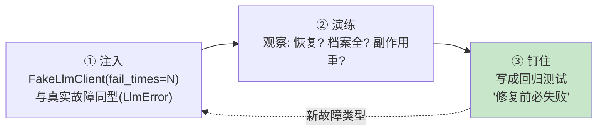

# 20 以故障为教材：跨故障完成任务

> **本课定位**：本课讲第五篇收口的方法论：**故障不是异常，是教材**。核心内容：故障分类学（四象限）、注入-演练-钉住的三步法、以及"全绿测试 ≠ 没有缺陷"的证明（参照工程四个全绿 Badcase）。学完本课，你能为新故障类型设计"会在修复前失败"的回归测试。
> **教学目标**：①能用四象限为故障分类并匹配期望行为；②能执行注入-演练-钉住三步法；③能应用死代码判据审查标志位；④能解释"测试全绿≠没有缺陷"的四例证据。
> **前置**：第 13 课（可靠执行）、第 19 课（分布式）
> **产出**：故障四象限实验 + 回归测试设计模板
> **对应代码**：`tests/fault/test_fault_injection.py`、`adapters/llm/fake_client.py`
> **对应测试**：`tests/fault/` 4 例、`test_integration.py::test_fault_injection_cross_failures`

---

## 0. 本课要用到的环境

| 组件 | 取值 | 说明 |
|---|---|---|
| 注入器 | `FakeLlmClient(fail_times, fail_error)` | 上游故障注入 |
| 故障测试 | `tests/fault/test_fault_injection.py` | 4 例四象限 |
| 验证命令 | `python -m pytest tests/fault/ tests/integration/test_integration.py -v` | 在 `dataagent/` 目录执行 |

---

## 1. 问题场景

"测试全绿但系统有病"的真实案例（参照工程 evolution_review.md 登记的 4 个 Badcase，全部通过了全部 480+ 测试）：

| # | Badcase | 为什么全绿也没发现 |
|---|---|---|
| 1 | SqlGuard 装配漂移（漏配 7 张系统禁表） | 没有测试对比"默认值"与"装配值"的一致性 |
| 2 | `degraded` 死代码恒为 False | 没有任何测试会让它变 True——**答不出"这行代码在什么条件下变成非初始值"，它就是死代码** |
| 3 | analysis 画像候选池只有 1 个 | 代码完全正确——**配置数据造成的架构性质，静态检查查不出，只有故障注入能发现** |
| 4 | `ToolCall.arguments` 是 mappingproxy，`json.dumps` 抛 TypeError | 没有测试会去序列化它 |

**本课核心论点**：故障注入测试的价值不在"多几个绿勾"，而在**逼出那些"正常路径永远走不到"的分支**。

---

## 2. 概念与机制

### 2.1 故障四象限


| 象限 | 例 | 期望行为 | 本仓库测试 |
|---|---|---|---|
| 瞬时可重试 | 抖动/偶发 5xx | 退避重试后恢复 | `test_recovers_after_failures` |
| 持续可重试 | 上游宕机 | 耗尽预算后 fail-fast | `test_unrecoverable_raises`（经 max_attempts 耗尽） |
| 瞬时不可重试 | 参数非法 | 立即换候选/抛出 | retryable=False 语义 |
| 持续不可重试 | 配置缺失 | fail-fast + 显式报错 | `Router.decide` 全空链 |

### 2.2 注入-演练-钉住三步法



**第③步的判据**：一个好的故障回归测试，在缺陷代码上跑**必须失败**——`test_side_effect_not_repeated` 若删掉幂等键逻辑立即红。

---

## 3. 动手实验

### 实验 1：四象限注入全演练

```bash
cd dataagent
$env:PYTHONPATH="src"
python -m pytest tests/fault/test_fault_injection.py -v
```

**预期输出**：

```text
test_recovers_after_failures PASSED          # 瞬时可重试
test_attempt_lifecycle_recorded PASSED       # 档案完整性
test_unrecoverable_raises PASSED             # 持续故障 fail-fast
test_side_effect_not_repeated PASSED         # 副作用幂等
4 passed
```

### 实验 2：跨故障完成任务（demo 实录）

```bash
python ../scripts/demo.py 2>&1 | Select-String "故障"
```

**预期输出**：

```text
[3] 故障注入与只读 SQL 网关
   注入 2 次模型故障后仍成功: 状态=succeeded, 调用次数=6
   SQL 网关拦截 'DELETE': {'error': 'SQL 含禁止关键字: DELETE'}
```

### 实验 3：设计一个"修复前必失败"的回归测试（三步法实操）

假设发现缺陷："Executor 耗尽重试后抛的异常不携带最后一次失败的模型名"。按三步法：

```bash
python -c "
# ③ 钉住示范: 断言异常含模型信息(当前实现未提供 → 本断言失败 = 修复前必失败)
from dataagent.infra.gateway.llm_runtime import ModelRegistry, ReliableExecutor, Router, LlmError
from dataagent.contracts.model import LogicalCall, Message, ModelCapability, Role
from dataagent.adapters.llm.fake_client import FakeLlmClient
reg = ModelRegistry(); reg.register(ModelCapability(model='demo'))
rt = Router(reg); rt.add_route('t', ['demo'])
ex = ReliableExecutor(FakeLlmClient(fail_times=9), rt, reg, max_attempts=2, sleep=lambda s: None)
call = LogicalCall.new(task='t', capability=reg.resolve('demo'), messages=[Message(role=Role.USER, content='x')])
try:
    ex.complete(call)
    print('未抛错 —— 测试失败(不通过)')
except LlmError as e:
    print('异常文本:', e)
    print('含模型名?', 'demo' in str(e))   # False → 缺陷坐实, 修复后此断言转绿
"
```

**预期输出**（示范当前状态，如实呈现缺陷）：

```text
异常文本: Simulated upstream failure
含模型名? False
```

**判定通过**：完成了"发现缺陷→写成可失败断言"的动作。这就是第 07 课 SDD"翻旧账"的日常形态。

### 实验 4：死代码检测法（Badcase #2 的判据）

```bash
python -c "
# 判据一行: '这行代码在什么条件下变成非初始值?' 答不出 = 死代码
from dataagent.infra.gateway.llm_runtime import LLMExecutionResult if False else None
from dataclasses import fields
import dataclasses
# 演示: 检查一个 dataclass 的字段是否在测试中会被赋非默认值
print('人工审查清单:')
print(' 1. degraded 标志位(参照工程): 无赋值点 → 死代码')
print(' 2. 本仓库 CallStats.timeouts: 无赋值点 → 第14课已登记')
"
```

**预期输出**：

```text
人工审查清单:
 1. degraded 标志位(参照工程): 无赋值点 → 死代码
 2. 本仓库 CallStats.timeouts: 无赋值点 → 第14课已登记
```

---

## 4. 代码走读

### 4.1 注入器与真实故障同型

```python
if self.fail_times > 0:
    self.fail_times -= 1
    raise LlmError(self.fail_error, retryable=True)
```

**设计意图**：注入抛的是**生产同款异常类型**（LlmError + retryable），执行器的重试逻辑无法区分演练与实战——保真度与"mock 掉 executor"天差地别。

### 4.2 fault 测试的三个断言面

`test_fault_injection.py` 四例分别钉住：恢复性（最终成功）、档案性（Attempt 记录）、终止性（耗尽抛错）、幂等性（副作用不重）——**故障测试断言的不是"没崩"，是这四条行为性质**。

---

## 5. 常见错误与 Badcase

| # | 错误现象 | 根因 | 正确做法 |
|---|---|---|---|
| 1 | 故障测试只断言"没抛异常" | 断言面太浅 | 四条行为性质（§4.2）逐条断言 |
| 2 | 注入的异常是自定义测试异常 | 类型不同型，重试逻辑走不到 | 与生产同型 LlmError |
| 3 | "全绿 = 健康"的错觉 | 正常路径覆盖不了故障分支 | 每次真实故障都要变成回归测试 |
| 4 | 标志位声明了永不赋值 | 死代码骗过所有测试 | 死代码判据（实验 4）纳入评审 |

---

## 6. 验收

```bash
cd dataagent
$env:PYTHONPATH="src"
python -m pytest tests/fault/ tests/integration/test_integration.py -q   # 期望: 12 passed
# 实验3 完成"修复前必失败"断言的设计动作
```

---

## 7. 思辨与讨论

1. **"故障演练会不会没完没了？"** 会有收敛点：四象限各至少一种 + 每次线上真实故障一个。本仓库现在 4 例，对 M0 足够；扩张的驱动永远是**真实事故**，不是想象力。
2. **"为什么说'测试全绿'和'没有缺陷'没有推理关系？"** 因为测试覆盖的是**想到的路径**，缺陷住在**没想到的路径**。缩小这个差距的两个工具：故障注入（主动走坏路径）与回归钉住（坏路径永久留下）——这正是 M5 评测线存在的原因（参照工程最重要的结构性结论）。

---

## 8. 延伸与引用

- 参照工程 `evolution_review.md`——4 个全绿 Badcase 的完整登记（本课 §1 来源）
- 第 40 课（Regression Gate）——把故障回归接入发布门禁
- 本仓库 `docs/11-大纲全面复审与缺口闭合.md`——"已知边界转待办"的登记纪律

---

## 9. 本课遗留问题

- `FakeLlmClient` 未模拟限流型（429+Retry-After）与超时型（挂起后抛）故障——四象限补齐项。
- ~~实验 3 发现的"异常不含模型名"缺陷~~ → **已修复（GAP-01）**：耗尽重试的异常现携带 `[最后尝试模型: xxx]`，回归测试 `test_exhaustion_error_carries_last_model` 钉住——"登记即钉住"的完整闭环示范。
- 网络分区/进程崩溃级故障需要容器环境——属 M1+ 混沌工程范畴，如实登记。
