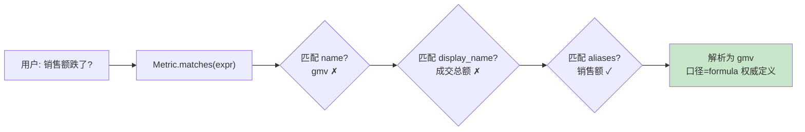

# 22 经营语义上下文：先理解指标再接触数据

> **本课定位**：本课讲第六篇的业务灵魂：**指标注册表**。核心原则："先确认指标口径再接触数据"——模型不能发明口径，只能选择已注册的口径。学完本课，你能解释为什么"销售额"必须能解析回 GMV 的标准定义，以及歧义检测为什么是刚需。
> **教学目标**：①能解释"口径是注册资产不是对话产物"；②能演示别名解析与未注册诚实失败；③能说出归因规则住领域层的 DDD 落点；④能识别口径争议三案的根因。
> **前置**：第 21 课（Context Schema）
> **产出**：指标别名解析实验 + 口径争议处置实验
> **对应代码**：`dataagent/src/dataagent/domain/analytics.py`、`container.py` 的 metric_registry Provider
> **对应测试**：`test_contracts_domain.py::TestMetricAlias`、`test_diagnose_gmv_drop`

---

## 0. 本课要用到的环境

| 组件 | 取值 | 说明 |
|---|---|---|
| 领域层 | `domain/analytics.py::Metric`（name/display_name_zh/formula/aliases） | 纯领域，无基础设施依赖 |
| 容器注册 | `container.py` 的 metric_registry Provider | 口径进上下文 |
| 验证命令 | `python -m pytest tests/unit/test_contracts_domain.py -v` | 在 `dataagent/` 目录执行 |

---

## 1. 问题场景（口径争议三连）

1. 财务说 GMV 该含运费，运营说不该——两个"GMV"打架，报表差 8%；
2. 用户问"销售额"，系统查不到（注册表里只有 gmv）——**别名缺失让指标不可达**；
3. 模型自作主张定义"GMV = 订单金额 × 1.13"——**口径被概率过程发明**，审计无法追溯。

三案的共同解药：**口径是注册资产，不是对话产物**。

---

## 2. 概念与机制

### 2.1 Metric 契约：口径的权威定义

```python
@dataclass(frozen=True)
class Metric:
    name: str                     # 唯一标识: "gmv"
    display_name_zh: str          # 中文名: "成交总额"
    formula: str                  # 计算口径: "已支付订单金额合计"
    aliases: tuple[str, ...]      # 别名: ("销售额", "成交额")
    dimension: str = "amount"     # amount/count/rate/stock
    refresh_policy: str = "daily"
```

### 2.2 别名解析：从自然语言到标准口径



**规则**：模型拿到的上下文是"GMV=已支付订单金额合计"（注册口径），不是让它自己定义——**解析发生在注册表，不在概率过程**。

### 2.3 领域服务的归因预埋

`RetailDiagnosisService.diagnose_gmv_drop` 用 `conversion_rate`/`aov` 阈值做归因：

```python
if conv_avg < 0.45: caused.append("转化率下降")
if aov_avg < 180:  caused.append("客单价下降")
if not caused:     caused.append("流量下降")
```

**设计意图**：归因逻辑是**领域规则**（可单测、可评审），不是 prompt 里的玄学——这是 DDD 在 Agent 里的落点：**业务规则住领域层，模型只做表达**。

---

## 3. 动手实验

### 实验 1：别名解析

```bash
cd dataagent
$env:PYTHONPATH="src"
python -m pytest tests/unit/test_contracts_domain.py::TestMetricAlias::test_alias_mapping -v
```

**预期输出**：

```text
tests/unit/test_contracts_domain.py::TestMetricAlias::test_alias_mapping PASSED
```

### 实验 2：口径进上下文（规划步的充分性依赖）

```bash
python -c "
from dataagent.app.container import DataAgentContainer, default_seed
c = DataAgentContainer(seed_orders=default_seed())
print('上下文里的口径 =', [i.content for i in c.ctx.assemble().items if i.key=='metric_registry'])
from dataagent.infra.context.assembler import ContextContract
s = c.ctx.assemble(step_contract=ContextContract('planning', required=('metric_registry',)))
print('规划步充分性 =', '满足' if not any(k=='__missing_required__' for k,_ in s.filtered) else '缺失')
"
```

**预期输出**：

```text
上下文里的口径 = ['核心指标：GMV=已支付订单金额合计；订单数；客单价=GMV/单量；转化率；退款率']
规划步充分性 = 满足
```

### 实验 3：领域归因（领域规则可单测）

```bash
python -m pytest tests/unit/test_contracts_domain.py::TestDiagnosis -v
# test_diagnose_gmv_drop PASSED —— 转化率/客单价阈值归因被钉住
```

### 实验 4：未注册指标的诚实失败

```bash
python -c "
from dataagent.domain.analytics import Metric
m = Metric(name='gmv', display_name_zh='成交总额', formula='已支付订单金额合计', aliases=('销售额',))
print('解析""复购率"" =', m.matches('复购率'))   # False —— 未注册即不可达, 诚实失败
"
```

**预期输出**：

```text
解析"复购率" = False
```

**判定通过**：未注册的指标**显式不可达**（返回 False），而不是模型编一个答案——对照参照工程 `/v1/metrics/resolve?term=复购率` 正确返回 404 的同款语义。

---

## 4. 代码走读

### 4.1 matches 的归一化

```python
def matches(self, expr: str) -> bool:
    expr_n = expr.strip().lower().replace(" ", "")
    names = [self.name.lower(), self.display_name_zh] + list(self.aliases)
    return any(n.replace(" ", "").lower() == expr_n for n in names)
```

**设计意图**：去空格 + 小写归一化——"GMV"/"gmv"/"成 交 总 额"都能命中。**解析的宽容性要归一化，不要正则玄学**。

**反面写法**：`expr in content` 子串匹配——"率"能匹配"转化率"也能匹配"退款率"，歧义爆炸。

### 4.2 领域层零依赖的红线

`domain/analytics.py` 的 import 区只有 `math/dataclasses/typing`——**没有 infra、没有 contracts**。领域规则可以在任何宿主（CLI/服务层/测试）中原样运行。

### 4.3 AnomalySignature：归因结果也是契约

```python
@dataclass
class AnomalySignature:
    caused_by: str
    reason: str
    impact_pct: Optional[float]
    evidence_keys: list[str]
    suggested_actions: list[str]
```

**设计意图**：归因输出带 `evidence_keys`——结论必须指回证据（第九篇证据链的领域侧源头）。

---

## 5. 常见错误与 Badcase

| # | 错误现象 | 根因 | 正确做法 |
|---|---|---|---|
| 1 | 两个报表的 GMV 差 8% | 口径各自定义 | 注册表唯一权威 + formula 显式 |
| 2 | "销售额"查不到 | 别名缺失 | aliases 注册 + matches 归一化解析 |
| 3 | 模型发明口径进报告 | 口径不在上下文 | metric_registry Provider 进规划步 + 充分性门 |
| 4 | 归因结论无法追溯 | 无证据键 | AnomalySignature.evidence_keys |

---

## 6. 验收

```bash
cd dataagent
$env:PYTHONPATH="src"
python -m pytest tests/unit/test_contracts_domain.py -q    # 期望: 12 passed
# 实验2 口径上下文输出与 §3.2 一致；实验4 未注册诚实失败
```

---

## 7. 思辨与讨论

1. **"阈值归因（conv<0.45）是不是太粗糙？"** 是 M0 的诚实水位：规则透明可评审，但阈值拍脑袋。演进方向是参照工程的恒等式拆解（GMV=订单数×客单价，贡献度之和≈1 可验算）——**粗糙但可验证，好过精致但玄学**。
2. **"指标注册表该谁维护？"** formula 是业务资产——owner 字段（M0 预留）+ 审批变更流程。模型/工程师都只是消费者。

---

## 8. 延伸与引用

- 第 23 课（动态装配与预算）——口径如何在预算约束下进上下文
- 参照工程 `domain/analytics/`——指标版本化/血缘/歧义检测的完整版
- 本仓库 `docs/00-TOGAF架构总览.md` B 阶段——业务架构与指标体系

---

## 9. 本课遗留问题

- `Metric` 无版本字段（口径变更不可追溯）——参照工程版本化设计为演进目标。
- 歧义检测（两个指标同别名）未实现——matches 返回首命中，登记。
- 归因阈值 0.45/180 为演示值，未按行业分布校准——如实登记。
