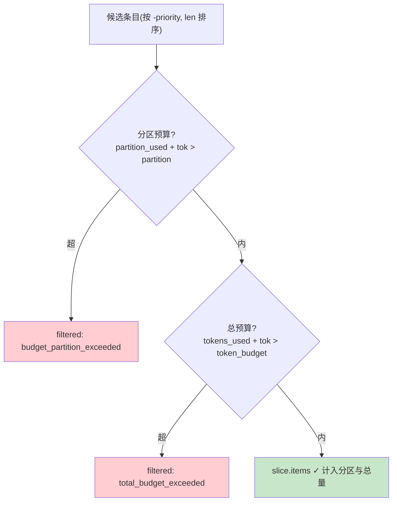

# 23 动态上下文装配与预算

> **本课定位**：本课深入装配管线的核心机制：**六分区预算**与**优先级装填**。核心命题：预算不是"总量控制"这么简单——分区防止"某一类信息淹死其他类"，优先级防止"次要信息挤掉必需信息"。学完本课，你能为一个新的决策场景设计分区与优先级，并跑通预算裁剪的完整实验。
> **教学目标**：①能解释分区预算防什么（结构失衡）；②能复述双层预算检查顺序及其原因；③能演示分区裁剪与优先级保护；④能按四步法为新场景设计分区。
> **前置**：第 21-22 课
> **产出**：分区预算实验 × 3 + 分区设计方法
> **对应代码**：`assembler.py::ContextAssembler.budget_partitions`
> **对应测试**：`test_context.py::test_budget_partition_and_total`

---

## 0. 本课要用到的环境

| 组件 | 取值 | 说明 |
|---|---|---|
| 分区默认值 | system_rule 600 / tenant_attr 400 / user_input 400 / business_knowledge 2000 / tool_result 1500 / memory 700 | 总预算 6000 |
| 验证命令 | `python -m pytest tests/unit/test_context.py -v` | 在 `dataagent/` 目录执行 |

---

## 1. 问题场景（只设总预算的两个翻车现场）

1. **检索结果淹没场景**：RAG 拉回 20 段文档（每段 800 token），总预算 6000 被文档吃光——系统规则和租户身份被挤掉，模型开始"自由发挥"。
2. **记忆刷屏场景**：召回 10 条历史记忆把工具结果挤出窗口——本轮决策最需要的"新鲜事实"反而缺位。

总预算只防"撑爆"，不防**结构失衡**。分区预算按 provenance 分配额度：`system_rule 600 / tenant_attr 400 / user_input 400 / business_knowledge 2000 / tool_result 1500 / memory 700`——**结构由预算保证，不是靠运气**。

---

## 2. 概念与机制

### 2.0 双层预算的检查顺序



**顺序不能反**：先查分区（结构性约束），再查总量（全局约束）——反了会出现"总量还有余但分区已超"时的错误装填。

### 2.1 装填顺序：优先级降序 + 短内容优先

```python
candidate_items.sort(key=lambda c: (-c.priority, len(c.content)))
```

**设计意图**：同优先级时**短内容先装**——同样的信息量，短条目让更多条目进窗（信息密度优先）。

### 2.2 双层预算检查

```python
if partition_used.get(it.provenance.value, 0) + tok > partition:
    slice_.filtered.append((it.key, "budget_partition_exceeded"))
    continue
if slice_.tokens_used + tok > self.token_budget:
    slice_.filtered.append((it.key, "total_budget_exceeded"))
    continue
```

**顺序不能反**：先查分区（结构性约束），再查总量（全局约束）——反了会出现"总量还有余但分区已超"时的错误装填。

### 2.3 分区设计方法（本课核心方法论）

| 步骤 | 问题 | DataAgent 的答案 |
|---|---|---|
| ① 列信息类 | 决策需要哪几类信息？ | 六类 provenance |
| ② 定比例 | 每类"该"占多少？ | 业务知识最多(2000)、工具结果次之(1500)、记忆 700——**离决策越近越多** |
| ③ 留硬底线 | 哪类是底线不可挤压？ | system_rule/tenant_attr 有独立配额（不被检索内容挤压） |
| ④ 用数据校准 | 分区超限频繁吗？ | 看 decision_trace 的 filtered 原因分布 |

---

## 3. 动手实验

### 实验 1：分区裁剪（business_knowledge 超 2000）

```bash
cd dataagent
$env:PYTHONPATH="src"
python -c "
from dataagent.infra.context.assembler import ContextAssembler, ContextProvider, ContextItem, Provenance
a = ContextAssembler(token_budget=6000)
for n in range(6):
    a.register(ContextProvider(f'bk{n}', lambda n=n: ContextItem(
        key=f'bk{n}', content='x'*1500, provenance=Provenance.BUSINESS_KNOWLEDGE), priority=50))
s = a.assemble()
print('包含 =', len(s.items), '条')
print('分区裁剪 =', [k for k, r in s.filtered if r == 'budget_partition_exceeded'])
"
```

**预期输出**（真实运行：375 token/条 × 5 = 1875 未触顶，第 6 条超限）：

```text
包含 = 5 条
分区裁剪 = ['bk5']
```

### 实验 2：优先级保护（高优先级顶掉低优先级）

```bash
python -c "
from dataagent.infra.context.assembler import ContextAssembler, ContextProvider, ContextItem, Provenance
a = ContextAssembler(token_budget=30)   # 小预算看竞争
a.register(ContextProvider('must', lambda: ContextItem(key='must', content='必需信息'*3,
    provenance=Provenance.SYSTEM_RULE, priority=100)))
a.register(ContextProvider('nice', lambda: ContextItem(key='nice', content='nice-'*20,
    provenance=Provenance.BUSINESS_KNOWLEDGE, priority=1)))
s = a.assemble()
print('进窗 =', [i.key for i in s.items])
print('被裁 =', [(k, r) for k, r in s.filtered])
"
```

**预期输出**（真实运行：must 约 13 token 先装，nice 约 26 token 使总量超 30 被裁）：

```text
进窗 = ['must']
被裁 = [('nice', 'total_budget_exceeded')]
```

### 实验 3：memory 分区独立（记忆再多不挤工具结果）

```bash
python -m pytest tests/unit/test_context.py::TestBudget::test_budget_partition_and_total -v
# PASSED —— 分区与总量的双层约束被钉住
```

---

## 4. 代码走读

### 4.1 分区缺省 300 的含义

```python
partition = self.budget_partitions.get(it.provenance.value, 300)
```

**设计意图**：未注册的 provenance 给 300 的保守配额——新类型信息不会无限制涌入，**fail-safe 默认**。

### 4.2 tokens=0 时回填

```python
if it.tokens == 0:
    it = dataclasses.replace(it, tokens=tok)
```

**设计意图**：ContextItem 是 frozen 的——计量后用 replace 生成新对象，**原始条目不被污染**（其他装配轮次可复用）。

### 4.3 token 估算器可插拔（GAP-13）

`ContextAssembler(token_estimator=...)` 接受自定义估算函数；默认 `default_token_estimator`（CJK 1 token + 其余 4 字符 1 token），对中文从旧口径 `len//4` 的"低估 2-4 倍"修正到接近真实——生产接真实 tokenizer 只需注入，装配管线不变。

---

## 5. 常见错误与 Badcase

| # | 错误现象 | 根因 | 正确做法 |
|---|---|---|---|
| 1 | 检索内容挤掉系统规则 | 无分区/分区未含 system_rule | 硬底线类独立配额 |
| 2 | 分区检查放总量之后 | 顺序错误 | 先分区后总量 |
| 3 | 高优先级信息反而被裁 | 未按 priority 排序 | `(-priority, len)` 双键排序 |
| 4 | 装配后 original 条目的 tokens 被改 | frozen 被绕过 | replace 生成新对象 |
| 5 | 分区值凭感觉定 | 无数据校准 | 看 filtered 原因分布调参 |

---

## 6. 验收

```bash
cd dataagent
$env:PYTHONPATH="src"
python -m pytest tests/unit/test_context.py -q    # 期望: 8 passed
# 实验1/2 输出与 §3 一致
```

---

## 7. 思辨与讨论

1. **"分区该静态配置还是动态学习？"** 静态起步（可评审），数据积累后按任务类型模板化（分析任务/SQL 任务各一套分区）——参照工程的 ContextBudget.PARTITIONS 是静态版，模板化是演进方向。**动态学习放最后，因为不可解释的预算分配是调优灾难**。
2. **"为什么记忆只给 700？"** 记忆是**背景增强**不是**决策输入**——新鲜事实（tool_result 1500）永远比历史偏好重要。分区比例本身就是一种架构表态。

---

## 8. 延伸与引用

- 第 05 课（CE 层）——本课是其中"预算分区"的展开
- 参照工程 `services/context/assembler.py`——六分区 `ContextBudget.PARTITIONS` 的同源实现
- 第 25 课（长任务上下文）——多轮装配的预算治理

---

## 9. 本课遗留问题

- 分区配额不可按任务类型切换（单一全局配置）——模板化演进项。
- ~~`len//4` 估算偏差（中文低估）会使分区实际容量虚高~~ → **已修复（GAP-13）**：默认中文感知估算器 + `token_estimator` 可插拔；本课实验输出已按新估算器真实运行校准。
