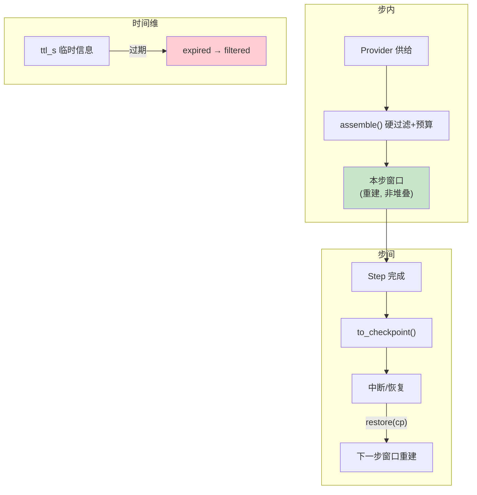

# 25 长任务上下文治理：TTL、检查点与多轮装配

> **本课定位**：本课讲长任务（多步/多轮/可中断）下的上下文治理三件事：**TTL 生命周期**（旧信息自然过期）、**检查点续跑**（中断后上下文从快照重建）、**逐轮装配**（每步重新装配而非增量堆叠）。学完本课，你能解释"为什么长任务的上下文不会越滚越大"。
> **教学目标**：①能复述长任务治理三板斧及分工；②能演示 TTL 过滤与检查点续跑；③能解释逐轮装配为何不通胀；④能给出四类信息的 ttl_s 建议。
> **前置**：第 23-24 课
> **产出**：TTL 实验 + 检查点续跑实验
> **对应代码**：`assembler.py`（TTL/expired）、`contracts/runtime.py`（Checkpoint/restore）
> **对应测试**：`test_context.py::test_expiry`、`test_contracts_domain.py::test_checkpoint_roundtrip`

---

## 0. 本课要用到的环境

| 组件 | 取值 | 说明 |
|---|---|---|
| TTL 机制 | `ContextItem.ttl_s` + `expired` 派生属性 | 装配时过滤 |
| 恢复机制 | `Run.to_checkpoint()` / `Run.restore(cp)` | 状态与事件流重建 |
| 验证命令 | `python -m pytest tests/unit/test_context.py tests/unit/test_contracts_domain.py -v` | 在 `dataagent/` 目录执行 |

---

## 1. 问题场景（长任务的上下文通胀）

一个 40 步的分析任务，如果上下文"只进不出"：
- 第 5 步的查询原始结果在第 38 步还在（占 1500 token）；
- 中间步骤的候选结论层层堆积；
- 进程中断后，这些"堆叠物"全部丢失且无法重建。

治理三板斧：
1. **TTL**：临时信息（查询原始行、中间计算）带 `ttl_s`，过期自动出局；
2. **逐轮装配**：每步从 Provider 重新 assemble，**不增量堆叠**——窗口内容永远"当前步所需"；
3. **检查点**：跨中断的连续性交给 Checkpoint（结构化），而不是靠堆叠上下文（非结构化）。

---

## 2. 概念与机制

### 2.1 三板斧的分工



### 2.2 TTL 的适用判据

| 信息类型 | ttl_s 建议 | 理由 |
|---|---|---|
| 查询原始行 | 60~300s | 只在当步分析用 |
| 中间计算 | 60s | 下一步即失效 |
| 注册口径/租户身份 | None（不过期） | 全程有效 |
| 临时候选结论 | 30s | 只在验证前有效 |

### 2.3 逐轮装配 vs 增量堆叠的对照

| | 增量堆叠 | 逐轮装配（本仓库） |
|---|---|---|
| 窗口增长 | 线性膨胀 | 恒定（预算封顶） |
| 旧信息污染 | 是 | TTL+重装配天然免疫 |
| 中断恢复 | 不可恢复 | Checkpoint 结构化恢复 |
| 调试 | 难（历史混杂） | decision_trace 每轮独立 |

---

## 3. 动手实验

### 实验 1：TTL 过滤

```bash
cd dataagent
$env:PYTHONPATH="src"
python -m pytest tests/unit/test_context.py::TestContextItem::test_expiry -v
```

**预期输出**：

```text
tests/unit/test_context.py::TestContextItem::test_expiry PASSED
```

```bash
python -c "
import time
from dataagent.infra.context.assembler import ContextAssembler, ContextProvider, ContextItem
a = ContextAssembler()
a.register(ContextProvider('stale', lambda: ContextItem(key='temp_result',
    content='第3步的原始查询行...', ttl_s=0.05, priority=90)))
time.sleep(0.1)          # 让 TTL 过期
s = a.assemble()
print('包含 =', [i.key for i in s.items])
print('过滤 =', s.filtered)
"
```

**预期输出**：

```text
包含 = []
过滤 = [('temp_result', 'expired')]
```

### 实验 2：检查点往返（状态+事件流全量）

```bash
python -m pytest tests/unit/test_contracts_domain.py::TestRun::test_checkpoint_roundtrip -v
```

**预期输出**：

```text
tests/unit/test_contracts_domain.py::TestRun::test_checkpoint_roundtrip PASSED
```

### 实验 3：workflow 级断点续跑（真实场景）

```bash
python -c "
from dataagent.contracts.runtime import Run, RunStatus
from dataagent.infra.runtime.workflow import (DurableWorkflowExecutor, HumanApprovalGate,
    IdempotencyStore, InMemoryApprovalPort, InMemoryRunStore, WorkflowDefinition, WorkflowNode)
ex = DurableWorkflowExecutor(store=InMemoryRunStore(),
    approval=HumanApprovalGate(InMemoryApprovalPort(auto_approve=True)),
    idem=IdempotencyStore(),
    harness_runner=None,
    approval_mode='manual')
wf = WorkflowDefinition('long', nodes=[
    WorkflowNode('step1', 'task', fn=lambda r, i: {'done': 1}),
    WorkflowNode('gate', 'human_gate', approval_action='approve_x'),
])
run = Run(query='长任务')
try:
    ex.execute(wf, run)
except Exception as e:
    print('中断于:', type(e).__name__)
    cps = [ (sid, st) for sid, st in ex.store.load_checkpoint(run.run_id).step_serial ]
    print('检查点步骤状态 =', cps)   # step1 已 SUCCEEDED —— 恢复时跳过
"
```

**预期输出**：

```text
中断于: ApprovalPendingError
检查点步骤状态 = [('stp_0001', 'succeeded'), ('stp_0002', 'waiting_approval')]
```

**判定通过**：中断瞬间检查点已落盘，step1 的完成状态被结构化保存——恢复时自动跳过，上下文与进度都不会"失忆"。

---

## 4. 代码走读

### 4.1 expired 为什么是 property

```python
@property
def expired(self) -> bool:
    return self.ttl_s is not None and (time.time() - self.created_at) > self.ttl_s
```

**设计意图**：实时派生——不存在"过期标志忘了刷"的状态 bug。代价是每次判定取系统时间（测试时配合注入时钟可控）。

### 4.2 检查点里的 step_serial

```python
step_serial=[(s.step_id, s.status.value) for s in self.steps],
```

**设计意图**：检查点记录**步骤状态对**而非完整步骤对象——恢复的最小充分信息是"哪些步骤完成了"。体积小、语义清。

---

## 5. 常见错误与 Badcase

| # | 错误现象 | 根因 | 正确做法 |
|---|---|---|---|
| 1 | 40 步任务窗口爆炸 | 增量堆叠 | 逐轮装配 + 预算封顶 |
| 2 | 中断后"失忆"重头跑 | 连续性靠上下文堆叠 | 连续性靠 Checkpoint |
| 3 | 临时信息十轮不散 | 无 TTL | 按信息类型配 ttl_s |
| 4 | 恢复后重复执行已完成步骤 | 恢复不核对 step_serial | 逐项核对 SUCCEEDED 再跳 |

---

## 6. 验收

```bash
cd dataagent
$env:PYTHONPATH="src"
python -m pytest tests/unit/test_context.py tests/unit/test_contracts_domain.py -q   # 期望: 19 passed
# 实验1/3 输出与 §3 一致
```

---

## 7. 思辨与讨论

1. **"压缩（summarization）为什么不在三板斧里？"** 压缩是"信息保不住时的补救"，三板斧是"信息结构化后不必保"——先有 TTL/重装配/检查点，压缩才是锦上添花。直接上压缩会把治理问题变成概率问题（摘要有损且不可审计）。
2. **"长任务的定义？"** 预算封顶后窗口仍恒定——所以本仓库的"长"是**步数长**而非"上下文长"。任务越长的正确应对是拆节点，不是塞上下文。

---

## 8. 延伸与引用

- 第 18 课（Durable Workflow）——检查点/恢复的完整语义
- 参照工程 `lessons/第6篇/L6-5`——长任务压缩与漂移的对照实现
- 第 17 课（执行模型）——Checkpoint 结构

---

## 9. 本课遗留问题

- Checkpoint 未含 steps 的 output 内容（只有状态对）——恢复后步骤产出不可回看，需持久化层补全。
- TTL 判定用 wall-clock，机器休眠/时钟回拨会误判——与 Event.ts 同源遗留。
- 压缩（summarization）完全未实现——如实登记为演进项而非缺陷。
