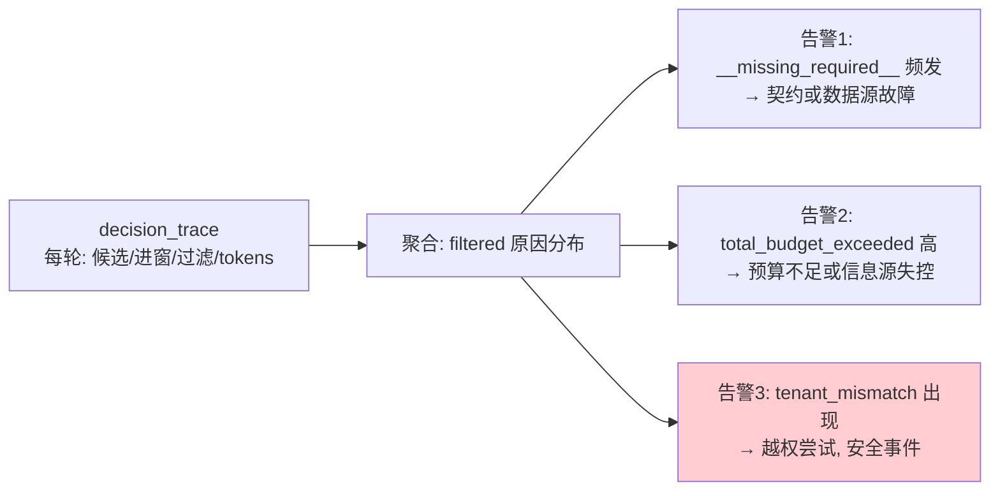

# 26 Context Security 与 ContextOps

> **本课定位**：第六篇收口。本课把前五课的机制收拢为两个运营视角：**Security**（信任分级接入硬过滤、注入防护纵深、敏感信息治理）与 **Ops**（决策追踪、装配监控、预算告警）。学完本课，你能为一个运行中的上下文管线设计安全基线与运营看板。
> **教学目标**：①能复述安全基线四条及本仓库落点状态；②能用 hard_filter 钩子接入敏感项拦截；③能设计 filtered 原因分布的运营告警（含 tenant_mismatch=0 基线）；④能说出 S1 遗留的修法。
> **前置**：第 21-25 课
> **产出**：安全基线清单 + 运营实验
> **对应代码**：`assembler.py`（hard_filter 钩子/decision_trace）、`guards.py::InjectionGuard`
> **对应测试**：`test_security.py` 7 例

---

## 0. 本课要用到的环境

| 组件 | 取值 | 说明 |
|---|---|---|
| 钩子 | `assemble(hard_filter=...)` | 自定义硬过滤接入点 |
| 运营数据 | `ContextSlice.decision_trace / filtered` | 追踪与原因分布 |
| 验证命令 | `python -m pytest tests/unit/test_security.py -v` | 在 `dataagent/` 目录执行 |

---

## 1. 问题场景

上线三个月后的运营例会，三个问题没人答得上：
1. "上个月有多少装配因为预算裁掉了必需信息？"——**没有 filtered 统计**；
2. "外部内容的信任标记真的在生效吗？"——**trust 未接入过滤，纯装饰**；
3. "有人往上下文里塞过敏感数据吗？"——**没有敏感项检查**。

本课把这三个问题变成三个可交付机制。

---

## 2. 概念与机制

### 2.1 Security 基线四条

| 基线 | 机制 | 本仓库落点 | 状态 |
|---|---|---|---|
| S1 信任分级生效 | trust → 硬过滤分区 | `TrustLevel` 已建模 | ⚠️ 未接入过滤（遗留） |
| S2 外部内容消毒 | sanitize_external 包裹 | `guards.py` | ✅ |
| S3 注入语料检测 | is_instruction_leak | `guards.py` | ✅（英文语料） |
| S4 凭据短期化 | CredentialBroker TTL | `guards.py` | ✅ 300s |

### 2.2 hard_filter 钩子：策略可插拔

```python
def block_pii(item: ContextItem) -> tuple[bool, str]:
    if "身份证" in item.content or "password" in item.content.lower():
        return False, "sensitive_content"
    return True, ""

s = assembler.assemble(hard_filter=block_pii)
```

**设计意图**：`assemble()` 的 `hard_filter` 参数是**管线内预留的策略插槽**——S1/S4/敏感项检查都从这里接入，无需改装配主流程。

### 2.3 Ops 三件套



**最锋利的一条**：`tenant_mismatch` 的正常值应当是**0**（合法请求根本不会携带他租户数据）——一旦出现就是安全信号，不是噪声。

---

## 3. 动手实验

### 实验 1：敏感项拦截（hard_filter 实战）

```bash
cd dataagent
$env:PYTHONPATH="src"
python -c "
from dataagent.infra.context.assembler import ContextAssembler, ContextProvider, ContextItem
def block_pii(item):
    if 'password' in item.content.lower() or '身份证' in item.content:
        return False, 'sensitive_content'
    return True, ''
a = ContextAssembler()
a.register(ContextProvider('leak', lambda: ContextItem(key='user_note',
    content='用户备注: 我的 password 是 abc123', priority=95)))
s = a.assemble(hard_filter=block_pii)
print('进窗 =', [i.key for i in s.items])
print('拦截 =', s.filtered)
"
```

**预期输出**：

```text
进窗 = []
拦截 = [('user_note', 'sensitive_content')]
```

### 实验 2：凭据短 TTL 验证

```bash
python -m pytest tests/unit/test_security.py::TestCredentialBroker::test_short_lived -v
# PASSED —— ttl 到期后 valid()=False
python -m pytest tests/unit/test_security.py::TestCredentialBroker::test_revoke -v
# PASSED —— revoke_all 立即全部失效
```

### 实验 3：运营看板数据（filtered 原因分布）

```bash
python -c "
from dataagent.app.container import DataAgentContainer, default_seed
c = DataAgentContainer(seed_orders=default_seed())
from collections import Counter
reasons = Counter()
for _ in range(5):
    s = c.ctx.assemble(tenant_id='ten_a', roles={'analyst'})
    for k, r in s.filtered: reasons[r] += 1
print('5 轮装配的过滤原因分布 =', dict(reasons) or '无过滤事件(健康)')
"
```

**预期输出**：

```text
5 轮装配的过滤原因分布 = 无过滤事件(健康)
```

### 实验 4：消毒与注入的全套回归

```bash
python -m pytest tests/unit/test_security.py -q    # 期望: 7 passed
```

---

## 4. 代码走读

### 4.1 hard_filter 在管线中的位置

```python
if hard_filter is not None:
    ok, reason = hard_filter(it)
    if not ok:
        slice_.filtered.append((it.key, reason))
        continue
```

**设计意图**：自定义过滤排在**租户/角色之后、预算之前**——策略过滤享受"硬过滤"地位（不可被预算挤掉），但也不越过租户底线。

### 4.2 CredentialBroker 的最小实现哲学

```python
def issue(self, role: str = "readonly") -> str:
    tok = f"cred_{uuid.uuid4().hex[:8]}"
    self._issued[tok] = time.time()
    return tok
```

**设计意图**：凭据 = 随机 token + 签发时间 + TTL 判定——没有更多魔法。**短期凭据的要点是"过期即无效 + 可整体吊销"**，实现复杂度在存储层（生产接 Redis TTL）。

---

## 5. 常见错误与 Badcase

| # | 错误现象 | 根因 | 正确做法 |
|---|---|---|---|
| 1 | trust 字段装饰性存在 | 未接入过滤 | hard_filter 按 trust 分区（S1 遗留的修法） |
| 2 | tenant_mismatch 当噪声忽略 | 缺乏安全视角 | 该原因 = 安全事件，计数告警 |
| 3 | 敏感词检查在输出侧才做 | 只防"说漏"不防"喂进" | 输入侧 hard_filter 先拦 |
| 4 | 凭据永不过期 | TTL 未配置 | 默认 300s + revoke 能力 |

---

## 6. 验收

```bash
cd dataagent
$env:PYTHONPATH="src"
python -m pytest tests/unit/test_security.py tests/unit/test_context.py -q   # 期望: 15 passed
# 实验1/3 输出与 §3 一致
```

---

## 7. 思辨与讨论

1. **"上下文安全为什么单独成课，并入系统安全不行吗？"** 因为攻击面不同：系统安全防"未授权访问"，上下文安全防"**授权访问里的内容投毒**"——外部文档里的注入指令是"合法检索回来的"。边界不同，防线必须独立。
2. **"Ops 告警怎么不烦人？"** 靠**原因的正常基线**：tenant_mismatch 基线为 0（出现即告警）、missing_required 基线为 0（频发即故障）、预算裁剪有正常波动（只告趋势）。**有基线的告警才可运营**。

---

## 8. 延伸与引用

- 参照工程 `services/context/schema.py:175`——外部内容禁指令的 schema 级强化
- 本仓库 `docs/06` §TOP-12 之 8——PII 掩码 + 提示注入 guardrail 的生产化方向
- 第 32-35 课（Memory 篇）——记忆侧的对称治理

---

## 9. 本课遗留问题

- ~~S1（trust 接入过滤）是本课最大遗留~~ → **已接入（GAP-07）**：UNTRUSTED 内容自动消毒包裹 + 注入语料拦截；~~中文注入语料库未建~~ → **已建（GAP-12）**：`corpus/injection_{en,zh}.json` 双语语料 + 清理样本零误报测试。
- decision_trace 无持久化（内存中随 Slice 消亡）→ **已落盘（GAP-18，第四轮）**：`JsonlRecorder.record_slice`（env `DATAAGENT_OBSERV_DIR` 启用）。
