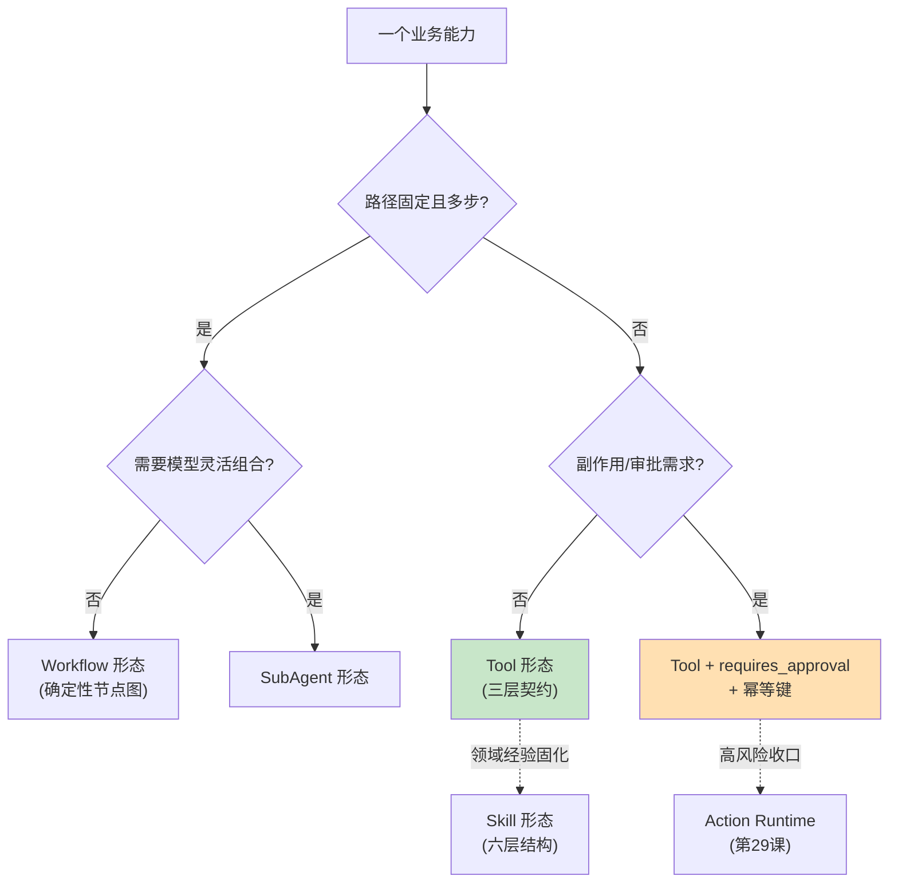

# 27 从 Function Call 到 Capability Architecture

> **本课定位**：第七篇开篇。本课回答能力形态的选型问题：一个业务能力应该以 Tool / Skill / Workflow / SubAgent / MCP 哪种形态存在？核心工具：**形态选型矩阵**（按确定性/副作用/复用面三轴判定）。学完本课，你能为 DataAgent 的五个能力（指标查询/订单查询/沙箱分析/工单创建/预算调整）说出形态选择理由。
> **教学目标**：①能用三轴判定矩阵做形态选型；②能盘点 DataAgent 五能力的形态与理由；③能演示动态最小工具集的风险过滤；④能识别三种形态错配翻车现场。
> **前置**：第 03 课（能力模型）
> **产出**：形态选型矩阵 + 本仓库能力地图走读
> **对应代码**：`contracts/tool.py::CapabilityRegistry`、`infra/gateway/tools.py::build_dataagent_toolchain`
> **对应测试**：`test_contracts_domain.py::TestCapabilityRegistry`

---

## 0. 本课要用到的环境

| 组件 | 取值 | 说明 |
|---|---|---|
| 能力地图 | `build_dataagent_toolchain(lake)` 注册 5 个工具 | query_metric/query_orders/python_analyze/create_ticket/adjust_budget |
| 验证命令 | `python -m pytest tests/unit/test_contracts_domain.py -v` | 在 `dataagent/` 目录执行 |

---

## 1. 问题场景（形态错配的三种翻车）

1. **把"经营异常诊断"做成单个 Tool**——工具越来越大，最后变成一个 2000 行的 `do_everything()`，没人敢改；
2. **把"查指标"做成 Skill**——六层结构（使命/原则/步骤/标准/验证器/产物）套在一个 3 行的聚合查询上，仪式感大于价值；
3. **把"调整预算"做成裸 Function Call**——没有审批、没有幂等、没有风险分级，直接打真实预算系统。

**形态选型错了，治理就没地方放。**

---

## 2. 概念与机制

### 2.1 形态选型矩阵



### 2.2 DataAgent 五能力的选择与理由

| 能力 | 形态 | 理由 | 本仓库落点 |
|---|---|---|---|
| query_metric | Tool(READONLY) | 单步、无副作用、高频 | `tools.py` risk=READONLY |
| query_orders | Tool(READONLY) | 单步、行级权限在网关 | 同上 |
| python_analyze | Tool(READONLY) | 受限沙箱执行 | 同上 + `sandbox/executor.py` |
| create_ticket | Tool(HIGH)+审批+幂等 | 副作用进工单系统 | requires_approval=True, idempotent=True |
| adjust_budget | Tool(HIGH)+审批+幂等 | 资金类，最严格 | 同上 |
| anomaly_diagnosis | Skill | 六步工序+领域原则固化 | `skills/skill.py::build_anomaly_skill` |

### 2.3 CapabilityRegistry：统一能力地图

```python
class CapabilityRegistry:
    def register(self, tool: Tool) -> None: ...
    def visible_for(self, *, tenant_id, roles, task="", stage="") -> list[dict]: ...
    def to_json(self) -> str: ...
```

**设计意图**：所有形态最终都注册进同一张地图，`visible_for` 提供**动态最小工具集**（按租户/角色过滤）——模型看到的永远是被治理裁剪过的视图。

---

## 3. 动手实验

### 实验 1：能力地图盘点

```bash
cd dataagent
$env:PYTHONPATH="src"
python -c "
from dataagent.app.container import DataAgentContainer, default_seed
c = DataAgentContainer(seed_orders=default_seed())
for name, t in c.tools.all().items():
    print(f'{name:16s} risk={t.risk_level.value:8s} 审批={t.requires_approval} 幂等={t.idempotent}')
"
```

**预期输出**：

```text
query_metric     risk=readonly  审批=False 幂等=False
query_orders     risk=readonly  审批=False 幂等=False
python_analyze   risk=readonly  审批=False 幂等=False
create_ticket    risk=high      审批=True 幂等=True
adjust_budget    risk=high      审批=True 幂等=True
```

**判定通过**：三个只读 + 两个高风险（带审批/幂等）——形态与治理需求一一对应。

### 实验 2：动态最小工具集（风险过滤）

```bash
python -c "
from dataagent.app.container import DataAgentContainer, default_seed
c = DataAgentContainer(seed_orders=default_seed())
visible = c.tools.visible_for(tenant_id='ten_a', roles={'analyst'})
names = [v['function']['name'] for v in visible]
print('analyst 可见 =', names)
print('HIGH 工具被隐藏 =', 'adjust_budget' not in names and 'create_ticket' not in names)
"
```

**预期输出**：

```text
analyst 可见 = ['query_metric', 'query_orders', 'python_analyze']
HIGH 工具被隐藏 = True
```

**判定通过**：非 admin 角色看不到 HIGH 工具——**最小可见面是治理的一部分**，不是功能裁剪。

### 实验 3：Skill 形态盘点

```bash
python -c "
from dataagent.app.container import DataAgentContainer
c = DataAgentContainer()
s = c.skills.get('anomaly_diagnosis')
print('使命 =', s.mission[:30], '...')
print('步骤 =', s.steps)
print('渐进加载(analysis 任务) =', [x.name for x in c.skills.progressive_load('analysis')])
"
```

**预期输出**：

```text
使命 = 经营异常诊断：负责对一个经营指标的下滑做归因与建议...
步骤 = ['指标确认', '提出假设', '查询证据', '分析验证', '原因排序', '生成报告']
渐进加载(analysis 任务) = ['anomaly_diagnosis']
```

---

## 4. 代码走读

### 4.1 注册即声明治理属性

```python
reg.register(Tool(
    name="adjust_budget",
    description="调整某区域营销预算（高风险副作用，需人工审批）",
    parameters_schema={"type": "object"},  # 参数 schema 详见 infra/gateway/tools.py
    executor=adjust_budget,
    risk_level=RiskLevel.HIGH,
    requires_approval=True,
    idempotent=True,
))
```

**设计意图**：治理属性在**注册时声明**，运行时由结构执行（visible_for 过滤、human_gate 拦截、幂等键先占）——治理不靠文档自觉。

### 4.2 为什么 Visible_for 过滤的是 schema 不是执行

```python
def visible_for(self, *, tenant_id, roles, task="", stage="") -> list[dict[str, Any]]:
    for name, t in self._tools.items():
        if t.risk_level in (RiskLevel.HIGH, RiskLevel.MEDIUM) and "admin" not in roles:
            continue
        out.append(t.schema_for_model())
```

**设计意图**：过滤发生在"给模型看什么"这一层——模型根本不知道 HIGH 工具存在，就不存在"说服模型别调"的问题。**让错误调用在物理上不可表达**。

---

## 5. 常见错误与 Badcase

| # | 错误现象 | 根因 | 正确做法 |
|---|---|---|---|
| 1 | do_everything 巨型工具 | 形态选型错 | 按 §2.1 矩阵拆分 |
| 2 | HIGH 工具对所有角色可见 | 无最小可见面 | visible_for 风险+角色过滤 |
| 3 | 副作用工具无幂等声明 | 治理属性缺席 | 注册时声明 idempotent |
| 4 | Skill 套在 3 行查询上 | 仪式感大于价值 | 单步能力用 Tool，工序用 Skill |

---

## 6. 验收

```bash
cd dataagent
$env:PYTHONPATH="src"
python -m pytest tests/unit/test_contracts_domain.py -q    # 期望: 12 passed
# 实验1/2 输出与 §3 一致
```

---

## 7. 思辨与讨论

1. **"MCP 算第五种形态吗？"** MCP 是**接入协议**不是能力形态——外部能力经 MCP 进来后，仍要按本课矩阵判定它在本系统中的形态与治理（第 31 课展开）。
2. **"能力地图会不会膨胀到失控？"** 会有失控感——所以 `visible_for` 的 task/stage 参数是为"分阶段供给"预留的（第 30 课渐进加载的近亲）。地图可以大，**窗口必须小**。

---

## 8. 延伸与引用

- 第 28 课（Tool Contract）——三层契约细节
- 参照工程 `lessons/第7篇/L7-1`——能力注册表与 fail-closed 语义
- 本仓库 `docs/00-TOGAF架构总览.md` C 阶段——应用架构与能力地图

---

## 9. 本课遗留问题

- `visible_for` 的 task/stage 参数未消费（只按租户/角色过滤）——分阶段供给登记为演进项。
- SubAgent/Workflow 形态在地图中无注册位（只支持 Tool）——形态扩展项，如实登记。
