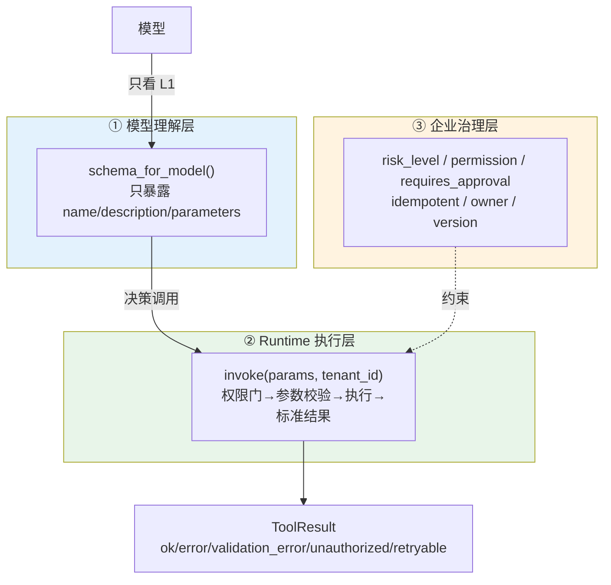

# 28 Tool Contract 与动态工具供给：三层契约

> **本课定位**：本课深入 Tool 的三层契约：**模型理解层**（schema_for_model 最小面）、**Runtime 执行层**（invoke 校验+标准结果）、**企业治理层**（风险/权限/审计/幂等元数据）。学完本课，你能为一个新工具完整实现三层契约，并解释"为什么模型看到的世界必须比真实世界小"。
> **教学目标**：①能说出三层契约各自的关注点与事故对应；②能实现一个带治理字段的新工具；③能解释权限先于校验的信息论依据；④能识别 bool/number 类型陷阱（本课登记的真实边界）。
> **前置**：第 27 课（形态选型）
> **产出**：三层契约走读 + 自定义工具实验
> **对应代码**：`contracts/tool.py::Tool`
> **对应测试**：`test_contracts_domain.py::TestToolParamsValidation / TestToolPermissionGate / TestSchemaForModel`

---

## 0. 本课要用到的环境

| 组件 | 取值 | 说明 |
|---|---|---|
| 契约对象 | `Tool(name, description, parameters_schema, executor, risk_level, permission, requires_approval, idempotent, owner, version)` | 三层合一 |
| 验证命令 | `python -m pytest tests/unit/test_contracts_domain.py -v` | 在 `dataagent/` 目录执行 |

---

## 1. 问题场景（单层契约的三宗罪）

把工具只定义成一个函数签名（单层契约）：

1. **模型看全部**：治理字段（风险/权限）也被塞进 schema——模型被"调预算很危险"的信息干扰，甚至被提示注入利用；
2. **结果无标准**：每次执行返回任意结构，Agent 无法程序化判断"重试/改参/放弃"；
3. **审计无据**：谁在什么时候用哪个版本的工具改了数据——查无对证。

三层契约把三种关注点**物理分离**。

---

## 2. 概念与机制

### 2.1 三层契约总览



### 2.2 ToolResult：标准结果语义

```python
class ToolResultStatus(str, Enum):
    OK = "ok"
    ERROR = "error"
    VALIDATION_ERROR = "validation_error"
    UNAUTHORIZED = "unauthorized"
    RETRYABLE = "retryable"
```

**五态的设计意图**：Agent 拿到结果能程序化分派——`ok` 继续、`validation_error` 改参重调、`unauthorized` 放弃、`retryable` 原样重试。没有标准语义，Agent 只能"看字符串猜"。

### 2.3 invoke 的防御顺序

```python
def invoke(self, params, *, tenant_id="default"):
    if self.risk_level is not RiskLevel.READONLY:     # ① 权限门(非只读才查)
        return ToolResult.err("当前租户无此工具权限", UNAUTHORIZED)
    ok, msg = self.validate_params(params)             # ② 参数校验
    if not ok: return ToolResult.err(msg, VALIDATION_ERROR)
    result = self.executor(dict(params))               # ③ 执行
    result.audit = {"tool": self.name, "version": self.version,
                    "tenant_id": tenant_id, "ts": time.time()}
    return result                                      # ④ 带审计返回
```

**顺序即策略**：权限先于校验（无权者连参数合法性都不配知道——减少信息泄露）。

---

## 3. 动手实验

### 实验 1：模型理解层——最小面验证

```bash
cd dataagent
$env:PYTHONPATH="src"
python -c "
from dataagent.app.container import DataAgentContainer, default_seed
c = DataAgentContainer(seed_orders=default_seed())
t = c.tools.get('adjust_budget')
s = t.schema_for_model()
print('模型看到的 keys =', sorted(s['function'].keys()))
print('治理字段泄露 =', 'risk_level' in str(s))
"
```

**预期输出**：

```text
模型看到的 keys = ['description', 'name', 'parameters']
治理字段泄露 = False
```

### 实验 2：参数校验（validation_error）

```bash
python -c "
from dataagent.app.container import DataAgentContainer, default_seed
c = DataAgentContainer(seed_orders=default_seed())
t = c.tools.get('adjust_budget')
r = t.invoke({'region': '华东'})     # 缺 amount/idempotency_key
print('状态 =', r.status.value)
print('错误 =', r.error)
"
```

**预期输出**：

```text
状态 = validation_error
错误 = 缺少必要参数: ['amount', 'idempotency_key']
```

### 实验 3：权限门（unauthorized）

```bash
python -m pytest tests/unit/test_contracts_domain.py::TestToolPermissionGate::test_permission_gate -v
# PASSED —— 非授权租户调用受限工具 → UNAUTHORIZED
```

### 实验 4：审计字段自动附加

```bash
python -c "
from dataagent.app.container import DataAgentContainer, default_seed
c = DataAgentContainer(seed_orders=default_seed())
r = c.tools.get('query_metric').invoke({'tenant_id': 'ten_a'}, tenant_id='ten_a')
print('审计 =', r.audit)
"
```

**预期输出**（ts 为时间戳）：

```text
审计 = {'tool': 'query_metric', 'version': '1.0.0', 'tenant_id': 'ten_a', 'ts': 1793...}
```

---

## 4. 代码走读

### 4.1 validate_params 的类型白名单

```python
if ptype == "string" and not isinstance(v, str):
    return False, f"参数 {k} 应为字符串"
```

**设计意图**：按 JSON Schema 的 type 做白名单校验（string/number/boolean）——**模型给的参数永远按不可信输入处理**。布尔校验用 `isinstance(v, bool)` 放在数字之前判断吗？看代码顺序：number 先判 `isinstance(v, (int, float))`——Python 的 bool 是 int 子类，`True` 会通过 number 校验！这是一个**已知边界**：M0 参数场景未出现布尔/数字混淆的实际危害，但严格实现应先判 bool。**如实登记为遗留缺陷**（这正是教学价值：契约层的类型缺陷最隐蔽）。

### 4.2 executor 收到的是 dict(params) 拷贝

```python
result = self.executor(dict(params))
```

**设计意图**：浅拷贝隔离——工具实现修改 params 不影响调用方（frozen 世界里的务实妥协）。

---

## 5. 常见错误与 Badcase

| # | 错误现象 | 根因 | 正确做法 |
|---|---|---|---|
| 1 | 治理字段出现在模型 schema 里 | 三层未分离 | schema_for_model 只给三件 |
| 2 | Agent 看不懂错误该重试还是放弃 | 结果无标准语义 | ToolResult 五态 |
| 3 | 无权租户能探测参数规则 | 权限在校验之后 | 权限门先行 |
| 4 | bool 被当 number 放行 | isinstance 子类陷阱 | 先判 bool（已登记遗留） |
| 5 | 审计信息靠工具实现自觉 | 无统一附加点 | invoke 统一附加 audit |

---

## 6. 验收

```bash
cd dataagent
$env:PYTHONPATH="src"
python -m pytest tests/unit/test_contracts_domain.py -q    # 期望: 12 passed
# 实验1-4 输出与 §3 一致
```

---

## 7. 思辨与讨论

1. **"为什么权限先于参数校验？"** 信息论视角：参数校验的报错本身是信息（"这个工具需要 amount 字段"）。对无权者暴露工具的参数结构 = 泄露系统能力地图。**fail-closed 到看不到**。
2. **"三层会不会过度设计？"** 每一层都对应一类真实事故（§1 三宗罪）。判断标准不是"层数"，是"删这层会复发什么事故"。

---

## 8. 延伸与引用

- 第 29 课（Action Runtime）——HIGH 工具的执行闭环
- 参照工程 `domain/capability/`——工具契约的实体化版本（构造期不变量）
- JSON Schema 规范（parameters_schema 的形态依据）

---

## 9. 本课遗留问题（本课最大的诚实产出）

1. ~~**bool/number isinstance 陷阱**：`isinstance(True, int) == True` 使布尔参数可通过 number 校验~~ → **已修复（GAP-04）**：number 判定显式排除 bool，回归测试 `test_bool_rejected_as_number` 钉住——登记到修复的完整闭环。
2. `parameters_schema` 仅支持 required+type 两项校验（enum/pattern/min/max 未实现）——按需增强。
3. `visible_for` 的角色过滤只认 "admin"（§27 遗留）——本课的 permission 字段与它未打通，登记。
