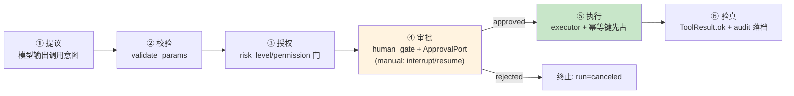

# 29 从 Tool Call 到 Action Runtime：受控副作用六阶段

> **本课定位**：本课讲 HIGH 风险工具的执行闭环：**提议→校验→授权→审批→执行→验真**六阶段（本仓库以 human_gate + ApprovalPort + IdempotencyStore 组合实现核心五段），以及"模型只能提议、不能执行"的结构保证。学完本课，你能走通一次受控行动的完整生命周期并解释每个阶段拦住的事故。
> **教学目标**：①能走通受控行动六阶段生命周期；②能演示手工 HITL 提议→中断→决议→恢复；③能解释模型只能提议的结构证明；④能说出幂等键设计的契约声明制方向。
> **前置**：第 18 课（审批门）、第 28 课（三层契约）
> **产出**：受控行动生命周期实验 × 3
> **对应代码**：`workflow.py`（human_gate 分支）、`tools.py::adjust_budget`、`services/api/admin.py`（生产审批单）
> **对应测试**：`test_integration.py::TestApprovalFlow`、`tests/fault/::test_side_effect_not_repeated`

---

## 0. 本课要用到的环境

| 组件 | 取值 | 说明 |
|---|---|---|
| 受控行动 | `adjust_budget`（HIGH + 审批 + 幂等） | 本课主演 |
| 审批生产实现 | `dataagent_approvals` 表 + `POST /v1/admin/approvals/{id}/resolve` | services 层 |
| 验证命令 | `python -m pytest tests/integration/test_integration.py -v` | 在 `dataagent/` 目录执行 |

---

## 1. 问题场景（不受控副作用的三次事故）

1. **模型幻觉执行**：模型"决定"调整预算，直接调用了资金系统 API——没人提议过、没人审批过；
2. **重复执行**：网络抖动重试，同一笔预算调整执行了两次；
3. **事后无凭**：预算变了，但谁批的、什么时候、依据什么参数——查无对证。

六阶段闭环把"副作用"从一次函数调用变成**一个有治理的流程**。

---

## 2. 概念与机制

### 2.1 六阶段与本仓库落点



| 阶段 | 拦住的事故 | 本仓库实现 |
|---|---|---|
| 提议 | ——（模型意图的自然表达） | 工具调用决策 |
| 校验 | 参数畸形 | `validate_params` |
| 授权 | 越权调用 | `permission` 门 + visible_for 不可见 |
| 审批 | 无人担责的资金操作 | human_gate + by 签名 |
| 执行 | 重复副作用 | IdempotencyStore.try_mark |
| 验真 | "说执行了"≠"执行了" | ToolResult + audit 字段 |

### 2.2 模型只能提议的结构证明

`adjust_budget` 注册为 Tool 后，模型层只产生**调用意图**；真正执行发生在：
- M0 演示：workflow 的 `build_approval_action`（带幂等保护的执行回执）；
- 生产：审批通过后由服务层执行（`services/api/admin.py` 审批 resolve → 后台恢复工作流）。

**关键结构**：`Harness` 的自主循环只放行 READONLY 工具（第 16 课 §4.3）——HIGH 工具**在自主循环里物理不可达**。

### 2.3 幂等键先占（执行阶段的核心）

```python
# tests/fault/test_fault_injection.py 的语义
def try_mark(self, key: str) -> bool:
    if key in self._executed:
        return False        # 已执行 → 返回已执行结果, 不再执行
    self._executed.add(key)
    return True
```

---

## 3. 动手实验

### 实验 1：完整生命周期（auto 演示模式）

```bash
cd dataagent
$env:PYTHONPATH="src"
python ../scripts/demo.py 2>&1 | Select-String "budget_adjust|审批"
```

**预期输出**：

```text
   - budget_adjust          [succeeded] {'approved': True, 'request_id': 'apr_1793146285940', 'effect_key': 'adjust_budget:', 'idempotent_skip': False, 'receipt': {'action': 'side_effect_executed', 'params': {}}}
   事件流长度=16  (可回放/可审计)
```

### 实验 2：手工 HITL（提议→中断→决议→恢复）

```bash
python -c "
from dataagent.contracts.runtime import Run, ApprovalRequest, ApprovalDecision
from dataagent.infra.runtime.workflow import (DurableWorkflowExecutor, HumanApprovalGate,
    IdempotencyStore, InMemoryApprovalPort, InMemoryRunStore, WorkflowDefinition, WorkflowNode,
    ApprovalPendingError)
port = InMemoryApprovalPort(auto_approve=False)
ex = DurableWorkflowExecutor(store=InMemoryRunStore(), approval=HumanApprovalGate(port),
    idem=IdempotencyStore(), approval_mode='manual', harness_runner=None)
wf = WorkflowDefinition('x', nodes=[WorkflowNode('budget', 'human_gate', approval_action='adjust_budget')])
run = Run(query='华东区预算调整 50000')
try: ex.execute(wf, run)
except ApprovalPendingError as e:
    print('① 提议+中断: action =', e.action, '| params =', e.params)
req = ApprovalRequest(request_id='apr_29', run_id=run.run_id, action='adjust_budget', params={})
port.request(req); port.resolve('apr_29', ApprovalDecision.APPROVED, by='运营总监-李')
run2 = ex.execute(wf, run, pre_approved={'adjust_budget': {'decision': 'approved', 'by': '运营总监-李'}})
print('④ 审批人 =', '运营总监-李')
print('⑤⑥ 恢复后 run =', run2.status.value)
"
```

**预期输出**：

```text
① 提议+中断: action = adjust_budget | params = {}
④ 审批人 = 运营总监-李
⑤⑥ 恢复后 run = succeeded
```

### 实验 3：幂等防重（副作用只发生一次）

```bash
python -m pytest tests/fault/test_fault_injection.py::TestFaultInjection::test_side_effect_not_repeated -v
# PASSED —— 重试命中幂等键, 副作用只执行一次
```

### 实验 4：未授权直接被结构挡住

```bash
python -c "
from dataagent.app.container import DataAgentContainer, default_seed
c = DataAgentContainer(seed_orders=default_seed())
visible = [v['function']['name'] for v in c.tools.visible_for(tenant_id='ten_a', roles={'analyst'})]
print('analyst 视野里有 adjust_budget 吗 =', 'adjust_budget' in visible)
print('→ 授权阶段: 模型根本看不到, 提议无从发生')
"
```

**预期输出**：

```text
analyst 视野里有 adjust_budget 吗 = False
→ 授权阶段: 模型根本看不到, 提议无从发生
```

---

## 4. 代码走读

### 4.1 build_approval_action：执行回执的最小形态

```python
def build_approval_action(run: Run, params: dict) -> dict:
    """作为 Workflow 的高风险副作用动作，返回执行回执。"""
    return {"action": "side_effect_executed", "params": params}
```

**设计意图**：M0 的"真实副作用"是一个占位（演示不碰真实资金系统）——但**回执的结构是真实的**：action 名 + 参数快照。生产替换点明确（对接资金系统 API），治理结构不变。

### 4.2 生产审批单（services 层）

`services/api/admin.py` 提供 `POST /v1/admin/approvals/{id}/resolve`：审批决议写 `decided_by/decided_at` 审计字段落 `dataagent_approvals` 表 → 后台恢复工作流。**内核的 ApprovalPort 协议在生产环境的实态**。

---

## 5. 常见错误与 Badcase

| # | 错误现象 | 根因 | 正确做法 |
|---|---|---|---|
| 1 | 模型"直接执行"了副作用 | HIGH 工具进了自主循环 | READONLY 过滤（结构挡住） |
| 2 | 重试双执行 | 无幂等先占 | try_mark 原子语义 |
| 3 | 审批记录缺责任人 | 协议无 by 字段 | ApprovalPort.resolve 强制 by |
| 4 | 幂等键含描述性参数（如 reason 文本） | 键设计错 | 只取副作用参数（参照工程缺陷 #4 的教训） |
| 5 | "拒绝"落成 step FAILED 审计误读 | 层级混淆 | 拒绝 = step SUCCEEDED + run CANCELED |

---

## 6. 验收

```bash
cd dataagent
$env:PYTHONPATH="src"
python -m pytest tests/integration/test_integration.py tests/fault/ -q    # 期望: 12 passed
# 实验2 的 HITL 输出与 §3.2 一致
```

---

## 7. 思辨与讨论

1. **"六阶段会不会太重，LOW 风险也要走吗？"** 六阶段是 HIGH 的完整形态；READONLY 工具实际只走"提议→校验→执行→验真"四段（授权/审批结构性跳过）。**轻重由 risk_level 驱动，流程骨架统一**。
2. **"验真阶段怎么验？"** M0 以 ToolResult.ok + audit 落档为准；生产的完整验真要**回查副作用系统**（资金系统回单号对账）——参照工程 action_runtime 六阶段的最后一阶段。本仓库登记为生产化增强。

---

## 8. 延伸与引用

- 参照工程 `services/capability/action_runtime.py`——六阶段的独立子系统实现（凭据签发/补偿路径）
- 第 18 课（Durable Workflow）——审批中断/恢复的协议细节
- 本仓库 `docs/11` §3.3——审批 HITL 的 LAN 实测记录

---

## 9. 本课遗留问题

- 验真阶段的"副作用系统对账"未实现（以执行回执为准）——生产化第一优先。
- 补偿（compensate）路径未实现（执行失败后的回滚语义）——参照工程同项亦未完成，双方登记。
- 幂等键目前由调用方拼装（action 名+参数），未升级为"契约声明制"——同第 18 课遗留。
