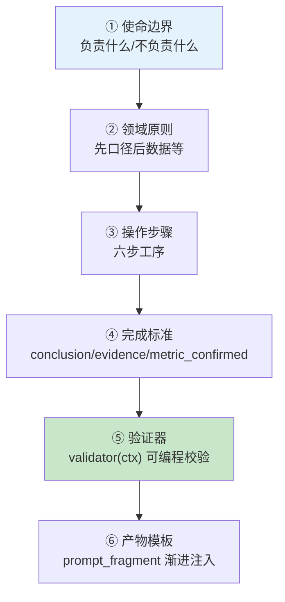

# 30 Skill Engineering：把成功经验固化为领域能力

> **本课定位**：本课讲 Skill 的六层结构（使命边界/领域原则/操作步骤/完成标准/验证器/产物模板）与生命周期治理。核心命题：**Skill 是"一次成功分析的固化"**——它承载的是领域经验（怎么做好诊断），而不是工具能力（能调什么 API）。学完本课，你能把一个反复人工执行的分析流程固化为 Skill。
> **教学目标**：①能复述 Skill 六层结构及各层职责；②能演示验证器的三种拒绝路径；③能解释"能被验证的经验才配叫 Skill"；④能识别 Skill 越界/无验证/挤爆上下文三类 Badcase。
> **前置**：第 27 课（形态选型）
> **产出**：六层结构走读 + Skill 验证器实验
> **对应代码**：`infra/skills/skill.py::build_anomaly_skill`
> **对应测试**：`test_contracts_domain.py`（Skill 相关）+ 手工实验

---

## 0. 本课要用到的环境

| 组件 | 取值 | 说明 |
|---|---|---|
| 样本 Skill | `anomaly_diagnosis`（经营异常诊断） | 六层结构齐备 |
| 验证命令 | `python -m pytest tests/unit/ -q` | 在 `dataagent/` 目录执行 |

---

## 1. 问题场景（为什么需要 Skill）

同一个"GMV 下滑诊断"，三位分析师三种做法：
- 新人：直接拉数据看曲线，忘了确认口径 → 结论口径错误；
- 老手：先确认口径再归因，但归因维度每次凭心情选；
- 专家：固定六步（指标确认→假设→证据→验证→排序→报告），每步有标准。

三周后新人问专家："你的六步清单能给我吗？"——**组织经验靠口口相传，不可扩展**。Skill 就是六步清单的工程化：**经验进代码，质量可验证**。

---

## 2. 概念与机制

### 2.1 Skill 六层结构



### 2.2 本仓库样本 Skill 全文走读

```python
Skill(
    name="anomaly_diagnosis",
    mission="经营异常诊断：负责对一个经营指标的下滑做归因与建议，不负责执行预算调整",
    #                                            ^^^^ 边界: 做什么 | 不做什么
    principles=[
        "先确认指标口径再接触数据",           # 对应第22课
        "结论必须可追溯到证据（Claim-Evidence）",  # 对应第24课
        "资金类动作必须走人工审批，Skill 不直接执行",  # 对应第29课
    ],
    steps=["指标确认", "提出假设", "查询证据", "分析验证", "原因排序", "生成报告"],
    completion_criteria=["conclusion", "evidence", "metric_confirmed"],
    validator=validator,          # 可编程验证: 口径确认? 证据存在? 已验证?
    prompt_fragment="【经营异常诊断】工序：指标确认→假设→证据→验证→原因→报告。结论需附证据链。",
)
```

**读法**：principles 三条分别对应课程三篇的机制——**Skill 是前面所学在业务侧的收口**。

### 2.3 验证器：Skill 的"牙齿"

```python
def validator(ctx: dict) -> tuple[bool, str]:
    if not ctx.get("metric_confirmed"): return False, "未确认指标口径"
    if not ctx.get("evidence"):         return False, "缺少证据链"
    if strict_evidence and not ctx.get("verified"): return False, "证据未验证"
    return True, "ok"
```

**设计意图**：完成标准（④）是声明，验证器（⑤）是执行——**没有验证器的标准是愿望**。`strict_evidence=True` 时"有证据但没验证"也不通过。

---

## 3. 动手实验

### 实验 1：Skill 验证器的三种拒绝

```bash
cd dataagent
$env:PYTHONPATH="src"
python -c "
from dataagent.app.container import DataAgentContainer
c = DataAgentContainer()
s = c.skills.get('anomaly_diagnosis')
ok, msg = s.validate({})
print('空上下文 →', ok, '|', msg)
ok, msg = s.validate({'metric_confirmed': True})
print('缺证据 →', ok, '|', msg)
ok, msg = s.validate({'metric_confirmed': True, 'evidence': ['row_1']})
print('证据未验证 →', ok, '|', msg)
ok, msg = s.validate({'metric_confirmed': True, 'evidence': ['row_1'], 'verified': True})
print('全通过 →', ok, '|', msg)
"
```

**预期输出**：

```text
空上下文 → False | 未确认指标口径
缺证据 → False | 缺少证据链
证据未验证 → False | 证据未验证
全通过 → True | ok
```

### 实验 2：渐进式加载（按任务注入最小描述）

```bash
python -c "
from dataagent.app.container import DataAgentContainer
c = DataAgentContainer()
print('analysis 任务加载 =', [s.prompt_fragment[:20] for s in c.skills.progressive_load('analysis')])
print('其他任务加载 =', c.skills.progressive_load('reporting'))
"
```

**预期输出**：

```text
analysis 任务加载 = ['【经营异常诊断】工序：指']
其他任务加载 = []
```

**判定通过**：Skill 描述只在相关任务注入（渐进加载）——技能库可以膨胀，上下文窗口不膨胀。

### 实验 3：完成标准的默认校验路径

```bash
python -c "
from dataagent.infra.skills.skill import Skill
s = Skill(name='x', mission='m', completion_criteria=['a', 'b'])
print('默认验证(无 validator) →', s.validate({'a': 1, 'b': 2}))
print('缺 b →', s.validate({'a': 1}))
"
```

**预期输出**：

```text
默认验证(无 validator) → (True, 'ok')
缺 b → (False, '缺失完成标准: b')
```

---

## 4. 代码走读

### 4.1 mission 的边界写法

```python
mission="经营异常诊断：负责对一个经营指标的下滑做归因与建议，不负责执行预算调整"
```

**设计意图**：一句话里显式包含**不做什么**——Skill 的失控通常从"顺手帮了下别的"开始（诊断 Skill 顺手调预算 = 绕过审批链）。边界写进使命，验证器才有依据。

### 4.2 progressive_load 的筛选逻辑

```python
def progressive_load(self, task: str) -> list[Skill]:
    for name, s in self._skills.items():
        if task == "analysis" and "诊断" in s.mission:
            out.append(s)
```

**设计意图**：按任务关键词 × 使命文本匹配——演示级实现（生产应为 Skill 注册 task 标签），但"**按需供给**"的结构不变。

---

## 5. 常见错误与 Badcase

| # | 错误现象 | 根因 | 正确做法 |
|---|---|---|---|
| 1 | Skill 越界做了资金操作 | mission 无"不做什么" | 边界显式 + 验证器拦截 |
| 2 | 完成标准从未被检查 | 只有声明无验证器 | validator 必配 |
| 3 | 技能库膨胀挤爆上下文 | 无渐进加载 | prompt_fragment 按任务注入 |
| 4 | Skill 版本升级后旧效果无回归 | 无生命周期治理 | version + 效果回归（第九篇） |

---

## 6. 验收

```bash
cd dataagent
$env:PYTHONPATH="src"
python -m pytest tests/unit/ -q    # 期望: 54 passed
# 实验1 四段验证输出与 §3.1 一致
```

---

## 7. 思辨与讨论

1. **"Skill 和 Prompt 模板有什么区别？"** 模板只有"说什么"（⑥），Skill 有"怎么做、怎么算做好、做错了怎么办"（③④⑤）。**能被验证的经验才配叫 Skill**——这是把经验从"师傅的口头禅"升级为"组织的资产"。
2. **"Skill 会过时吗？"** 会——业务规则变了（归因阈值调整）Skill 就过时了。所以 version 字段 + 第九篇的效果回归是 Skill 生命周期的后半场：**固化的经验需要被重新验证，而不是供起来**。

---

## 8. 延伸与引用

- 第 22 课（指标口径）——principle #1 的机制支撑
- 第 24 课（证据链）——principle #2 的机制支撑
- 参照工程 `lessons/第7篇/L7-4`——Skill 治理与评测集的完整版

---

## 9. 本课遗留问题

- Skill 注册无 task 标签（progressive_load 靠文本匹配）——结构化元数据演进项。
- Skill 的"效果回归"未接入第九篇评测体系（Skill 版本升级无门禁）——两篇联动的真实缺口，登记。
- 产物模板（⑥）仅 prompt_fragment 单行——结构化产物模板（报告骨架）未实现。
