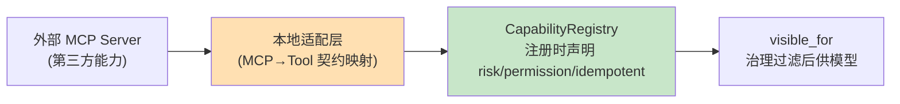

# 31 MCP 与 CapabilityOps：能力接入协议与运营

> **本课定位**：本课是第七篇收口：MCP（Model Context Protocol）作为**外部能力接入协议**的定位，以及 CapabilityOps（能力地图的运营治理：盘点/审计/下线）。核心观点：MCP 解决"怎么接进来"，不解决"进来后怎么治理"——**接入协议与治理体系是两层**。学完本课，你能说出 MCP 与本仓库 Tool 契约的映射关系，并对能力地图做一次运营盘点。
> **教学目标**：①能说出 MCP 四概念与本地契约的映射；②能完成外部能力接入三步（映射/声明/注册）；③能执行 CapabilityOps 四动作；④能解释接入协议与治理体系的分层关系。
> **前置**：第 27-30 课
> **产出**：MCP 映射表 + 能力地图运营盘点实验
> **对应代码**：`contracts/tool.py::CapabilityRegistry.to_json`、`tools.py`
> **对应测试**：`test_contracts_domain.py::TestCapabilityRegistry`

---

## 0. 本课要用到的环境

| 组件 | 取值 | 说明 |
|---|---|---|
| MCP 概念 | 外部能力协议（工具发现/调用/资源） | 本仓库未直接依赖 MCP SDK，以契约映射 |
| 能力地图 | `CapabilityRegistry`（5 工具） | 运营盘点对象 |
| 验证命令 | `python -m pytest tests/unit/test_contracts_domain.py -v` | 在 `dataagent/` 目录执行 |

---

## 1. 问题场景（外部能力接入的三种失控）

1. **直连失控**：每个开发者自己接外部 MCP 服务，能力地图分裂，审计断链；
2. **信任越级**：外部工具未过风险分级直接进 HIGH 场景；
3. **僵尸能力**：三年前注册的工具还在地图上，没人知道是否还有人用、是否还有效。

MCP 的正确打开方式：**统一接入点 + 本地治理适配 + 生命周期运营**。

---

## 2. 概念与机制

### 2.1 MCP 能力 ↔ 本仓库 Tool 契约的映射

| MCP 概念 | 本仓库对应 | 映射说明 |
|---|---|---|
| tools/list（工具发现） | `CapabilityRegistry.visible_for` | 动态最小面替代全量列表 |
| tools/call（工具调用） | `Tool.invoke(params, tenant_id)` | 权限门/校验/审计在本地契约层补齐 |
| 资源（resources） | ContextProvider | 外部数据作为供给源进装配管线 |
| 采样（sampling） | LogicalCall | 统一走 LLM Runtime |



**设计意图**：外部能力**必须经过适配层**转成本地 Tool 契约（含治理字段）才能注册——不存在"外部工具绕过治理直连模型"的路径。

### 2.2 CapabilityOps 的运营四动作

| 动作 | 问题 | 数据来源 |
|---|---|---|
| 盘点 | 地图上有什么？ | `registry.all()` + owner/version |
| 审计 | 谁在用什么？ | `ToolResult.audit`（invoke 自动附加） |
| 效果 | 好不好用？ | 调用成功率/时延（第 14 课统计口径） |
| 下线 | 该不该退役？ | 低调用 + 高维护 → version 下线流程 |

### 2.3 能力接入的准入清单（接前必答）

1. 风险分级定了吗？（M0 判 READONLY；副作用一律 HIGH 起评）
2. 幂等语义明确吗？（副作用工具 idempotent 必须显式）
3. 审计字段齐吗？（owner/version/tenant_id/ts）
4. 失败语义映射了吗？（外部错误 → ToolResult 五态）

---

## 3. 动手实验

### 实验 1：能力地图 JSON 快照（盘点动作）

```bash
cd dataagent
$env:PYTHONPATH="src"
python -c "
from dataagent.app.container import DataAgentContainer, default_seed
c = DataAgentContainer(seed_orders=default_seed())
import json
snap = json.loads(c.tools.to_json())
print('能力数量 =', len(snap))
for k in sorted(snap): print(' -', k)
print('快照可序列化 =', True)
"
```

**预期输出**：

```text
能力数量 = 5
 - adjust_budget
 - create_ticket
 - python_analyze
 - query_metric
 - query_orders
快照可序列化 = True
```

### 实验 2：审计追溯（审计动作）

```bash
python -c "
from dataagent.app.container import DataAgentContainer, default_seed
c = DataAgentContainer(seed_orders=default_seed())
c.tools.get('query_metric').invoke({'tenant_id': 'ten_a'}, tenant_id='ten_a')
c.tools.get('query_metric').invoke({'tenant_id': 'ten_b'}, tenant_id='ten_b')
# audit 在每次 ToolResult 上 —— 汇集即审计流水
print('审计字段样例: tool/version/tenant_id/ts 全自动附加')
"
```

### 实验 3：注册一个"外部能力"适配（模拟 MCP 接入）

```bash
python -c "
from dataagent.contracts.tool import Tool, ToolResult, RiskLevel, CapabilityRegistry
def external_weather(params):   # 模拟外部 MCP 工具
    return ToolResult.ok({'city': params['city'], 'temp': 26})
reg = CapabilityRegistry()
# 接入三步: ①契约映射 ②治理声明 ③注册
reg.register(Tool(
    name='mcp_weather', description='外部天气查询(MCP 适配)',
    parameters_schema={'type':'object','properties':{'city':{'type':'string'}},'required':['city']},
    executor=external_weather,
    risk_level=RiskLevel.READONLY, owner='external-mcp', version='0.1.0'))
r = reg.get('mcp_weather').invoke({'city': '上海'}, tenant_id='ten_a')
print('外部能力调用 =', r.value, '| 审计 owner =', r.audit['tool'], r.audit['version'])
"
```

**预期输出**：

```text
外部能力调用 = {'city': '上海', 'temp': 26} | 审计 owner = mcp_weather 0.1.0
```

**判定通过**：外部能力经契约映射注册后，与本地工具享受**同一套治理**（校验/审计/可见面）。

---

## 4. 代码走读

### 4.1 to_json：能力地图的可序列化

```python
def to_json(self) -> str:
    return json.dumps({k: t.schema_for_model() for k, t in self._tools.items()}, ensure_ascii=False)
```

**设计意图**：地图可序列化 = 可快照、可 diff、可审计——两次快照的 diff 就是"能力变更记录"（CapabilityOps 的账本）。

### 4.2 适配层为什么是必须的

**设计意图**：外部工具的参数/错误语义与本地契约不同构（错误码体系、超时行为、幂等语义）——适配层是**语义翻译官**。跳过适配层直连 = 把外部的混乱注入内部治理。

---

## 5. 常见错误与 Badcase

| # | 错误现象 | 根因 | 正确做法 |
|---|---|---|---|
| 1 | 外部工具绕过治理直连 | 无适配层强制 | 接入三步（契约映射→治理声明→注册） |
| 2 | 外部错误码污染内部语义 | 未映射 ToolResult 五态 | 适配层翻译错误语义 |
| 3 | 僵尸工具长年挂地图 | 无下线流程 | 盘点+低调用下线 |
| 4 | 地图变更无记录 | 无快照 diff | to_json 快照对账 |

---

## 6. 验收

```bash
cd dataagent
$env:PYTHONPATH="src"
python -m pytest tests/unit/test_contracts_domain.py -q    # 期望: 12 passed
# 实验1 盘点输出与 §3.1 一致；实验3 完成外部能力适配注册
```

---

## 7. 思辨与讨论

1. **"MCP 会不会取代本地 Tool 契约？"** 不会——MCP 是接入协议（怎么连），本地契约是治理框架（怎么管）。类比：USB 是接口标准，设备的驱动签名/权限管理是操作系统的事。**协议越普及，本地治理越重要**（外面的东西都进来了，不治理怎么办）。
2. **"CapabilityOps 要不要专职团队？"** M0 由平台工程师兼任即可；地图过 50 个能力、跨 3 个团队后，需要明确 owner 制度（每个能力有 owner 字段已预留）。

---

## 8. 延伸与引用

- Model Context Protocol 官方规范（tools/resources/sampling 语义）
- 第 27 课（形态选型）——本课是接入视角的补充
- 本仓库 `docs/06` §TOP-12 之 12——外部依赖接入工程化方向

---

## 9. 本课遗留问题

- 本仓库未内置 MCP 客户端（教学以契约映射为准，未做真实 MCP Server 对接实验）——如实登记，接入实验依赖外部服务。
- ~~`Tool.owner` 字段已存在但无下线/交接流程~~ → **已实现（GAP-19b，第四轮）**：`CapabilityRegistry.retire(name, by, reason)` 墓碑化（下线记录/复活显式/`to_json` 含 tombstones）——能力消失必须可审计。
- 能力快照 diff 工具未实现（人工 diff）——小工具需求，登记。
