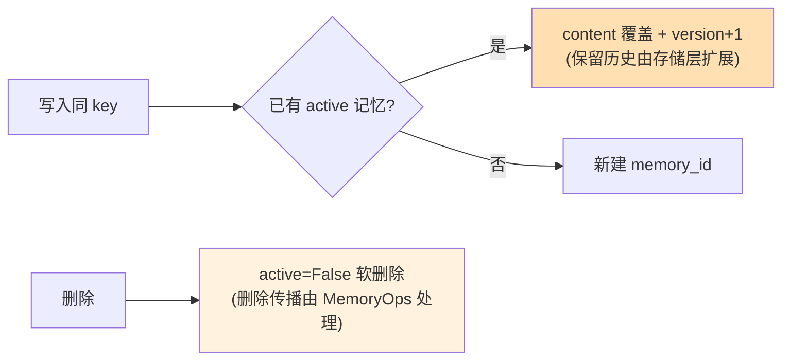

# 32 从聊天记录到记忆契约

> **本课定位**：第八篇开篇。本课先划清四个易混概念（Chat History / Context / State / Memory），再给出 Memory 的完整 Schema（来源/范围/权限/版本/证据）。核心命题：**记忆是组织资产，必须有契约**——什么能写、存多久、谁能用，全部显式。学完本课，你能为一个记忆条目完整填写十项 Schema 并解释每项的治理意义。
> **教学目标**：①能划清四概念边界（History/Context/State/Memory）；②能完整填写 Memory 十项 Schema；③能演示 scope 三向隔离与版本升级；④能解释软删除与删除传播的分工。
> **前置**：第 21 课（Context Schema）
> **产出**：四概念边界表 + Memory Schema 实验
> **对应代码**：`dataagent/src/dataagent/infra/memory/memory.py`
> **对应测试**：`tests/unit/test_memory.py` 8 例

---

## 0. 本课要用到的环境

| 组件 | 取值 | 说明 |
|---|---|---|
| 核心模块 | `memory.py`：Memory / MemoryScope / MemoryStore | Schema 与存储契约 |
| 验证命令 | `python -m pytest tests/unit/test_memory.py -v` | 在 `dataagent/` 目录执行 |

---

## 1. 问题场景（概念混淆的四种事故）

| 事故 | 混淆 | 后果 |
|---|---|---|
| 对话记录当记忆 | Chat History ↔ Memory | "用户上次说 wanting 柱状图"被当作事实，实际是寒暄 |
| 上下文当记忆 | Context ↔ Memory | 本轮装配的临时信息被持久化，下轮"闹鬼" |
| 状态当记忆 | State ↔ Memory | 运行时变量（当前步计数）进长期记忆 |
| 记忆无边界 | 无 Scope | A 用户的偏好出现在 B 用户的会话里 |

**一句话边界**：Chat History 是**过程**，Context 是**本轮输入**，State 是**运行时变量**，Memory 是**跨会话的组织资产**。

---

## 2. 概念与机制

### 2.1 Memory Schema 十项

```python
@dataclass
class Memory:
    memory_id: str              # 唯一标识
    scope: MemoryScope          # 范围: user/tenant/project/task
    owner: str                  # 归属(用户)
    tenant_id: str              # 租户
    key: str                    # 语义键(如 "report_preference")
    content: str                # 内容
    ttl_s: Optional[float]      # 时效
    version: int                # 版本(同 key 升级)
    active: bool                # 软删除标记
    source: str                 # 来源 trace/event id
    evidence_ref: str           # 证据凭证引用
```

### 2.2 Scope：记忆的权限第一维

```python
def matches_scope(self, tenant_id: str, owner: str) -> bool:
    if self.scope == MemoryScope.TENANT:
        return tenant_id == self.tenant_id
    if self.scope == MemoryScope.USER:
        return owner == self.owner and tenant_id == self.tenant_id
    return True
```

| Scope | 可见范围 | 典型内容 |
|---|---|---|
| USER | 本人 + 本租户 | 报表偏好 |
| TENANT | 本租户全员 | 业务规则备注 |
| PROJECT | 项目内 | 项目口径决议 |
| TASK | 任务内 | 任务级上下文（M0 未启用） |

### 2.3 版本与软删除



---

## 3. 动手实验

### 实验 1：完整 Schema 填写

```bash
cd dataagent
$env:PYTHONPATH="src"
python -c "
from dataagent.infra.memory.memory import Memory, MemoryScope
m = Memory(scope=MemoryScope.USER, owner='u1', tenant_id='ten_a',
           key='report_preference', content='用户偏好：周报用柱状图',
           source='evt_run123_step4', ttl_s=86400*30)
print('id =', m.memory_id)
print('scope 匹配(本人) =', m.matches_scope('ten_a', 'u1'))
print('scope 匹配(他人) =', m.matches_scope('ten_a', 'u2'))
print('scope 匹配(他租户) =', m.matches_scope('ten_b', 'u1'))
"
```

**预期输出**：

```text
id = mem_xxxxxxxx
scope 匹配(本人) = True
scope 匹配(他人) = False
scope 匹配(他租户) = False
```

### 实验 2：版本升级（同 key 幂等写入）

```bash
python -m pytest tests/unit/test_memory.py::TestWritePipeline::test_write_and_idempotent_upgrade_version -v
# PASSED —— 同 key 二次写入 = 版本+1 覆盖, 不产生重复条目
```

### 实验 3：软删除后不可得

```bash
python -m pytest tests/unit/test_memory.py::TestMemoryOps::test_explain_and_delete_propagation -v
# PASSED —— 删除后 get 返回 None, explain 拒绝跨租户
```

### 实验 4：跨租户隔离（scope 硬边界）

```bash
python -m pytest tests/unit/test_memory.py::TestRecall::test_scope_isolation -v
# PASSED —— ten_b 的召回永远看不到 ten_a 的记忆
```

---

## 4. 代码走读

### 4.1 source 与 evidence_ref：记忆的"出身证明"

```python
source: str = ""           # 来源 trace/event id
evidence_ref: str = ""     # Evidence Store 里的凭证引用
```

**设计意图**：每条记忆可回答"从哪次运行的哪个事件来、依据什么证据"——第 35 课 MemoryOps 的 explain 就消费这两个字段。**没有出身的记忆不可信，也不可审计**。

### 4.2 软删除的设计取舍

```python
def delete(self, memory_id: str, tenant_id: str) -> bool:
    m = self._mem.get(memory_id)
    if m is None or m.tenant_id != tenant_id:
        return False
    m.active = False  # 软删除，删除传播由 MemoryOps 处理向量索引
    return True
```

**设计意图**：软删除保留审计轨迹（"删过什么"是合规需求）；**删除传播**（向量索引/缓存/下游同步）是独立动作——只删主库不删索引是真实事故源（幽灵记忆复活）。

---

## 5. 常见错误与 Badcase

| # | 错误现象 | 根因 | 正确做法 |
|---|---|---|---|
| 1 | A 用户看到 B 的偏好 | 无 scope 过滤 | matches_scope 硬边界 |
| 2 | 同一偏好写出一堆重复条目 | 无版本治理 | 同 key 版本升级 |
| 3 | 删了记忆但召回还出现 | 无删除传播 | MemoryOps.delete_with_propagation |
| 4 | 记忆无法追溯出处 | source/evidence 空 | 写入管线强制带 source |

---

## 6. 验收

```bash
cd dataagent
$env:PYTHONPATH="src"
python -m pytest tests/unit/test_memory.py -q    # 期望: 8 passed
# 实验1 输出与 §3.1 一致
```

---

## 7. 思辨与讨论

1. **"记忆该默认存还是默认不存？"** 本仓库立场：**默认不存，策略放行才存**（第 33 课的 Policy 三通道 ALLOWED/NEEDS_CONFIRM/DENIED）。记忆是负债（会过时、会泄露、会投毒），资产属性要靠治理挣回来。
2. **"scope 为什么默认 USER 而不是 TENANT？"** 最小可见原则：默认 USER，升级 TENANT 是显式动作（第 33 课 NEEDS_CONFIRM 通道承接）——**可见面只应缩小不应默认放大**。

---

## 8. 延伸与引用

- 第 33 课（写入链路）——什么能写的策略引擎
- 参照工程 `domain/memory/`——记忆价值评估/衰减/污染防护的领域版
- GB/T 35273《个人信息安全规范》——个人记忆(偏好)数据的合规参照

---

## 9. 本课遗留问题

- PROJECT/TASK scope 已定义未启用（matches_scope 直接 True 放行）——启用需配权限策略，如实登记。
- 版本历史仅计数（不存旧内容）——"回滚到 v1"不可达，登记为存储层增强。
- `updated_at` 字段已建模，但过期策略只看 created_at + ttl——"访问续期"语义未实现。
