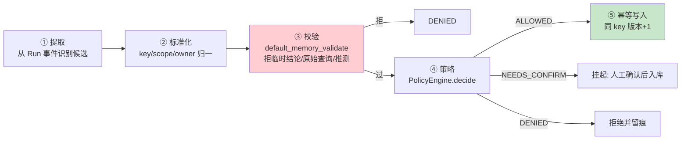

# 33 从 Run 事件到可信记忆：写入链路与策略引擎

> **本课定位**：本课讲记忆写入的完整链路：**提取 → 标准化 → 校验 → 策略判断 → 幂等写入**，重点是 `MemoryPolicyEngine` 的三通道决策（ALLOWED / NEEDS_CONFIRM / DENIED）与防投毒校验。核心命题：**不是所有信息都配成为记忆**——"临时结论/原始查询/模型推测"必须被拒绝在门外。
> **教学目标**：①能复述写入五段链路；②能演示 DENY/ALLOWED/NEEDS_CONFIRM 三通道；③能解释"模型负责发现、规则负责把关"；④能识别投毒入库的三种来源与防线。
> **前置**：第 32 课（Memory Schema）
> **产出**：写入链路实验 × 3 + 防投毒语料表
> **对应代码**：`memory.py::MemoryWritePipeline / MemoryPolicyEngine / default_memory_validate`
> **对应测试**：`test_memory.py::TestPolicy / TestWritePipeline / TestDeny`

---

## 0. 本课要用到的环境

| 组件 | 取值 | 说明 |
|---|---|---|
| 写入管线 | `MemoryWritePipeline(store, policy)` | 五段链路 |
| 策略引擎 | `MemoryPolicyEngine(validate=...)` | 三通道 |
| 验证命令 | `python -m pytest tests/unit/test_memory.py -v` | 在 `dataagent/` 目录执行 |

---

## 1. 问题场景（污染记忆的三种来源）

1. **临时结论入库**："GMV 下滑可能是促销结束"——这是**当轮假设**，三个月后会被当作"确认过的事实"召回；
2. **原始查询结果入库**：把 56 行订单明细写进记忆——那不是知识，是数据快照；
3. **投毒内容入库**：外部内容经提示注入让系统"记住"恶意指令——记忆成了持久化后门。

三案的共同防线：**写入侧的策略引擎 + 内容校验**（不是召回侧补救）。

---

## 2. 概念与机制

### 2.1 写入五段链路



### 2.2 防投毒校验语料（DENY 清单）

```python
MEMORY_DENY_HINTS = ("临时结论", "原始查询结果", "模型推测", "未经验证的")

def default_memory_validate(content: str) -> tuple[bool, str]:
    for hint in MEMORY_DENY_HINTS:
        if hint in content:
            return False, f"禁止写入: 包含'{hint}'"
    if len(content) < 4:
        return False, "内容过短"
    return True, "ok"
```

| 语料类型 | 示例 | 判定 |
|---|---|---|
| 临时结论 | "临时结论：可能是促销结束" | ❌ DENY（命中"临时结论"） |
| 原始数据 | "原始查询结果：56行订单..." | ❌ DENY |
| 模型推测 | "模型推测：退款率异常" | ❌ DENY |
| 用户偏好 | "用户偏好：周报用柱状图" | ✅ ALLOWED |

### 2.3 三通道决策

```python
def decide(self, content, *, proposed_scope=MemoryScope.USER):
    ok, msg = self.validate(content)
    if not ok: return OutputChannel.DENIED, msg
    if "偏好" in content: return OutputChannel.ALLOWED, "用户明确偏好，允许写入"
    if proposed_scope == MemoryScope.USER: return OutputChannel.ALLOWED, "用户级记忆"
    return OutputChannel.NEEDS_CONFIRM, "建议负向确认"
```

**通道语义**：DENIED（内容有毒/太短）→ 拒；ALLOWED（用户偏好/USER 级）→ 直接写；NEEDS_CONFIRM（TENANT 级等敏感范围）→ 挂起待人确认——**可见面放大必须过人**。

---

## 3. 动手实验

### 实验 1：DENY 语料全拦截

```bash
cd dataagent
$env:PYTHONPATH="src"
python -m pytest tests/unit/test_memory.py::TestPolicy::test_deny_temporary -v
python -m pytest tests/unit/test_memory.py::TestWritePipeline::test_deny_write -v
```

**预期输出**：两条 PASSED（"临时结论"被 validate 拒绝 + 管线返回"拒绝写入(...)"且不落库）。

### 实验 2：ALLOWED 正常写入

```bash
python -c "
from dataagent.infra.memory.memory import (InMemoryMemoryStore, MemoryPolicyEngine,
    MemoryWritePipeline, MemoryScope)
store, policy = InMemoryMemoryStore(), MemoryPolicyEngine()
pipe = MemoryWritePipeline(store, policy)
ok, msg, mem = pipe.write(tenant_id='ten_a', owner='u1', key='report_preference',
    content='用户偏好：周报用柱状图', scope=MemoryScope.USER, source='evt_demo')
print('写入 =', ok, '|', msg)
print('召回命中 =', any(m.key=='report_preference' for m in store.search_candidates('偏好', 'ten_a', 'u1')))
"
```

**预期输出**：

```text
写入 = True | 写入成功 mem_xxxxxxxx
召回命中 = True
```

### 实验 3：投毒语料拦截

```bash
python -m pytest tests/unit/test_memory.py::TestDeny::test_deny_malicious_content -v
# PASSED —— 恶意/注入类内容被 validate 拒绝
```

### 实验 4：NEEDS_CONFIRM 挂起（TENANT 级放大需人确认）

```bash
python -c "
from dataagent.infra.memory.memory import (InMemoryMemoryStore, MemoryPolicyEngine,
    MemoryWritePipeline, MemoryScope, OutputChannel)
pipe = MemoryWritePipeline(InMemoryMemoryStore(), MemoryPolicyEngine())
ok, msg, mem = pipe.write(tenant_id='ten_a', owner='u1', key='biz_rule',
    content='全租户统一口径备注', scope=MemoryScope.TENANT)
print('TENANT 级写入 =', ok, '|', msg)
"
```

**预期输出**：

```text
TENANT 级写入 = False | 需人工确认(建议负向确认)
```

---

## 4. 代码走读

### 4.1 校验先于策略

```python
def write(self, *, tenant_id, owner, key, content, scope=MemoryScope.USER, source="", ttl_s=None):
    channel, msg = self.policy.decide(content, proposed_scope=scope)
    if channel == OutputChannel.DENIED:
        return False, f"拒绝写入({msg})", None
```

**设计意图**：`policy.decide` 内部**先跑 validate 再跑通道规则**——有毒内容连"进入通道讨论"的资格都没有。防线顺序：内容健康 → 范围授权。

### 4.2 拒绝也要留痕

```python
return False, f"拒绝写入({msg})", None
```

**设计意图**：返回 (False, 原因, None) 三元组——拒绝不是静默丢弃，**原因要能进审计流**（谁想写什么被为什么拒了）。

---

## 5. 常见错误与 Badcase

| # | 错误现象 | 根因 | 正确做法 |
|---|---|---|---|
| 1 | 三个月前的假设被当事实召回 | 临时结论入库 | DENY 语料 + 显式"已验证"标记才可入 |
| 2 | 原始数据快照挤爆记忆库 | 数据当知识存 | 原始结果 DENY，提炼后才可入 |
| 3 | 注入内容持久化成后门 | 写入无校验 | 防投毒校验（本课核心） |
| 4 | TENANT 级记忆随意写入 | 范围放大无确认 | NEEDS_CONFIRM 通道 |
| 5 | 拒绝原因无处可查 | 静默丢弃 | 三元组留痕 |

---

## 6. 验收

```bash
cd dataagent
$env:PYTHONPATH="src"
python -m pytest tests/unit/test_memory.py -q    # 期望: 8 passed
# 实验2/4 输出与 §3 一致
```

---

## 7. 思辨与讨论

1. **"关键词 DENY 会不会误杀/漏杀？"** 会——这是**演示级水位**（与第 24 课注入检测同类局限）。但结构优先：`validate` 是可插拔函数（`MemoryPolicyEngine(validate=...)`），生产替换为分类器时**链路不变**。承认水位 + 结构可换，好过假装完备。
2. **"为什么提取（①）在本课讲得最少？"** 因为提取是**最依赖模型**的一段（从对话里识别候选记忆），也是**最不该信任**的一段——所以工程重心放在它后面的确定性防线（校验/策略）上。模型负责发现，规则负责把关。

---

## 8. 延伸与引用

- 第 32 课（Schema）——写入目标的形态
- 参照工程 `domain/memory/`——记忆价值评估与随时间衰减的领域实现
- OWASP LLM Top-10（LLM01 Prompt Injection）——防投毒的威胁模型参照

---

## 9. 本课遗留问题

- "已验证"标记机制未实现（通过验证的记忆应带 verified 标志与证据引用）——与 evidence_ref 贯通。
- DENY 关键词仅中文 4 条——语料库扩充 + 分类器演进，登记。
- 提取段（①）无实现（本课程由调用方显式 write）——自动提取属 M1+ 特性。
