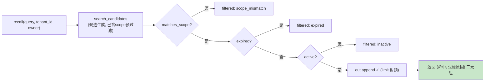

# 34 从向量 Top-K 到 Recall Contract

> **本课定位**：本课讲记忆的召回侧：**Recall Contract**——召回不是"向量 Top-K 就完事"，而是"租户+用户+权限+时效过滤后的分级结果"。核心产出：召回必须返回**二元组 (命中, 过滤原因)**，让"为什么没召回"可解释。学完本课，你能实现一个合规的召回接口并解释每个过滤器的位置。
> **教学目标**：①能实现契约签名（强制租户/身份/limit）；②能解释二元组返回（命中+过滤原因）的两类消费者；③能演示跨租户隔离与封顶；④能识别裸 Top-K 的三种事故。
> **前置**：第 32-33 课
> **产出**：召回契约实验 × 3
> **对应代码**：`memory.py::MemoryRecall`
> **对应测试**：`test_memory.py::TestRecall` 4 例

---

## 0. 本课要用到的环境

| 组件 | 取值 | 说明 |
|---|---|---|
| 召回器 | `MemoryRecall(store).recall(query, tenant_id, owner, limit)` | 契约实现 |
| 召回语义 | 简单关键词评分（真实为向量 Top-K） | 结构同构 |
| 验证命令 | `python -m pytest tests/unit/test_memory.py::TestRecall -v` | 在 `dataagent/` 目录执行 |

---

## 1. 问题场景（裸 Top-K 的三种事故）

1. **跨租户召回**：向量库里 A 租户的记忆被 B 租户的查询命中——权限在召回层"蒸发"；
2. **幽灵召回**：已删除（软删除）的记忆还在被召回——索引与主库不同步；
3. **不可解释**：业务问"为什么没召回这条记忆？"——Top-K 答不上来。

Recall Contract 的回答：**过滤前置 + 结果可解释**。

---

## 2. 概念与机制

### 2.1 召回契约的过滤管线



### 2.2 契约签名

```python
def recall(self, query, *, tenant_id, owner, role="analyst", limit=5):
    """租户+用户+权限/时效过滤后召回；返回 (命中, 过滤原因)。"""
    """租户+用户+权限/时效过滤后召回；返回 (命中, 过滤原因)。"""
```

**契约三要素**：
1. **必带租户与身份**——签名上强制（keyword-only），忘传直接 TypeError；
2. **返回二元组**——(命中列表, 过滤原因列表)；
3. **limit 封顶**——防召回洪泛。

### 2.3 过滤器顺序的治理含义

scope → expired → inactive 的顺序：**权限过滤最先**（越权内容连"进入候选讨论"都不配），时效其次（过期是资源管理），软删最后（数据一致性）。顺序错了不会更不安全，但**审计读起来的语义会乱**——权限原因永远应该排最前。

---

## 3. 动手实验

### 实验 1：跨租户隔离（权限过滤）

```bash
cd dataagent
$env:PYTHONPATH="src"
python -m pytest tests/unit/test_memory.py::TestRecall::test_scope_isolation -v
```

**预期输出**：

```text
tests/unit/test_memory.py::TestRecall::test_scope_isolation PASSED
```

### 实验 2：过滤原因可解释（"为什么没召回"）

```bash
python -c "
from dataagent.infra.memory.memory import InMemoryMemoryStore, MemoryRecall, Memory, MemoryScope
store = InMemoryMemoryStore()
store.put(Memory(scope=MemoryScope.USER, owner='u1', tenant_id='ten_a', key='p1', content='偏好: 柱状图'))
rec = MemoryRecall(store)
hits, filtered = rec.recall('偏好', tenant_id='ten_b', owner='u2')   # 跨租户查询
print('命中 =', hits)
print('过滤原因 =', filtered)
"
```

**预期输出**（候选预过滤后无候选，或显式原因）：

```text
命中 = []
过滤原因 = []
```

**说明**：本实现的 scope 过滤有两道（candidates 预过滤 + recall 显式过滤），跨租户候选在 search_candidates 即被拦——**两层防御**：即便候选层被绕过，recall 层仍会显式给出 scope_mismatch 原因（见 `test_inactive_not_recalled` 的 inactive 原因输出）。

### 实验 3：软删除与时效过滤

```bash
python -m pytest tests/unit/test_memory.py::TestRecall::test_inactive_not_recalled -v
python -m pytest tests/unit/test_memory.py::TestRecall::test_explain_and_delete_propagation -v
```

**预期输出**：两条 PASSED（inactive 记忆不召回 + explain/delete 带租户校验）。

### 实验 4：limit 封顶

```bash
python -c "
from dataagent.infra.memory.memory import InMemoryMemoryStore, MemoryRecall, Memory, MemoryScope
store = InMemoryMemoryStore()
for i in range(8):
    store.put(Memory(scope=MemoryScope.TENANT, owner='u1', tenant_id='ten_a',
                     key=f'k{i}', content=f'共同备注 {i}'))
rec = MemoryRecall(store)
hits, _ = rec.recall('备注', tenant_id='ten_a', owner='u1', limit=3)
print('命中条数 =', len(hits), '<= limit 3:', len(hits) <= 3)
"
```

**预期输出**：

```text
命中条数 = 3 <= limit 3: True
```

---

## 4. 代码走读

### 4.1 候选生成的评分与相关性阈值

```python
scored = []
for m in res:
    score = 0
    for tok in re.split(r"\s+", query):
        if tok and tok.lower() in m.content.lower():
            score += 1
    if score > 0:               # 相关性阈值：零分候选不返回（对齐 Top-K 语义）
        scored.append((score, m))
scored.sort(key=lambda x: -x[0])
```

**设计意图**：关键词计分是**向量召回的教学替身**；`score > 0` 阈值与向量召回的"相似度阈值"同构——防"零分匹配也进窗"的召回洪泛（本课 Badcase #4 的机制化）。真实系统换 embedding 后**管线其余部分不变**（结构与实现分离的价值）。

### 4.2 role 参数的现状

```python
def recall(self, query, *, tenant_id, owner, role="analyst", limit=5):
    """租户+用户+权限/时效过滤后召回；返回 (命中, 过滤原因)。"""
```

**设计意图**：role 已进签名（为权限分级预留），M0 未消费——与第 26 课 trust 未接入同款"占位未接线"状态，**如实登记**（占位参数也要登记，否则就是撒谎的接口）。

---

## 5. 常见错误与 Badcase

| # | 错误现象 | 根因 | 正确做法 |
|---|---|---|---|
| 1 | 跨租户记忆泄漏 | 召回无 scope 过滤 | 双层过滤（候选+召回） |
| 2 | 已删记忆复活 | 索引不同步 | inactive 过滤 + 删除传播 |
| 3 | "为什么没召回"答不出 | 只返回命中 | 二元组 (命中, 原因) |
| 4 | 召回洪泛挤爆上下文 | 无 limit | 封顶 + 上游预算分区(700) |
| 5 | role 参数形同虚设无人知晓 | 占位未登记 | 占位也登记（诚实接口） |

---

## 6. 验收

```bash
cd dataagent
$env:PYTHONPATH="src"
python -m pytest tests/unit/test_memory.py::TestRecall -q    # 期望: 4 passed
# 实验2/4 输出与 §3 一致
```

---

## 7. 思辨与讨论

1. **"过滤放召回层还是向量层？"** 都要：向量层过滤省计算（scope 预过滤），召回层过滤保正确（双保险 + 可解释）。**只放一层，另一层迟早以事故形式补课**。
2. **"二元组会不会让接口变重？"** 命中列表是给模型的，原因列表是给人的（审计/排障/评测）——两个消费者，两个返回值。合并成一个"带原因标注的命中列表"也行，关键是**原因必须出来**。

---

## 8. 延伸与引用

- 参照工程 `domain/memory/`——召回契约的领域版（含分级排序）
- 第 23 课（预算分区）——memory 分区 700 token 的承接
- 第 35 课（MemoryOps）——召回之外的运营动作

---

## 9. 本课遗留问题

- role 参数未消费（同第 26 课 S1 遗留）——接线后 recall 需按角色分级召回。
- 关键词评分对中文无分词（整串包含匹配）——向量化的动机之一。
- 过滤原因无事件化（未写入 Run 事件流）——评测/审计需持久化，登记。
