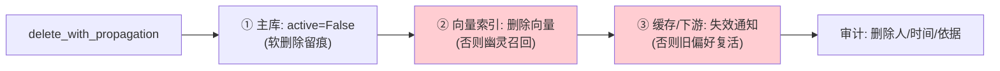

# 35 从个性化功能到 MemoryOps

> **本课定位**：第八篇收口。本课把记忆从"功能"升级为"运营对象"：**MemoryOps** 四动作（查看/解释/修正/删除传播）+ 多租户治理 + 评测缺口。核心命题：**记忆上线那天，运营才刚开始**——会过时、会投毒、会被遗忘权诉求删除。学完本课，你能对一条记忆完成全生命周期操作并解释删除传播的必要性。
> **教学目标**：①能执行 explain/修正/删除传播全生命周期操作；②能解释删除传播三站与幽灵召回；③能演示跨租户 None 语义（不泄露存在性）；④能登记 MemoryOps 评测缺口（两仓库同源）。
> **前置**：第 32-34 课
> **产出**：MemoryOps 实验 × 3 + 治理清单
> **对应代码**：`memory.py::MemoryOps`
> **对应测试**：`test_memory.py::TestMemoryOps / TestDeny`

---

## 0. 本课要用到的环境

| 组件 | 取值 | 说明 |
|---|---|---|
| 运营对象 | `MemoryOps(store)`：explain / delete_with_propagation | 查看与删除 |
| 验证命令 | `python -m pytest tests/unit/test_memory.py -v` | 在 `dataagent/` 目录执行 |

---

## 1. 问题场景（记忆运营缺失的四类工单）

1. "为什么 AI 知道我的偏好？从哪来的？"——**解释能力缺失**；
2. "这个偏好过时了，帮我改"——**修正机制缺失**（重写 = 版本升级）；
3. "请删除关于我的一切"（遗忘权）——**删除传播缺失**（主库删了向量库还在，幽灵召回）；
4. "租户 A 投诉记忆里混入了 B 的信息"——**多租户审计缺失**。

四类工单对应 MemoryOps 的四个动作——**运营能力不是客服技巧，是接口设计**。

---

## 2. 概念与机制

### 2.1 MemoryOps 接口

```python
class MemoryOps:
    def explain(self, memory_id: str, tenant_id: str) -> Optional[dict]:
        """跨租户直接返回 None —— 不存在性不泄露。"""
        ...
    def delete_with_propagation(self, memory_id: str, tenant_id: str) -> bool:
        removed = self.store.delete(memory_id, tenant_id)
        # 真实实现: 删主库后还要从向量索引/缓存/下游系统移除(删除传播)
        return removed
```

### 2.2 explain 输出的九字段

```python
{"memory_id", "key", "content", "scope", "source",
 "evidence_ref", "version", "active", "created_at"}
```

**设计意图**：九字段 = 第 32 课 Schema 的运营投影——回答工单 1（"从哪来"→ source/evidence_ref）与工单 4（"混入什么"→ scope/tenant 校验）。

### 2.3 删除传播的三站



**M0 实现**：①已实现（软删除 + active 过滤），②③为演示占位（内存存储天然同源）——**生产化时 ②③ 是第一优先**，跳过它们 = 遗忘权承诺是假的。

---

## 3. 动手实验

### 实验 1：explain 全字段（含跨租户拒绝）

```bash
cd dataagent
$env:PYTHONPATH="src"
python -c "
from dataagent.infra.memory.memory import (InMemoryMemoryStore, MemoryPolicyEngine,
    MemoryWritePipeline, MemoryOps, MemoryScope)
pipe = MemoryWritePipeline(InMemoryMemoryStore(), MemoryPolicyEngine())
ok, msg, mem = pipe.write(tenant_id='ten_a', owner='u1', key='report_preference',
    content='用户偏好：周报用柱状图', scope=MemoryScope.USER, source='evt_demo_1')
ops = MemoryOps(pipe.store)
info = ops.explain(mem.memory_id, tenant_id='ten_a')
print('本租户 explain =', {k: info[k] for k in ('key','scope','source','version')})
print('跨租户 explain =', ops.explain(mem.memory_id, tenant_id='ten_b'))
"
```

**预期输出**：

```text
本租户 explain = {'key': 'report_preference', 'scope': 'user', 'source': 'evt_demo_1', 'version': 1}
跨租户 explain = None
```

### 实验 2：修正（版本升级即修正）

```bash
python -m pytest tests/unit/test_memory.py::TestWritePipeline::test_write_and_idempotent_upgrade_version -v
# PASSED —— 同 key 重写 = version+1 内容覆盖(修正的工程形态)
```

### 实验 3：删除传播（软删除后召回消失）

```bash
python -c "
from dataagent.infra.memory.memory import (InMemoryMemoryStore, MemoryPolicyEngine,
    MemoryWritePipeline, MemoryOps, MemoryScope)
pipe = MemoryWritePipeline(InMemoryMemoryStore(), MemoryPolicyEngine())
_, _, mem = pipe.write(tenant_id='ten_a', owner='u1', key='pref',
    content='用户偏好：表格', scope=MemoryScope.USER)
ops = MemoryOps(pipe.store)
print('删除 =', ops.delete_with_propagation(mem.memory_id, 'ten_a'))
hits, _ = pipe.store.search_candidates('偏好', 'ten_a', 'u1'), None
print('删除后 get =', ops.explain(mem.memory_id, 'ten_a'))
print('再删一次(幂等) =', ops.delete_with_propagation(mem.memory_id, 'ten_a'))
"
```

**预期输出**：

```text
删除 = True
删除后 get = None
再删一次(幂等) = False
```

**判定通过**：删除幂等（重复删返回 False 不报错）、删除后 explain 不可见——遗忘权的最小闭环。

---

## 4. 代码走读

### 4.1 explain 的"404 语义"

```python
def explain(self, memory_id: str, tenant_id: str) -> Optional[dict]:
    m = self.store.get(memory_id)
    if m is None or m.tenant_id != tenant_id:
        return None
```

**设计意图**：跨租户与不存在**同返回 None**——与第 19 课参照工程"跨租户 404 而非 403"同源：**不泄露资源存在性**。

### 4.2 delete_with_propagation 的注释即契约

```python
# 真实实现：删除主库后，还要从向量索引/缓存/下游系统移除（删除传播）
```

**设计意图**：占位实现 + 注释写明生产义务——**注释即待办**，比"假装做完了"诚实，也比"什么都不写"负责。

---

## 5. 常见错误与 Badcase

| # | 错误现象 | 根因 | 正确做法 |
|---|---|---|---|
| 1 | 用户问"为什么知道我的偏好"答不上 | 无 explain | 九字段运营投影 |
| 2 | 遗忘权只删主库，向量库复活 | 删除无传播 | 三站传播（本课 §2.3） |
| 3 | 修正 = 删了重写，历史丢失 | 无版本 | 同 key 版本升级 |
| 4 | 跨租户探测到"记忆存在" | explain 泄露存在性 | None 语义 |
| 5 | 重复删除报错 | 删除不幂等 | bool 返回 + 幂等语义 |

---

## 6. 验收

```bash
cd dataagent
$env:PYTHONPATH="src"
python -m pytest tests/unit/test_memory.py -q    # 期望: 8 passed
# 实验1/3 输出与 §3 一致
```

---

## 7. 思辨与讨论

1. **"记忆评测（MemoryOps Eval）是什么？"** 召回质量要能被度量：给定 query 与期望记忆，验证"该召回的召回、不该的不召回、过滤原因正确"——参照工程把它列为 V4 缺口（MemoryOps 评测未实现），本仓库同样未实现，**双方如实登记**。没有评测的记忆系统，治理是感觉不是事实。
2. **"删除传播第三站（下游通知）该怎么设计？"** 事件化：删除动作发 domain event，下游订阅失效——与"Run 事件"同哲学：**事实已发生，广播即可**，轮询同步是反模式。

---

## 8. 延伸与引用

- 第 32-34 课——本课是三课的运营收口
- 参照工程 `lessons/第8篇/L8-4`——MemoryOps 评测的完整设计
- GDPR 第 17 条（被遗忘权）——删除传播的合规动因

---

## 9. 本课遗留问题（诚实登记，本篇最大缺口）

1. ~~**MemoryOps 评测未实现**：召回质量/过滤正确性无自动度量~~ → **已实现（GAP-05）**：`MemoryRecallEvaluator`（hit_rate + 跨租户 leak + 逐 case 明细），测试 `test_eval_multi.py::TestMemoryRecallEvaluator`——第八篇与第九篇的联动缺口闭合。
2. 删除传播②③站为占位——生产化第一优先。
3. 记忆价值评估/衰减（低价值记忆自动淘汰）未实现——存储膨胀治理项。
