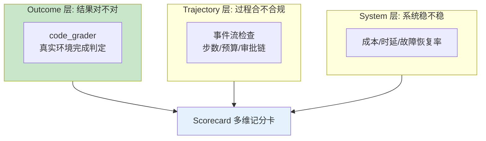

# 36 从"看起来不错"到质量契约

> **本课定位**：第九篇开篇。本课把"Agent 效果不错"翻译成**可判定、可回归、可分维**的质量契约：Grader/GraderResult 的评测原子、三层评测（Outcome/Trajectory/System）的分工。核心命题：**质量没有契约 = 质量由感觉定义**。学完本课，你能为一个 Agent 任务写出第一条可执行的质量契约。
> **教学目标**：①能把"效果不错"翻译为可判定契约（Grader/GraderResult/score/passed 分离）；②能写出第一条 code_grader 质量契约并过门禁；③能说出三层评测的分工与本仓库覆盖状态；④能理解"先建最小门禁"的反直觉结论。
> **前置**：第 03 课（CP-7）
> **产出**：质量契约三要素实验
> **对应代码**：`dataagent/src/dataagent/infra/metrics/eval_ops.py`
> **对应测试**：`test_integration.py::TestEval`

---

## 0. 本课要用到的环境

| 组件 | 取值 | 说明 |
|---|---|---|
| 评测原子 | `Grader(name, grade, max_score)` + `GraderResult(name, score, passed, detail)` | 本课主角 |
| 验证命令 | `python -m pytest tests/integration/test_integration.py::TestEval -v` | 在 `dataagent/` 目录执行 |

---

## 1. 问题场景（"看起来不错"的三个版本）

1. **嘴上版**："感觉这次比上次好"——不可比较，不可回归；
2. **单分版**："准确率 87%"——一个数字掩盖所有维度（安全没测？时延没测？）；
3. **契约版**：`code: 通过判定(完成判据+事件流) / llm: 开放质量评分 / gate: code ≥ 0.8`——**每个数字有名字、有算法、有阈值**。

本仓库的评测原语就是契约版的最小形态。

---

## 2. 概念与机制

### 2.1 评测原子

```python
@dataclass
class GraderResult:
    name: str
    score: float               # 0..1 或原始值
    passed: bool
    detail: str = ""

class Grader:
    def __init__(self, name: str, grade: GraderFn, max_score: float = 1.0): ...
```

**设计意图**：score 与 passed 分离——`score=0.6, passed=False` 表达"部分达成但未过线"，比单一布尔诚实。

### 2.2 三层评测的分工



### 2.3 code_grader：完成判据的评测化

```python
def code_grader(verify: Callable[[Run], bool], name: str = "code") -> Grader:
    """Code Grader：真实环境是否确实完成（区别于"Agent 说做了"）。"""
    def g(run, ref):
        ok = verify(run)
        return GraderResult(name=name, score=1.0 if ok else 0.0, passed=ok)
    return Grader(name, g, max_score=20)
```

**设计意图**：verify 是**任意可编程判定**——本仓库演示用 `r.status.value == "succeeded" and len(r.events) > 5`（终态对 + 事件流真实发生）。这与第 16 课 Verifier 同哲学：**判据挂可观测事实**。

---

## 3. 动手实验

### 实验 1：写第一条质量契约并跑通

```bash
cd dataagent
$env:PYTHONPATH="src"
python -c "
from dataagent.app.container import DataAgentContainer, default_seed
from dataagent.infra.metrics.eval_ops import BatchEvalRunner, RegressionGate, code_grader
c = DataAgentContainer(seed_orders=default_seed())
run = c.analyze('华东区 GMV 下滑')
# 质量契约: ①终态 succeeded ②事件流真实发生(>5条) ③结论步有产出
def verify(r):
    ok = r.status.value == 'succeeded' and len(r.events) > 5
    concl = [s for s in r.steps if s.name == 'conclusion']
    return ok and bool(concl) and bool(concl[-1].output)
runner = BatchEvalRunner([code_grader(verify)])
report = runner.evaluate([(run, {})])
print(report.summary())
gate = RegressionGate(min_scores={'code': 0.8})
ok, viol = gate.evaluate(report)
print('契约门禁:', 'PASS ✓' if ok else f'BLOCK ✗ {viol}')
"
```

**预期输出**：

```text
Eval Scorecard:
  code: 1.0 / 20
契约门禁: PASS ✓
```

### 实验 2：失败案例的正确记分（fail 侧验证）

```bash
python -c "
from dataagent.infra.metrics.eval_ops import code_grader, BatchEvalRunner
from dataagent.contracts.runtime import Run, RunStatus
bad_run = Run(query='x')   # 一个从未跑过的 run: pending + 0 事件
runner = BatchEvalRunner([code_grader(lambda r: r.status.value == 'succeeded')])
report = runner.evaluate([(bad_run, {})])
print('scorecard =', report.scorecard)          # code: 0.0
g = code_grader(lambda r: False)
res = g.grade(bad_run, {})
print('passed =', res.passed, '| score =', res.score)   # False 0.0
"
```

**预期输出**：

```text
scorecard = {'code': 0.0}
passed = False | score = 0.0
```

### 实验 3：TestEval 集成回归

```bash
python -m pytest tests/integration/test_integration.py::TestEval::test_eval_scorecard_and_gate -v
# PASSED
```

---

### 进阶实验（第三/六轮新特性）：Dataset 覆盖矩阵评测

```bash
cd dataagent
$env:PYTHONPATH="src"
python -c "
from dataagent.app.container import DataAgentContainer, default_seed
from dataagent.infra.metrics.eval_ops import Dataset, BatchEvalRunner, code_grader, trajectory_grader
ds = Dataset.load('evals/dataset_v1.jsonl')
c = DataAgentContainer(seed_orders=default_seed())
cases = [(c.analyze(x['input'], x['meta']['tenant']), x['expect']) for x in ds.cases if x['meta']['kind']=='positive']
rep = BatchEvalRunner([code_grader(lambda r: r.status.value=='succeeded' and len(r.events)>5), trajectory_grader()]).evaluate(cases)
print(rep.summary())
print('矩阵 = 4 任务 × 2 租户 =', len(cases), '例')
"
```

**预期输出**（真实运行）：

```text
Eval Scorecard:
  code: 1.0 / 20
  trajectory: 1.0 / 10
矩阵 = 4 任务 × 2 租户 = 8 例
```

**读法**：`evals/dataset_v1.jsonl`（Dataset.load 直接消费）承载 4 任务 × 2 租户的覆盖矩阵 + 1 反例——矩阵缺格由 `test_dataset_matrix.py` 机器断言（第 37 课"覆盖矩阵"的机制化）。这条评测线同时是回归门禁的数据源（第 40 课）。

## 4. 代码走读

### 4.1 max_score 的含义

```python
return Grader(name, g, max_score=20)
```

**设计意图**：不同 Grader 权重不同（code 20 分 / llm 30 分）——Scorecard 汇总时 `scorecard[k] / max_scores[k]` 归一。**维度权重显式化**，而不是全隐含在 0-1 里。

### 4.2 llm_grader 的诚实占位

```python
def fake_complete(client, prompt, run, ref):
    # 演示用：真实实现由 LLM Grader 模型评分
    return "结论合理，证据链完整，通过。"
```

**设计意图**：函数名 fake_ + 注释声明演示口径——LLM 评分器是"用模型评模型"，其可靠性本身要被校准（judge 评测），M0 不假装已具备。

---

## 5. 常见错误与 Badcase

| # | 错误现象 | 根因 | 正确做法 |
|---|---|---|---|
| 1 | "效果不错"无法回答"比哪个版本" | 无契约无基线 | Grader + 命名 + 阈值 |
| 2 | 单一准确率掩盖安全退化 | 维度缺失 | 三层评测分维 |
| 3 | 用"Agent 自己说完成"当判据 | 文本当事实 | code_grader 挂可观测事实 |
| 4 | judge 评分直接当真值 | LLM Grader 未校准 | 显式占位 + 校准计划 |

---

## 6. 验收

```bash
cd dataagent
$env:PYTHONPATH="src"
python -m pytest tests/integration/test_integration.py::TestEval -q    # 期望: 2 passed
# 实验1 契约门禁输出 PASS ✓
```

---

## 7. 思辨与讨论

1. **"质量契约和单元测试有什么区别？"** 单测钉**实现行为**（输入→输出），质量契约钉**效果水位**（这版 Agent 好不好）。前者变了要查实现，后者变了要查模型/提示词/上下文——**归因对象不同，所以分开建**。
2. **"先建评测还是先建门禁？"** 参照工程 CP-07 的反直觉结论：**先建最小门禁**（哪怕只有一条判定）——"degraded 恒 False"这类缺陷被 491 条测试放行，正因为在 Dataset 建成前没有门禁值守。门禁先行能少积累一批无人发现的缺陷。

---

## 8. 延伸与引用

- 第 40 课（Regression Gate）——契约的消费方
- 参照工程 `domain/evalops/`——评测集/指标计算/Badcase 的领域版
- 第 16 课（Verifier）——同哲学的执行侧判据

---

## 9. 本课遗留问题

- ~~Trajectory/System 两层 Grader 未实现~~ → **Trajectory + Safety 已实现（GAP-03）**：`trajectory_grader`（步数/步骤成功/事件流）与 `safety_grader`（高风险工具审批不变式，安全不可交易维）；System 层（成本/时延）仍缺——如实登记。
- llm_grader 的 judge 校准机制未建——显式占位已登记。
- 质量契约无版本化（阈值变更无记录）——与第 40 课发布治理合并。
