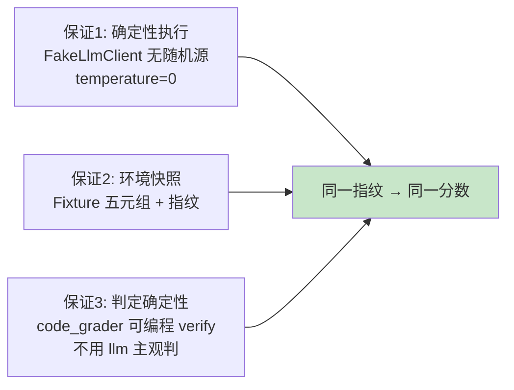

# 37 从样例集合到可复现基准：Dataset 与 Fixture

> **本课定位**：本课讲可复现评测的两大基建：**Dataset**（样例集合的版本化管理）与 **Fixture**（环境快照 + 版本元组）。核心命题：**没有版本元组的评测分数无法归因**——分数变了，是模型变了？提示词变了？还是工具集变了？学完本课，你能给任何一次评测贴上"指纹"。
> **教学目标**：①能生成并验证 Fixture 五元指纹的等价关系；②能实证同指纹复跑同分；③能设计 Dataset 三元组（输入/期望/元数据）；④能说明"复现是光谱不是开关"的三层声明。
> **前置**：第 36 课（质量契约）
> **产出**：Fixture 指纹实验 + Dataset 设计
> **对应代码**：`eval_ops.py::snapshot_fixture`
> **对应测试**：手工实验（Dataset 为 M0 轻量版）

---

## 0. 本课要用到的环境

| 组件 | 取值 | 说明 |
|---|---|---|
| 快照原语 | `snapshot_fixture(model, prompt_version, context_version, tool_set, tenant)` | 五元版本 + 指纹 |
| 验证命令 | `python -c`（本课以实验为主） | 在 `dataagent/` 目录执行 |

---

## 1. 问题场景（不可归因的分数）

团队月报写着"Agent 质量分从 82 涨到 87"。三个问题没人能答：
1. 变好的是**全部任务**还是**某个租户**？——没有 tenant 维度；
2. 期间换过提示词 v3→v4、加了一个工具——**分数变化归因于谁**？没有版本元组；
3. 评测当天的上游模型是哪个快照？——模型本身也在变。

三个问题的共同解药：**每次评测必须携带 (model, prompt_version, context_version, tool_set, tenant) 五元组 + 指纹**。

---

## 2. 概念与机制

### 2.1 Fixture 快照与指纹

```python
def snapshot_fixture(*, model, prompt_version, context_version, tool_set, tenant) -> dict:
    raw = f"{model}|{prompt_version}|{context_version}|{tool_set}|{tenant}"
    return {
        "model": model, "prompt_version": prompt_version, "context_version": context_version,
        "tool_set": tool_set, "tenant": tenant,
        "fingerprint": hashlib.md5(raw.encode()).hexdigest()[:12],
    }
```

**设计意图**：指纹（12 位哈希）是五元组的**等价键**——两次评测指纹相同 = 同环境下可比；指纹不同 = 变更点可从五元组 diff 里直接读出。

### 2.2 Dataset 的最小规格（M0 轻量版）

```python
# Dataset 条目的最小三元组
cases = [
    # (输入, 参考答案/判定要点, 元数据)
    ("华东区本月 GMV 下滑原因诊断", {"expect_status": "succeeded", "expect_events_gt": 5}, {"tenant": "ten_a"}),
]
```

**规格三要素**：输入、可判定期望、元数据（租户/难度/标签）。M0 以代码内列表承载；持久化 Dataset（JSONL + 版本号）是 M1 演进。

### 2.3 可复现的三道保证



---

## 3. 动手实验

### 实验 1：生成 Fixture 指纹

```bash
cd dataagent
$env:PYTHONPATH="src"
python -c "
from dataagent.infra.metrics.eval_ops import snapshot_fixture
f1 = snapshot_fixture(model='fake-llm-v1', prompt_version='p3',
    context_version='c2', tool_set='toolchain-v1', tenant='ten_a')
f2 = snapshot_fixture(model='fake-llm-v1', prompt_version='p3',
    context_version='c2', tool_set='toolchain-v1', tenant='ten_a')
f3 = snapshot_fixture(model='fake-llm-v1', prompt_version='p4',
    context_version='c2', tool_set='toolchain-v1', tenant='ten_a')
print('同环境两次指纹相等 =', f1['fingerprint'] == f2['fingerprint'])
print('提示词升级后指纹变化 =', f1['fingerprint'] != f3['fingerprint'])
print('指纹 =', f1['fingerprint'])
"
```

**预期输出**（指纹值固定——MD5 确定性，真实值如下）：

```text
同环境两次指纹相等 = True
提示词升级后指纹变化 = True
指纹 = ba50fe2d3dfd
```

### 实验 2：同指纹复跑分数一致（可复现实证）

```bash
python -c "
from dataagent.app.container import DataAgentContainer, default_seed
from dataagent.infra.metrics.eval_ops import BatchEvalRunner, code_grader
def run_once():
    c = DataAgentContainer(seed_orders=default_seed())
    run = c.analyze('华东区 GMV 下滑')
    return BatchEvalRunner([code_grader(lambda r: r.status.value=='succeeded' and len(r.events)>5)]).evaluate([(run, {})])
s1, s2 = run_once(), run_once()
print('两次独立评测 scorecard 相等 =', s1.scorecard == s2.scorecard, s1.scorecard)
"
```

**预期输出**：

```text
两次独立评测 scorecard 相等 = True {'code': 1.0}
```

**判定通过**：假模型 + 确定性判定 → 同分。这就是"可复现"的实证（真实模型下以温度 0 + 快照近似）。

### 实验 3：Dataset 三元组建模

```bash
python -c "
cases = [
    ('华东区本月 GMV 下滑原因诊断', {'expect_status': 'succeeded'}, {'tenant': 'ten_a', 'difficulty': 'easy'}),
    ('华南区订单量分析', {'expect_status': 'succeeded'}, {'tenant': 'ten_a', 'difficulty': 'easy'}),
    ('ten_b 的 GMV 诊断', {'expect_status': 'succeeded'}, {'tenant': 'ten_b', 'difficulty': 'easy'}),
]
print('Dataset 大小 =', len(cases), '| 租户覆盖 =', sorted({c[2]['tenant'] for c in cases}))
"
```

---

## 4. 代码走读

### 4.1 为什么 tenant 进指纹

```python
raw = f"{model}|{prompt_version}|{context_version}|{tool_set}|{tenant}"
```

**设计意图**：不同租户的数据分布不同（ten_a 12 单 vs ten_b 6 单），分数天然不可比——**把租户写进指纹，防止跨租户比较的伪结论**。

### 4.2 MD5 指纹的取舍

**设计意图**：指纹用途是**等价判定**（相同/不同），不是安全摘要——MD5 的碰撞风险对 12 位截断的用途完全够。用 SHA256 属于仪式感。

---

## 5. 常见错误与 Badcase

| # | 错误现象 | 根因 | 正确做法 |
|---|---|---|---|
| 1 | 分数变化无法归因 | 无版本元组 | Fixture 五元组 + 指纹 |
| 2 | 跨租户比较分数 | tenant 不在元组 | 进指纹 |
| 3 | 真实模型下"复现"失败 | 无快照/温度非 0 | 温度 0 + 模型快照 + 诚实声明非严格复现 |
| 4 | Dataset 无期望值（只有输入） | 不可判定 | 三元组：输入/期望/元数据 |
| 5 | Dataset 改了但没升版本 | 基线漂移 | Dataset 版本号 + 变更记录 |

---

## 6. 验收

```bash
cd dataagent
$env:PYTHONPATH="src"
# 实验1 指纹等价关系成立；实验2 同指纹复跑同分
```

---

## 7. 思辨与讨论

1. **"真实模型下能做到严格复现吗？"** 不能完全做到（上游模型服务本身在变）——诚实的做法是三层声明：假模型严格复现（本课实验 2）、真实模型温度 0 近似复现、真实模型跨时间对比必须同快照。**复现是光谱不是开关**。
2. **"Dataset 多大才够？"** 判定标准不是条数，是**覆盖率**：每个任务类型 × 每个租户 × 正反例（含失败案例）都有代表。M0 的 3 条是教学骨架，生产按覆盖矩阵扩。

---

## 8. 延伸与引用

- 第 38 课（Batch Runner）——Dataset 的批量消费
- 参照工程 `lessons/第9篇/L9-2`——Dataset 与 Fixture 的完整设计（本仓库同项为 V5 缺口的部分补齐）
- 第 14 课（模型版本化）——model 字段的版本语义

---

## 9. 本课遗留问题

- Dataset 持久化（JSONL + 版本号 + 变更记录）未实现——M0 代码内列表，如实登记。
- Fixture 未自动采集（当前手工填五元组）——应从 Run/容器自动提取，登记。
- 失败案例（Badcase）进 Dataset 的机制未建——第 20 课"钉住"的评测侧承接。
