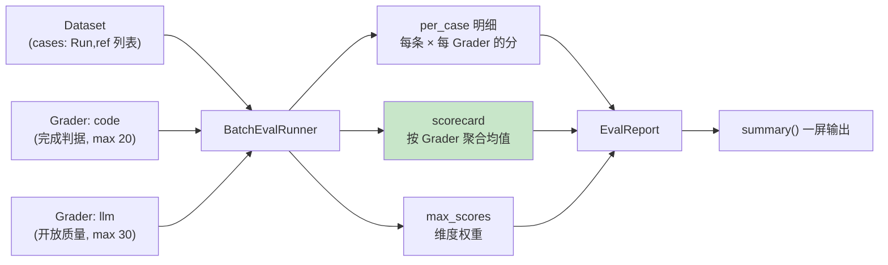

# 38 从"有标准"到"能自动测"：Multi-Grader 与 Batch Runner

> **本课定位**：本课讲评测的**规模化执行**：Multi-Grader（多维度并行打分）与 BatchEvalRunner（批量跑 + Scorecard 汇总）。核心命题：单条评测是手工艺术，批量评测才是工程能力——**能自动测、能批量测、能聚合看**。学完本课，你能为 DataAgent 搭一条"多 Grader + 批量 + 记分卡"的评测流水线。
> **教学目标**：①能搭建多 Grader 批量评测流水线；②能解读 Scorecard/per_case/max_scores 三层输出；③能编写符合纯度要求的自定义 Grader；④能制定"快测管门禁、全量管水位"的执行策略。
> **前置**：第 36-37 课
> **产出**：Multi-Grader 实验 + Batch 流水线实验
> **对应代码**：`eval_ops.py::BatchEvalRunner / EvalReport`
> **对应测试**：`test_integration.py::TestEval::test_eval_scorecard_and_gate`

---

## 0. 本课要用到的环境

| 组件 | 取值 | 说明 |
|---|---|---|
| 批量执行器 | `BatchEvalRunner(graders: list[Grader])` | 批量 + 聚合 |
| 报表 | `EvalReport(cases, scorecard, max_scores)` + `summary()` | 多维记分卡 |
| 验证命令 | `python -m pytest tests/integration/test_integration.py::TestEval -v` | 在 `dataagent/` 目录执行 |

---

## 1. 问题场景（手工评测的三难）

1. **测不全**：一个 Grader 只看一个面，多维度要跑多次；
2. **测不快**：逐条手跑，Dataset 一大就放弃；
3. **看不懂**：十次评测的结果散在十个终端里，没有聚合视图。

BatchEvalRunner 一次解决：**多 Grader 并行打分 → 批量跑 Dataset → Scorecard 一屏汇总**。

---

## 2. 概念与机制

### 2.1 Batch 流水线



### 2.2 Scorecard 的聚合口径

```python
scorecard = {k: round(v / len(cases), 3) if cases else 0.0 for k, v in totals.items()}
```

**口径要点**：均值按 **case 数**平均（每条 case 每维度贡献一次），不是按 Grader 数——维度之间互不干扰，聚合语义干净。

### 2.3 自定义 Grader 的模板

```python
def trajectory_grader(max_steps: int = 8) -> Grader:
    def g(run: Run, ref: dict) -> GraderResult:
        ok = len(run.steps) <= max_steps
        return GraderResult(name="trajectory", score=1.0 if ok else 0.5, passed=ok,
                            detail=f"steps={len(run.steps)}")
    return Grader("trajectory", g, max_score=10)
```

**模板要点**：命名（进 Scorecard 的 key）、分数语义（0/0.5/1 的分档含义）、detail（人可读证据）。

---

## 3. 动手实验

### 实验 1：双 Grader 批量流水线

```bash
cd dataagent
$env:PYTHONPATH="src"
python -c "
from dataagent.app.container import DataAgentContainer, default_seed
from dataagent.infra.metrics.eval_ops import BatchEvalRunner, code_grader, Grader, GraderResult
from dataagent.contracts.runtime import Run

def trajectory_grader(max_steps: int = 8) -> Grader:
    def g(run: Run, ref: dict) -> GraderResult:
        ok = len(run.steps) <= max_steps
        return GraderResult(name='trajectory', score=1.0 if ok else 0.5, passed=ok,
                            detail=f'steps={len(run.steps)}')
    return Grader('trajectory', g, max_score=10)

c = DataAgentContainer(seed_orders=default_seed())
runs = [c.analyze(q) for q in ('华东区 GMV 下滑', '华南区订单量分析', 'ten_b GMV 诊断')]
runner = BatchEvalRunner([
    code_grader(lambda r: r.status.value == 'succeeded' and len(r.events) > 5),
    trajectory_grader(8),
])
report = runner.evaluate([(r, {}) for r in runs])
print(report.summary())
"
```

**预期输出**：

```text
Eval Scorecard:
  code: 1.0 / 20
  trajectory: 1.0 / 10
```

### 实验 2：per_case 明细可见

```bash
python -c "
from dataagent.app.container import DataAgentContainer, default_seed
from dataagent.infra.metrics.eval_ops import BatchEvalRunner, code_grader
c = DataAgentContainer(seed_orders=default_seed())
runs = [c.analyze(q) for q in ('Q1', 'Q2')]
report = BatchEvalRunner([code_grader(lambda r: r.status.value == 'succeeded')]).evaluate([(r, {}) for r in runs])
print('per_case =', report.cases)      # 每条 case 的分项明细
print('max_scores =', report.max_scores)
"
```

**预期输出**：

```text
per_case = [{'code': 1.0}, {'code': 1.0}]
max_scores = {'code': 20}
```

### 实验 3：失败维度在 Scorecard 中显形

```bash
python -m pytest tests/integration/test_integration.py::TestEval::test_eval_scorecard_and_gate -v
# PASSED —— 契约门禁消费 scorecard 的链路被钉住
```

---

## 4. 代码走读

### 4.1 evaluate 的双循环结构

```python
for run, ref in cases:            # 外层: Dataset
    row = {}
    for gr in self.graders:       # 内层: Graders
        res = gr.grade(run, ref)
        row[gr.name] = res.score
        totals[gr.name] = totals.get(gr.name, 0) + res.score
        max_scores[gr.name] = gr.max_score
    per_case.append(row)
```

**设计意图**：内层 Grader 循环**无副作用隔离要求**（Grader 应为纯函数）——评测 Grader 若有副作用（写库/发通知）会让批量结果不可信。**Grader 纯度是批量化的前提**。

### 4.2 summary 的可读性设计

```python
lines = ["Eval Scorecard:"]
for k in sorted(self.scorecard):
    lines.append(f"  {k}: {self.scorecard[k]} / {self.max_scores.get(k, 1.0)}")
```

**设计意图**：排序输出 + "实得/满分"格式——评测报告首先是**给人看的**，其次才是给门禁判的。

---

## 5. 常见错误与 Badcase

| # | 错误现象 | 根因 | 正确做法 |
|---|---|---|---|
| 1 | 批量跑两次分数不同 | Grader 有副作用/随机 | Grader 纯函数化 |
| 2 | Scorecard 维度间不可比 | max_score 不一致却直接比 | 归一后比（score/max） |
| 3 | 聚合均值被极端 case 拉偏 | 无分位视角 | scorecard 之外补 P50/P95（演进） |
| 4 | 失败 case 的原因不可见 | 只有分数 | detail 字段人可读证据 |

---

## 6. 验收

```bash
cd dataagent
$env:PYTHONPATH="src"
python -m pytest tests/integration/test_integration.py::TestEval -q    # 期望: 2 passed
# 实验1 双 Grader 输出与 §3.1 一致
```

---

## 7. 思辨与讨论

1. **"评测跑在 CI 里还是定时跑？"** 本仓库两者皆可：CI 里跑**快测子集**（假模型，秒级，防回归）；定时跑**全量**（ Dataset 全集 + 真实模型采样）。**快的管门禁，全的管水位**，混用会把 CI 拖成小时级。
2. **"多 Grader 会不会越加越多？"** 加 Grader 的门槛 = 对应一个真实质量事故或业务关注点。与第 09 课"器的事故驱动"同标准——**没有案子的维度不加**。

---

## 8. 延伸与引用

- 第 40 课（Regression Gate）——Scorecard 的门禁消费
- 参照工程 `domain/evalops/`——多维聚合与 Badcase 管理的领域版
- 第 37 课（Dataset）——本课的输入侧

---

## 9. 本课遗留问题

- 分位统计（P50/P95）未实现（仅均值）——聚合增强项。
- Grader 纯度无强制（无框架校验）——约定 + 评审把关，登记。
- 并行执行（Grader 间/Case 间并行）未实现——M0 单线程，规模化时引入。
