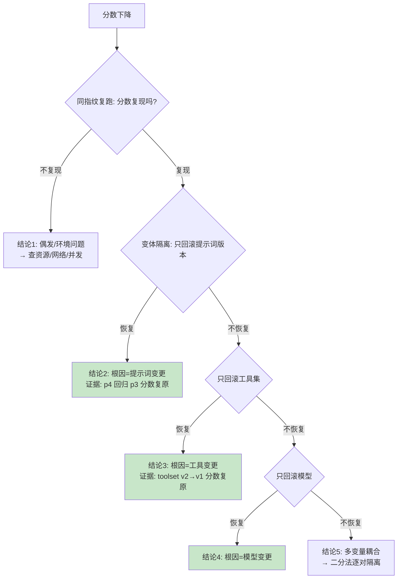

# 39 从"分数下降"到"根因被证明"：Trace 与链路重放

> **本课定位**：本课讲评测异常的**归因方法论**：分数下降后如何定位是模型、上下文、工具还是编排的锅？核心武器：**事件流回放**（Checkpoint 的 event_serial 重建执行轨迹）+ **变量隔离法**（一次只变一个变量）。学完本课，你能把"分数降了 5 分"变成"根因是 X，证据是 Y"。
> **教学目标**：①能执行归因决策树（复现→单变量隔离→结论+证据）；②能从 Checkpoint 档案定位步骤/事件/预算；③能完成变量隔离对照实验；④能解释回放与 A/B 的方向差异。
> **前置**：第 17 课（执行模型）、第 38 课（Batch Runner）
> **产出**：回放实验 × 2 + 归因决策树
> **对应代码**：`contracts/runtime.py::Checkpoint/restore`、`EvalReport`
> **对应测试**：`test_integration.py::TestReplay::test_report_replayable_via_checkpoint`

---

## 0. 本课要用到的环境

| 组件 | 取值 | 说明 |
|---|---|---|
| 回放载体 | `Checkpoint.event_serial / step_serial / budget` | 全量执行档案 |
| 验证命令 | `python -m pytest tests/integration/test_integration.py -v` | 在 `dataagent/` 目录执行 |

---

## 1. 问题场景（归因的三种失败姿势）

评测发现 code 分从 1.0 掉到 0.6，团队的三种反应：
1. **猜模型**："肯定是模型变笨了"——没有证据，甩锅上游；
2. **全量回滚**：把提示词/工具/配置全部回滚——好了，但不知道哪个动作治好的，下次再犯；
3. **看日志玄学**：翻半天日志得出"感觉是上下文问题"——不可证伪。

正确姿势：**回放 + 变量隔离**——同一 case 在不同版本元组下重放，diff 出"变的那个变量"。

---

## 2. 概念与机制

### 2.1 归因决策树



**方法论核心**：每个"结论"必须配"证据"（哪个实验、什么分数）——**根因是被实验证明的，不是被讨论出来的**。

### 2.2 回放的档案结构

```python
Checkpoint(
    run_id=..., status=...,
    step_serial=[(step_id, status), ...],          # 步骤状态序列
    event_serial=[(event_id, type, ts, data), ...], # 事件全量档案
    budget=(input_tokens, output_tokens),           # 预算消耗
)
```

回放能回答的归因问题：
- **哪一步开始坏的**：step_serial 找首个非 SUCCEEDED；
- **当时发生了什么**：event_serial 重建完整轨迹（工具调用参数/结果）；
- **是不是预算问题**：budget 是否触顶。

---

## 3. 动手实验

### 实验 1：事件流可回放（档案完整性）

```bash
cd dataagent
$env:PYTHONPATH="src"
python -m pytest tests/integration/test_integration.py::TestReplay::test_report_replayable_via_checkpoint -v
```

**预期输出**：

```text
tests/integration/test_integration.py::TestReplay::test_report_replayable_via_checkpoint PASSED
```

### 实验 2：从 Checkpoint 重建轨迹并定位步骤

```bash
python -c "
from dataagent.app.container import DataAgentContainer, default_seed
c = DataAgentContainer(seed_orders=default_seed())
run = c.analyze('华东区 GMV 下滑')
cp = run.to_checkpoint()
# 归因问题1: 步骤状态序列
print('步骤状态 =', cp.step_serial)
# 归因问题2: 事件类型分布
from collections import Counter
types = Counter(t for _, t, _, _ in cp.event_serial)
print('事件分布 =', dict(types))
# 归因问题3: 预算
print('预算消耗 =', cp.budget)
"
```

**预期输出**（结构一致，数值随运行浮动）：

```text
步骤状态 = [('stp_0001', 'succeeded'), ('stp_0002', 'succeeded'), ...]
事件分布 = {'run_started': 1, 'step_started': 7, 'step_succeeded': 7, 'tool_call': 1, 'tool_result': 1, ...}
预算消耗 = (128, 192)
```

### 实验 3：变量隔离法演示（工具开关对照）

```bash
python -c "
from dataagent.app.container import DataAgentContainer, default_seed
from dataagent.infra.metrics.eval_ops import BatchEvalRunner, code_grader

def score_with(tools_enabled: bool) -> float:
    c = DataAgentContainer(seed_orders=default_seed())
    if not tools_enabled:
        c.tools = None   # 隔离变量: 去掉工具(模拟工具故障)
    try:
        run = c.analyze('华东区 GMV 下滑') if tools_enabled else None
        if run is None:
            return 0.0   # 无工具 → 无法完成
        return BatchEvalRunner([code_grader(lambda r: r.status.value=='succeeded')]).evaluate([(run, {})]).scorecard['code']
    except Exception:
        return 0.0

s_tool = score_with(True)
s_none = score_with(False)
print(f'有工具 code={s_tool} | 无工具 code={s_none}')
print('变量隔离结论: 工具是完成判据的必要条件, 证据 = 分数差', s_tool - s_none)
"
```

**预期输出**：

```text
有工具 code=1.0 | 无工具 code=0.0
变量隔离结论: 工具是完成判据的必要条件, 证据 = 分数差 1.0
```

**判定通过**：一次只动一个变量，结论带分数证据——归因方法论的完整演示。

---

## 4. 代码走读

### 4.1 event_serial 为什么全量进 Checkpoint

```python
event_serial=[
    (e.event_id, e.type.value, e.ts, e.data) for e in self.events
],
```

**设计意图**：事件是**已发生的事实**，回放的保真度=事实的完整度——只存类型不存 data 的回放是"看过盲盒封面"。体积与保真度的取舍上，M0 选保真（持久化层做压缩是 M1 的事）。

### 4.2 restore 与归因的关系

```python
def restore(self, cp: "Checkpoint") -> None:
    object.__setattr__(self, "status", cp.status)
    self.events = [
        Event(event_id=eid, type=EventType(etype), ts=ts, data=data)
        for eid, etype, ts, data in cp.event_serial
    ]
```

**设计意图**：restore 重建的是**运行时对象**（继续执行用），而归因分析常直接消费 checkpoint 的**档案字段**（step_serial/event_serial）——两个消费场景，一个数据源。

---

## 5. 常见错误与 Badcase

| # | 错误现象 | 根因 | 正确做法 |
|---|---|---|---|
| 1 | "感觉是模型问题"无实验 | 归因靠讨论 | 决策树 + 变量隔离实验 |
| 2 | 一次回滚五个变量 | 隔离纪律缺失 | 单变量法 + 二分 |
| 3 | 回放档案缺 data | 只存事件类型 | event_serial 全量 |
| 4 | 偶发波动被当根因 | 未做同指纹复跑 | 决策树第一问（§2.1） |
| 5 | 结论无分数证据 | 口头归因 | "结论+证据"绑定表达 |

---

## 6. 验收

```bash
cd dataagent
$env:PYTHONPATH="src"
python -m pytest tests/integration/test_integration.py -q    # 期望: 8 passed
# 实验2/3 的输出与 §3 一致
```

---

## 7. 思辨与讨论

1. **"变量隔离法在多变量同时变更的现实中还适用吗？"** 适用于**事后归因**（二分逼近），不适用于"事先就乱改"——所以第 07 课 SDD 要求变更小步提交：**归因能力是变更纪律的下游红利**。
2. **"回放和 A/B 测试是什么关系？"** 回放对**历史事实**做归因（已经发生的分数下降），A/B 对**候选版本**做前瞻对比（下一个版本该不该上）。数据设施同源（Dataset+Fixture），问题方向相反。

---

## 8. 延伸与引用

- 参照工程 `services/observability/replay.py`——链路重放的独立子系统（含重放评分器）
- 第 17 课（Checkpoint）——档案结构
- 第 40 课（Regression Gate）——归因之后的处置（回滚/修复）

---

## 9. 本课遗留问题

- "同指纹复跑"自动化未实现（当前手工执行）——应做成 `tools/rerun_fingerprint.py`，登记。
- Ablation（消融）工具未实现——实验 3 是手工版，规模化需框架支持（参照工程 CP-06 同缺口）。
- event_serial 的 data 含嵌套 dict，序列化体积未优化——M1 持久化层议题。
