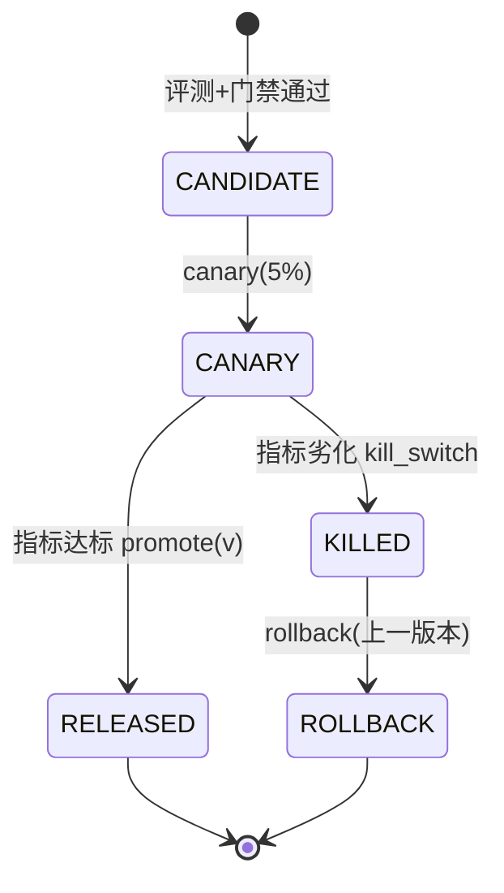

# 40 从离线提升到安全发布：Regression Gate 与受控发布

> **本课定位**：第九篇收口。本课讲分数之外的安全发布三道闸：**RegressionGate**（关键维度不得退化）、**ReleaseEVolution**（Canary/Kill Switch/回滚）、以及"平均分上升也不许发布"的反直觉规则。学完本课，你能为本仓库搭建"评测→门禁→灰度→回滚"的发布闭环。
> **教学目标**：①能配置逐维门禁并演示拦截路径；②能解释"关键维度不可交易"与缺测按 0 处理；③能走通 Canary→KillSwitch→回滚全流程；④能制定五项发布治理清单。
> **前置**：第 36-39 课
> **产出**：门禁实验 × 3 + 发布治理清单
> **对应代码**：`eval_ops.py::RegressionGate / ReleaseEVolution`、`.github/workflows/ci.yml`
> **对应测试**：`test_integration.py::TestEval::test_eval_scorecard_and_gate`

---

## 0. 本课要用到的环境

| 组件 | 取值 | 说明 |
|---|---|---|
| 门禁 | `RegressionGate(min_scores={'code': 0.8})` | 逐维度阈值 |
| 发布治理 | `ReleaseEVolution: canary / promote / rollback / kill_switch` | 三机制 |
| 验证命令 | `python -m pytest tests/integration/test_integration.py::TestEval -v` | 在 `dataagent/` 目录执行 |

---

## 1. 问题场景（无门禁发布的四次事故）

1. **静默退化**：新版"平均分 0.87"看起来更好，但**安全维度从 1.0 掉到 0.6**——越权拦截失效，没人看分维度；
2. **全量上线翻车**：新版本直接 100% 放量，缺陷影响全部租户——无 Canary；
3. **回滚不知滚回哪**：出事后"回滚上一个版本"，但没人说清上一个是什么配置——无版本台账；
4. **紧急止不住**：缺陷持续影响用户，等修复发布要 4 小时——无 Kill Switch。

四事故对应三道闸：Gate / Canary / KillSwitch+Rollback。

---

## 2. 概念与机制

### 2.1 RegressionGate：逐维度红线

```python
class RegressionGate:
    """CI Regression Gate：平均分提升不代表可发布 —— 关键能力/安全不得退化。"""
    def evaluate(self, report: EvalReport) -> tuple[bool, list[str]]:
        violations = []
        for metric, threshold in self.min_scores.items():
            got = report.scorecard.get(metric, 0.0)
            if got < threshold:
                violations.append(f"{metric}: {got} < {threshold}")
        return (len(violations) == 0), violations
```

**反直觉规则的逻辑**：平均分是**可交易的**（用安全换体验也能涨均分），门禁的存在就是**宣布哪些维度不可交易**。`min_scores` 清单 = 质量宪法。

### 2.2 发布三机制的语义



```python
class ReleaseEVolution:
    def canary(self, percent): self.canary_pct = percent
    def promote(self, version):
        if not self.kill_switch:
            self.released_versions.append(version)
    def rollback(self, version):
        self.kill_switch = True
        return f"已触发 Kill Switch，回滚到上一版本：{version}"
```

**设计意图**：`promote` 检查 kill_switch——**紧急状态下一律不许晋升**；`rollback` 激活 kill_switch——回滚即进入保守态，直到人工复位。

### 2.3 发布治理清单

| # | 项 | 判据 |
|---|---|---|
| 1 | 门禁维度清单 | 关键能力+安全+成本，逐维有阈值 |
| 2 | Canary 比例与观察期 | 5% × 24h，指标劣化自动停 |
| 3 | 版本台账 | released_versions + Fixture 指纹绑定 |
| 4 | 回滚演练 | 周期演练，回滚时间 P95 < 10min |
| 5 | Kill Switch 复位流程 | 人工确认修复后复位 |

---

## 3. 动手实验

### 实验 1：门禁通过路径

```bash
cd dataagent
$env:PYTHONPATH="src"
python -c "
from dataagent.app.container import DataAgentContainer, default_seed
from dataagent.infra.metrics.eval_ops import BatchEvalRunner, RegressionGate, code_grader
c = DataAgentContainer(seed_orders=default_seed())
run = c.analyze('华东区 GMV 下滑')
report = BatchEvalRunner([code_grader(lambda r: r.status.value=='succeeded' and len(r.events)>5)]).evaluate([(run, {})])
gate = RegressionGate(min_scores={'code': 0.8})
ok, viol = gate.evaluate(report)
print('门禁 =', 'PASS ✓' if ok else 'BLOCK ✗', '| violations =', viol)
"
```

**预期输出**：

```text
门禁 = PASS ✓ | violations = []
```

### 实验 2：门禁拦截路径（安全维度退化）

```bash
python -c "
from dataagent.infra.metrics.eval_ops import EvalReport, RegressionGate
# 模拟: 平均分上升但安全维度退化
report = EvalReport(cases=[{'code': 1.0, 'safety': 0.6}],
                    scorecard={'code': 1.0, 'safety': 0.6},
                    max_scores={'code': 20, 'safety': 30})
gate = RegressionGate(min_scores={'code': 0.8, 'safety': 0.9})
ok, viol = gate.evaluate(report)
print('平均分更高但安全退化 → 门禁 =', 'PASS' if ok else 'BLOCK ✗')
print('violations =', viol)
"
```

**预期输出**：

```text
平均分更高但安全退化 → 门禁 = BLOCK ✗
violations = ['safety: 0.6 < 0.9']
```

**判定通过**：`code=1.0` 满分也救不了 `safety=0.6`——**关键维度不可交易**被数据证明。

### 实验 3：Canary → KillSwitch → 回滚全流程

```bash
python -c "
from dataagent.infra.metrics.eval_ops import ReleaseEVolution
rel = ReleaseEVolution()
rel.canary(5)
print('灰度 5% =', rel.canary_pct)
rel.promote('v1.2.0')          # 灰度指标达标 → 晋升
print('已发布 =', rel.released_versions)
msg = rel.rollback('v1.1.0')   # 新版本出事 → 紧急回滚
print(msg)
rel.promote('v1.3.0')          # 紧急态下试图晋升
print('紧急态下晋升被拒, 台账 =', rel.released_versions)
"
```

**预期输出**：

```text
灰度 5% = 5
已发布 = ['v1.2.0']
已触发 Kill Switch，回滚到上一版本：v1.1.0
紧急态下晋升被拒, 台账 = ['v1.2.0']
```

---

## 4. 代码走读

### 4.1 min_scores 的缺失维度语义

```python
got = report.scorecard.get(metric, 0.0)
```

**设计意图**：门禁要求的维度若在报表中缺失，按 **0.0** 处理——"评测没测安全"不等于"安全没问题"，缺测即不过。**门禁宁可误拦，不可漏放**。

### 4.2 CI 里的门禁位置

`.github/workflows/ci.yml` 的门禁序列：72 例测试 → 资料自检 →（评测子集 + RegressionGate）。**门禁在合入前**，不是发布前才发现退化——把回归拦截在最早的环节。

---

## 5. 常见错误与 Badcase

| # | 错误现象 | 根因 | 正确做法 |
|---|---|---|---|
| 1 | 平均分达标即发布 | 无分维红线 | min_scores 质量宪法 |
| 2 | 缺测维度默认通过 | `get(metric, 1.0)` 的方向反了 | 缺失按 0.0（fail-closed） |
| 3 | 灰度无观察期 | canary 只有比例 | 比例 × 观察期 × 自动停 |
| 4 | 回滚无台账 | promote 不记录 | released_versions + 指纹 |
| 5 | Kill Switch 无人能关 | 无复位流程 | 复位=人工确认的显式动作 |

---

## 6. 验收

```bash
cd dataagent
$env:PYTHONPATH="src"
python -m pytest tests/integration/test_integration.py -q    # 期望: 8 passed
# 实验2 的拦截输出与实验3 的三机制输出与 §3 一致
```

---

## 7. 思辨与讨论

1. **"门禁太严会不会永远发不了版？"** 会——所以 min_scores 清单要**短而硬**（关键能力+安全，3-5 条），其余维度进观察看板。门禁条目 = 你愿意为它"宁可误拦"的清单，清单越长越说明不知道什么重要。
2. **"Kill Switch 和回滚的区别？"** Kill Switch 是**止血**（立即停止影响，版本不变），回滚是**换血**（切回上一版本）。止血永远先于换血——先断影响面，再从容回滚。

---

## 8. 延伸与引用

- 参照工程 `lessons/第9篇/L9-5`——灰度与回滚的完整实现（本仓库同项为 M5 缺口的机制版补齐）
- 第 14 课（模型治理）——LLM 侧的预算/降级联动
- 本仓库 `docs/06` §上线门槛 GO-12——混沌/回归门禁的运维判据

---

## 9. 本课遗留问题

- Canary 的"自动停"未实现（比例可设但无观察期指标联动）——机制版已备，自动化登记。
- released_versions 未与 Fixture 指纹绑定（版本无环境快照）——归因链缺口，登记。
- ~~safety 维度 Grader 未实现~~ → **已实现（GAP-03）**：`safety_grader` 内置"高风险工具必须带已批准审批"不变式，`test_eval_multi.py::TestSafetyGrader` 与三维门禁端到端测试钉住。
