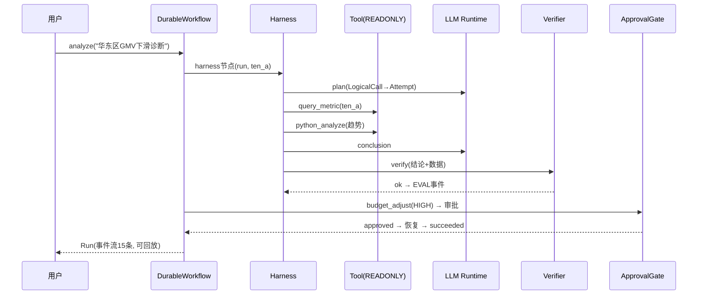

# 41 DataAgent 最终展示与全课程总结

> **本课定位**：本课是全课程的技术收口：以 `scripts/demo.py` 的五段演示为线索，把 10 篇 42 讲的机制串成一条完整链路，并做能力闭环盘点。学完本课，你能独立完成一次"可讲解、可验证、可复现"的 DataAgent 全链路展示。
> **教学目标**：①能独立完成五段演示的讲解与验收；②能把每个机制指回课程/模块/测试三重定位；③能按诚实版能力闭环表回答"做到与没做到"；④能说出全课程五大遗留项。
> **前置**：全部前序课程
> **产出**：五段演示的完整走查 + 课程机制映射总表
> **对应代码**：`scripts/demo.py`、`dataagent/src/dataagent/` 全部模块
> **对应测试**：全量 `python -m pytest -q`（244 passed + 5 skipped）

---

## 0. 本课要用到的环境

| 组件 | 取值 | 说明 |
|---|---|---|
| 演示脚本 | `python ../scripts/demo.py` | 在 `dataagent/` 目录执行 |
| CLI 形态 | `python -m dataagent "分析问题"` | 第二演示形态 |
| 测试基线 | 244 passed + 5 skipped（e2e 诚实门控） | 全程离线 |

---

## 1. 问题场景（最终展示的三条标准）

一场合格的最终展示要经得起三条追问：
1. **可验证**：每段演示输出可复现（命令+期望输出）；
2. **可追溯**：每个机制能指回"哪一课、哪个模块、哪条测试"；
3. **可诚实**：讲得了做到了什么，也讲得了没做到什么。

`demo.py` 的五段就是按这三条标准设计的。

---

## 2. 概念与机制

### 2.1 五段演示 × 课程机制映射总表

| 段 | 演示内容 | 课程机制 | 代码落点 | 钉住测试 |
|---|---|---|---|---|
| [1] | 经营诊断链路（Workflow 包 Harness） | 第 02/16/18 课 | `harness.py`+`workflow.py` | `test_full_analysis_pipeline` |
| [2] | 多租户隔离 | 第 10/22 课 | `TenantDataLake` | `test_tenant_isolation_in_lake` |
| [3] | 故障注入恢复 + SQL 网关 | 第 13/20/26 课 | `FakeLlmClient`+`guards.py` | `test_fault_injection_cross_failures` |
| [4] | Eval 评分卡 + 回归门禁 | 第 36/40 课 | `eval_ops.py` | `test_eval_scorecard_and_gate` |
| [5] | Context/Memory/工具/安全自检 | 第 21-35 课 | `assembler/memory/tool/guards` | 各单元测试文件 |

### 2.2 全链路时序（讲解用主线）



### 2.3 能力闭环盘点（诚实版）

| 能力闭环 | 状态 | 缺口 |
|---|---|---|
| 诊断→结论→证据 | ✅ 闭环 | 归因阈值为演示值（第 22 课遗留） |
| 副作用→审批→执行 | ✅ 闭环 | 验真对账/补偿未实现（第 29 课遗留） |
| 记忆→召回→治理→**评测** | ✅ 闭环 | MemoryRecallEvaluator 已建（GAP-05）；删除传播②③站仍占位 |
| 评测→**三维门禁**→灰度 | ✅ 机制完整 | Outcome+Trajectory+Safety 三维 Grader 已建（GAP-03）；Canary 自动停/指纹绑定仍缺 |
| 分布式→多副本 | ⚠️ 端口预留 | 租约接管未实现（第 19 课遗留） |

**展示纪律**：闭环表先讲 ✅ 再讲 ⚠️——**只讲 ✅ 的展示是营销，全讲的才是工程**。

---

## 3. 动手实验

### 实验 1：完整五段演示（最终验收）

```bash
cd dataagent
$env:PYTHONPATH="src"
python ../scripts/demo.py
```

**预期输出**（完整实录，run_id/ts 随机）：

```text
==============================================================
DataAgent —— 企业级多租户零售经营分析与决策 Agent (课程贯穿项目)
==============================================================

[1] 经营诊断链路
   Run=run_48b1d341ba  状态=succeeded
   - autonomous_analysis    [succeeded] {}
   - plan                   [succeeded] {'plan': '1. 确认指标口径\n2. 查询数据\n3. 诊断原因\n4. 生成建议'}
   - query                  [succeeded] {}
   - analyze                [succeeded] {}
   - conclusion             [succeeded] {'conclusion': '基于查询结果，GMV 下滑主要来自华东区转化率下降，建议补充库存。'}
   - verifier               [succeeded] {'verified': True}
   - budget_adjust          [succeeded] {'approved': True, 'request_id': 'apr_1793146285940', 'effect_key': 'adjust_budget:', 'idempotent_skip': False, 'receipt': {'action': 'side_effect_executed', 'params': {}}}
   事件流长度=16  (可回放/可审计)
   事件流长度=15  (可回放/可审计)

[2] 多租户隔离
   ten_a: GMV=2880.0  单量=12.0
   ten_b: GMV=1560.0  单量=6.0

[3] 故障注入与只读 SQL 网关
   注入 2 次模型故障后仍成功: 状态=succeeded, 调用次数=6
   SQL 网关拦截 'DELETE': {'error': 'SQL 含禁止关键字: DELETE'}

[4] Eval 评分卡 + CI 回归门禁
Eval Scorecard:
  code: 1.0 / 20
   回归门禁: PASS ✓

[5] 上下文/Memory/工具/安全 机制自检
   Context 充分性(规划需要指标口径): 满足
   Memory 策略: 写入偏好 → 允许

✅ 全部演示离线运行成功 —— 完整、可测试、可部署。
```

### 实验 2：CLI 形态 + Timeline 展示

```bash
python -m dataagent "华东区本月 GMV 下滑原因诊断"
```

**预期输出**（节选）：

```text
=== DataAgent 经营诊断 Run: run_xxx 状态=succeeded ===
查询: 华东区本月 GMV 下滑原因诊断

[stp_0001] plan  (succeeded)
    -> {"plan": "1. 确认指标口径\n2. 查询数据\n3. 诊断原因\n4. 生成建议"}
...
=== Run Timeline (事件流) ===
  evt_xxxxxxxx  run_started  step=-
  evt_xxxxxxxx  step_started  step=stp_0001
  ...
诊断完成 ✅  全部离线运行，无需任何外部 API。
```

### 实验 3：全量测试（展示的可信底座）

```bash
python -m pytest -q
# 期望: 248 passed, 5 skipped, 0 failed
```

---

## 4. 代码走读

### 4.1 demo 的第 [5] 段：机制自检而非功能演示

```python
sl = c.ctx.assemble(step_contract=ContextContract("planning", required=("metric_registry",)))
ok, msg = default_memory_validate("用户偏好：周报要柱状图")
print(f"   Context 充分性(规划需要指标口径): {'满足' if ... else '缺失'}")
```

**设计意图**：第 5 段不是"演示功能"而是"自检机制"——充分性门/写入策略是**内部治理面**，用户看不见但决定系统可信度。展示要给机制留位置。

### 4.2 展示脚本即验收脚本

`demo.py` 每段输出都是**确定性文本**（假模型无随机源）——同一份脚本既是课程演示又是回归验收（改动破坏链路 → 输出变样 → 立即可见）。**演示与验收同源**是离线可复现架构的红利。

---

## 5. 常见错误与 Badcase

| # | 错误现象 | 根因 | 正确做法 |
|---|---|---|---|
| 1 | 展示只跑成功路径 | 回避失败语义 | demo 第 3 段故意注入故障再恢复 |
| 2 | 被问"审批人是谁"答不出 | 责任链未讲 | `request_id` + by 签名一并展示 |
| 3 | 只讲 ✅ 不讲 ⚠️ | 展示变营销 | 能力闭环表诚实版（§2.3） |
| 4 | 演示环境与测试基线脱节 | 演示脚本不在 CI | demo 输出即验收（§4.2） |

---

## 6. 验收

```bash
cd dataagent
$env:PYTHONPATH="src"
python ../scripts/demo.py     # 期望: 五段全绿 ✅
python -m pytest -q           # 期望: 248 passed, 5 skipped
python -m dataagent "任意分析问题"   # 期望: succeeded + Timeline
```

三条全过 = 最终展示通过。

---

## 7. 思辨与讨论

1. **"展示的最后一页该放什么？"** 本课的答案是**遗留问题清单**（§2.3 ⚠️ 行 + 各课遗留汇总）——它向听众传达：这个系统是**活的**（有明确的下一步），而不是"完成品"。
2. **"42 讲学完，最重要的一个能力是什么？"** 本仓库的答案：**把任何声称变成可验证的实验**。状态机如此（第 07 课翻旧账）、工具如此（第 28 课类型陷阱）、评测如此（第 36 课契约）——课程教的是工程判断力，代码只是练习场。

---

## 8. 延伸与引用

- 本仓库 `README.md`——快速开始与课程映射（本课的文档版）
- `docs/11-大纲全面复审与缺口闭合.md`——三轮复审的缺口台账
- 第 42 课——面向未来的判断

---

## 9. 本课遗留问题（全课程遗留的总入口）

各课遗留问题已分散登记（每课 §9），本课汇总高频项（截至本轮重构后状态）：
1. ~~deadline/timeout 执行器实现~~ → **已实现（GAP-01，第 13 课）**；硬超时强杀（线程化）仍登记；
2. ~~安全/轨迹维度 Grader~~ → **已实现（GAP-03，第 36/40 课）**；Canary 自动停仍缺；
3. ~~MemoryOps 评测~~ → **已实现（GAP-05，第 35 课）**；
4. 跨 Worker 租约接管（第 19 课）；
5. 验真对账/补偿路径（第 29 课）。
