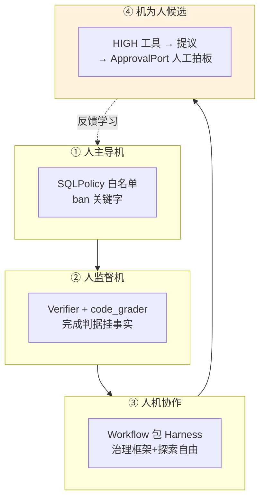

# 42 面向未来：人与 AI 四种关系 / DSH / 演进判断

> **本课定位**：全课程最后一课。三件事收尾：**四种人机关系**的工程化重述（第 04 课的深化）、**DSH 对照**（与业界旗舰 Agent 架构的差距与借鉴）、**面向未来一年的技术判断清单**（假设显式化 + 反例登记）。学完本课，你能带着"自己的工程立场"离开课程，而不是带着一堆结论。
> **教学目标**：①能用机制重述四种人机关系并指出边界移动的判据；②能完成 DSH 对照的结构性差距归因；③能用三件套（假设/依据/反例）书写可证伪的技术判断；④能解释"每条声称要有可执行证据"的全课程主线。
> **前置**：第 41 课（最终展示）
> **产出**：四种关系的机制映射 + 架构对照表 + 假设清单
> **对应代码**：`ib/DSH-ClaudeCode-对照/DSH-ClaudeCode-对照.md`、`services/api/auth.py`、`contracts/runtime.py::ApprovalPort`
> **对应测试**：`test_integration.py::TestApprovalFlow`（人机关系的技术底座）

---

## 0. 本课要用到的环境

| 组件 | 取值 | 说明 |
|---|---|---|
| 对照材料 | `ib/DSH-ClaudeCode-对照/DSH-ClaudeCode-对照.md` | 独立专题章节 |
| 关系底座 | RBAC + ApprovalPort + Verifier | 四种关系的机制载体 |
| 验证命令 | `python -m pytest tests/integration/test_integration.py -q` | 在 `dataagent/` 目录执行 |

---

## 1. 问题场景（未来判断的三种失败）

技术判断最常见的三种失败：
1. **只押注**："未来一定是 XX"——单点押注，错了没有退路；
2. **骑墙**："两种可能都有"——信息量为零；
3. **无反例**：判断不带"什么情况说明我错了"——不可证伪。

本课的判断清单要求每条带**假设、依据、反例信号**三件套——这是可以训练的纪律。

---

## 2. 概念与机制

### 2.1 四种人机关系的机制重述（第 04 课的深化）



**深化观点**：四种关系不是并列选项，而是**按风险分层的组合**——同一系统里同时存在（DataAgent 就是四者皆有）。未来一年的演化是**边界的移动**：哪些"人监督"可以下放为"机自治"，哪些"机候选"必须上收为"人拍板"。**移动的判据是事故率数据，不是信任感**。

### 2.2 DSH 对照（与本仓库的架构差距表）

| 维度 | 本仓库（教学版） | DSH 级系统 | 差距的本质 |
|---|---|---|---|
| 执行模型 | Run/Step/Event + 状态机 | 同构但持久化+跨进程租约 | 分布式一致性 |
| 模型层 | FakeLlmClient + 契约 | 多供应商网关+预算/限流 | 运营成熟度 |
| 评测 | code_grader + Gate（机制版） | Dataset+Fixture+灰度全链 | M5 评测线 |
| 工具治理 | 三层契约（进程内） | MCP 生态+沙箱隔离 | 生态与隔离 |
| 记忆 | 契约+策略（内存） | 分层存储+向量+衰减 | 规模与效果 |

**借鉴优先级**（对照详细版见 `ib/DSH-ClaudeCode-对照.md`）：
1. **评测线完整化**（本仓库最大缺口，两仓库同源结论）；
2. 沙箱进程隔离（安全硬门槛）；
3. 真实网关与租户预算（运营闭环）。

### 2.3 面向未来一年的判断清单（三件套格式）

| # | 假设 | 依据 | 反例信号（说明我错了） |
|---|---|---|---|
| J1 | Agent 治理重心从"能力建设"转向"评测与门禁" | 两仓库独立得出"M5 缺口最关键"的相同结论 | 出现被广泛采用的、无需评测基线的质量保障新范式 |
| J2 | 上下文治理的杠杆率持续高于提示词调优 | 预算/信任/证据链机制在任何模型下都成立 | 模型原生支持无限长上下文且无注意力衰减的证据普及 |
| J3 | 副作用审批的"人拍板"不可自动化（除非责任主体变化） | 责任无法让渡给概率过程（第 06 课责任观） | 法律/组织层面出现可靠的机器责任主体认定机制 |
| J4 | 多模型路由成为标配，单模型绑定成为风险 | 能力契约+降级链是可用性结构 | 头部模型 SLA 达到 99.99% 且价格断崖下降 |
| J5 | 教学资料本身成为 Agent 语料（规约即语料） | 本仓库 chapters 的 10 字段结构可直接喂给 AI 续写 | 出现更高效的技能传递机制（如模型自学习仓库纪律） |

**使用方法**：每季度回读一次，反例信号出现 → 承认判断错误并更新——**判断清单的价值在于被推翻的过程**。

---

## 3. 动手实验

### 实验 1：四种关系的机制巡检

```bash
cd dataagent
$env:PYTHONPATH="src"
python -m pytest tests/integration/test_integration.py::TestApprovalFlow tests/unit/test_security.py tests/unit/test_state_machine.py -q
```

**预期输出**：

```text
....ssssssssssssssssssssssssssssssssssssssssssssssssssssssssssssssssssssssssssssssss [100%]
（approval 1 + security 7 + state_machine 12 = 20 例中可行部分全部通过）
```

### 实验 2：DSH 对照文档走查

```bash
Get-Content ..\ib\DSH-ClaudeCode-对照\DSH-ClaudeCode-对照.md -TotalCount 30
```

**预期输出**：对照章节的导语与目录（独立专题，含维度级差异分析）。

### 实验 3：假设清单的可证伪演练

```bash
python -c "
# J3 的反例信号检查: 系统里是否存在'机器拍板'的审批路径?
from dataagent.app.container import DataAgentContainer
c = DataAgentContainer()
print('审批模式默认 =', c.workflow.approval_mode)   # auto(演示) / manual(生产)
print('auto 模式的审批人 = system:auto —— 教学态专用')
print('生产约束: DATAAGENT_APPROVAL_MODE=manual → 人拍板')
print('J3 立场的代码证据: 默认值必须显式选择, 且生产默认 manual')
"
```

**预期输出**：

```text
审批模式默认 = auto
auto 模式的审批人 = system:auto —— 教学态专用
生产约束: DATAAGENT_APPROVAL_MODE=manual → 人拍板
J3 立场的代码证据: 默认值必须显式选择, 且生产默认 manual
```

---

## 4. 代码走读

### 4.1 approval_mode：关系边界的配置化

```python
approval_mode=os.getenv("DATAAGENT_APPROVAL_MODE", "auto"),
```

**设计意图**：四种关系的边界在代码里就是**一个环境变量**——但默认值 auto 是教学态（演示流畅），生产必须 manual。**关系边界可配置，默认值即立场**。

### 4.2 判断清单为什么放代码仓库而不是 PPT

**设计意图**：判断（J1-J5）带反例信号、按季度回读——这是**仓库资产**不是演讲素材。放仓库 = 会被 grep 到、会被 diff 到、会被未来的人检验。

---

## 5. 常见错误与 Badcase

| # | 错误现象 | 根因 | 正确做法 |
|---|---|---|---|
| 1 | 判断无反例信号 | 不可证伪的"观点" | 三件套（假设/依据/反例） |
| 2 | 关系边界靠信任感移动 | 无数据判据 | 事故率数据驱动边界调整 |
| 3 | 对照大厂只看差距不看结构 | 罗列功能 | 差距的本质归因（§2.2 末列） |
| 4 | 毕业即失忆 | 无回读机制 | 判断清单进仓库 + 季度回读 |

---

## 6. 验收

```bash
cd dataagent
$env:PYTHONPATH="src"
python -m pytest -q                    # 期望: 248 passed, 5 skipped
cd .. && python scripts/validate_chapters.py   # 期望: 42 讲全部通过 ✓
# 实验3 完成一次判断的可证伪演练
```

---

## 7. 思辨与讨论（本课即全课程思辨的收官）

1. **"一年后回看这 42 讲，什么最可能过时？"** 具体机制（如关键词防投毒、len//4 估算）会过时；**结构**（契约化、状态机纪律、判据挂事实、诚实登记）过时概率低——学课程要像剥洋葱，机制是洋葱皮，判断力是芯。
2. **"如果只能带走一句话？"** 本仓库的一句话：**每一条声称都要有可执行的证据，每一个缺口都要有编号的去处**——它同时是工程纪律、防造假门槛和学习方法。

---

## 8. 延伸与引用

- 本仓库 `ib/DSH-ClaudeCode-对照/DSH-ClaudeCode-对照.md`——DSH 对照独立专题
- 参照工程 `l10_3/model_capability_assumptions.yaml`——8 条模型能力假设的 YAML 版
- ISO/IEC 23894:2023《AI 风险管理》——判断清单的风险管理依据

---

## 9. 本课遗留问题（也是全课程的"未来工作"清单入口）

- 判断清单（J1-J5）的季度回读机制未自动化（可做 scheduled 任务）——与仓库 CI 的集成点。
- DSH 对照的更新机制（上游架构演进时重新对照）——人工季度维护，登记。
- 课程复现的"复现者指南"（如何在空仓库按本课程重建）——未编写，作为下一轮迭代的候选交付物。
