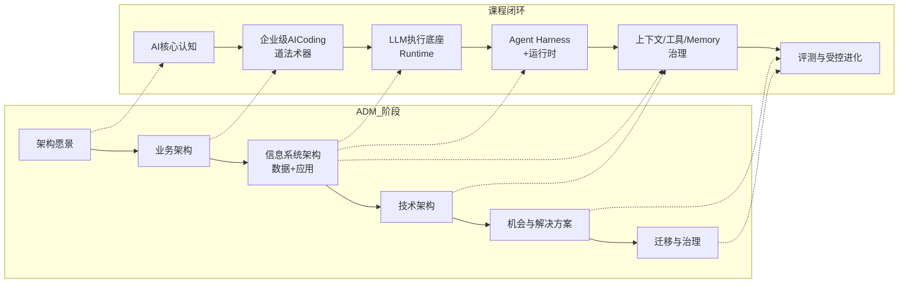
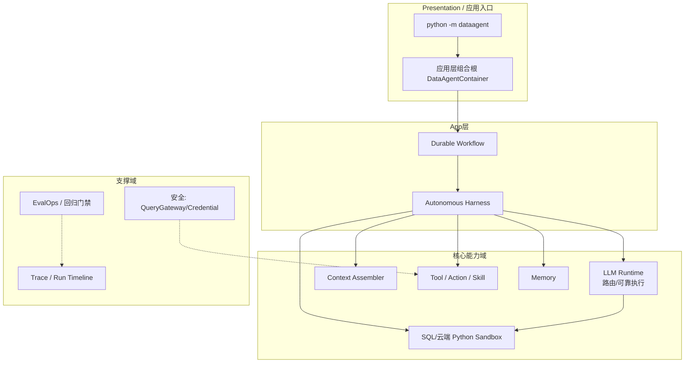

# TOGAF 架构总览 —— 《企业级 Agent 工程架构实战营》

> 本文档把课程的**架构分层**与 **TOGAF（The Open Group Architecture Framework）** 的 ADM 阶段及轴线对应起来，
> 论证本课程"不只是一堆工具"，而是一套可按企业架构方法论治理的完整体系。符合软件工程国标对"架构文档"的要求。

## 1. 为什么要用 TOGAF 框这门课

课程核心目标（大纲第一/二节）：训练**架构判断力、运行时设计力、系统抽象力、工程治理力、可靠性、可观测、生产演进、架构交付与评审**能力。
TOGAF 提供从"架构愿景"到"技术架构实现"的闭环，天然匹配"从求到系统、从系统到演进"的讲授主线。

## 2. 课程架构分层（纵轴）与 TOGAF ADM（横轴）映射

### 2.1 逐阶段对照表

| TOGAF ADM 阶段 | 对应课程模块 | 关键产物 |
|----------------|--------------|----------|
| 架构愿景 (Prelim/A) | 第一篇 认知 + 第三篇 立项 | 能力模型、目标架构、贯穿项目 DataAgent、M0 基线 |
| 业务架构 (B) | 第二篇 AI Coding 之"道 / 法" | 生产观/角色观/责任观、SDD 流程、总交付成本观 |
| 信息系统架构·数据 (C-Data) | 第六篇 上下文治理、第八篇 Memory | Context Schema、Metric Registry、Memory Schema、数据血缘 |
| 信息系统架构·应用 (C-App) | 第四/五篇 Runtime、第七篇 工具 | LLM Runtime、Run/Step/事件、Tool/Action/Skill/MCP |
| 技术架构 (D) | 第四篇 可靠执行、第五篇 分布式、安全 | 路由/重试/沙箱、Scheduler/Queue/Worker、凭据/权限 |
| 机会与解决方案 (E) | 第九篇 评测 | Eval 三层、评分卡、回归门禁、Canary/回滚 |
| 迁移与治理 (F/G) | 第九/十篇 受控进化 | 版本元组、Replay、Kill Switch、ADR 演进 |

## 3. 贯穿项目：DataAgent 的 TOGAF 架构视图

## 4. 架构原则（贯穿实现，见 `dataagent/src`）

1. **边界清晰（DDD 分层）**：`contracts`（契约/端口）→ `domain`（纯领域）→ `infra`（基础设施）→ `adapters`（适配器）→ `app`（组合根），依赖单向 inward。
2. **稳定工程对象（不绑定框架/版本）**：以 `LogicalCall`、`Run/Step/Event`、`Tool 三层契约`、`Memory`、`Eval` 为"稳定的工程对象"，模型与框架可替换。
3. **证据驱动决策**：每个里程碑的架构选型由 `docs/02-架构决策记录-ADR.md` 记录候选方案×取舍矩阵。
4. **可演进闭包**：从模块化单体（M0）到分布式，全部模块是**可替换端口**，保证"可持续演进"。

## 5. 软件工程国标（GB/T）对应

| 国标关注点 | 本项目落点 |
|------------|-----------|
| 需求规格 | `docs/01-SDD规格说明书.md` 含功能/非功能需求、验收准则 |
| 架构设计 | `docs/03-架构图集.md`、`docs/00-TOGAF架构总览.md` |
| 接口契约 | `dataagent/src/dataagent/contracts/*.py` |
| 测试 | `dataagent/tests/*`（单元/集成/故障注入） |
| 部署 | `docs/05-部署与运行.md`（离线/Docker/演进式） |
| 验收/变更治理 | `docs/04-交付物清单.md`、ADR、CI 回归门禁 |