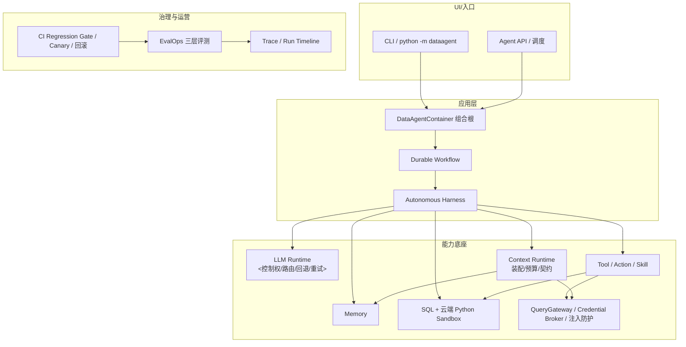
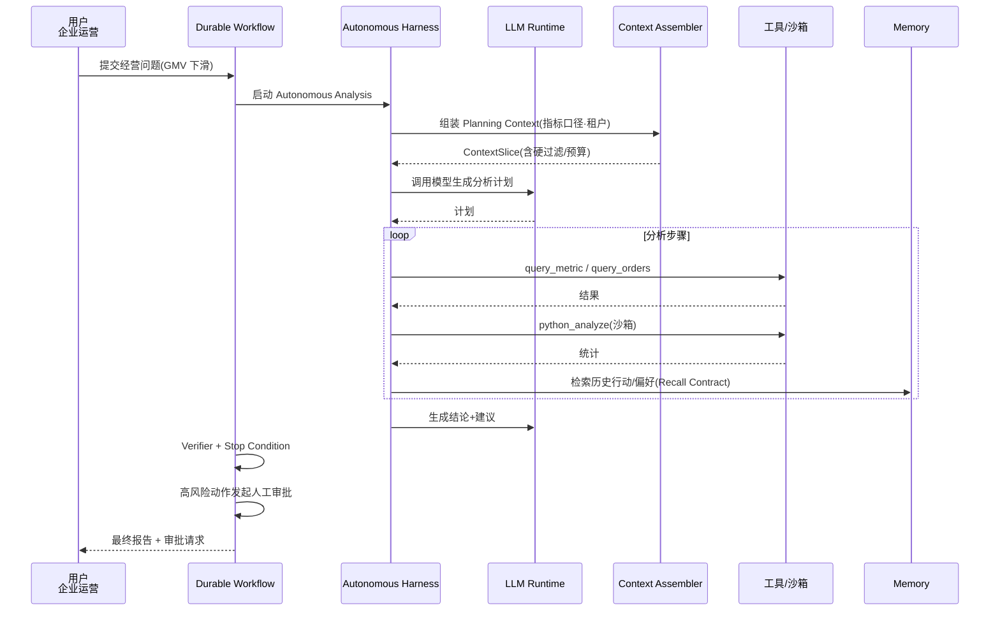
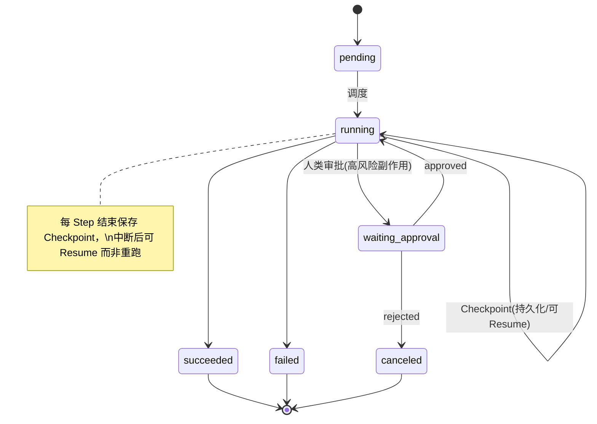
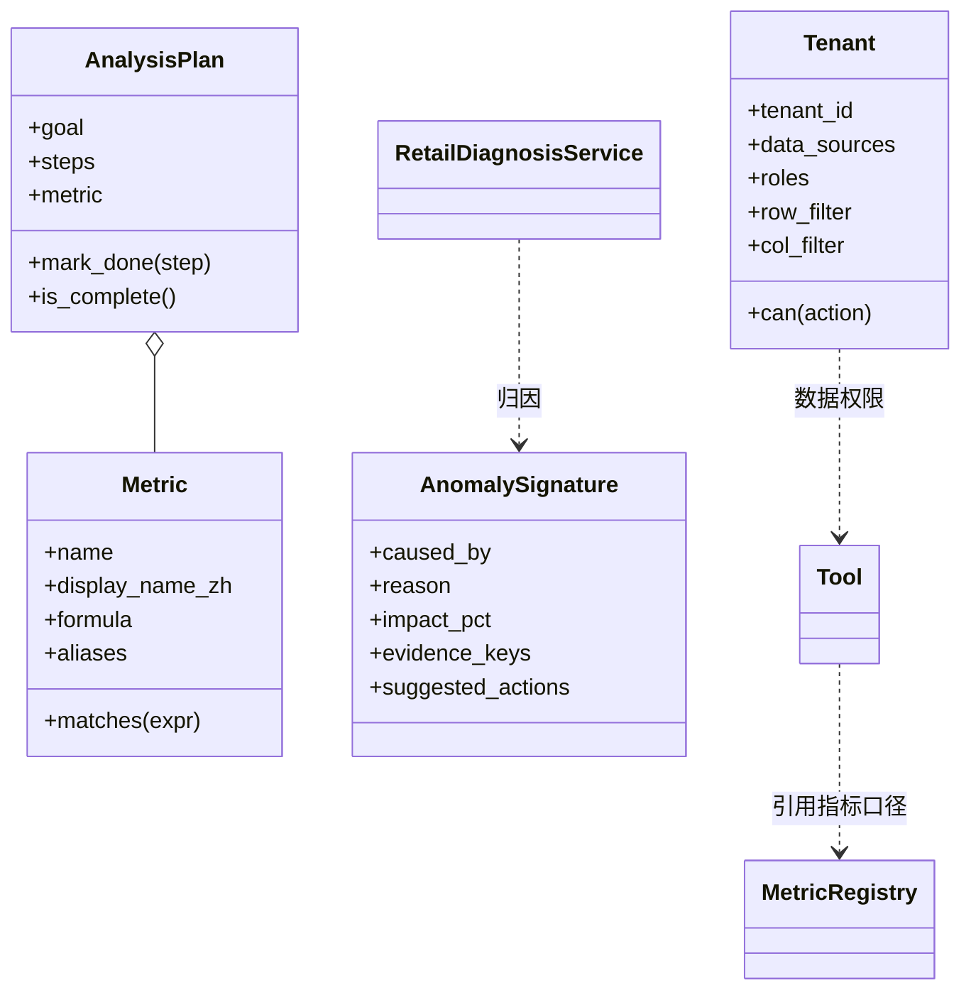
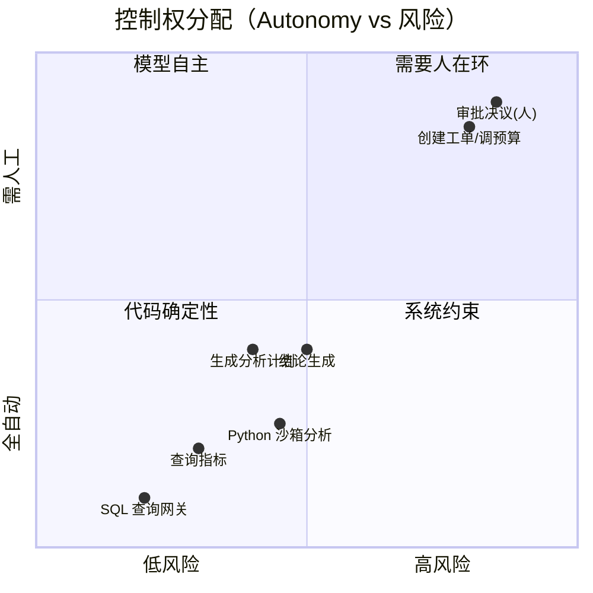
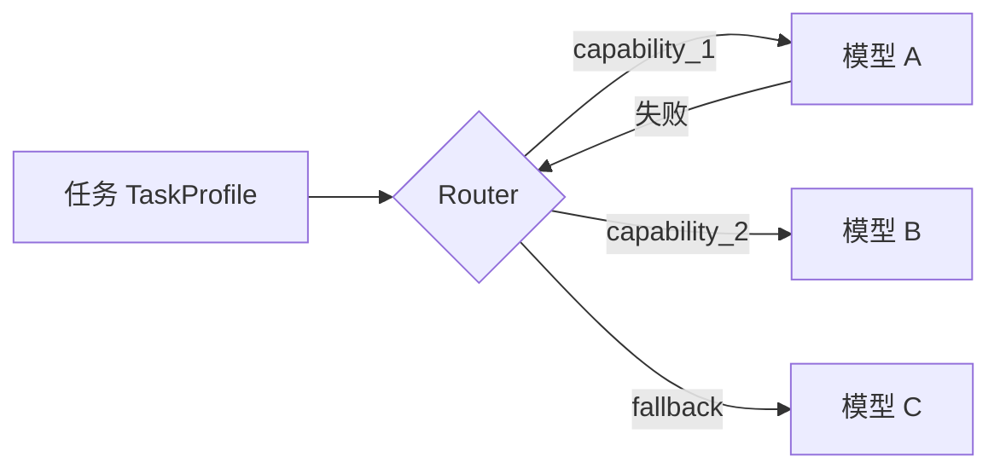

# 架构图集（Mermaid）—— DataAgent 企业级 Agent 系统

> 配合教学章节（第四~九篇）使用的图：系统架构、执行时序、状态机、领域图、Control 权限矩阵。
> 所有图皆为 `mermaid` 源码，可在 GitHub / VS Code / Typora 直接渲染。

## 1. 系统总体架构（分层）

## 2. 一次经营诊断的时序（第六/五篇）

## 3. Run/Checkpoint 状态机（第五篇第3课）

## 4. 领域图（DDD 聚合 / 边界）（第三篇）

## 5. 控制权矩阵（第五篇第1课：哪些交给模型/代码/人）

> 说明：横轴=风险，纵轴=自动化程度。落在"需要人在环"象限（工单/调预算）的动作，
> 一律经 `HumanApprovalGate` 审批后执行，并配幂等保护 —— 这正是"有副作用工具的风险分级与 Human Approval"。

## 6. 技术选型依据（第四篇第2课：路由能力契约）

